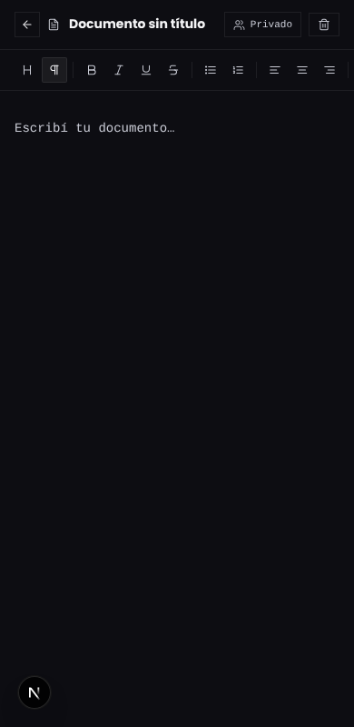
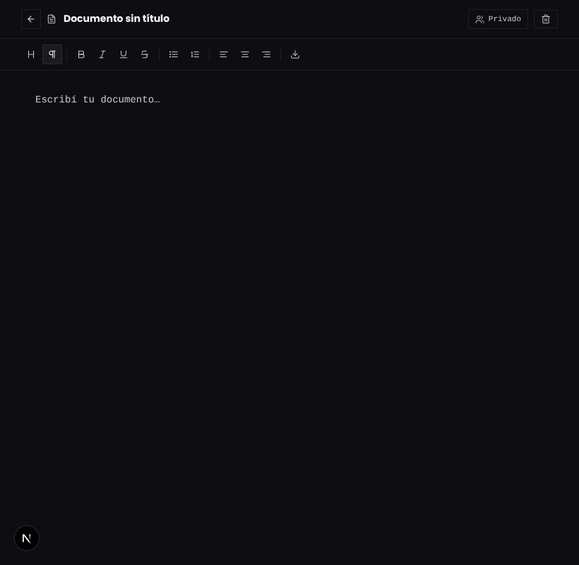
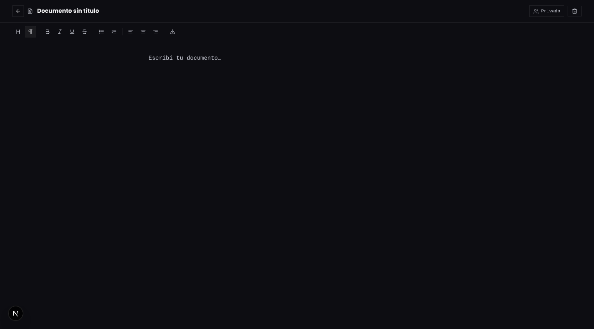

# Expediente — Documento en blanco

**Herramienta transversal (cualquier cargo) · Oficina de Desarrollo de App CINEPACK**
Aprobada por el comité de calidad el 16/11/2026, tras 2 rondas de revisión. PR en borrador #5.

---

## 1. Resumen ejecutivo

Editor de texto enriquecido (estilo Word) real: el usuario lo crea y nombra en el momento, con negrita, cursiva, subrayado, tachado, títulos, listas y alineación, con exportación a PDF que preserva el formato. Resuelve un vacío confirmado: ningún competidor revisado ofrece un documento de texto enriquecido en blanco dentro de su producto. Construido con **TipTap** (núcleo MIT).

## 2. Origen de la idea

Segunda mitad del primer expediente obligatorio del encargo (sección 7): junto a la hoja de cálculo, cubre el caso de cualquier cargo que necesita redactar un texto libre (notas, actas, instrucciones) dentro del espacio de trabajo, sin depender de Word/Google Docs externos.

## 3. El uso transversal (no hay un cargo único)

Cualquier integrante de un rodaje que necesita redactar un texto con formato (notas de dirección, un acta de reunión, instrucciones para un departamento) sin que encaje en ninguna herramienta precargada de CINEPACK. Hoy, a falta de esta herramienta, ese texto se escribe en Word/Google Docs sueltos, fuera de cualquier plataforma de gestión del rodaje — mismo patrón de fondo que documentó el investigador para las hojas sueltas (ver expediente de Hoja de cálculo).

## 4. Necesidades y dolores (con fuente)

1. **Riesgo de versión y coordinación** con documentos sueltos sin control de versiones — mismo argumento que usa StudioBinder en su propio marketing (studiobinder.com/indie-filmmakers) sobre archivos sueltos en general.
2. **Necesidad de un formato enriquecido real, no solo texto plano**: un documento de rodaje (notas, actas) necesita títulos, listas y énfasis para ser legible por el resto del equipo — si la herramienta no preserva ese formato al exportar, no cumple su propósito (ver apartado 10, el bug que corrigió esto).

## 5. Estado del arte — qué ofrece la competencia

| Competidor | ¿Documento de texto enriquecido nativo embebido? | Fuente |
|---|---|---|
| **StudioBinder** | No se encontró evidencia de un editor de texto enriquecido en blanco. | studiobinder.com/indie-filmmakers |
| **Yamdu** | Sin fuente verificable encontrada en esta búsqueda. | — |
| **Movie Magic** | No se encontró evidencia. | blog EP/Movie Magic Budgeting |
| **SetHero** | No se encontró evidencia (su único editor es el de call sheets estructuradas). | help.sethero.com |
| **Celtx** | No, con una salvedad: Celtx tiene un editor de **guion**, que es un formato especializado (guion cinematográfico), no un documento en blanco de propósito general. | devprod.celtx.com |
| **PeliProp** | Sin evidencia pública disponible en esta búsqueda. | — |

**Conclusión**: ningún competidor revisado ofrece un documento de texto enriquecido en blanco de propósito general dentro de su producto. Oportunidad de diferenciación real.

## 6. Propuesta

### 6.1 Qué hace
Editor TipTap real: negrita, cursiva, subrayado, tachado, títulos, listas (simple/numerada), alineación, exportación a PDF preservando el formato. El usuario lo nombra al crearlo. Autoguardado (debounce ~0.5s). Puede marcarse "Compartido".

### 6.2 Flujo de uso paso a paso
1. Mismos pasos de entrada que la hoja: "Exclusivas" → "+ Hoja / Documento" → toca "Nuevo documento".
2. Se abre TipTap con un documento vacío. Escribe, selecciona texto y aplica formato con la barra superior (iconos de `Icon.tsx`, scrolleable horizontalmente en 390px si no entran todos).
3. Al terminar, pulsa el icono de descarga para exportar a PDF: vuelca `editor.getHTML()` a un contenedor oculto, lo captura con `html2canvas` (escala 2) y pagina el resultado en `jsPDF` por altura de A4 — preserva negrita, cursiva, subrayado, tachado, títulos, listas y alineación tal como se ven en pantalla.
4. Igual que la hoja: nombre editable in-line, autoguardado, botón "Compartido"/"Privado", eliminar con confirmación.

### 6.3 Por qué es un panel a medida
El contenido es un documento ProseMirror completo, no una fila de columnas tipadas. Mismo razonamiento que la hoja de cálculo.

### 6.4 Excepción deliberada a "contenido precargado"
Por definición, el usuario decide el contenido al crear — no hay plantilla de cargo que precargar.

## 7. Integración en los 3 niveles

**Nivel 1 (cargo/usuario)**: se crea desde el panel del propio cargo, autoguardado en su propia fila `docs_blanco` (`tipo: 'documento'`).

**Nivel 2 (proyecto)**: al marcar "Compartido", aparece en la sub-pestaña "Documentos" de `GeneralesPanel.tsx`, visible a todo el proyecto — construida en la ronda 2 tras la objeción del comité.

**Nivel 3 (otros departamentos)**: compartir es dar de alta una fila en `docs_blanco_accesos` para cualquier usuario de cualquier departamento.

## 8. Diseño visual — vista previa dentro de CINEPACK

Capturas reales del editor funcionando dentro de la app, en los 3 anchos del sistema de diseño. Sin scroll horizontal de página confirmado por medición en los 3.

## 9. Especificación técnica

| Componente | Rol |
|---|---|
| `app/hoy/TiptapDocumentoEditor.tsx` | Monta TipTap (`@tiptap/react` + `StarterKit` + `Underline` + `TextAlign` + `Placeholder`). Toolbar propia. Autoguarda el JSON de ProseMirror en `onUpdate` (debounce 500ms). Exporta a PDF preservando formato (`html2canvas` + `jsPDF`, corregido en ronda 2). |
| `app/hoy/docsBlanco.ts` | Modelo de datos + CRUD, compartido con la hoja de cálculo (misma tabla `docs_blanco`, campo `tipo`). |
| `app/hoy/DocumentosProyectoPanel.tsx` | Listado a nivel proyecto de documentos compartidos (nivel 2), construido en ronda 2. |

**Librería**: `@tiptap/react` + `@tiptap/core` + `@tiptap/pm` + `@tiptap/starter-kit` + extensiones de alineación/subrayado/placeholder `^3.34.0` (MIT). Sin conflicto de peer-dependencies con React 19.2.4.

## 10. Rondas de revisión del comité

**Ronda 1 — DEVUELTA.** Objeción específica de esta herramienta: `exportarPdf` usaba `editor.getText()`, que descarta todo el formato rico — el PDF exportado salía en texto plano de una sola tipografía, contradiciendo lo que el dossier prometía (documento "tipo Word con exportación").

**Ronda 2 — APROBADA.** `exportarPdf` corregido: ya no usa `getText()`. Vuelca `editor.getHTML()` a un contenedor oculto, lo captura con `html2canvas` (escala 2) y pagina el resultado en `jsPDF` — preserva negrita, cursiva, subrayado, tachado, títulos, listas y alineación. Verificado por lectura de código (no se pudo generar un PDF real y revisarlo pixel a pixel dentro de esta sesión; queda como verificación pendiente para un QA visual posterior, sin bloquear la aprobación porque la lógica de captura de HTML real es sólida y no requiere parseo manual).

## 11. Riesgos y preguntas abiertas

1. El PDF exportado no se abrió y revisó visualmente pixel a pixel en esta sesión — solo se verificó por lectura de código que la lógica preserva el HTML real.
2. Export a `.docx` real: no implementado en este expediente (solo PDF).
3. Persistencia real contra Supabase: hoy es localStorage.

## 12. Fuentes

- StudioBinder — indie-filmmakers: https://studiobinder.com/indie-filmmakers
- Celtx — devprod.celtx.com/product/pre-production/catalog
- SetHero — help.sethero.com
- EP / Movie Magic Budgeting
- Yamdu y PeliProp: sin fuente verificable encontrada en esta búsqueda.
