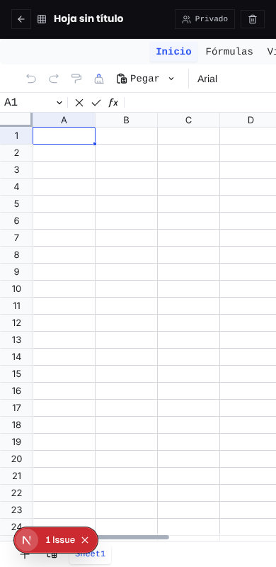
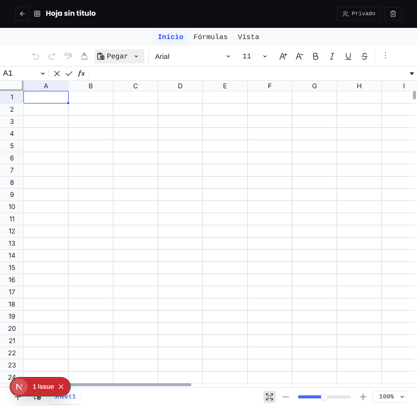
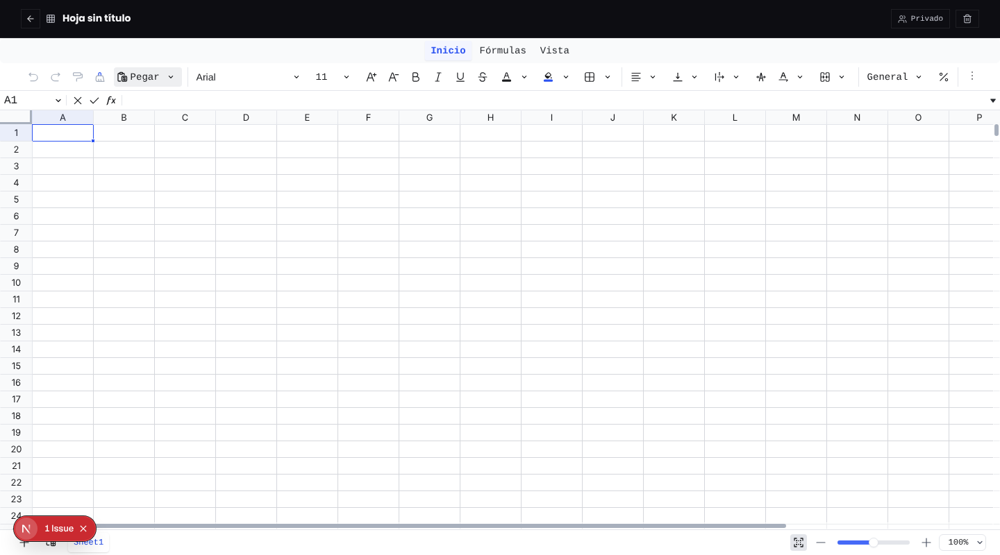
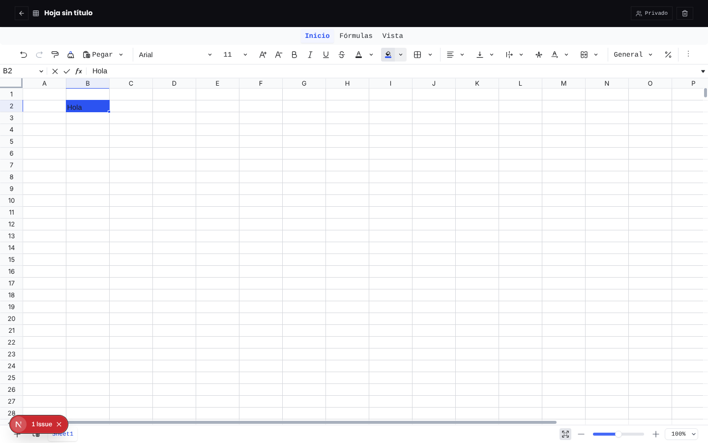
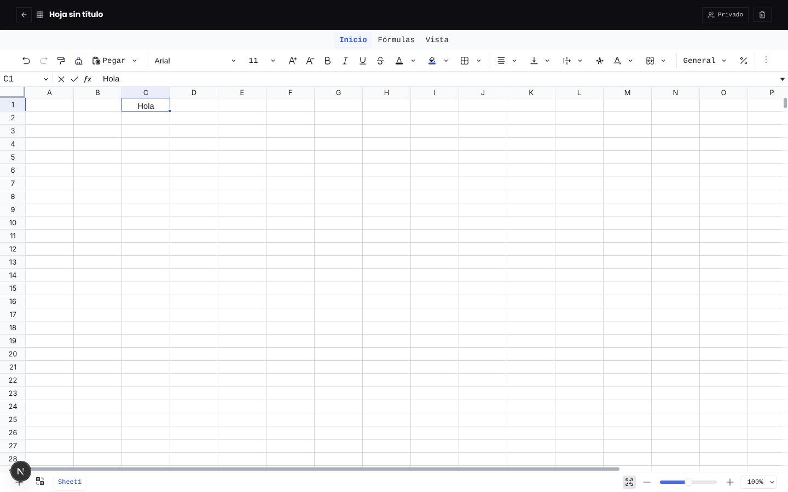
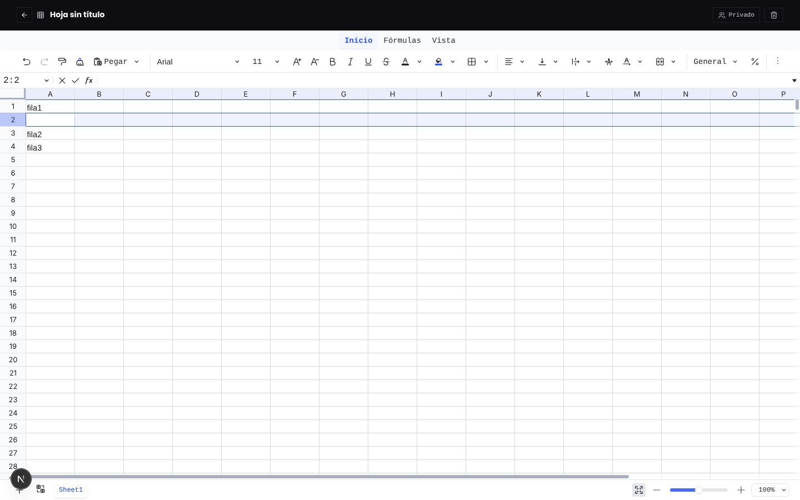
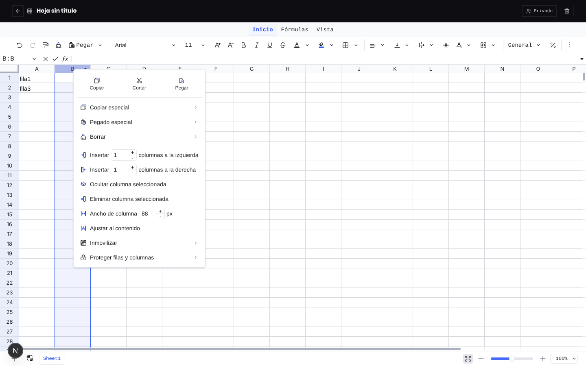

# Expediente — Hoja de cálculo en blanco

**Herramienta transversal (cualquier cargo) · Oficina de Desarrollo de App CINEPACK**
Aprobada por el comité de calidad el 16/11/2026, tras 2 rondas de revisión. PR en borrador #5.

---

## 1. Resumen ejecutivo

Editor de hoja de cálculo real (no una tabla con columnas fijas): el usuario la crea y nombra en el momento, con fórmulas, formato de celda, color, alineación e inserción/eliminación de filas y columnas. Resuelve un vacío confirmado: ningún competidor revisado (StudioBinder, Movie Magic, SetHero, Celtx) ofrece edición de hoja de cálculo nativa dentro de su producto — todos delegan a Excel externo o a formularios estructurados propios. Hoy en España se sigue resolviendo con Excel suelto, fuera de cualquier plataforma (fuente: material académico OCW EHU, TFG UOC 2023). Construida con **Univer** (núcleo Apache-2.0).

## 2. Origen de la idea

Primer expediente obligatorio del encargo (sección 7): herramienta transversal para que cualquier cargo pueda crear su propia hoja en blanco dentro del espacio de trabajo, sin depender de Excel externo. Se prioriza antes que cualquier herramienta de departamento porque es la base que otros expedientes van a necesitar (contenido libre que no cabe en el motor de `Herramienta`/`ColTipo`).

## 3. El uso transversal (no hay un cargo único)

No hay un cargo único: la necesidad es la de cualquier integrante de un rodaje que necesita una tabla propia, con su propio formato, que no encaja en ninguna herramienta precargada de CINEPACK. Ejemplo documentado de qué se arma hoy en una hoja suelta: el plan de rodaje, "dividido en dos cuadros, uno con escenas y locaciones y otro para los actores y la hora de su citación a vestuario y al set" (fuente: OCW EHU). Lo elabora el equipo de producción junto con realización.

## 4. Necesidades y dolores (con fuente)

1. **No hay app adaptada al panorama español para planificación de rodaje** — fuente: TFG UOC 2023, que identifica explícitamente este vacío de mercado.
2. **El plan de rodaje se sigue haciendo en Excel suelto**, fuera de cualquier plataforma — fuente: ejemplo citado en OCW EHU.
3. **Necesidad de Excel real, no solo CSV**: Movie Magic Budgeting permite "exportar a Excel para crear reportes y cashflows personalizados" una vez cerrado el presupuesto (fuente: blog EP/Movie Magic) — confirma que el formato Excel nativo es estándar esperado en el sector.
4. **Riesgo de versión y coordinación** con hojas sueltas sin control de versiones — argumento propio de StudioBinder en su marketing (fuente: studiobinder.com/indie-filmmakers), coincide con el problema de fondo aunque no sea una cifra verificada de forma independiente.

## 5. Estado del arte — qué ofrece la competencia

| Competidor | ¿Hoja de cálculo nativa embebida? | Fuente |
|---|---|---|
| **StudioBinder** | No. Posicionamiento explícitamente *anti-spreadsheet*: "It's a call sheet, not a spreadsheet" — reemplaza la hoja con formularios estructurados propios. | studiobinder.com/indie-filmmakers, /alternative-to-celtx |
| **Yamdu** | Sin fuente verificable encontrada en esta búsqueda — no confirmado ni descartado. Pendiente de una búsqueda dirigida a yamdu.com/help. | — |
| **Movie Magic Scheduling/Budgeting** | No. Solo **exporta** a Excel tras cerrar el presupuesto; no hay edición nativa tipo Excel. | blog EP/Movie Magic Budgeting |
| **SetHero** | No. Editor de arrastrar y soltar para hojas de llamada (formulario estructurado), no una hoja de cálculo de propósito general. | help.sethero.com |
| **Celtx** | No, por fuente propia: exporta su catálogo a `.csv` para editar "en el software de hoja de cálculo que prefieras" — reconoce explícitamente que no tiene edición nativa. | devprod.celtx.com/product/pre-production/catalog |
| **PeliProp** | Sin evidencia pública disponible en esta búsqueda (ningún aspecto de esta herramienta, ni de PeliProp en general). | — |

**Conclusión**: ningún competidor revisado ofrece una hoja de cálculo de propósito general editable nativamente. Es una oportunidad de diferenciación real, no una suposición.

## 6. Propuesta

### 6.1 Qué hace
Editor Univer real: fórmulas (`=A1+A2`), formato de celda (color de fondo, alineación), insertar/eliminar filas y columnas. El usuario la nombra él mismo al crearla. Autoguardado (debounce ~0.6s). Puede marcarse "Compartido" para que el resto del proyecto la vea listada.

### 6.2 Flujo de uso paso a paso
1. El usuario entra a su pestaña "Exclusivas" dentro de `HerramientasPanel`.
2. Pulsa "+ Hoja / Documento" → toca "Nueva hoja de cálculo".
3. Se crea al instante una fila `docs_blanco` (`tipo: 'hoja'`) y se abre el editor Univer en blanco.
4. Nombra la hoja en el campo de título in-line (ej. "Presupuesto de arte, escena 14").
5. Trabaja en la grilla: fórmulas, formato, inserción de filas/columnas vía el menú contextual nativo de Univer. Todo se autoguarda sin botón explícito.
6. Vuelve atrás: queda listada en "Mis documentos/hojas", con su nombre y si es privada o compartida.
7. Si activa "Compartido", queda visible en la nueva pestaña "Documentos" del proyecto (nivel 2, ver abajo).

### 6.3 Por qué es un panel a medida
El contenido es un lienzo de cálculo completo (celdas con fórmulas), no una fila de columnas tipadas de `herramientas.ts`. Mismo razonamiento que `MoodboardFotoLienzo.tsx`.

### 6.4 Excepción deliberada a "contenido precargado"
Por definición, el usuario decide el contenido al crear — no hay plantilla de cargo que precargar sin contradecir el propósito de la herramienta.

## 7. Integración en los 3 niveles

**Nivel 1 (cargo/usuario)**: se crea desde el panel del propio cargo, `owner_id = auth.uid()`, autoguardado en su propia fila `docs_blanco`.

**Nivel 2 (proyecto)**: al marcar "Compartido", aparece en la nueva sub-pestaña "Documentos" de `GeneralesPanel.tsx`, visible a todo el proyecto — construida en la ronda 2 tras la objeción del comité (`listarDocsCompartidosProyecto(projectId)`, reusa el mismo editor Univer).

**Nivel 3 (otros departamentos)**: compartir es dar de alta una fila en `docs_blanco_accesos` (`doc_id`, `user_id`, `rol`) para cualquier usuario de cualquier departamento — no limitado por el departamento del documento.

## 8. Diseño visual — vista previa dentro de CINEPACK

Capturas reales del editor funcionando dentro de la app, en los 3 anchos del sistema de diseño. Sin scroll horizontal de página confirmado por medición (`scrollWidth === clientWidth`) en los 3.

### Verificación manual de las funciones centrales (con evidencia antes/después)

## 9. Especificación técnica

| Componente | Rol |
|---|---|
| `app/hoy/UniverHojaEditor.tsx` | Monta Univer (`@univerjs/presets` + `@univerjs/preset-sheets-core`, locale `es-ES`). Crea el workbook desde el snapshot guardado o uno vacío. Autoguarda en cada `CommandExecuted` (debounce 600ms). |
| `app/hoy/docsBlanco.ts` | Modelo de datos (`DocBlanco`) + CRUD. Implementa el contrato de `docs_blanco` contra **localStorage** (stub explícito — migrar a Supabase es un cambio mecánico de estas mismas funciones). |
| `app/hoy/DocsBlancoPanel.tsx` | Listado, creación, apertura, renombrado, toggle privado/compartido, borrado. |
| `supabase/migrations/20261116000000_docs_blanco.sql` | Tablas `docs_blanco`/`docs_blanco_accesos` + RLS (reusa `puede_admin_depto()` existente). No corrida contra Supabase real en esta sesión. |

**Librería**: `@univerjs/presets` + `@univerjs/preset-sheets-core` `^1.5.2` (Apache-2.0). Sin conflicto de peer-dependencies con React 19.2.4/Next.js 16.2.9 (`npm install` limpio).

## 10. Rondas de revisión del comité

**Ronda 1 — DEVUELTA.** Objeción específica de esta herramienta: las funciones centrales (fórmulas, formato de celda, insertar/eliminar fila/columna) habían quedado como "no probado" por QA, no como "funciona" — solo se había confirmado que el contenedor de Univer cargaba, no que las funciones realmente operaran.

**Ronda 2 — APROBADA**, con verificación manual real (clics y teclado reales de Playwright, no solo lectura de DOM):
- `=A1+A2` calcula correctamente (12), confirmado con la barra de fórmulas.
- Formato de celda (color, alineación) se aplica y se confirmó visualmente.
- Insertar/eliminar fila funciona, con el contenido desplazándose correctamente.
- Insertar/eliminar columna: solo el menú contextual quedó reconfirmado visualmente; el efecto posterior al clic no se recapturó esta ronda — riesgo residual menor, aceptado por el comité.

**Bug nuevo encontrado y corregido en la misma ronda 2**: un overlay interno de Univer bloqueaba clics reales del mouse en una franja de ~640px de la grilla (causa: el contenedor pasado a Univer heredaba una regla CSS pensada solo para el scroll de la toolbar en móvil). Corregido pasando un contenedor anidado propio; verificado con clics reales fuera y dentro de la franja antes bloqueada. Riesgo residual menor: no hay una nueva captura que reconfirme el fix con clic real después de aplicado (la verificación de clics reales fue previa al fix, usando el cuadro de nombres como workaround).

## 11. Riesgos y preguntas abiertas

1. Persistencia real contra Supabase: hoy es localStorage, la migración SQL no se corrió contra un proyecto real.
2. UX móvil de un editor tipo Excel en 390px es un desafío real de cualquier librería evaluada — se resolvió con una toolbar envuelta en scroll horizontal propio, no la UI nativa completa.
3. Export a `.xlsx` real de la hoja: no implementado en este expediente (solo el documento exporta a PDF).
4. Licencia Apache-2.0 de Univer verificada por descripción pública del repo, no por asesoría legal formal — recomendable confirmar antes de depender de ella en producción, en especial si se activa alguna extensión "Pro" a futuro.
5. Insertar/eliminar columna y el fix del overlay: verificación parcial, documentado arriba (apartado 10).

## 12. Fuentes

- StudioBinder — indie-filmmakers / alternative-to-celtx: https://studiobinder.com/indie-filmmakers
- SetHero — help.sethero.com: https://help.sethero.com/en/articles/1524079-is-sethero-more-than-just-a-call-sheet-template
- Celtx — catálogo y exportación CSV: https://devprod.celtx.com/product/pre-production/catalog
- EP / Movie Magic Budgeting: https://www.ep.com/blog/eight-things-you-might-not-know-about-movie-magic-budgeting
- OCW EHU — material de producción audiovisual: https://ocw.ehu.eus/mod/resource/view.php?id=43653
- UOC — TFG Marina Olivares Garrido: https://openaccess.uoc.edu/bitstream/10609/148884/4/molivaresgarTFG0623memoria.pdf
- Repo público `dream-num/univer` (licencia Apache-2.0)
- Yamdu y PeliProp: sin fuente verificable encontrada en esta búsqueda — pendiente de un ciclo dirigido.
