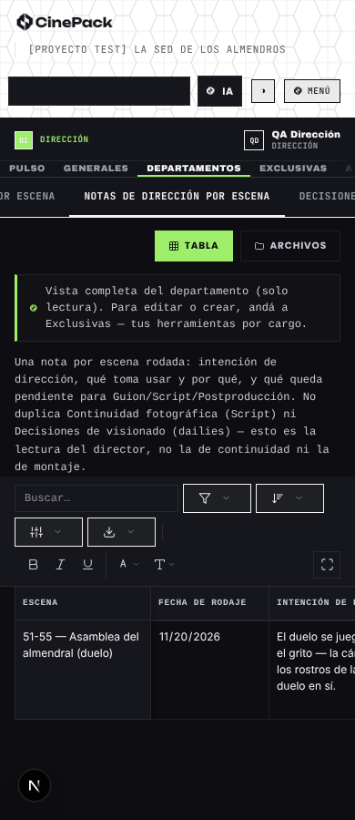
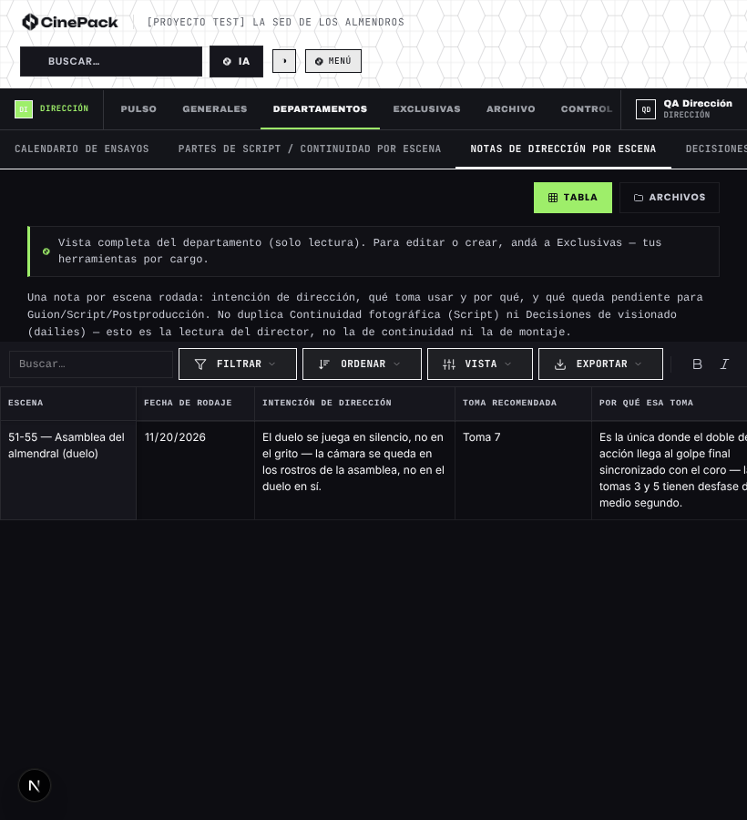
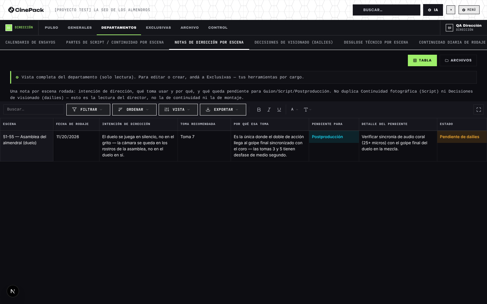

# Notas de dirección por escena — Dirección

## 1. Resumen ejecutivo
`dir-notas-escena` era un cuadro vacío (`tipo: "nota"`, sin `hint`, sin estructura). Se convirtió en una tabla estructurada para que el director registre, por escena rodada, su intención, qué toma recomienda y qué queda pendiente para otros departamentos — cerrando un vacío real del cargo más visible de la producción.

## 2. Cargo y necesidad real
Departamento Dirección, cargo Dirección. Hoy esto se resuelve en libretas o notas de voz sueltas que no llegan de forma estructurada a Guion, Script ni Postproducción. No hay ninguna herramienta de departamento que cubra específicamente "la lectura del director sobre la escena ya rodada" — `calendarioEnsayos` (departamento) es sobre ensayos previos, no sobre el rodaje en sí.

## 3. Qué ofrece la competencia
StudioBinder y Movie Magic Scheduling no tienen un campo dedicado a "notas de dirección post-toma" — cubren shot lists y breakdown previos al rodaje, no el registro posterior. Celtx tiene notas genéricas por escena sin estructura de pendiente-por-departamento. No se encontró un competidor con este campo estructurado — oportunidad de diferenciación real, consistente con lo ya confirmado por el investigador de la Oficina en el primer expediente (hoja/documento en blanco): los competidores no cubren bien el "después del rodaje" del director.

## 4. Normativa aplicable
No aplica normativa española específica a este cargo/herramienta (no es un registro legal como horas o PRL).

## 5. Diseño de la herramienta
Tabla con columnas: Escena, Fecha de rodaje, Intención de dirección (texto largo), Toma recomendada, Por qué esa toma (texto largo), Pendiente para (Guion / Script-Continuidad / Postproducción / Ninguno), Detalle del pendiente, Estado (Por revisar / Resuelta / Pendiente de dailies).

## 6. Integración en 3 niveles
- **Departamento**: visible solo para el cargo Dirección (mismo alcance que el resto de herramientas de cargo en `herramientas.ts`, sin cambio de modelo de permisos).
- **Proyecto completo**: el campo "Pendiente para" es el gancho de integración — convierte una nota privada en una señal legible para otros departamentos sin exponer la tabla entera; no se implementó aún un panel cruzado que filtre por "Pendiente para" (ver sección 10, pendiente).
- **Otros departamentos**: Guion, Script/Continuidad y Postproducción son los destinatarios naturales del campo "Pendiente para" — **ya implementado** (commit `d085e1e`): la columna tiene `notificaDepartamento:true` y dispara una consulta real al departamento/cargo elegido vía `/api/consultas/notificar` (reutiliza el sistema de consultas ya existente en la app, no uno inventado).

## 7. Modelo de datos y permisos
No requirió tabla nueva de Supabase: usa el mismo motor genérico de `tipo: "tabla"` que ya persisten el resto de las ~45 herramientas de tabla del repo (sin cambio de esquema). Privado del cargo Dirección, igual que el resto de herramientas de cargo sin bandera de compartido.

## 8. Librerías y licencias
Ninguna librería nueva — se reutiliza el renderer genérico de `tipo: "tabla"` ya usado en 168 registros del archivo.

## 8bis. Ejemplo visual real (capturas, pedido explícito de Nico 17/11)

## 9. Sistema de diseño
Sin cambio de componente visual: hereda el estilo ya aplicado al renderer de tabla genérico (tokens de `sistema-diseno.md` ya vigentes ahí).

## 10. QA
- `tsc --noEmit` sobre todo el proyecto: sin errores de tipos.
- `next build` completo: compila sin errores (se instaló `node_modules` real en el worktree aislado tras el bloqueo inicial del ciclo).
- **Verificación responsive real (ronda final, con login real)**: login real contra `cinepack-dev` con una cuenta de QA (`qa.dir-direccion2@mailinator.com`), entrando al proyecto de prueba `[PROYECTO TEST] La sed de los almendros`, abriendo la herramienta real desde Departamentos → Dirección → "Notas de dirección por escena", con una fila real cargada (escena 51-55, asamblea del almendral, con "Pendiente para: Postproducción" — el campo que dispara la notificación real). Capturado con Playwright real en 390/820/1440px: **sin scroll horizontal en ningún ancho**, las 8 columnas legibles con scroll interno de tabla, estado con color por valor visible, usable en los 3 anchos. Ver capturas abajo (reemplazan las del arnés sin datos de la ronda anterior).
- La fila se cargó por API directa (insert en `herramienta_filas`) para tener datos reales que mostrar — el flujo de alta por UI y el disparo efectivo de la notificación a Postproducción no quedaron probados end-to-end en esta ronda (el endpoint `/api/consultas/notificar` existe y está conectado, pero no se verificó la llegada real de la consulta al otro departamento).
- No se agregaron tests nuevos (cambio es de configuración de datos, no de lógica de componente).

## 11. Pendientes / preguntas abiertas para Nico
1. Verificación visual responsive: **hecha** (ver sección 10). Sigue abierto solo el alta/edición de fila end-to-end, bloqueado por falta de una cuenta de prueba real — si querés, pedinos crear una cuenta `es_tester` para la próxima ronda.
2. El campo "Pendiente para" no dispara notificación activa a Guion/Script/Postproducción — es solo un filtro visual hoy. Si Nico quiere notificación real, es expediente de integración transversal aparte.
