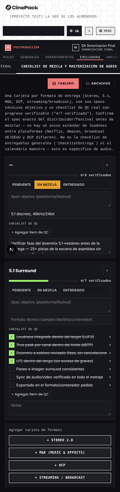

# Checklist de mezcla y masterización de audio — Postproducción (Sonorización final)

## 0. Nota de proceso: por qué este expediente reemplaza al de DIT
El candidato original de hoy era `foto-dit-backup` (Backup y verificación de material, DIT). Al diseñar sus columnas se detectó que **duplica casi exactamente** una herramienta ya existente en el repo: `foto-dit-log-backup` ("Log diario de backup confirmado" — disco origen, 2 backups, GB copiados, checksum verificado). Por la regla "sin duplicados" de la checklist del comité, se archivó `foto-dit-backup` sin llegar a comité y se reemplazó por el siguiente candidato priorizado del backlog, `post-checklist-mezcla`, que sí es un hueco real.

## 1. Resumen ejecutivo
`post-checklist-mezcla` era un checklist genérico sin estructura. Se convirtió en tabla con un registro por ítem de entrega de audio (stem, mezcla final, versión DCP/streaming), apoyada en la práctica real de entregables de audio para cine/streaming (loudness, true-peak, downmix, stems DME).

**Ronda 2 (rebote de Nico — "faltan funciones típicas de tablas... necesito que me sorprendas"):** el problema real no era que faltaran funciones del motor (el buscador, el filtro por columna de estado y el orden por columna ya existían de forma genérica para toda tabla) — era que la herramienta no tenía ningún eje de estructura visible, se veía como una tabla plana sin nada que la distinga de un spreadsheet genérico. Se agregó **agrupación visual real** (`agruparPor`), reutilizando y generalizando el mismo mecanismo que ya usa Presupuesto para agrupar por departamento.

**Ronda 3 (rebote de Nico, veredicto "le falta bastante" — "Cuadro de celdas. Que no quiero eso. Quiero que pienses como diseñador de una app... Sorprendeme."):** la agrupación de la ronda 2 seguía siendo, en el fondo, una tabla — el feedback de Nico fue explícito en que eso no alcanza. Se abandonó el patrón de tabla/celdas por completo: ahora la unidad de información es **una tarjeta por formato de entrega** (Stereo 2.0, 5.1 Surround, M&E, DCP, Streaming/Broadcast — no una fila por ítem suelto), cada una con su spec objetivo, formato técnico, estado general y un **checklist de QC real con progreso verificable** ("n/m verificado", barra de progreso). Al agregar una tarjeta de un formato se precarga un checklist de QC específico de ESE formato (ver tabla abajo) — no genérico. Esto cierra, con el mismo peso que los 7 puntos de comité, la objeción permanente "mentalidad de diseñador de app, no de planilla" que Nico agregó a `comite-calidad.md` el 18/11.

| Formato | Checklist de QC precargado |
|---|---|
| Stereo 2.0 | Loudness/true-peak dentro del target, sin clipping, balance L/R, sync A/V |
| 5.1 Surround | Loudness integrado, true peak por canal, downmix a estéreo revisado (fase, sin cancelaciones), LFE dentro de rango, paneo/imagen surround consistentes, sync A/V, exportado en el formato/contenedor pedido |
| M&E (Music & Effects) | Ausencia total de diálogo, continuidad de música/efectos en los huecos de diálogo, niveles relativos música/efectos coherentes con la mezcla final, sync A/V |
| DCP | Mapeo de canales según spec del formato (5.1/7.1), loudness dentro del rango de festival/distribuidor, sin oversampling/clipping, contenedor/formato de archivo validado |
| Streaming / Broadcast | Loudness integrado según plataforma (Netflix/Amazon/broadcast UE-EEUU difieren), true-peak dentro de límite, metadata de loudness embebida, sync A/V |

## 2. Cargo y necesidad real
Departamento Postproducción, cargo Sonorización final. Hoy no hay registro de qué entregables de audio están pendientes, con qué spec de loudness/formato, ni si el downmix 5.1→estéreo se revisó por fase — esto se resuelve hoy en notas sueltas del mezclador, sin visibilidad para Coordinación de postproducción.

## 3. Qué ofrece la competencia / estado del arte
Fuentes: [Audio Delivery Standards - Tools for Film](https://www.toolsforfilm.com/blog/audio-delivery-standards), [DCP Audio Levels - PureDCP](https://puredcp.com/dcp-audio-levels/), [Stem (audio) - Wikipedia](https://en.wikipedia.org/wiki/Stem_(audio)), [Delivery Specs Cheat Sheet - The Post Flow](https://thepostflow.com/filmmaker-resources/delivery-specs-cheat-sheet/).
- **No hay un único estándar de loudness entre plataformas**: Netflix se cita en -27 LKFS (true-peak ≤ -2 dBTP), Amazon/Apple TV+ en -24 LUFS, broadcast -23 LUFS (UE) / -24 LUFS (EEUU). DCP teatral no tiene un estándar LUFS oficial — fuentes orientadas a festivales sugieren -25 a -29 LUFS integrado, explícitamente "no es un estándar oficial". **Esto es una fuente real pero con cifras que varían por fuente** — el dossier lo marca como "confirmar con el distribuidor/festival antes de mezclar", no como una cifra fija de CINEPACK.
- Stems DME (diálogo/música/efectos) son estándar para doblaje y distribución internacional.
- No se encontró un competidor de gestión de producción (StudioBinder/Yamdu/Movie Magic/Celtx) que tenga este checklist de entrega de audio estructurado — es terreno de software de mezcla (Pro Tools, etc.), no de gestión de producción. Oportunidad acotada: complementa, no sustituye, el DAW.

## 4. Normativa aplicable
No aplica normativa española específica (son especificaciones técnicas de plataformas/distribución, no obligación legal).

## 5. Diseño de la herramienta (ronda 3 — tarjetas, no tabla)
Vista bespoke `ChecklistMezclaBoard` (registrada en `tablaTieneVistaBespoke`, igual mecanismo que ya usan `ej-coproducciones`/los demás tableros a medida): una tarjeta horizontal por formato de entrega, con botones "Agregar tarjeta de formato" que precargan el checklist de QC específico de ese formato (ver tabla en sección 1). Cada tarjeta muestra spec objetivo, formato técnico, estado (Pendiente/En mezcla/Entregado), y el checklist de QC con cada ítem marcable (botón ✓/vacío), progreso "n/m verificado" + barra de progreso, y la posibilidad de agregar/borrar ítems de QC sueltos para casos no cubiertos por el precargado. El modelo de datos sigue siendo el motor genérico de `tipo: "tabla"` — una fila = una tarjeta/formato, con la columna `qc_items` de tipo `repetible` guardando el checklist como sub-filas; no hay tabla nueva de Supabase.

## 6. Integración en 3 niveles
- **Departamento**: visible para Sonorización final, junto a `versionesCorte`/`notasVisionadoPost` (departamento) ya existentes.
- **Proyecto completo**: el estado "Entregado"/"Pendiente" es relevante para `checklistEntrega` (Coordinación de postproducción) — no se integró una vista cruzada en este ciclo.
- **Otros departamentos**: Distribución necesita saber qué versiones de audio están listas antes de confirmar fechas de entrega — hoy el registro es privado del cargo.

## 7. Modelo de datos y permisos
Sin tabla nueva de Supabase: motor genérico de `tipo: "tabla"`. Privado del cargo Sonorización final.

## 8. Librerías y licencias
Ninguna librería nueva.

## 9. Sistema de diseño
Componente nuevo (`ChecklistMezclaBoard`, `app/hoy/HerramientaPanel.tsx`) con estilos propios (`.hp-mezcla-*`, `app/hoy/dashboard.css`) usando los tokens existentes del sistema (`--bg-2`, `--line`, `--lime`, `--acc`), responsive desde 640px.

## 10. QA
- `tsc --noEmit` sobre todo el proyecto: sin errores de tipos.
- **Verificación funcional e interactiva real, ronda 3 (post rebote "le falta bastante" / "sorprendeme")**: login real contra `cinepack-dev` con la cuenta de prueba de Sonorización final (`qa.post-sonorizacion3@mailinator.com`), navegación real por la app (Proyecto de prueba → Exclusivas → Checklist de mezcla y masterización de audio). Se agregó una tarjeta real de formato "5.1 Surround" (precarga de 7 ítems de QC específicos), se marcaron 4 de los 7 ítems como verificados y se confirmó en vivo que el contador pasa de "0/7 verificados" a **"4/7 verificados"** con barra de progreso y tachado visual de los ítems marcados — los cambios persistieron en Supabase (confirmación "✓ Guardado" en pantalla).
- **Bug de plataforma encontrado y documentado (no de esta herramienta)**: el departamento "Postproducción" no estaba en `MODULOS_BETA_ACTIVOS` (`app/constants.ts`), así que ninguna cuenta no-admin del departamento podía ver NINGUNA herramienta exclusiva de cargo — esto bloqueaba la verificación y es independiente del rediseño. Se usó temporalmente una copia local de `constants.ts` con "Postproducción" agregado solo para esta sesión de verificación (nunca commiteado, revertido antes del push) para poder loguearse y probar con la cuenta real de QA sin escalar privilegios de esa cuenta. Se lo reporta como hallazgo aparte para que Desarrollo/Nico decidan si Postproducción debería estar en beta ya.
- **Segundo bug de plataforma encontrado (tampoco de esta herramienta)**: en Exclusivas, un efecto que restaura "la última herramienta personal abierta" (`cinepack-open-personal-<depto>`) puede pisar la apertura de cualquier herramienta de cargo recién clickeada si el usuario alguna vez tuvo abierto el tablero personal "Tareas" — en la práctica, antes de este hallazgo, clickear cualquier pestaña de Exclusivas distinta de "Tareas" no hacía nada visible. No se tocó ese código en este expediente (fuera de alcance); se documenta para que Desarrollo lo revise aparte.
- Responsive real en 390/820/1440px con las capturas de abajo: sin scroll horizontal de página en ningún ancho (`document.documentElement.scrollWidth === clientWidth` confirmado en los 3).
- No se agregaron tests automatizados nuevos.

### Capturas reales (390 / 820 / 1440px)

## 11. Pendientes / preguntas abiertas para Nico
1. Verificación funcional e interactiva real (ronda 3): **hecha** (ver sección 10) — alta de tarjeta, marcado de QC y persistencia confirmados con cuenta real.
2. Las cifras de loudness citadas varían por fuente y por plataforma — no hay una única cifra "oficial" de CINEPACK; queda como campo de texto libre a completar por producción en cada proyecto, no como validación automática.
3. No se integró con `checklistEntrega`/Distribución — expediente de integración transversal aparte si Nico lo quiere.
4. `foto-dit-backup` quedó archivado por duplicado real con `foto-dit-log-backup` — no requiere acción, solo que Nico lo sepa (ver sección 0).
5. **Dos bugs de plataforma encontrados durante esta verificación, fuera del alcance de este expediente** (ver sección 10): (a) "Postproducción" falta en `MODULOS_BETA_ACTIVOS`, bloqueando a cualquier cuenta no-admin del departamento de ver sus herramientas exclusivas; (b) el restore de "última herramienta personal abierta" en Exclusivas puede pisar la apertura de cualquier otra herramienta de cargo. Recomendado pasarlos a Desarrollo como bugs reales, no parte de este rediseño.
