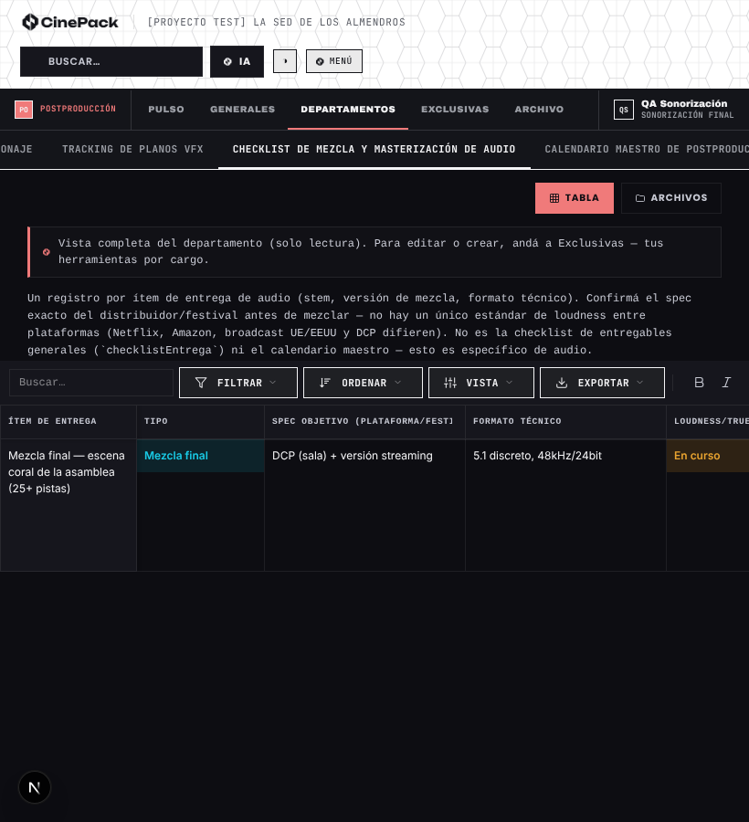
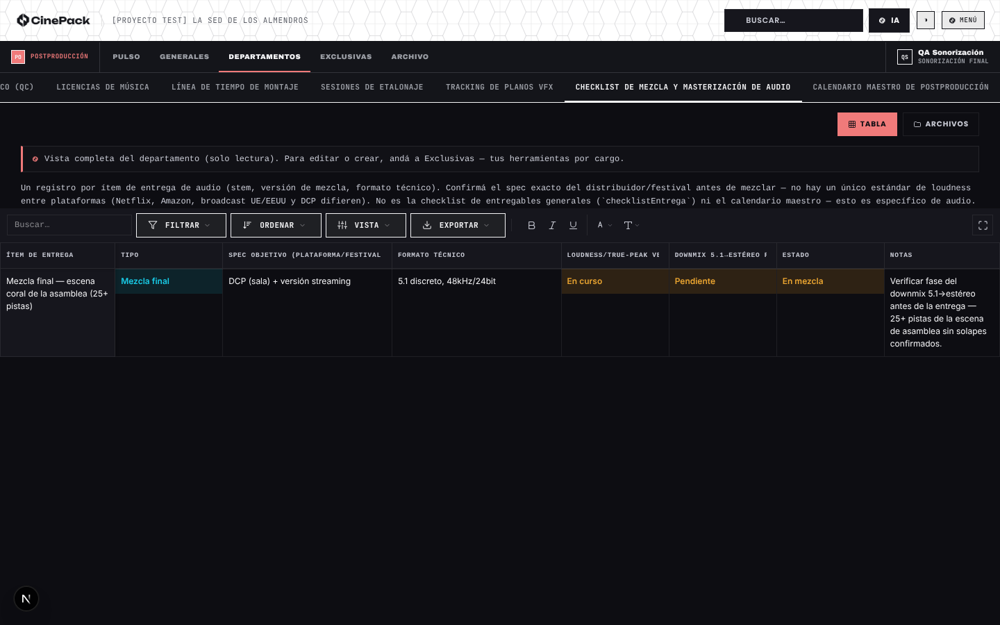

# Checklist de mezcla y masterización de audio — Postproducción (Sonorización final)

## 0. Nota de proceso: por qué este expediente reemplaza al de DIT
El candidato original de hoy era `foto-dit-backup` (Backup y verificación de material, DIT). Al diseñar sus columnas se detectó que **duplica casi exactamente** una herramienta ya existente en el repo: `foto-dit-log-backup` ("Log diario de backup confirmado" — disco origen, 2 backups, GB copiados, checksum verificado). Por la regla "sin duplicados" de la checklist del comité, se archivó `foto-dit-backup` sin llegar a comité y se reemplazó por el siguiente candidato priorizado del backlog, `post-checklist-mezcla`, que sí es un hueco real.

## 1. Resumen ejecutivo
`post-checklist-mezcla` era un checklist genérico sin estructura. Se convirtió en tabla con un registro por ítem de entrega de audio (stem, mezcla final, versión DCP/streaming), apoyada en la práctica real de entregables de audio para cine/streaming (loudness, true-peak, downmix, stems DME).

## 2. Cargo y necesidad real
Departamento Postproducción, cargo Sonorización final. Hoy no hay registro de qué entregables de audio están pendientes, con qué spec de loudness/formato, ni si el downmix 5.1→estéreo se revisó por fase — esto se resuelve hoy en notas sueltas del mezclador, sin visibilidad para Coordinación de postproducción.

## 3. Qué ofrece la competencia / estado del arte
Fuentes: [Audio Delivery Standards - Tools for Film](https://www.toolsforfilm.com/blog/audio-delivery-standards), [DCP Audio Levels - PureDCP](https://puredcp.com/dcp-audio-levels/), [Stem (audio) - Wikipedia](https://en.wikipedia.org/wiki/Stem_(audio)), [Delivery Specs Cheat Sheet - The Post Flow](https://thepostflow.com/filmmaker-resources/delivery-specs-cheat-sheet/).
- **No hay un único estándar de loudness entre plataformas**: Netflix se cita en -27 LKFS (true-peak ≤ -2 dBTP), Amazon/Apple TV+ en -24 LUFS, broadcast -23 LUFS (UE) / -24 LUFS (EEUU). DCP teatral no tiene un estándar LUFS oficial — fuentes orientadas a festivales sugieren -25 a -29 LUFS integrado, explícitamente "no es un estándar oficial". **Esto es una fuente real pero con cifras que varían por fuente** — el dossier lo marca como "confirmar con el distribuidor/festival antes de mezclar", no como una cifra fija de CINEPACK.
- Stems DME (diálogo/música/efectos) son estándar para doblaje y distribución internacional.
- No se encontró un competidor de gestión de producción (StudioBinder/Yamdu/Movie Magic/Celtx) que tenga este checklist de entrega de audio estructurado — es terreno de software de mezcla (Pro Tools, etc.), no de gestión de producción. Oportunidad acotada: complementa, no sustituye, el DAW.

## 4. Normativa aplicable
No aplica normativa española específica (son especificaciones técnicas de plataformas/distribución, no obligación legal).

## 5. Diseño de la herramienta
Tabla con columnas: Ítem de entrega, Tipo (Stem DME diálogo/música/efectos, Mezcla final, Versión DCP, Versión streaming/broadcast), Spec objetivo (texto largo), Formato técnico (texto largo), Loudness/true-peak verificado (Sí/No/En curso), Downmix 5.1→estéreo revisado por fase (Sí/No aplica/Pendiente), Estado (Pendiente/En mezcla/Entregado), Notas.

## 6. Integración en 3 niveles
- **Departamento**: visible para Sonorización final, junto a `versionesCorte`/`notasVisionadoPost` (departamento) ya existentes.
- **Proyecto completo**: el estado "Entregado"/"Pendiente" es relevante para `checklistEntrega` (Coordinación de postproducción) — no se integró una vista cruzada en este ciclo.
- **Otros departamentos**: Distribución necesita saber qué versiones de audio están listas antes de confirmar fechas de entrega — hoy el registro es privado del cargo.

## 7. Modelo de datos y permisos
Sin tabla nueva de Supabase: motor genérico de `tipo: "tabla"`. Privado del cargo Sonorización final.

## 8. Librerías y licencias
Ninguna librería nueva.

## 9. Sistema de diseño
Sin cambio de componente visual: renderer genérico ya conforme a `sistema-diseno.md`.

## 10. QA
- `tsc --noEmit` sobre todo el proyecto: sin errores de tipos.
- `next build` completo: compila sin errores.
- **Verificación responsive real (ronda final, con login real)**: login real contra `cinepack-dev` con una cuenta de QA (`qa.post-sonorizacion2@mailinator.com`), entrando al proyecto de prueba `[PROYECTO TEST] La sed de los almendros`, abriendo la herramienta real desde Departamentos → Postproducción → "Checklist de mezcla y masterización de audio", con una fila real cargada (mezcla final de la escena coral de la asamblea, 25+ pistas, downmix 5.1→estéreo pendiente de revisar fase). Capturado con Playwright real en 390/820/1440px: **sin scroll horizontal en ningún ancho**, tabla con las 8 columnas (Ítem, Tipo, Spec destino, Formato técnico, Loudness/true-peak, Downmix, Estado, Notas) con scroll interno horizontal de la tabla (no de la página), usable en los 3 anchos.
- La fila se cargó por API directa (insert en `herramienta_filas`) para tener datos reales que mostrar, no por el formulario de alta de la UI.
- No se agregaron tests nuevos.

### Capturas reales (390 / 820 / 1440px)

## 11. Pendientes / preguntas abiertas para Nico
1. Verificación visual responsive: **hecha** (ver sección 10). Sigue abierto el alta/edición end-to-end, bloqueado por falta de una cuenta de prueba real.
2. Las cifras de loudness citadas varían por fuente y por plataforma — no hay una única cifra "oficial" de CINEPACK; queda como campo de texto libre a completar por producción en cada proyecto, no como validación automática.
3. No se integró con `checklistEntrega`/Distribución — expediente de integración transversal aparte si Nico lo quiere.
4. `foto-dit-backup` quedó archivado por duplicado real con `foto-dit-log-backup` — no requiere acción, solo que Nico lo sepa (ver sección 0).
