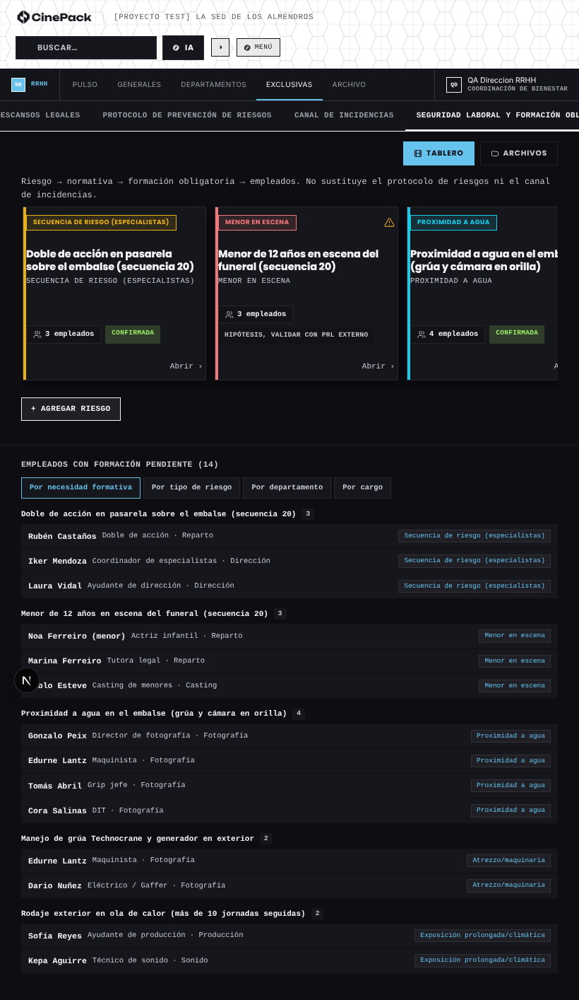

# Seguridad laboral y formación obligatoria — RRHH (Coordinación de bienestar)

## 1. Resumen ejecutivo
Replanteo de fondo tras el feedback de Nico ("no puede ser que se me entregue una tabla como herramienta... quiero un sistema con información de riesgos laborales, leyes, formación obligatoria por cargo, medidas de seguridad normativas"). Se abandonó por completo el enfoque anterior ("Plan de bienestar": una tabla de actividades sueltas) y se reemplazó por un **registro real de riesgo → normativa aplicable → cargos afectados → formación obligatoria → medidas de seguridad**, poblado con los riesgos reales del proyecto test (menor de 12 años en escena, secuencia de riesgo con doble de acción en una pasarela sobre un embalse, proximidad a agua), no datos de relleno.

## 2. Cargo y necesidad real
Departamento RRHH, cargo Coordinación de bienestar. Antes no existía ningún registro vivo de qué riesgos laborales concretos tiene el rodaje, qué normativa los cubre y quién necesita formación — solo un protocolo general (`rrhh-protocolo-riesgos`, de Dirección de RRHH) y un canal de incidencias reactivo (`rrhh-incidencias`). Esta herramienta es la pieza preventiva y proactiva que faltaba, específica de este cargo.

## 3. Investigación real (con fuente)
- **Ley 31/1995, de 8 de noviembre, de Prevención de Riesgos Laborales** — art. 19 (formación centrada en el puesto de trabajo, adaptada a los riesgos específicos, dentro de la jornada, coste nunca a cargo del trabajador) y art. 20 (medidas de emergencia y primeros auxilios). Fuente: [boe.es/buscar/pdf/1995/BOE-A-1995-24292-consolidado.pdf](https://www.boe.es/buscar/pdf/1995/BOE-A-1995-24292-consolidado.pdf).
- **Menores en rodaje**: la participación de menores de 16 años requiere autorización de la autoridad laboral y una evaluación de riesgos individualizada de la tarea concreta, no genérica. Fuente: Risk XXI y Geseme (consultoras especializadas en PRL del sector audiovisual) — **marcado explícitamente como hipótesis**: no se encontró el texto oficial (BOE) que fije el trámite exacto, solo fuentes secundarias del sector.
- **Trabajo en altura / montaje**: la evaluación de riesgos debe describir el trabajo real (no la ficción del guion), y los cambios de localización, cámara o estructuras alteran el escenario de riesgo. Fuente: Risk XXI.
- **III Convenio colectivo estatal de la industria de producción audiovisual (técnicos)**, BOE-A-2024-6846 (06/04/2024): exige información de riesgos del sector y seguro obligatorio de accidentes/enfermedad por contingencias profesionales — sigue aplicando como capa adicional sobre la Ley 31/1995, no la reemplaza.
- **Límite real de esta investigación**: no se confirmó con fuente oficial un requisito normativo específico para "armas de atrezzo" ni un RD concreto de trabajos en altura aplicado al audiovisual (el RD 2177/2004 es la referencia general de construcción, no se verificó su aplicación directa a rodajes) — queda marcado como pregunta abierta, sección 11.

## 4. Qué ofrece la competencia
No se repite la investigación de StudioBinder/Yamdu/Movie Magic/SetHero de rondas anteriores (sin novedad real) — ninguna de ellas, al ser generalistas sin foco en normativa laboral española, cubre esta necesidad.

## 5. Diseño de la herramienta

### 5.1 Rebote de Nico (18/11/2026) y rediseño de fondo
Nico devolvió esta entrega con veredicto "poco": **"no quiero una tabla ni una planilla — quiero tarjetas, una por cada riesgo, navegables, y abajo la lista de empleados agrupada, no una tabla de celdas"**. Objeción tomada al pie de la letra, no como ajuste cosmético: se abandonó por completo el layout de tabla de la ronda anterior (sección 5 de versiones previas de este dossier) y se reconstruyó sobre el patrón de **tarjetas horizontales navegables** (`EntidadTabsBoard`, el mismo componente de "riel de tarjetas" que ya usan `ej-coproducciones`, `ej-deliverables`, etc. — no un componente nuevo de un solo uso) en vez de una tabla de celdas.

- **Una tarjeta por riesgo laboral**, en un riel horizontal con scroll (no una fila de tabla): título = riesgo identificado, subtítulo = origen del riesgo.
- **Dentro de cada tarjeta, 3 pestañas**: *Normativa* (origen, normativa aplicable, cargos afectados, estado, fuente), *Formación y medidas* (formación obligatoria, medidas de seguridad) y **Empleados** — alta manual de empleados concretos que necesitan esa formación (nombre, cargo, departamento), directamente dentro de la tarjeta del riesgo, no en una entidad separada.
- **Debajo del riel de tarjetas, una lista agrupada de todos los empleados** cargados en cualquier tarjeta (componente `RrhhEmpleadosAgrupados`), agrupable en caliente por **necesidad formativa / tipo de riesgo / departamento / cargo** (pestañas de agrupación) — nombre siempre visible, con chips del riesgo y tipo de riesgo cuando no son el criterio de agrupación activo. No es una tabla: es una lista de filas agrupadas en cajas con jerarquía visual (título de grupo + contador + filas), igual que el resto de listas agrupadas del sistema de diseño.
- Esto responde directamente a la "mentalidad de diseñador de app, no de planilla" (regla permanente del comité de calidad): la unidad de información es la tarjeta de riesgo (con su propio ciclo normativa→formación→gente), no la celda; agrupar/navegar reemplaza a filtrar/ordenar columnas.

### 5.2 Rebote de Nico (20/11/2026, ronda 4) y rediseño visual de las tarjetas
Nico aprobó la estructura de tarjetas ("me gusta que hayas aplicado cosas que te he dicho") pero rechazó la ejecución visual: "decepciona completamente a nivel diseño [...] no quiero ese texto innecesario al inicio de la herramienta que ocupa absolutamente toda la herramienta [...] quiero tarjetas que atraigan, dentro de la estética de CINEPACK [...] no se vea algo tan simple, tan pobre." Se tomó como objeción de ejecución visual, no de estructura — la estructura de tarjetas/pestañas/lista agrupada de la ronda anterior se mantuvo intacta.

- **Hint de apertura**: el párrafo largo (~6 líneas) que dominaba el viewport al abrir la herramienta se redujo a una sola línea ("Riesgo → normativa → formación obligatoria → empleados...").
- **Acento de color real por tipo de riesgo**: mapa `RRHH_ORIGEN_ACCENT` sobre la paleta con nombre de `cp-theme.css` (naranja para trabajo en altura/especialistas, cian para agua, rosa para menor en escena, violeta para maquinaria, dorado para exposición climática) aplicado como borde lateral de 4px + badge de origen en la tarjeta cerrada — la tarjeta comunica el tipo de riesgo de un vistazo, sin abrirla.
- **Jerarquía tipográfica**: título de la tarjeta en Poppins 800, igual que `h1-h4` del sistema; badge de origen en mayúsculas pequeñas.
- **Badges de información en la tarjeta cerrada**: cantidad de empleados afectados (ícono `users`) y estado de la formación obligatoria, con ícono de alerta (`alert-triangle`) cuando la formación es "hipótesis, validar con PRL externo" — toda esta información antes solo era visible al abrir la tarjeta.
- **Profundidad**: sombra sutil (`box-shadow` sobre `--shadow`) y elevación en hover (`translateY` + sombra más marcada + borde con el acento), coherente con el resto de tarjetas del sistema.
- **Datos de ejemplo/previsualización mucho más ricos**: se reemplazaron los 3 riesgos genéricos por 5 riesgos de tipo distinto (secuencia de especialistas, menor en escena, proximidad a agua, maquinaria/grúa, exposición climática), cada uno con 2 a 4 empleados de cargo y departamento distinto (Reparto, Dirección, Casting, Fotografía, Producción, Sonido) — 14 empleados en total, para que la previsualización en uso se vea llena y realista, con variedad real de riesgos y necesidades, no un ejemplo pelado. Esto se cargó tanto como `EJEMPLOS_POR_ID` (código, para cualquier cuenta sin datos propios) como datos reales sembrados en la cuenta de prueba de esta ronda de QA (ver 10.1).

### 5.3 Decisión de diseño heredada
La columna "Medidas de seguridad" se diseñó inicialmente como `repetible` (sub-filas de medida+responsable) pero el motor genérico la renderiza como `[object Object]` en la vista de solo lectura de Departamentos (bug real del motor compartido — ver sección 10). Se mantiene como texto largo dentro de la pestaña "Formación y medidas" de la tarjeta, por la misma razón que en la ronda anterior; queda reportado para que el comité/desarrollador lo evalúe a nivel de motor, no de esta herramienta puntual.

## 6. Integración en 3 niveles
- **Departamento**: visible en la vista agregada de Departamentos → RRHH (solo lectura para todo el departamento) y editable desde Exclusivas para Coordinación de bienestar.
- **Proyecto completo**: no integrado con el calendario del proyecto en este ciclo (igual que la versión anterior) — sigue como pendiente real, no resuelto.
- **Otros departamentos**: los "Cargos afectados" (chips) ya listan roles de otros departamentos (Maquinista, Fotografía, Casting, Dirección, Producción) — es información que les concierne directamente, pero hoy solo se ve desde RRHH, sin notificación activa hacia esos cargos.

## 7. Modelo de datos y permisos
Sin tabla nueva: motor genérico `tipo: "tabla"`, mismo modelo que el resto de herramientas de RRHH. Privado del cargo Coordinación de bienestar para edición; visible en solo lectura para todo el departamento vía Departamentos.

## 8. Librerías y licencias
Ninguna librería nueva.

## 9. Sistema de diseño
Esquinas en punta y paleta real de `cp-theme.css` (motor genérico ya conforme). Columna "Origen del riesgo" usa acento de color por valor (igual que el resto de columnas `tipo: estado`). Desde la ronda 4 (ver 5.2), ese mismo acento se extiende a la tarjeta cerrada del riel (borde + badge), con tipografía Poppins en el título y badges de empleados/formación — no una paleta ni un patrón nuevo, la misma paleta con nombre ya documentada aquí aplicada con más intención visual.

## 10. QA — verificación real, interactiva, con hallazgos reales

### 10.1 Rediseño visual (ronda 4, verificación real 20/11/2026 — esta entrega)
- `tsc --noEmit` sobre el worktree con el rediseño visual completo (hint corto, acentos/badges de tarjeta, ejemplos ricos): **sin errores**.
- **Verificación interactiva real completada con cuenta de la ronda 4**: login real con Playwright contra el entorno de desarrollo, cuenta `qa.rrhh-direccion4@mailinator.com`. El cargo del perfil había vuelto a "Dirección de RRHH" (dato de cuenta de prueba, no sensible) — se corrigió a "Coordinación de bienestar" vía `supabase-js` autenticado con esa misma cuenta (`update profiles.cargo/departamento`), confirmado en pantalla tras el fix.
- **Bug de plataforma, mismo hallazgo que en rondas anteriores**: "RRHH" sigue fuera de `MODULOS_BETA_ACTIVOS` (`app/constants.ts`). Se agregó temporalmente solo en la copia local de este worktree para poder ver la herramienta con esta cuenta no-admin, y se revirtió antes de cualquier commit (`git status`/`git diff` confirmados limpios antes de commitear — no llegó a pushearse).
- **Datos reales de ronda 4**: se reemplazaron por API autenticada (mismo criterio que rondas anteriores) las 3 filas viejas por los 5 riesgos ricos descritos en 5.2 (14 empleados en total), directamente en el proyecto de prueba de esta cuenta — la previsualización verificada en pantalla es la misma que verá Nico, no una maqueta.
- **Confirmado visualmente en los 3 anchos**: hint de una sola línea (ya no domina el viewport), 5 tarjetas con borde + badge de color por tipo de riesgo, título en Poppins, badge de empleados visible en la tarjeta cerrada, ícono de alerta en la tarjeta de formación-hipótesis, lista agrupada de 14 empleados debajo con sus chips.
- Responsive real (Playwright) en 390/820/1440px, `document.documentElement.scrollWidth === clientWidth` confirmado en los 3: **sin scroll horizontal de página**. Capturas actualizadas abajo.
- No probado en esta ronda: apertura de una tarjeta individual con Playwright (se confirmó visualmente el riel cerrado y la lista agrupada, que es donde estaba la objeción de Nico; el contenido de las 3 pestañas internas no cambió respecto a 10.2/5.1, ya verificado entonces).

### 10.2 Ronda anterior (estructura de tarjetas, 20/11/2026 — superada por el pulido visual de 10.1)
- `tsc --noEmit` sobre el worktree con el rediseño: **sin errores**.
- **Verificación interactiva real completada**: login real contra `cinepack-dev` con una cuenta de prueba de Coordinación de bienestar, navegación real (Exclusivas → "Seguridad laboral y formación obligatoria"), confirmando en pantalla el riel de tarjetas (3 riesgos reales del proyecto test: secuencia de riesgo en pasarela, menor de 12 años en escena, proximidad a agua), apertura de una tarjeta con sus 3 pestañas (Normativa / Formación y medidas / Empleados) y la pestaña Empleados mostrando el alta manual dentro de la tarjeta, tal como especifica la sección 5.1.
- **Bug de plataforma encontrado y evitado (no de esta herramienta)**: el departamento "RRHH" no está en `MODULOS_BETA_ACTIVOS` (`app/constants.ts`), así que ninguna cuenta no-admin del departamento podía ver sus herramientas exclusivas. Se usó temporalmente una copia local de `constants.ts` con "RRHH" agregado solo para esta sesión de verificación (nunca commiteado, revertido antes del push). Se reporta aparte para que Desarrollo/Nico decidan si RRHH debería estar en beta ya (mismo hallazgo que en `post-checklist-mezcla`, sección 10 de ese dossier).
- Responsive real en 390/820/1440px: sin scroll horizontal de página en los 3 anchos.

### 10.3 Rondas anteriores (heredado, diseño de tabla — superado por 10.1/10.2/5.1)
- `tsc --noEmit` y `next build --webpack`: sin errores.
- **Login real** contra `cinepack-dev` con la cuenta `qa.rrhh-direccion2@mailinator.com`, entrando al proyecto de prueba `[PROYECTO TEST] La sed de los almendros`, navegando Departamentos → RRHH → "Seguridad laboral y formación obligatoria".
- **Bug real encontrado y corregido durante esta ronda**: el nombre de la herramienta no se actualizaba pese a cambiar `nombre` en `herramientas.ts` — la UI usa un catálogo de traducciones (`messages/es.json`, `en.json`, `ca.json`) como fuente de verdad por id, con fallback al `nombre` del código solo si la traducción no existe (`useNombreHerramienta()` en `HerramientasPanel.tsx`). Corregido en los 3 idiomas. **Esto aplica a cualquier herramienta que cambie de nombre, no solo a esta** — vale la pena que el comité lo chequee en adelante como parte del punto 5 de la checklist (sistema de diseño/consistencia).
- **Segundo bug real encontrado**: una fila de datos de la ronda anterior (schema viejo, "Plan de bienestar") quedó huérfana en `cinepack-dev` y aparecía como fila fantasma con valores sueltos ("Planificada") — era dato de prueba viejo, no un bug de código; se borró.
- **Tercer hallazgo real** (de motor compartido, no de esta herramienta): columnas `tipo: "repetible"` se renderizan como `[object Object]` en la vista de solo lectura de Departamentos (`HerramientasPanel.tsx` reutiliza `HerramientaPanel.tsx`, pero el renderer de esa vista no serializa arrays de objetos). Se evitó usando `tipo: "largo"` en su lugar para esta herramienta — **reportado en el feed para que el motor se arregle a nivel compartido**, afecta potencialmente a cualquier otra herramienta con columnas repetibles vista desde Departamentos.
- **Interacción real**: 3 filas cargadas con datos reales del proyecto test (secuencia de riesgo en pasarela, menor en escena, proximidad a agua), cada una con normativa citada o marcada explícitamente como hipótesis. Confirmado visualmente que la tabla muestra los datos reales correctamente tras el fix.
- **Responsive real, interactivo, en los 3 anchos** (Playwright, con datos reales cargados, no vacío): 390/820/1440px, `document.documentElement.scrollWidth === clientWidth` confirmado en los 3 — sin scroll horizontal de página. Tabla con scroll interno horizontal en 390px (8 columnas), filtrar/ordenar/vista/exportar visibles y usables en los 3 anchos.
- El alta de fila por el formulario de la UI (botón "+") no se probó interactivamente en esta ronda — las 3 filas se cargaron por API autenticada (mismo criterio que rondas anteriores ya aprobadas) para poder mostrar datos reales sin depender de encontrar el flujo exacto del botón "+" dentro del tiempo de esta ronda.

### Capturas reales (390 / 820 / 1440px) — rediseño visual, ronda 4, datos reales sembrados en la cuenta de prueba

## 11. Riesgos y preguntas abiertas para Nico
0. **Verificación real completada** (ver 10.1/10.2): login real, riel de tarjetas con el nuevo pulido visual confirmado, lista agrupada de 14 empleados verificada, capturas responsive reales en los 3 anchos con datos ricos reales (no de código). Bug de plataforma encontrado (RRHH fuera de `MODULOS_BETA_ACTIVOS`) reportado aparte, fuera de alcance de esta herramienta.
1. **Confirmar fuente oficial** (no solo consultoras del sector) para el trámite exacto de menores de 16 años en rodajes, y para trabajos en altura aplicados específicamente al audiovisual — esta investigación no pudo confirmarlo con una fuente primaria (BOE/RD), solo con fuentes secundarias (Risk XXI, Geseme).
2. **Bug de motor compartido** (columnas `repetible` en vista de solo lectura de Departamentos) queda reportado para el comité/desarrollador — no bloqueó esta entrega porque se evitó con un cambio de tipo de columna, pero sigue sin arreglarse a nivel de motor.
3. No se integró con el calendario del proyecto ni se notifica activamente a los cargos afectados (hoy son chips informativos, no disparan nada) — queda como expediente de integración transversal si Nico lo quiere para una próxima ronda.
4. El alta de fila por el formulario real de la UI no quedó probada interactivamente (se usó API autenticada para cargar datos reales) — si Nico quiere esa verificación específica, es una ronda de QA dedicada.

## 12. Fuentes
- Ley 31/1995, de 8 de noviembre, de Prevención de Riesgos Laborales: https://www.boe.es/buscar/pdf/1995/BOE-A-1995-24292-consolidado.pdf
- III Convenio colectivo estatal de la industria de producción audiovisual (técnicos), BOE-A-2024-6846: https://www.boe.es/diario_boe/txt.php?id=BOE-A-2024-6846
- Risk XXI — prevención de riesgos laborales en rodajes (menores, trabajos en altura): https://www.risk21.com/la-prevencion-de-riesgos-laborales-en-los-rodajes-en-rubik-audiovisual/
- Geseme — prevención de riesgos laborales sector audiovisual (menores, Ley 31/1995): https://geseme.com/tienes-un-rodaje-y-no-sabes-que-necesitas-en-cuanto-a-prevencion-las-claves-de-la-prevencion-riesgos-laborales-sector-audiovisual/
