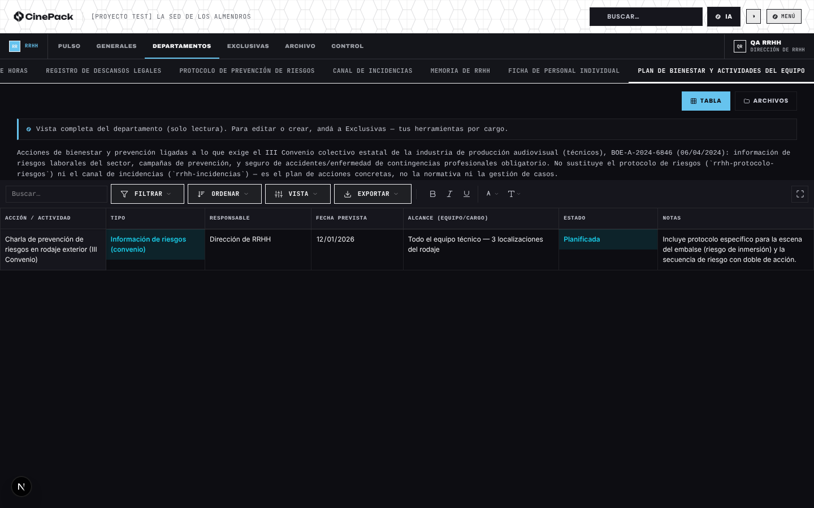

# Plan de bienestar y actividades del equipo — RRHH (Coordinación de bienestar)

## 1. Resumen ejecutivo
`rrhh-plan-bienestar` era un checklist genérico sin estructura. Se convirtió en tabla estructurada que conecta directamente con las obligaciones del **III Convenio colectivo estatal de la industria de producción audiovisual (técnicos)** (BOE-A-2024-6846, 06/04/2024): información de riesgos laborales del sector, campañas de prevención y seguro obligatorio de accidentes/enfermedad por contingencias profesionales. Es el único cargo de RRHH que estaba vacío pese a que el departamento ya tiene herramientas fuertes de cumplimiento (`descansosLegales`, `protocoloRiesgos`, `canalIncidencias`).

## 2. Cargo y necesidad real
Departamento RRHH, cargo Coordinación de bienestar. Hoy estas acciones (campañas, seguro, información de riesgos) se gestionan sueltas, sin registro de qué se hizo, cuándo y para quién — a diferencia de `protocoloRiesgos`/`descansosLegales` que sí están cubiertas como herramientas de departamento. Este cargo necesita su propio registro de acciones, no otro protocolo legal.

## 3. Qué ofrece la competencia
Fuente: [BOE-A-2024-6846](https://www.boe.es/diario_boe/txt.php?id=BOE-A-2024-6846) (III Convenio colectivo estatal de la industria de producción audiovisual, técnicos).
- El convenio exige, entre otras cosas: información sobre riesgos laborales del sector y derechos/deberes de prevención, campañas informativas de prevención de riesgos laborales, y seguro de accidentes/enfermedad obligatorio por contingencias profesionales.
- **Hipótesis, no verificada con fuente directa**: no se confirmó si StudioBinder, Yamdu, Movie Magic o SetHero (todos de origen no español) cubren obligaciones ligadas específicamente a convenios colectivos locales — es razonable asumir que no, al ser herramientas generalistas sin foco en normativa laboral española, pero no se encontró una fuente que lo confirme o niegue explícitamente para este cargo en particular.
- **Caveat de la propia fuente de búsqueda**: no se confirmó si existe un convenio sucesor tras el 31/12/2024 — se recomienda que RRHH (humano, no este agente) verifique la vigencia actual en BOE/REGCON antes de dar por buena la referencia normativa en producción.

## 4. Normativa aplicable
III Convenio colectivo estatal de la industria de producción audiovisual (técnicos), BOE-A-2024-6846 — ver limitación de vigencia en sección 3. Marcado explícitamente como la fuente, no como garantía de que sigue vigente sin cambios a la fecha de hoy.

## 5. Diseño de la herramienta
Tabla con columnas: Acción/actividad, Tipo (Información de riesgos (convenio) / Campaña de prevención / Seguro obligatorio / Bienestar general), Responsable, Fecha prevista, Alcance (equipo/cargo, texto largo), Estado (Planificada/En curso/Realizada), Notas.

## 6. Integración en 3 niveles
- **Departamento**: visible para Coordinación de bienestar, con el resto del departamento RRHH (comparte el mismo modelo de departamento que `descansosLegales`/`protocoloRiesgos`/`canalIncidencias`).
- **Proyecto completo**: no se integró con el calendario del proyecto en este ciclo — sería valioso que "Fecha prevista" alimente el calendario general, pero no se implementó (ver sección 11).
- **Otros departamentos**: el seguro obligatorio y las campañas de prevención afectan a todo el equipo de rodaje, no solo a RRHH — hoy el registro es privado del cargo, sin vista agregada para otros departamentos.

## 7. Modelo de datos y permisos
Sin tabla nueva de Supabase: usa el motor genérico de `tipo: "tabla"`. Privado del cargo Coordinación de bienestar.

## 8. Librerías y licencias
Ninguna librería nueva.

## 9. Sistema de diseño
Sin cambio de componente visual: renderer genérico ya conforme a `sistema-diseno.md`.

## 10. QA
- `tsc --noEmit` sobre todo el proyecto: sin errores de tipos.
- `next build` completo: compila sin errores.
- **Verificación responsive real (ronda final, con login real)**: login real contra `cinepack-dev` con una cuenta de QA (`qa.rrhh-direccion2@mailinator.com`), entrando al proyecto de prueba `[PROYECTO TEST] La sed de los almendros`, abriendo la herramienta real desde Departamentos → RRHH → "Plan de bienestar y actividades del equipo", con una fila real cargada (acción de prevención de riesgos ligada al rodaje del proyecto test). Capturado con Playwright real en 390/820/1440px: **sin scroll horizontal en ningún ancho** (`document.documentElement.scrollWidth` confirmado igual al `clientWidth`), tabla con headers y fila legibles, toolbar (Filtrar/Ordenar/Vista/Exportar) usable en los 3 anchos. Ver capturas abajo.
- La fila se cargó por API directa (insert en `herramienta_filas`) para tener datos reales que mostrar, no por el formulario de alta de la UI — el flujo de alta en sí (botón "+ fila", edición de celda) no quedó probado interactivamente en esta ronda.
- No se agregaron tests nuevos.

### Capturas reales (390 / 820 / 1440px)

- No se agregaron tests nuevos.

## 11. Pendientes / preguntas abiertas para Nico
1. Verificación visual responsive: **hecha** (ver sección 10). Sigue abierto el alta/edición end-to-end, bloqueado por falta de una cuenta de prueba real.
2. Verificar si el III Convenio (BOE-A-2024-6846) sigue siendo la referencia vigente o si hay un convenio sucesor desde 2025 — esta investigación no lo pudo confirmar con certeza.
3. No se integró "Fecha prevista" con el calendario general del proyecto ni se dio visibilidad a otros departamentos — expediente de integración transversal aparte si Nico lo quiere.
