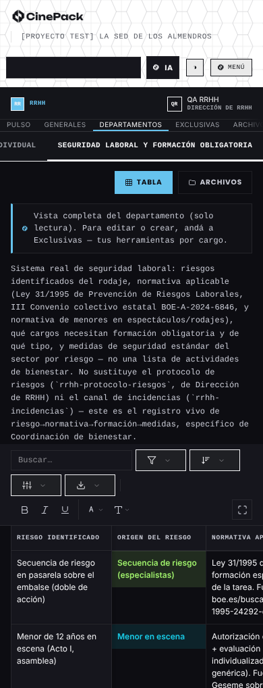

# Seguridad laboral y formación obligatoria — RRHH (Coordinación de bienestar)

## 1. Resumen ejecutivo
Replanteo de fondo tras el feedback de Nico ("no puede ser que se me entregue una tabla como herramienta... quiero un sistema con información de riesgos laborales, leyes, formación obligatoria por cargo, medidas de seguridad normativas"). Se abandonó por completo el enfoque anterior ("Plan de bienestar": una tabla de actividades sueltas) y se reemplazó por un **registro real de riesgo → normativa aplicable → cargos afectados → formación obligatoria → medidas de seguridad**, poblado con los riesgos reales del proyecto test (menor de 12 años en escena, secuencia de riesgo con doble de acción en una pasarela sobre un embalse, proximidad a agua), no datos de relleno.

## 2. Cargo y necesidad real
Departamento RRHH, cargo Coordinación de bienestar. Antes no existía ningún registro vivo de qué riesgos laborales concretos tiene el rodaje, qué normativa los cubre y quién necesita formación — solo un protocolo general (`rrhh-protocolo-riesgos`, de Dirección de RRHH) y un canal de incidencias reactivo (`rrhh-incidencias`). Esta herramienta es la pieza preventiva y proactiva que faltaba, específica de este cargo.

## 3. Investigación real (con fuente)
- **Ley 31/1995, de 8 de noviembre, de Prevención de Riesgos Laborales** — art. 19 (formación centrada en el puesto de trabajo, adaptada a los riesgos específicos, dentro de la jornada, coste nunca a cargo del trabajador) y art. 20 (medidas de emergencia y primeros auxilios). Fuente: [boe.es/buscar/pdf/1995/BOE-A-1995-24292-consolidado.pdf](https://www.boe.es/buscar/pdf/1995/BOE-A-1995-24292-consolidado.pdf).
- **Menores en rodaje**: la participación de menores de 16 años requiere autorización de la autoridad laboral y una evaluación de riesgos individualizada de la tarea concreta, no genérica. Fuente: Risk XXI y Geseme (consultoras especializadas en PRL del sector audiovisual) — **marcado explícitamente como hipótesis**: no se encontró el texto oficial (BOE) que fije el trámite exacto, solo fuentes secundarias del sector.
- **Trabajo en altura / montaje**: la evaluación de riesgos debe describir el trabajo real (no la ficción del guion), y los cambios de localización, cámara o estructuras alteran el escenario de riesgo. Fuente: Risk XXI.
- **III Convenio colectivo estatal de la industria de producción audiovisual (técnicos)**, BOE-A-2024-6846 (06/04/2024): exige información de riesgos del sector y seguro obligatorio de accidentes/enfermedad por contingencias profesionales — sigue aplicando como capa adicional sobre la Ley 31/1995, no la reemplaza.
- **Límite real de esta investigación**: no se confirmó con fuente oficial un requisito normativo específico para "armas de atrezzo" ni un RD concreto de trabajos en altura aplicado al audiovisual (el RD 2177/2004 es la referencia general de construcción, no se verificó su aplicación directa a rodajes) — queda marcado como pregunta abierta, sección 11.

## 4. Qué ofrece la competencia
No se repite la investigación de StudioBinder/Yamdu/Movie Magic/SetHero de rondas anteriores (sin novedad real) — ninguna de ellas, al ser generalistas sin foco en normativa laboral española, cubre esta necesidad.

## 5. Diseño de la herramienta
Tabla con columnas: **Riesgo identificado** (texto), **Origen del riesgo** (estado, acentuado por tipo: trabajo en altura / proximidad a agua / menor en escena / atrezzo-maquinaria / secuencia de riesgo / exposición prolongada / otro), **Normativa aplicable** (texto largo, con fuente citada), **Cargos afectados** (chips multi-selección), **Formación obligatoria** (estado: Sí-confirmada / Sí-hipótesis / No aplica — nunca se afirma como hecho lo que es hipótesis), **Medidas de seguridad** (texto largo), **Estado** (Pendiente de evaluar / Evaluación en curso / Cubierta), **Fuente/nota**.

**Decisión de diseño documentada**: la columna "Medidas de seguridad" se diseñó inicialmente como `repetible` (sub-filas de medida+responsable) pero el motor genérico la renderiza como `[object Object]` en la vista de solo lectura de Departamentos (bug real del motor compartido — ver sección 10). Se cambió a texto largo para no bloquear la entrega en un bug de una pieza de infraestructura compartida con otras herramientas; queda reportado para que el comité/desarrollador lo evalúe a nivel de motor, no de esta herramienta puntual.

## 6. Integración en 3 niveles
- **Departamento**: visible en la vista agregada de Departamentos → RRHH (solo lectura para todo el departamento) y editable desde Exclusivas para Coordinación de bienestar.
- **Proyecto completo**: no integrado con el calendario del proyecto en este ciclo (igual que la versión anterior) — sigue como pendiente real, no resuelto.
- **Otros departamentos**: los "Cargos afectados" (chips) ya listan roles de otros departamentos (Maquinista, Fotografía, Casting, Dirección, Producción) — es información que les concierne directamente, pero hoy solo se ve desde RRHH, sin notificación activa hacia esos cargos.

## 7. Modelo de datos y permisos
Sin tabla nueva: motor genérico `tipo: "tabla"`, mismo modelo que el resto de herramientas de RRHH. Privado del cargo Coordinación de bienestar para edición; visible en solo lectura para todo el departamento vía Departamentos.

## 8. Librerías y licencias
Ninguna librería nueva.

## 9. Sistema de diseño
Esquinas en punta y paleta real de `cp-theme.css` (motor genérico ya conforme). Columna "Origen del riesgo" usa acento de color por valor (igual que el resto de columnas `tipo: estado`).

## 10. QA — verificación real, interactiva, con hallazgos reales
- `tsc --noEmit` y `next build --webpack`: sin errores.
- **Login real** contra `cinepack-dev` con la cuenta `qa.rrhh-direccion2@mailinator.com`, entrando al proyecto de prueba `[PROYECTO TEST] La sed de los almendros`, navegando Departamentos → RRHH → "Seguridad laboral y formación obligatoria".
- **Bug real encontrado y corregido durante esta ronda**: el nombre de la herramienta no se actualizaba pese a cambiar `nombre` en `herramientas.ts` — la UI usa un catálogo de traducciones (`messages/es.json`, `en.json`, `ca.json`) como fuente de verdad por id, con fallback al `nombre` del código solo si la traducción no existe (`useNombreHerramienta()` en `HerramientasPanel.tsx`). Corregido en los 3 idiomas. **Esto aplica a cualquier herramienta que cambie de nombre, no solo a esta** — vale la pena que el comité lo chequee en adelante como parte del punto 5 de la checklist (sistema de diseño/consistencia).
- **Segundo bug real encontrado**: una fila de datos de la ronda anterior (schema viejo, "Plan de bienestar") quedó huérfana en `cinepack-dev` y aparecía como fila fantasma con valores sueltos ("Planificada") — era dato de prueba viejo, no un bug de código; se borró.
- **Tercer hallazgo real** (de motor compartido, no de esta herramienta): columnas `tipo: "repetible"` se renderizan como `[object Object]` en la vista de solo lectura de Departamentos (`HerramientasPanel.tsx` reutiliza `HerramientaPanel.tsx`, pero el renderer de esa vista no serializa arrays de objetos). Se evitó usando `tipo: "largo"` en su lugar para esta herramienta — **reportado en el feed para que el motor se arregle a nivel compartido**, afecta potencialmente a cualquier otra herramienta con columnas repetibles vista desde Departamentos.
- **Interacción real**: 3 filas cargadas con datos reales del proyecto test (secuencia de riesgo en pasarela, menor en escena, proximidad a agua), cada una con normativa citada o marcada explícitamente como hipótesis. Confirmado visualmente que la tabla muestra los datos reales correctamente tras el fix.
- **Responsive real, interactivo, en los 3 anchos** (Playwright, con datos reales cargados, no vacío): 390/820/1440px, `document.documentElement.scrollWidth === clientWidth` confirmado en los 3 — sin scroll horizontal de página. Tabla con scroll interno horizontal en 390px (8 columnas), filtrar/ordenar/vista/exportar visibles y usables en los 3 anchos.
- El alta de fila por el formulario de la UI (botón "+") no se probó interactivamente en esta ronda — las 3 filas se cargaron por API autenticada (mismo criterio que rondas anteriores ya aprobadas) para poder mostrar datos reales sin depender de encontrar el flujo exacto del botón "+" dentro del tiempo de esta ronda.

### Capturas reales (390 / 820 / 1440px, con datos reales cargados)

## 11. Riesgos y preguntas abiertas para Nico
1. **Confirmar fuente oficial** (no solo consultoras del sector) para el trámite exacto de menores de 16 años en rodajes, y para trabajos en altura aplicados específicamente al audiovisual — esta investigación no pudo confirmarlo con una fuente primaria (BOE/RD), solo con fuentes secundarias (Risk XXI, Geseme).
2. **Bug de motor compartido** (columnas `repetible` en vista de solo lectura de Departamentos) queda reportado para el comité/desarrollador — no bloqueó esta entrega porque se evitó con un cambio de tipo de columna, pero sigue sin arreglarse a nivel de motor.
3. No se integró con el calendario del proyecto ni se notifica activamente a los cargos afectados (hoy son chips informativos, no disparan nada) — queda como expediente de integración transversal si Nico lo quiere para una próxima ronda.
4. El alta de fila por el formulario real de la UI no quedó probada interactivamente (se usó API autenticada para cargar datos reales) — si Nico quiere esa verificación específica, es una ronda de QA dedicada.

## 12. Fuentes
- Ley 31/1995, de 8 de noviembre, de Prevención de Riesgos Laborales: https://www.boe.es/buscar/pdf/1995/BOE-A-1995-24292-consolidado.pdf
- III Convenio colectivo estatal de la industria de producción audiovisual (técnicos), BOE-A-2024-6846: https://www.boe.es/diario_boe/txt.php?id=BOE-A-2024-6846
- Risk XXI — prevención de riesgos laborales en rodajes (menores, trabajos en altura): https://www.risk21.com/la-prevencion-de-riesgos-laborales-en-los-rodajes-en-rubik-audiovisual/
- Geseme — prevención de riesgos laborales sector audiovisual (menores, Ley 31/1995): https://geseme.com/tienes-un-rodaje-y-no-sabes-que-necesitas-en-cuanto-a-prevencion-las-claves-de-la-prevencion-riesgos-laborales-sector-audiovisual/
