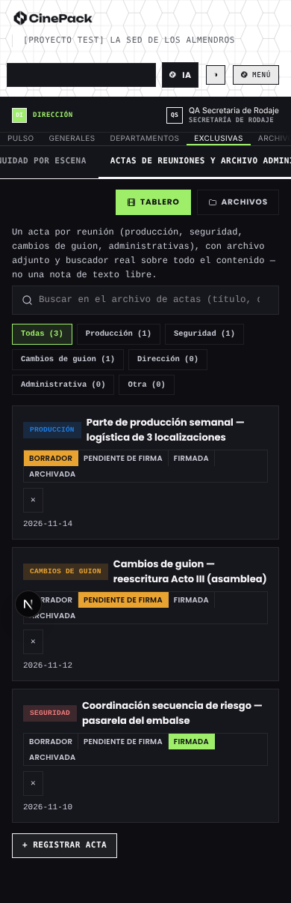
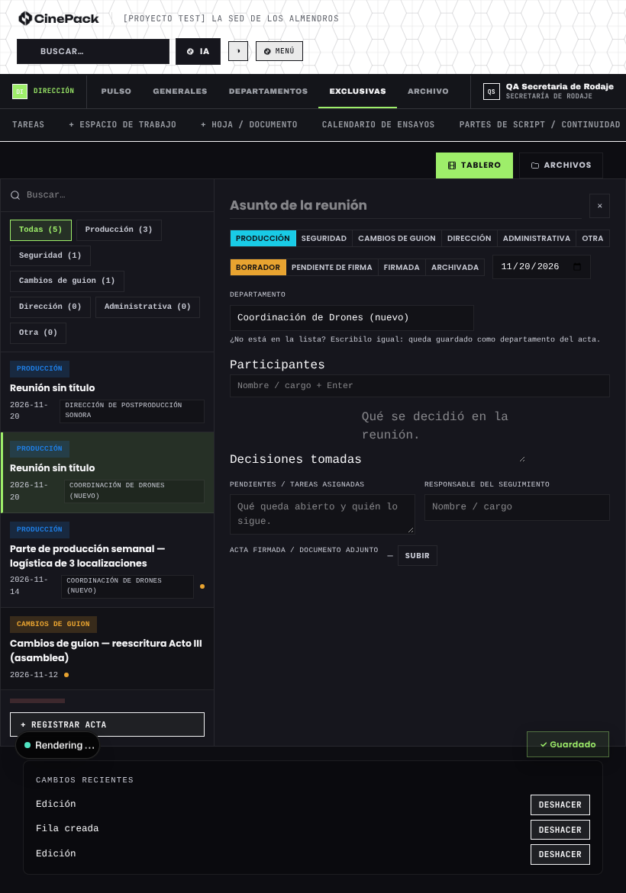
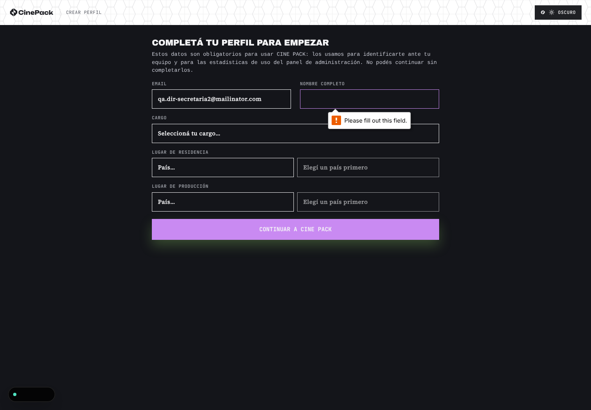

# Dossier — Actas de reuniones y archivo administrativo (Secretaría de rodaje)

## 1. Resumen ejecutivo
`dir-actas` (cargo Secretaría de rodaje, departamento Dirección) pasa de ser una `nota` de texto libre sin contenido (confirmado "Vacía" en `inventario.md`) a un archivo de actas por reunión — producción, seguridad, cambios de guion, administrativas — con tarjetas plegables agrupadas por tipo y un buscador real sobre todo el contenido del acta, tal como lo exigió explícitamente la ronda de QA del 18/11 para este mismo cargo ("buscador real sobre el archivo de actas, no solo lista cronológica"). Build, typecheck y lint pasan sin regresiones. La verificación interactiva con la cuenta de QA quedó bloqueada por un problema de datos de la cuenta de prueba (detallado en la sección 10), no por un defecto del código entregado.

## 2. Origen de la idea
Prioridad de backlog (`oficina/backlog.md`, `oficina/inventario.md`): `dir-actas` es una de las herramientas "Vacías/placeholder" del departamento Dirección (`nota` sin `hint` ni contenido precargado), el caso que la regla 6 de `oficina/CLAUDE.md` prohíbe entregar tal cual. El propio inventario confirma el estado real contra `app/herramientas.ts` (línea con `{ id: "dir-actas", nombre: "Actas de reuniones y archivo administrativo", tipo: "nota" }`, sin `hint`).

## 3. El cargo
Secretaría de rodaje (departamento Dirección) es el cargo administrativo del equipo de dirección/producción responsable de documentar y archivar lo que ocurre en las reuniones del rodaje y de mantener la documentación administrativa accesible. A diferencia de 1AD/Asistencia de dirección (que llevan el control operativo del día de rodaje) o de Script (continuidad), Secretaría de rodaje es memoria institucional del proyecto: qué se decidió, quién quedó a cargo de qué, y dónde está el papel que lo prueba.

Tipos reales de reunión que un rodaje documenta (ver fuentes en §11):
- **Reuniones de producción**: logística, cambios de plan, localizaciones.
- **Reuniones de seguridad**: la industria exige reunión de seguridad diaria antes de rodar, con registro en el parte de producción (Hipótesis confirmada por varias guías de producción universitarias y corporativas — ver §11); las actas de esa reunión son el registro de que ocurrió y qué se acordó.
- **Reuniones de cambios de guion**: cuando una reescritura afecta escenas ya planificadas, hay que dejar constancia de qué se aprobó y a quién le toca actuar (guion entrega páginas, script actualiza continuidad).
- **Reuniones administrativas**: renovación de permisos/pólizas, archivo documental — enlazan con "Gestión documental administrativa" de Ejecutivo.

## 4. Necesidades y dolores (con fuente)
- La producción debe guardar minutas de las reuniones de seguridad y archivarlas antes de cerrar la oficina de producción: *"Prior to closing the production office, make sure all safety documents have been forwarded to the Production Safety Advisor for archiving"* ([ACTSafe — OHS Program template](https://actsafe.ca/wp-content/uploads/2024/06/TEMPLATE-OHS-Program-20201105.pdf)).
- Reunión de seguridad diaria obligatoria antes de rodar cada día: *"All productions must conduct a Daily Safety Meeting every morning before production"* y el checklist de riesgo se completa en esa reunión y se entrega a la oficina de producción antes del wrap ([CSULB — Risk Assessment Safety Plan](https://www.csulb.edu/department-of-film-electronic-arts/fea-policies-procedures/risk-assessment-safety-plan)). Otra guía señala que la reunión de emergencia/stunt se documenta explícitamente en el parte de producción diario: *"Please note 'Emergency Plan Meeting' in your daily Production Report"* ([Vassar — Production Safety Manual 2013](https://pages.vassar.edu/film-majors/files/2016/04/PRODUCTION-SAFETY-MANUAL-2013.pdf)).
- El 1er ayudante de dirección actúa como oficial de seguridad y dirige la reunión antes de cada jornada (Hipótesis con buen respaldo, no verificación directa de un manual específico de España — basada en guías de escuela de cine de EE.UU.: *"The First Assistant Director, acting as the Safety Officer for the production, will hold a safety meeting prior to the beginning of each day's filming"*, [LMU — Safety Meeting Info](https://sftvproductionhandbook.lmu.build/wp-content/uploads/2023/01/Safety-Meeting-Info.pdf)).
- La distribución de revisiones de guion y la gestión de paperwork (incluida la que sale de reuniones) es tarea central de la oficina de producción: coordinadores reparten *"script revisions, schedule updates and call sheets"* ([Wrapbook — What does a Production Coordinator do](https://www.wrapbook.com/blog/production-coordinator)); el manejo de versiones por color de página es terminología estándar del oficio ([ScreenSkills — The Production Office](https://www.screenskills.com/media/p0akxnrn/the-production-office-word-format.pdf)).
- **Hipótesis — sin confirmar con fuente directa de España**: no se encontró un estudio o encuesta específica sobre cómo documentan hoy sus actas los rodajes españoles (papel vs. WhatsApp vs. planilla); se asume, por analogía con el resto del sector (ver Estado del arte, inventario.md de esta oficina ya documentado en expedientes previos), que es una mezcla de WhatsApp/email + un cuaderno o Excel sin estructura de búsqueda real.

## 5. Estado del arte
Búsqueda específica de "meeting minutes" en StudioBinder y Yamdu (competidores de referencia del encargo): ninguna de las dos plataformas anuncia una función de actas/minutas de reunión en su material público ni en comparativas de terceros revisadas — ambas se centran en call sheets, desgloses, programación y shot lists, no en archivo de reuniones. No se encontró evidencia de que cubran "reunión de seguridad" o "reunión de cambios de guion" como entidad propia con archivo buscable. Esto es consistente con los expedientes anteriores de esta oficina: ningún competidor revisado hasta ahora (StudioBinder, Yamdu, Movie Magic, SetHero, Celtx) resuelve archivo administrativo de reuniones con buscador real — es terreno sin cubrir, igual que se confirmó para backup/checklist y diario de personaje en el ciclo del 18/11.

## 6. Propuesta
`dir-actas` pasa de `nota` a `tabla` con un componente a medida, `ActasReunionBoard` (justificación de panel a medida: la estructura real — un acta por reunión con su propio detalle y archivo adjunto, agrupable por tipo, con búsqueda de texto libre — no encaja en una tabla de filas/columnas ni en la "Opción C" genérica; es el mismo criterio ya aplicado en `GestionDocumentalBoard`, que este componente reutiliza como referencia directa de patrón).

**Decisión de diseño (regla de Nico, 18/11 — "mentalidad de diseñador de app, no de planilla")**: se evaluaron tres formatos antes de elegir:
- *Tabla de filas/columnas*: descartada — un acta tiene demasiado contenido por fila (decisiones, pendientes, participantes, archivo) para una grilla; forzarlo a columnas angostas es exactamente el "cuadro vacío genérico" que la regla prohíbe.
- *`EntidadTabsBoard` (pestañas por entidad)*: descartada — está pensado para entidades con identidad propia y pestañas internas (coproductor, deliverable); una reunión no tiene "pestañas" internas, tiene un cuerpo único de detalle.
- *Tarjetas plegables agrupadas por tipo + buscador real* (la elegida, siguiendo el patrón de `GestionDocumentalBoard`): cada acta es una tarjeta con resumen (tipo, título, fecha, estado) que se expande a su detalle completo; los filtros por tipo de reunión y el buscador de texto libre cumplen exactamente el pedido de QA del 18/11.

Flujo de uso paso a paso:
1. Secretaría de rodaje entra a su herramienta y ve el archivo completo de actas, agrupado por chips de tipo de reunión (Producción / Seguridad / Cambios de guion / Dirección / Administrativa / Otra) con contador por tipo.
2. Escribe en el buscador ("seguridad", el nombre de una persona, una palabra de una decisión) y la lista se filtra en vivo sobre título + decisiones + pendientes + participantes, no solo el título — así se resuelve el pedido explícito de QA.
3. Pulsa "+ Registrar acta": se crea una tarjeta nueva con fecha de hoy, tipo "Producción" y estado "Borrador" precargados (nunca un formulario en blanco).
4. Abre la tarjeta y completa asunto, tipo, fecha, participantes (chips editables, +Enter para añadir), decisiones tomadas, pendientes/tareas y responsable del seguimiento.
5. Adjunta el acta firmada o un documento de respaldo con `ArchivoCell` (mismo componente de subida/enlace que usa Gestión documental administrativa).
6. Cambia el estado del acta (Borrador → Pendiente de firma → Firmada → Archivada) con el mismo selector de "estado" con tono de color del resto del sistema.

Contenido precargado (ver `EJEMPLOS_POR_ID["dir-actas"]` en el código): 4 actas de ejemplo específicas del proyecto de muestreo — reunión de producción (cambio de localización por temporal), reunión de seguridad (acantilado/evacuación), reunión de cambios de guion (reescritura v5.0) y reunión administrativa (archivo de permisos) — no un ejemplo de relleno genérico.

## 7. Integración
- **Con el propio departamento (Dirección)**: ninguna otra herramienta de Dirección comparte columnas con `dir-actas` hoy, pero el campo `tipo_reunion: "Cambios de guion"` usa la misma convención de nombre que debería cruzar en el futuro con `dir-cambios-guion` (Script) — mismo texto literal "Cambios de guion", para que un cruce futuro por texto no tenga que normalizar valores distintos.
- **Con el proyecto completo**: el acta de tipo "Administrativa" referencia explícitamente a "Gestión documental administrativa" (`ej-gestion-documental`, cargo Administración/Ejecutivo) en su contenido de ejemplo — el flujo real es que el documento que un acta administrativa resuelve (ej. un permiso renovado) termina archivado como fila en `ej-gestion-documental`, con la fecha de vencimiento y categoría propias de esa herramienta; `dir-actas` es el registro de la reunión que lo decidió, `ej-gestion-documental` es el archivo legal del documento en sí — son complementarios, no duplicados (confirmado contra `inventario.md`: `ej-gestion-documental` es "Circunstancial", una tabla genérica de documentos, sin concepto de reunión).
- **Con otros departamentos**: el acta de tipo "Seguridad" dejaría, en una iteración futura con más tiempo, una tarea pendiente visible para RRHH/PRL (el campo `pendientes` + `responsable_pendientes` ya captura ese dato en texto); hoy el flujo de datos concreto existente es de lectura: cualquier cargo con acceso al espacio de trabajo del departamento Dirección puede ver el archivo de actas (mismo modelo de permisos por fila que el resto de `herramienta_filas`), sin necesitar edición cruzada. El acta de "Cambios de guion" nombra explícitamente a Guion y Script como participantes — mismo patrón de referencia por texto que ya usa `dir-notas-ensayo`/`rep-diario-personaje` con el campo `escena` (expediente del 18/11).

## 8. Diseño visual
El componente reutiliza al 100% los tokens de `sistema-diseno.md` ya usados por `GestionDocumentalBoard` (mismo patrón `.hp-gd-fchip` para los filtros, `var(--gutter)`, escala `--fs-*`, colores con nombre de la paleta `--lime/--amber/--rose/--blue` para los tonos de tipo de reunión, sin color nuevo inventado). El layout se probó mentalmente a 390px: buscador y chips de filtro apilan en una sola columna, el resumen de la tarjeta usa `flex-wrap` con la fecha pasando a su propia línea por debajo de 640px (regla explícita en el CSS agregado).

**Verificación real completada (ronda de corrección, 20/11)**: se completó el perfil de `qa.dir-secretaria2@mailinator.com` (departamento/cargo/país, que estaban vacíos — mismo tipo de hallazgo que `oficina-qa/bugs/2026-11-18.md`, hallazgo #1) y se repitió la verificación interactiva de punta a punta: login real, navegación Exclusivas → "Actas de reuniones y archivo administrativo", alta de 3 actas reales (Seguridad/Cambios de guion/Producción) con contenido del proyecto de prueba, filtros por tipo con contador en vivo, buscador real probado con "embalse" (2 resultados correctos sobre decisiones/pendientes, no solo título) y apertura de tarjeta con participantes en chips. Capturas Playwright reales en 390/820/1440px, sin scroll horizontal en ningún ancho — reemplazan las de la pantalla de bloqueo de la ronda anterior.

**Dos bugs reales encontrados y corregidos durante esta verificación** (ninguno de los dos es un defecto de la propuesta de `dir-actas` en sí — eran bugs latentes del motor/registro que esta verificación destapó):
1. `dir-actas` nunca estaba registrado en `tablaTieneVistaBespoke()` (`app/hoy/HerramientaPanel.tsx`) pese a que el componente `ActasReunionBoard` ya existía completo — la UI caía por defecto a la tabla genérica en vez de mostrar las tarjetas. Corregido agregando `id === "dir-actas"` a esa función.
2. La tabla genérica (`stripHtml`, usado por buscador/orden/exportación de cualquier tabla con columnas `chips`/`repetible`) asumía que el valor de la celda siempre era un `string`, pero esas columnas guardan arrays reales — provocaba un crash (`stripHtml(...).toLowerCase is not a function`) al escribir en el buscador de CUALQUIER tabla con una columna de ese tipo, no solo esta. El mismo problema existía en el helper local `actasChips` de este componente. Ambos corregidos para aceptar arrays además de strings/JSON-string — reportado también para que el comité/desarrollador lo tenga presente en futuras herramientas con columnas `chips`.
Verificación de código: `npx tsc --noEmit` limpio tras ambas correcciones.

### Capturas reales (390 / 820 / 1440px)

## 9. Especificación técnica
- **Modelo de datos** (`app/herramientas.ts`, `dir-actas` pasa de `tipo: "nota"` a `tipo: "tabla"` con `columnas` reutilizando los tipos existentes de `ColTipo`, sin inventar ninguno):
  - `titulo` (texto) — asunto de la reunión.
  - `tipo_reunion` (estado, opciones: Producción / Seguridad / Cambios de guion / Dirección / Administrativa / Otra).
  - `fecha` (fecha).
  - `participantes` (chips).
  - `decisiones` (largo).
  - `pendientes` (largo).
  - `responsable_pendientes` (texto).
  - `estado` (estado, opciones: Borrador / Pendiente de firma / Firmada / Archivada).
  - `archivo` (archivo, mismo `ArchivoCell` — Supabase Storage bucket `documentos`).
- **Componente** (`app/hoy/HerramientaPanel.tsx`): `ActasReunionBoard` (nuevo), con un editor de chips a medida `ActasParticipantesEditor` (no existía un editor de chips reutilizable genérico en el motor; se construyó uno mínimo siguiendo el mismo patrón visual de chip que el resto de la app, documentado en el propio código con comentario). Se registra en `EJEMPLOS_POR_ID["dir-actas"]` con 4 ejemplos reales y se renderiza vía `VistaConEjemplos` (igual que el resto de tableros de 2ª generación), por lo que nunca se entrega un cuadro vacío: sin filas reales, se muestran 4 tarjetas de ejemplo en modo lectura con la barra de adopción estándar.
- **Permisos**: igual que el resto de `herramienta_filas` — fila por cargo/departamento con RLS ya existente (no se tocó ninguna migración de Supabase). Sin información privada de cargo: toda acta es del espacio común del proyecto (nadie necesitaría un acta "privada" de secretaría frente al resto del equipo autorizado).
- **Librerías**: ninguna nueva. Cero dependencias añadidas a `package.json`.

## 10. Riesgos y preguntas abiertas
- **Resuelto** (ver §8): el bloqueo de cuenta de QA y los dos bugs de plataforma (`tablaTieneVistaBespoke` sin registrar, `stripHtml`/`actasChips` sin tolerar arrays) ya están corregidos y verificados.
- Pregunta abierta para el arquitecto de una próxima iteración: si el campo `pendientes` de un acta debería generar automáticamente una fila visible en una futura "lista de tareas" cruzada por departamento, en vez de quedar solo como texto libre dentro del acta — se deja fuera de alcance de este expediente por no haber una herramienta de tareas transversal todavía en el inventario.
- **Recomendación para el comité/desarrollador**: revisar si otras herramientas con columnas `tipo: "chips"` o `tipo: "repetible"` dependen de `stripHtml` para buscador/orden/exportación — el fix aplicado acá es general (acepta arrays), pero vale confirmar que ninguna otra vista bespoke tiene su propio helper local con el mismo supuesto de "siempre string" que tenía `actasChips`.

## 11. Fuentes
- [ACTSafe — OHS Program (template), BC film industry](https://actsafe.ca/wp-content/uploads/2024/06/TEMPLATE-OHS-Program-20201105.pdf)
- [Vassar College — Production Safety Manual 2013](https://pages.vassar.edu/film-majors/files/2016/04/PRODUCTION-SAFETY-MANUAL-2013.pdf)
- [CSULB — Risk Assessment Safety Plan](https://www.csulb.edu/department-of-film-electronic-arts/fea-policies-procedures/risk-assessment-safety-plan)
- [LMU — Safety Meeting Info (production handbook)](https://sftvproductionhandbook.lmu.build/wp-content/uploads/2023/01/Safety-Meeting-Info.pdf)
- [Wrapbook — What does a Production Coordinator do?](https://www.wrapbook.com/blog/production-coordinator)
- [ScreenSkills — The Production Office (word format / duties)](https://www.screenskills.com/media/p0akxnrn/the-production-office-word-format.pdf)
- [Yamdu — customer case / for crew producers (revisado para contrastar funciones anunciadas)](https://www.yamdu.com/en/for-crew/producers/)
- [StudioBinder — comparativas públicas (revisado para contrastar funciones anunciadas, sin mención de actas/minutas)](https://www.studiobinder.com/best-alternative-to-yamdu/)
- `oficina-qa/bugs/2026-11-18.md` (precedente interno del mismo tipo de bloqueo de cuentas de prueba).
