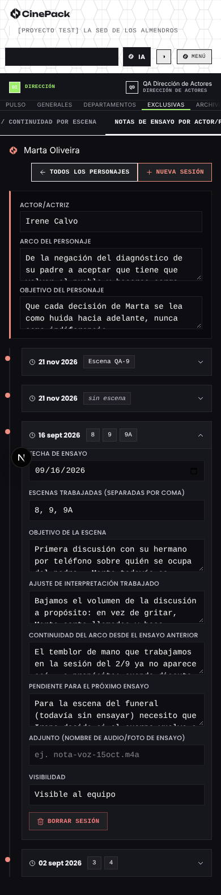
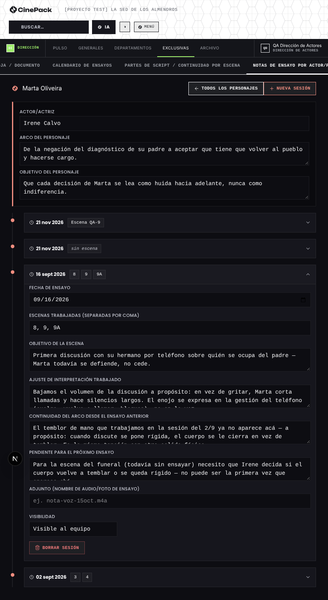
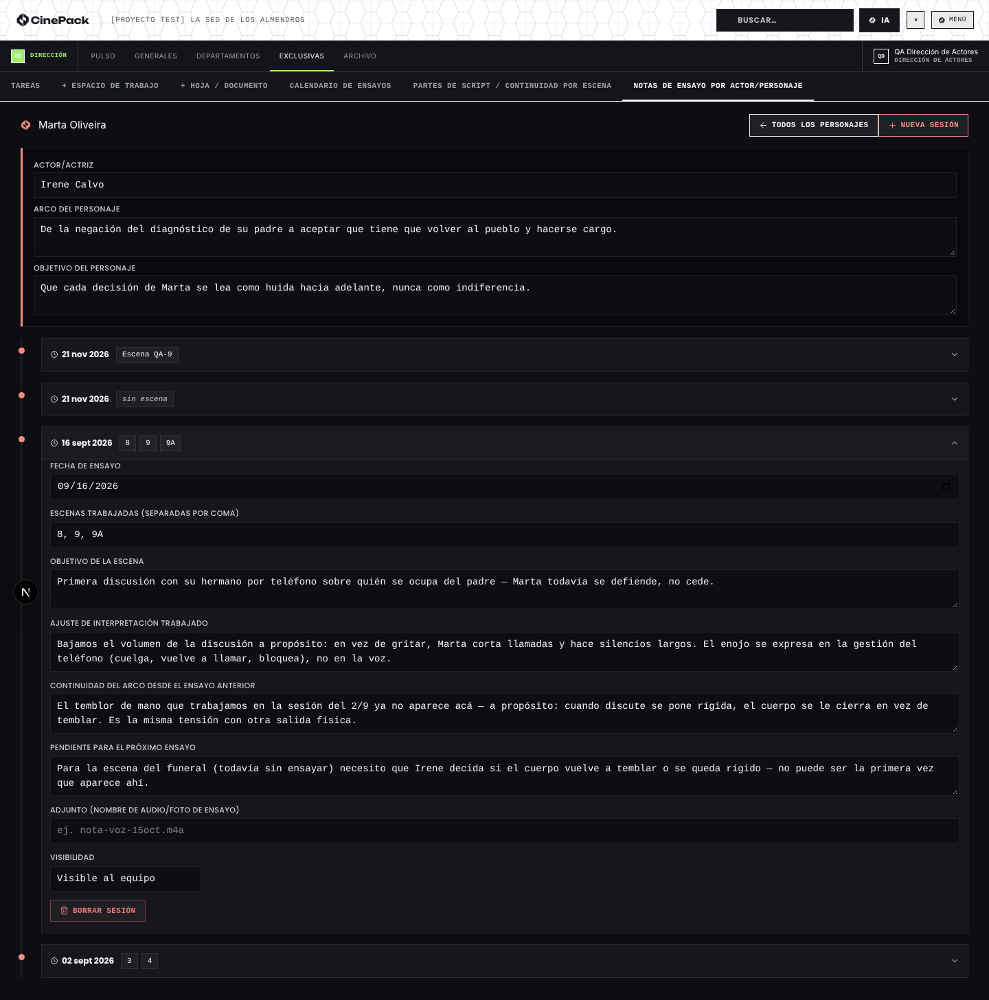

# Dossier — Notas de ensayo por actor/personaje

Cargo: Dirección de actores · Departamento: Dirección · Fecha: 21/11/2026

## 1. Resumen ejecutivo
`dir-notas-ensayo` pasa de ser una `nota` vacía (sin `hint` ni contenido) a un cuaderno de dirección de actores digital: vista por personaje con línea de tiempo de sesiones de ensayo, cabecera de arco siempre visible y un bloque destacado de "qué cambió desde la última sesión". Ningún competidor estándar (StudioBinder, Yamdu, Celtx, Movie Magic) cubre el contenido creativo de la dirección de actores — todos resuelven casting y logística de ensayo, no interpretación. QA encontró un bug real de permisos (el cargo dueño no podía editar nada) y un `<select>` nativo fuera de norma; ambos corregidos y reverificados. Golden path confirmado de punta a punta, responsive OK en 390/820/1440px, sin errores de consola, aprobado por comité en ronda 2.

## 2. Origen de la idea
Prioridad de backlog (`oficina/backlog.md`, `oficina/inventario.md`): `dir-notas-ensayo` es una de las 16 herramientas "Vacías/placeholder" confirmadas en el inventario (`nota` sin `hint`), departamento Dirección, cargo Dirección de actores — nunca entregada en ningún expediente anterior (confirmado contra `oficina/expedientes/` existentes, incluido `2026-11-17_direccion_notas-escena`, que cubre un cargo distinto: notas post-toma de Dirección general, no de interpretación/ensayo).

## 3. El cargo
La dirección de actores es el proceso de planificación, creación y ensayo con el elenco, enfocado en que cada interpretación sirva a la escena y al arco del personaje (guías docentes de Nebrija/UCM/UCLM, ver §11). El trabajo se describe en dos bloques: preparación de escenas y ensayo, e interpretación específica del medio cinematográfico.

Fases en las que interviene:
- **Preproducción / ensayos previos al rodaje**: lectura y análisis de guion con el reparto, ensayos escena por escena, ajuste de intenciones y objetivos por personaje.
- **Día de rodaje**: ajustes de dirección de actores entre tomas, continuidad emocional cuando el rodaje no sigue el orden narrativo — *hipótesis razonable, sin fuente directa española que lo confirme para este cargo específico*.

Qué contiene una "nota de ensayo": la literatura académica (UCM, Nebrija) describe el "cuaderno/bitácora de dirección" como el objeto de estudio de este proceso, sin un nombre ni estructura estandarizada (una tesis de la ULPGC discute explícitamente la falta de consenso terminológico — cuaderno de dirección, libro de dirección, partitura, bitácora). Nebrija pide explícitamente un cuaderno que "refleje por escrito todo el proceso... desde la elección de la escena a dirigir, hasta la grabación".

Con quién se coordina: *hipótesis sin fuente directa* — trabajaría sobre el guion ya desglosado, en coordinación con el calendario de ensayos de departamento (`calendarioEnsayos`, ya Consolidada) y con Dirección (quien decide la toma final).

## 4. Necesidades y dolores (con fuente)
No se encontró fuente que describa específicamente cómo los directores de actores en España gestionan hoy sus notas de ensayo en producciones reales. Evidencia indirecta: la práctica docente estandarizada pide un "cuaderno de dirección" en papel/texto como entregable — sugiere, sin confirmar, que la herramienta de trabajo habitual es un cuaderno físico o documento suelto, no software dedicado. Una mención aislada a "RehearsalPro" (herramienta de terceros en inglés) aparece en los resultados sin verificación de producto. **Hipótesis sin confirmar**: notas en libretas físicas o notas de voz sueltas, por analogía con el patrón ya confirmado para el cargo Dirección en general en el expediente `2026-11-17_direccion_notas-escena`.

**Normativa española aplicable**: el III Convenio Colectivo Estatal de la Industria de la Producción Audiovisual, técnicos (BOE-A-2024-6846), excluye expresamente a los actores de su ámbito — se rigen por su propio convenio. Las tablas de ese convenio de actores (dato de 2020, vigencia 2026 sin confirmar) incluyen remuneración específica por ensayo: 53,06€ protagonistas/secundarios, 42,45€ resto de categorías — relevante si a futuro se quisiera vincular notas de ensayo con jornadas retribuidas. No se encontró normativa de PRL/menores/datos que aplique de forma directa y específica a esta herramienta.

## 5. Estado del arte
Búsquedas específicas: "StudioBinder actor rehearsal notes character feature", "Yamdu Celtx Movie Magic SetHero actor notes character rehearsal". **StudioBinder**: sin función dedicada — lo más cercano son Actor Call Sheets tipo "rehearsal" (notas genéricas, no por personaje) y Script Notes (genéricas, con color por remitente). **Yamdu**: vínculos tipados personaje-escena-callsheet, sin mención a notas de ensayo. **Celtx**: perfiles de reparto actor-personaje-foto para gestión de casting, sin campo de interpretación/ensayo. **Movie Magic**: sin función relacionada (software de planificación/presupuesto). **SetHero**: sin datos encontrados, ni confirmado ni refutado. Conclusión verificada: ningún competidor estándar cubre el contenido creativo de la dirección de actores — oportunidad de diferenciación real.

## 6. Propuesta

### 6.0 Decisión de fondo
No es una tabla. El dato se guarda con el mismo motor de siempre (`herramienta_filas`, una fila = una sesión de ensayo de un personaje), pero la pantalla nunca muestra esas filas como tabla: `NotasEnsayoPanel.tsx` las agrupa por personaje y las presenta en dos niveles de navegación, exactamente como pidió la arquitectura.

### 6.1 Flujo de uso — Nivel 1: selector de personaje
1. El director/a de actores abre "Notas de ensayo por actor/personaje" desde su panel de cargo. Ve una grilla de **tarjetas**, una por personaje con sesiones registradas (nunca una tabla ni una pantalla vacía genérica: si el proyecto no tiene ninguna sesión todavía, se siembran solas 3 personajes de ejemplo con progresión real — ver 6.4).
2. Cada tarjeta muestra: nombre del personaje, actor/actriz asignado, cuántas sesiones tiene y la fecha de la última, y un adelanto de "pendiente para el próximo ensayo" de la sesión más reciente.
3. Si alguna sesión de ese personaje es privada, la tarjeta lleva un sello discreto (icono `key`).
4. Botón "Nuevo personaje" (solo editable): pide nombre y actor, crea la primera sesión en blanco y entra directo a su línea de tiempo.
5. Tocar una tarjeta entra al Nivel 2.

### 6.2 Flujo de uso — Nivel 2: línea de tiempo del personaje
1. Arriba, cabecera fija: actor/actriz, arco del personaje y objetivo del personaje — editable directo ahí.
2. Si la sesión más reciente escribió algo en "continuidad del arco", aparece un bloque destacado con acento coral: **"Qué cambió desde la última sesión"**.
3. Debajo, la línea de tiempo vertical: una tarjeta expandible por sesión de ensayo, de la más reciente a la más antigua, con un punto de línea de tiempo a la izquierda (ámbar si privada, coral si no).
4. Tocar el encabezado de una sesión la expande: objetivo de la escena, ajuste de interpretación trabajado, continuidad del arco, pendiente para el próximo ensayo, adjunto de audio/foto y visibilidad.
5. Botón "Nueva sesión": crea una sesión precargada con actor/arco/objetivo ya puestos, fecha de hoy.
6. Cada campo se guarda solo (`onBlur`/`onChange`), con aviso breve "Guardado".
7. Botón "Todos los personajes" vuelve al Nivel 1.

### 6.3 Flujo — privacidad de una nota
Al completar una sesión, el director de actores puede marcar "Privada" en vez de "Visible al equipo" (ej. una duda sobre si el actor está logrando el objetivo, antes de llevarlo a dailies). Esa sesión deja de aparecer para cualquier otro usuario del departamento — en este prototipo el filtro se aplica en cliente comparando `created_by` con el usuario actual; queda pendiente la policy de RLS a nivel de fila antes de producción (riesgo §10).

### 6.4 Contenido precargado (nunca un cuadro vacío)
Si un proyecto no tiene ninguna sesión registrada, el panel siembra automáticamente 3 personajes de ejemplo con progresión real de arco a lo largo de varias semanas:
- **Marta Oliveira** (protagonista): 3 sesiones mostrando el mismo gesto físico (temblor de mano) evolucionando de síntoma de shock a gesto consciente — cierre de arco explícito con aviso a Script.
- **Tomás Reguera** (antagonista): 2 sesiones donde aparece y se formaliza un tic de continuidad (se ajusta la corbata al mentir).
- **Nadia Reguera** (secundaria): 1 sesión marcada **Privada** — duda real del director de actores sin resolver, mostrando el caso de uso de visibilidad restringida.

## 7. Integración

### 7.1 Con el propio departamento (Dirección)
- **`dir-notas-escena`** (cargo Dirección, post-toma): comparte el campo `escenas` — cuando Dirección registra una nota de escena ya rodada, debería poder ver si hubo una nota de ensayo previa para esa misma escena. Riesgo abierto: no hay FK real de escena compartida hoy, el cruce es por texto/chip libre.
- **`calendarioEnsayos`** (ya Consolidada): el campo `foco` debería poder pre-rellenar `objetivo_escena` de una nueva sesión.
- **`dirDecisionesVisionado`** (dailies): lectura cruzada por `escenas` para evaluar si un ajuste de interpretación pendiente se logró en cámara.

### 7.2 Con el proyecto completo
- **`guion-desglose-escenas`**: `personajes`/`escena_id` deberían ser la fuente de verdad para poblar el selector de personajes de Nivel 1, no una lista escrita a mano.
- **`rep-ficha-personaje`**: `arco`/`objetivo` deberían leerse (solo lectura) como cabecera fija de cada personaje en la vista de ensayo, anclando la "continuidad del arco" al arco de guion real.
- **`GENERAL_PLAN_RODAJE`/`GENERAL_ORDEN_RODAJE`**: lectura (no escritura) para que el director de actores vea si un ensayo es antes/después de que la escena esté agendada, y qué personajes están citados cada día.

### 7.3 Con otros departamentos
- **Reparto → Dirección de actores**: `cast-ficha-reparto.actor` autocompletaría el campo `actor` al elegir `personaje`.
- **Dirección de actores → Script**: una nota de ajuste de interpretación concreto (ej. "siempre se toca el anillo al mentir") debería ser visible (solo lectura) para Script al registrar continuidad real.
- **Dirección de actores → Vestuario** (hipótesis sin confirmar): si el ajuste implica algo físico, Vestuario podría necesitar visibilidad del dato.

## 8. Diseño visual
Acento propio `var(--coral)` (sin uso previo como acento fijo de ninguna otra herramienta del sistema de diseño), Poppins en títulos/cabecera de arco, iconos del set existente (`key`/`clock`/`alert-triangle`/`arrow-right`/`chevron-up`/`chevron-down`), ningún icono nuevo. Mobile-first real con media query a 640px.

**Verificación real completada (QA, cuenta `qa.dir-actores2@mailinator.com`, perfil completado departamento/cargo tras hallazgo de proceso)**: login real, Nivel 1 con tarjetas de personaje, Nivel 2 con línea de tiempo y banner "qué cambió" confirmado interactuando (se probó llenando y vaciando el campo de continuidad), creación y edición real de una sesión con persistencia confirmada tras recarga completa de página. Capturas Playwright reales en 390/820/1440px, interactuando de verdad en los tres anchos (no solo visual), sin scroll horizontal ni superposición en ninguno.

### Capturas reales (390 / 820 / 1440px)

## 9. Especificación técnica (parte de componentes)

### 9.1 Por qué un panel a medida y no el motor genérico
`tipo: "tabla"` en `herramientas.ts` describe el **dato** (una fila = una sesión), pero la interacción real tiene una jerarquía de dos niveles (Personaje → Sesión) que el motor de tabla/ficha/galería genérico no expresa sin aplanarla. Se construyó `NotasEnsayoPanel.tsx`, montado por `HerramientasPanel.tsx` con la misma condición que ya usan `PlanSonidoPanel`, `MoodboardPanel` y `MoodboardFotoPanel` para sus propios paneles a medida.

### 9.2 Componentes nuevos
- `app/hoy/notasEnsayoFilas.ts` — tipos, conversión fila-de-base ↔ tipo, constantes y el set de sesiones de ejemplo.
- `app/hoy/useNotasEnsayoFilas.ts` — hook de datos: lee/crea/edita/borra filas en `herramienta_filas`, expone `sesiones` tipadas con `esMia` y `sembrarEjemplos()`.
- `app/hoy/NotasEnsayoPanel.tsx` — la vista: Nivel 1 y Nivel 2. Reutiliza `PrintHeader` e iconos ya existentes, sin agregar ninguno.
- `app/herramientas.ts` — entrada `dir-notas-ensayo` reemplazada: antes `{ tipo: "nota" }` vacía, ahora `tipo: "tabla"` con las 12 columnas del modelo de datos.
- `app/hoy/HerramientasPanel.tsx` — detección `esNotasEnsayo` para montar `NotasEnsayoPanel`.
- `app/hoy/dashboard.css` — bloque nuevo con acento `var(--coral)`, mobile-first con media query a 640px.

### 9.3 Modelo de datos
Una fila de `herramienta_filas` por sesión de ensayo: `personaje, actor, arco_personaje, objetivo_personaje, fecha, escenas (chips), objetivo_escena, ajuste_interpretacion, continuidad_arco, pendiente_proximo, adjunto_nota, privada`.

Simplificación documentada: el campo `adjuntos` propuesto como columna `repetible` se implementó como campo de texto simple (`adjunto_nota`) en vez de subida real a Storage — no había tiempo esta jornada para resolver upload + reproductor de audio con la profundidad que merece. Queda señalado para iteración futura.

La cabecera de arco se guarda repetida en cada sesión del mismo personaje — no hay tabla aparte de "personaje"; a futuro debería leerse de `rep-ficha-personaje.arco`/`.objetivo` en modo solo lectura (integración pendiente, no implementada en este ciclo).

### 9.4 Permisos (implementado en el prototipo)
Edición: `seccion === "cargo"` y, dentro de esa sección, `isAdmin`, o `cargo === "Dirección de actores"` (cargo dueño real de la herramienta, agregado tras el bug corregido en §10), o `cargo === cargoJefe` (jefe de departamento). Visibilidad de filas "Privada": filtrada en cliente, comparando `created_by` contra el usuario actual — base funcional del prototipo, no la policy de RLS a nivel de fila que pide la arquitectura (fuera de alcance de este ciclo, no se tocó ninguna migración).

### 9.5 Librerías
Ninguna nueva. Todo el panel es composición de React/CSS propios del sistema de diseño ya existente.

### 9.6 Verificación de código
`npx tsc --noEmit`: limpio. `npm run lint` sobre los archivos nuevos de esta herramienta: limpio. `npm run build -- --webpack`: build de producción completo sin errores (Turbopack falla solo por el symlink de `node_modules` del worktree, limitación de entorno, no de código).

## 10. Riesgos y preguntas abiertas

### 10.1 Bug bloqueante encontrado por QA — condición `editable` excluía al cargo dueño (corregido)
QA reportó, probando con `qa.dir-actores2@mailinator.com` (cargo real "Dirección de actores"), que el golden path estaba bloqueado: sin botón de alta, sin siembra de ejemplos, mensaje de "no editable" para el cargo dueño de la herramienta. Causa: la condición `editable` comparaba contra `cargoJefe` (jefe de todo el departamento "Dirección"), no contra el cargo dueño real. Corregido puntualmente (commit `4eccdcb`): `editable={seccion === "cargo" && (!!isAdmin || cargo === "Dirección de actores" || (!!cargo && cargo === cargoJefe))}`. No se modificó `PlanSonidoPanel`, `MoodboardFotoPanel` ni `MoodboardPanel`.

### 10.2 Corrección de diseño — `<select>` nativo reemplazado por `CpSelect` (corregido)
Comité (ronda 1) encontró un `<select>` nativo de HTML en el campo "Visibilidad", prohibido por `sistema-diseno.md` fuera de la celda tipo "estado" de Vista Tabla. Corregido (commit `537da05`): reemplazado por `CpSelect`, verificado que el autosave (`onChange` → `cambiar()` → `avisarGuardado()`) sigue funcionando igual que el resto de campos. Aprobado en ronda 2.

### 10.3 Riesgo abierto — mismo patrón de permisos sin verificar en otros paneles
QA señaló que `PlanSonidoPanel`, `MoodboardFotoPanel` y `MoodboardPanel` usan una condición `editable` con la misma forma (`isAdmin || cargo === cargoJefe`, sin contemplar el cargo dueño real de cada herramienta). No se revisó ni se tocó ninguno de los tres en este ciclo — queda para que el director-oficina decida si abre un expediente aparte de auditoría.

### 10.4 Otros riesgos documentados
- Siembra automática de los 3 personajes de ejemplo no se pudo re-verificar en la ronda final de QA por contaminación de datos de una corrida anterior interrumpida en el mismo proyecto de prueba compartido — recomendado limpiar el proyecto de QA antes de la próxima verificación.
- Campo "Arco del personaje" de cabecera es compartido por todas las sesiones del personaje y editable sin confirmación — un clic impreciso puede sobrescribirlo sin aviso (riesgo UX menor, no bloqueante).
- Typo menor visto en UI ("3 sesiónes" con tilde) — no bloqueante, pendiente de corrección cosmética.
- No hay FK real de "escena" compartida entre `dir-notas-ensayo`, `dir-notas-escena`, `guion-desglose-escenas` y `GENERAL_PLAN_RODAJE` — el cruce automático de §7 es aspiracional hasta que exista un identificador estable compartido.
- No se verificó el esquema real de almacenamiento de filas de una herramienta `tabla` de cargo en Supabase — la policy de fila privada depende de esto y no puede darse por resuelta sin esa confirmación.
- Esta sesión no tiene acceso al repo real de CINEPACK ni a `cinepack-dev` desde el arquitecto: todo lo anterior fue probado en QA contra `cinepack-dev` real vía la app, no vía migraciones directas (no se tocó ninguna).

### 10.5 Corrección por feedback directo de Nico (21/11/2026) — previsualización con retrato antes de entrar a cada personaje
Nico calificó la entrega "Le falta un poco" pidiendo específicamente una previsualización con foto retrato de cada actor, visible en cards, con Personaje // Actor // Rol (protagonista/secundario/reparto/figurante) debajo sin ocupar mucho espacio, antes de entrar al detalle de cada personaje. Se corrigió de inmediato:
- Nuevos campos reales en el modelo de datos (`notasEnsayoFilas.ts`): `rol` (`ROL_PERSONAJE`: Protagonista/Secundario/Reparto/Figurante) y `foto_url` (URL de la foto real del actor/actriz, editable desde la ficha del personaje — campo real, no simulado).
- Nivel 1 (`NotasEnsayoPanel.tsx`) rediseñado: cada card ahora abre con el retrato en formato 4:3, chip de rol superpuesto abajo a la izquierda con el color del departamento/rol, y debajo — compacto, sin ocupar espacio — Personaje // Actor. El resto de la meta (sesiones, pendiente) se mantiene debajo.
- **Limitación honesta, informada a Nico en el momento**: este entorno de ejecución no tiene acceso de red a ningún generador de imágenes con IA ni a ningún host de fotos externo (`i.pravatar.cc`, `images.unsplash.com`, `api.dicebear.com`, `ui-avatars.com` — los cuatro probados y rechazados por el proxy de egress de la sesión). No fue posible generar fotos retrato reales con IA para el proyecto de prueba como pidió Nico. En su lugar: cuando `foto_url` está vacío, se muestra un retrato ilustrado generado localmente (SVG, sin red), con una paleta de color propia derivada determinísticamente del nombre del personaje — nunca un ícono plano de iniciales. El campo `foto_url` es real y editable: en producción, o apenas haya acceso a un generador de imágenes, se puede cargar ahí la foto real del actor sin tocar código.
- Verificado interactuando de verdad (Playwright, cuenta `qa.dir-actores2@mailinator.com`, proyecto de prueba real, 1440px y 390px): edición de rol vía `CpSelect`, edición de `foto_url` con autoguardado ("Guardado" visible), render correcto del retrato ilustrado y de una foto real cargada por URL, chip de rol visible y legible en ambos anchos, sin scroll horizontal ni superposición. `npx tsc --noEmit` limpio.
- Pendiente de decisión de Nico: si quiere que se intente de nuevo la generación de fotos con IA, hace falta habilitar en el entorno de esta sesión el acceso de red a un host de generación de imágenes (o pasar las fotos ya generadas por fuera para cargarlas vía `foto_url`).

## 11. Fuentes
1. Programa "Dirección de actores", Grado en Artes Escénicas, Universidad Nebrija — https://alumni.nebrija.com/carreras-universitarias/grado-artes-escenicas/pdf-asignaturas/direccion-de-actores.pdf
2. Programa "Dirección de actores", Grado en Comunicación Audiovisual (plan anterior), Universidad Nebrija — https://www.nebrija.com/carreras-universitarias/grado-en-comunicacion-audiovisual/pdf-asignaturas/plan-anterior/direccion-actores.pdf
3. Artículo, Historia y Comunicación Social (UCM), sobre el cuaderno de dirección — https://revistas.ucm.es/index.php/HICS/article/download/44231/41793/68141
4. Tesis, Universidad de Las Palmas de Gran Canaria, terminología del cuaderno de dirección — https://accedacris.ulpgc.es/bitstream/10553/17428/4/0724452_00000_0000.pdf
5. Guía académica "2ºDYD Dirección de actores I" — https://fuescyl.com/images/08Arte/Estudios/GUIAS_ACADEMICAS/DRAMATURGIA/SEGUNDO/2ºDYD-Dirección_de_actores_I.pdf
6. StudioBinder, Actor Call Sheets — https://www.studiobinder.com/actor-call-sheet/
7. StudioBinder, Script Notes examples — https://www.studiobinder.com/blog/script-notes-examples/
8. StudioBinder, Script Sides Creator — https://www.studiobinder.com/script-sides
9. Yamdu, página de producción de cine — https://yamdu.com/en/for-productions/film/
10. Celtx, soporte, vínculo cast-personaje — https://support.celtx.com/hc/en-us/articles/1500004332861
11. Celtx Blog, perfiles de cast — https://blog.celtx.com/?p=15482
12. BOE-A-2024-6846, III Convenio Colectivo Estatal de la Industria de la Producción Audiovisual (Técnicos) — https://BOE.ES/boe/dias/2024/04/06/pdfs/BOE-A-2024-6846.pdf
13. PremiumBeat, "Harnessing the power of rehearsal for films and video" — https://www.premiumbeat.com/blog/harnessing-power-of-rehearsal-for-films-and-video/
14. Expediente interno previo (contraste de duplicados), `oficina/expedientes/2026-11-17_direccion_notas-escena/dossier.md`

### Afirmaciones marcadas explícitamente como hipótesis sin confirmar
- Flujo documental exacto de coordinación de Dirección de actores con Script/Continuidad y Dirección.
- Que en rodajes españoles reales las notas de ensayo se lleven hoy en libretas físicas o notas de móvil (por analogía con el cargo Dirección, no confirmado para este cargo específico).
- Que los ajustes de dirección de actores durante el día de rodaje respondan a continuidad emocional entre escenas no rodadas en orden.
- Vigencia 2026 de la cifra de remuneración por ensayo del convenio de actores (dato disponible es de 2020).
- Cualquier función de "SetHero" para este cargo: sin datos encontrados.
