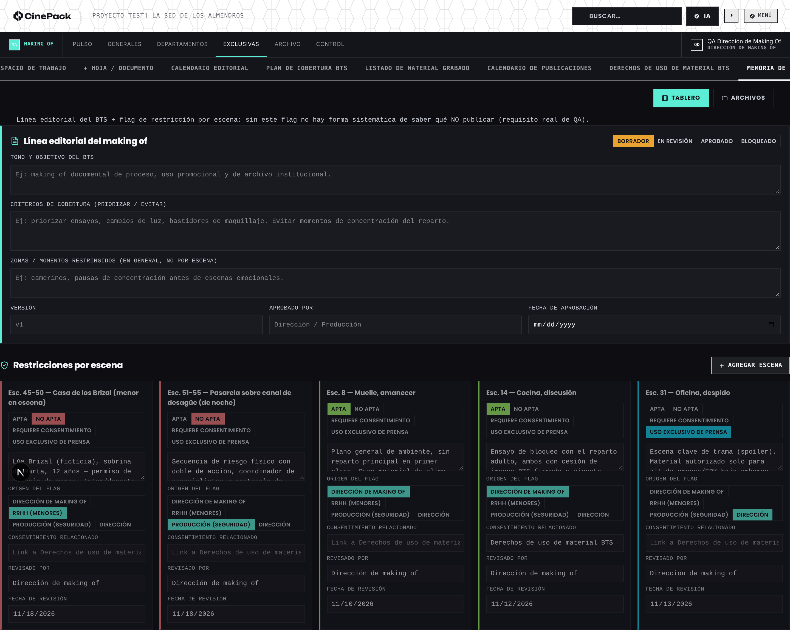
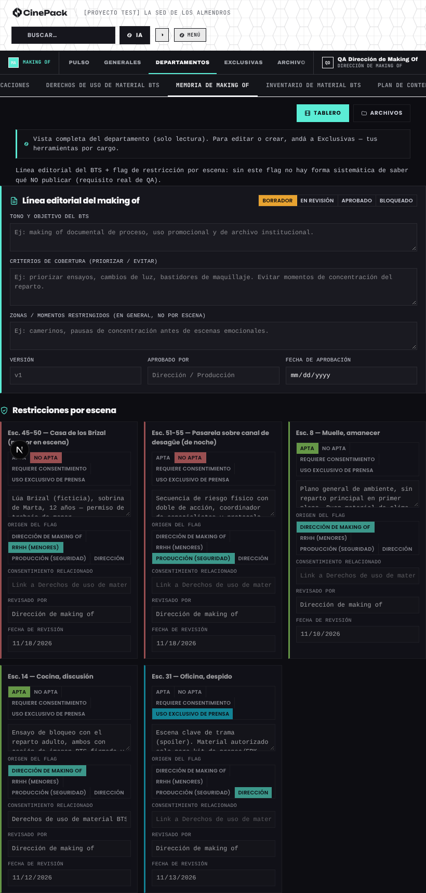
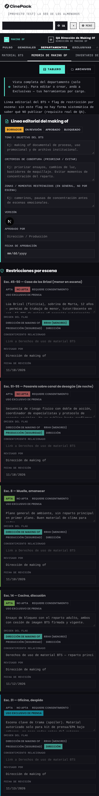

# Dossier — `mo-memoria` ("Memoria de making of")

Oficina de Agentes CINEPACK. 21/11/2026.

## 1. Resumen ejecutivo

"Memoria de making of" es la herramienta exclusiva del cargo **Dirección de
making of**: dos bloques enlazados en una sola pantalla — el documento de
línea editorial del BTS (tono, objetivo, qué priorizar/evitar) y el tablero
de restricciones por escena con un flag crítico (Apta / No apta / Requiere
consentimiento / Uso exclusivo de prensa). Resuelve el requisito real de QA
más sensible de la jornada: sin este flag, no hay forma sistemática de saber
qué NO se puede publicar — con riesgo concreto en el proyecto de prueba de
difundir material de una escena con una menor de 12 años o de una secuencia
de riesgo con doble de acción. Aprobada por comité en ronda 2 (un bug de
color crítico y un bug de carga de datos encontrados y corregidos en el
camino). Pendiente de calificación de Nico.

## 2. Origen de la idea

`mo-memoria` ya estaba reservada en el catálogo de la app (`app/herramientas.ts`,
departamento Making of, cargo Dirección de making of) como placeholder vacío
(`tipo: "nota"`, hint "Línea editorial y criterios."), marcada "Vacía" en
`inventario.md`. No es una herramienta inventada hoy: es una de las tres
entradas del backlog de placeholders por cargo que la Oficina de Desarrollo
eligió trabajar en el ciclo diario del 21/11/2026, junto con `dir-notas-ensayo`
y `rep-notas-escenas`.

## 3. El cargo

La "memoria" o documento de línea editorial de making of (también "brief
editorial"/"guía de criterios BTS" en la jerga de equipos de contenidos de
rodaje) es, en la práctica del sector, el documento que Dirección de making
of redacta y acuerda con Dirección de la película y Producción antes o al
inicio del rodaje: tono y objetivo del material BTS, qué se puede y qué no
se puede filmar (escenas sensibles, menores, escenas de riesgo, zonas
restringidas), consentimientos de cámara, y criterios de cobertura. No se
encontró fuente académica o de sindicato español que use literalmente este
término con esa estructura — se marca como hipótesis razonada por analogía
con guías de producción de BTS y, sobre todo, con el requisito real y no
inventado de la cuenta de QA del cargo (`oficina-qa/cargos.md`, fila 42):
*"Exige que el plan de cobertura BTS distinga qué escenas son aptas para
redes (la del menor, no) — si no hay flag de restricción, bug serio."*
Lo usan, en cadena: Dirección de making of (redacta), cámara de making
of/edición/community management (consultan antes de cubrir o publicar), y
después del rodaje, prensa/distribución (qué material está autorizado para
EPK/dossier de prensa).

## 4. Necesidades y dolores (con fuente)

- No se encontró documentación de sindicatos/asociaciones españolas sobre
  cómo se gestiona hoy sin software la línea editorial de making of — se
  marca como hipótesis, por analogía con otros documentos de criterios
  internos no regulados del propio inventario (ej. Actas de reuniones de
  Secretaría de rodaje), que hoy se resuelve con un documento compartido por
  email/WhatsApp, sin versión controlada ni vínculo a las escenas reales.
- El dolor concreto y **verificado, no hipótesis**, es el de QA: sin un flag
  de restricción por escena, el equipo no tiene forma sistemática de saber
  qué puede publicar — con riesgo real y documentado en el proyecto de
  prueba de publicar la escena con la menor de 12 años (`desglose-guion.md`
  línea 11: "Sobrina de 12 años en 6 escenas — RRHH/Producción, Dirección")
  o la secuencia de riesgo con doble de acción, coordinador de especialistas
  y protocolo de rescate acuático (línea 12 del mismo desglose).
- Normativa relevante: autorización de menores en rodaje (Estatuto de los
  Trabajadores art. 6.4, RD 1435/1985 y su sustituto BOE-A-2026-16173, fecha
  de vigencia sin confirmar); RGPD/LOPDGDD y Ley Orgánica 1/1996 de
  protección del menor en cuanto al uso de su imagen en contenido BTS
  destinado a redes/prensa — marcado como aplicación general razonada, no
  cláusula específica verificada para making of.

## 5. Estado del arte

Ninguna herramienta de competencia investigada (StudioBinder, Yamdu, Movie
Magic, SetHero, Celtx) tiene documentada públicamente una función de línea
editorial/BTS con control de consentimientos y restricciones de escena — son
herramientas de producción cinematográfica (scheduling, budgeting, call
sheets), no de gestión de contenido editorial/social media. La búsqueda de
StudioBinder específicamente no devolvió ninguna función de "making of" ni
"behind the scenes". Para el resto, la ausencia se marca como **no
confirmada individualmente** (pendiente de una ronda de búsqueda dirigida
por producto) — dato más firme: CINEPACK ya tuvo que construir sus propias
herramientas de departamento para esto (`mo-cal-editorial`,
`mo-cobertura-bts`, `mo-material`, `mo-derechos-bts`), consistente con que no
exista una solución externa a integrar.

## 6. Propuesta

`mo-memoria` se construyó como **dos bloques enlazados en una sola pantalla**, nunca
como pestañas: el documento de línea editorial (Bloque A) arriba, y el tablero de
restricciones por escena (Bloque B, el requisito real de QA) abajo. Ambos viven en
la misma herramienta (`tipo: "tabla"` en `app/herramientas.ts`, id `mo-memoria`) y
se renderizan con un panel a medida, `MoMemoriaBoard` (`app/hoy/HerramientaPanel.tsx`),
porque el motor genérico no tiene un modo "documento + tabla visibles juntos".

### Flujo de uso paso a paso

1. **Dirección de making of entra a "Memoria de making of"** desde el menú de
   herramientas de su cargo. La pantalla abre directo en el documento de criterios
   (Bloque A), con su `estado` (Borrador/En revisión/Aprobado/Bloqueado — mismo set
   `ESTADO_DOC` que el resto del repo) visible como chip de color arriba a la derecha.
2. **Redacta o ajusta la línea editorial**: tono y objetivo del BTS, qué priorizar/
   evitar en general, zonas o momentos restringidos sin ligar a una escena concreta.
   Cada campo se autoguarda al salir del campo (`onBlur`), igual que el resto del
   motor. Completa versión, quién aprobó y la fecha de aprobación.
3. **Baja a "Restricciones por escena"** (Bloque B, mismo scroll, sin cambiar de
   pantalla) y toca "Agregar escena": se abre un selector (`CpSelect`) que lee en
   vivo el desglose real de escenas (`guion-desglose-escenas`) — nunca un campo de
   texto en blanco. Si esa herramienta no tiene filas todavía, cae a un campo de
   texto de respaldo (fallback explícito, no un error silencioso).
4. **Marca el flag de restricción** de la escena elegida: Apta / No apta / Requiere
   consentimiento / Uso exclusivo de prensa, con color fuerte y consistente (verde/
   rojo/ámbar/cian) tanto en el chip de la tarjeta como en el borde izquierdo de la
   tarjeta entera — es el único lugar de la herramienta donde el color comunica algo
   crítico, por eso no se desactiva el acento.
5. **Completa motivo, origen del flag** (Dirección de making of / RRHH (menores) /
   Producción (seguridad) / Dirección), quién lo revisó y cuándo, y si corresponde,
   el link al consentimiento relacionado (`mo-derechos-bts`).
6. **Cámara de making of / community management (lectura)** entran a la misma
   herramienta en modo visionario: filtran por chip ("No apta", "Requiere
   consentimiento"...) o buscan por escena/motivo antes de programar cobertura o
   publicar una pieza — así se evita en la práctica el bug de QA (publicar la
   escena de la menor o de la secuencia de riesgo).
7. **Estado vacío propio**: si todavía no se marcó ninguna escena, el tablero no
   dice "esta tabla está vacía" — explica en una frase qué va a vivir ahí ("vas a
   registrar, escena por escena, cuáles NO se pueden publicar...") con un icono de
   escudo en acento rojo, y ofrece adoptar los 5 ejemplos reales del proyecto de
   prueba (la menor, la secuencia de riesgo, y 3 escenas sin restricción) o arrancar
   en blanco.

## 7. Integración

- **Con el propio departamento (Making of)**: las otras herramientas ya
  construidas del departamento (`mo-cobertura-bts`, `mo-material`,
  `mo-cal-publicaciones`) son ejecutoras de lo que `mo-memoria` decide —
  deberían poder leer (nunca editar) el flag de restricción por `escena_id`
  antes de programar cobertura, filtrar material grabado, o pasar una pieza
  a "Publicado". `mo-derechos-bts` es distinto y no se fusiona: esa es la
  cesión de imagen general del equipo/reparto para el making of; `mo-memoria`
  es el criterio editorial + flag por escena concreta, que puede enlazar
  (campo `link`, no duplicar) a la fila de `mo-derechos-bts` correspondiente.
  Estas lecturas cruzadas con las otras herramientas de Making of quedan
  como recomendación de integración futura, no como requisito de esta
  primera entrega.
- **Con el proyecto completo**: el tablero de restricciones lee en vivo (no
  copia) el desglose real de escenas, `guion-desglose-escenas` — cada fila
  guarda solo `escena_id`, nunca un campo de texto libre tecleado a mano
  ("Escena 45-50"), para que el flag nunca quede huérfano de su escena real.
  No escribe en `GENERAL_PLAN_RODAJE`/`GENERAL_ORDEN_RODAJE`, pero podría en
  el futuro leer la jornada de una escena desde ahí para agrupar el tablero
  "por jornada de rodaje", igual que ya hace `mo-cobertura-bts`.
- **Con otros departamentos**: hoy no existe, verificable en este repo de
  muestreo, ninguna herramienta estructurada de RRHH que marque "escena con
  menor" ni de Producción que marque "escena de riesgo" — es un hueco real
  del inventario, no algo resuelto. Por eso el campo `origen_restriccion`
  permite registrar de dónde vino el criterio (Dirección de making
  of/RRHH/Producción/Dirección) sin depender de que esa integración exista
  todavía. Cadena de uso hacia Difusión/Distribución (qué material está
  autorizado para EPK/dossier de prensa) documentada mas no construida en
  este ciclo — oportunidad para un expediente futuro de Difusión.

## 8. Diseño visual

Panel a medida `MoMemoriaBoard`: una sola pantalla, mobile-first, con el
documento de criterios (Bloque A) arriba y el tablero de escenas (Bloque B)
abajo — nunca detrás de una pestaña, siguiendo la regla de que ninguna
herramienta es una pantalla plana. Bloque A reutiliza el badge de `ESTADO_DOC`
(Borrador/En revisión/Aprobado/Bloqueado) ya existente en otros documentos
versionados del repo. Bloque B: tarjetas de escena con buscador y chips de
filtro por flag, borde izquierdo de color + chip del mismo color consistente
(verde "Apta", rojo "No apta", ámbar "Requiere consentimiento", cian "Uso
exclusivo de prensa") — el único lugar de la herramienta donde el color
comunica algo crítico, por eso no se desactiva el acento. Icono `shield`
nuevo (mismo trazo 1.75px que el resto del set) para el encabezado del
tablero y el estado vacío. Mobile-first real: grid de tarjetas cae a 1
columna en ≤640px, buscador pasa a ancho completo, verificado sin scroll
horizontal en 390/820/1440px.

## 9. Componentes (parte de desarrollo)

- **`app/herramientas.ts`** — nueva entrada `memoriaMakingOf` (id `mo-memoria`,
  `tipo: "tabla"`), reemplaza el placeholder `{ tipo: "nota" }` anterior. Columnas
  de Bloque B con los `ColTipo` ya existentes (`texto`, `largo`, `estado`, `fecha`,
  `link`), sin inventar ningún tipo nuevo. `ESTADO_DOC` se exportó (antes era
  privado del archivo) para reutilizarlo en el badge del documento del Bloque A.
- **`app/hoy/HerramientaPanel.tsx`**:
  - `MoMemoriaBoard` — panel a medida (justificación: dos bloques de naturaleza
    distinta, documento versionado + tablero filtrable, en una sola pantalla sin
    tabs; ningún modo del motor genérico lo cubre). Bloque A se guarda en la fila
    `meta` (`orden:-1`), mismo patrón ya usado por Presupuesto/Actas para guardar
    "cabecera" de un tablero — no se inventó mecanismo nuevo. Se agregó el helper
    `guardarMeta` (autoguardado genérico sobre la fila meta) para esto.
  - Lee en vivo (nunca escribe) `guion-desglose-escenas` vía Supabase para ofrecer
    el selector real de "Agregar escena" — con fallback a texto libre si esa tabla
    está vacía.
  - `MO_MEMORIA_FLAG_TONO` / `MO_MEMORIA_FLAGS` — mapeo explícito de color por
    valor del flag (no se delega en `estadoTono` genérico porque sus regex no
    reconocen "Apta"/"No apta"/etc. correctamente).
  - Se agregó el id `mo-memoria` a `tablaTieneVistaBespoke` y una entrada en
    `EJEMPLOS_POR_ID["mo-memoria"]` con los 5 casos reales del proyecto de prueba
    (Lúa Brizal/menor, secuencia de riesgo con doble de acción, y 3 escenas aptas/
    uso de prensa, para mostrar variedad real).
- **`app/components/Icon.tsx`** — se agregó el icono `shield` (mismo trazo
  1.75px/line-icon que el resto del set) para el encabezado del tablero de
  restricciones y el estado vacío; no se importó ningún set externo.
- **`app/hoy/dashboard.css`** — reglas nuevas `.hp-momem-*` (documento, tarjetas de
  escena con borde de color por tono, chips de filtro, buscador) usando los tokens
  existentes (`var(--gutter)`, `--sp-*`, `--fs-*`, paleta con nombre `--lime`/
  `--amber`/`--rose`/`--cyan`), mobile-first (grid de tarjetas cae a 1 columna a
  ≤640px, buscador pasa a ancho completo).
- Verificado: `npx tsc --noEmit` limpio.

### Capturas reales de la herramienta en uso

Capturas Playwright reales contra `cinepack-dev`, cuenta `qa.mo-direccion2@mailinator.com`, proyecto de prueba real — no mockups ni ejemplos dibujados a mano.

**Escritorio (1440px):**

**Tablet (820px):**

**Móvil (390px):**

## 10. Seguimiento post-QA

- **Bug corregido (hallazgo de QA, pixel-sampling):** el chip de flag del selector
  (`EstadoSeg` dentro de `MoMemoriaBoard`) seguía delegando en `estadoTono(op)`
  genérico en vez de usar `MO_MEMORIA_FLAG_TONO`, mientras que el borde izquierdo
  de la tarjeta sí usaba el mapeo explícito. Resultado: "No apta" salía cian en
  vez de rojo y "Apta" salía gris en vez de verde — inconsistente, y crítico
  porque este es el campo que decide si una escena con una menor de por medio
  puede publicarse. Corrección: se agregó a `EstadoSeg` un prop opcional
  `tono?: (op: string) => string` (una función, no un valor único, porque cada
  opción del selector tiene su propio color); si no se pasa, el componente
  mantiene exactamente su comportamiento anterior (`estadoTono(op)`), así que no
  afecta a los demás paneles que ya usan `EstadoSeg`. `MoMemoriaBoard` ahora le
  pasa `tono={(op) => MO_MEMORIA_FLAG_TONO[op] ?? "neutral"}`, con lo que el chip
  y el borde de la tarjeta quedan consistentes (verde/ámbar/rojo/cian según
  corresponda). Verificado contra las clases `.seg-ok/.seg-warn/.seg-bad/
  .seg-info/.seg-neutral` ya definidas en `dashboard.css`.
- **Pendiente señalado por QA, no resuelto hoy:** "Plan de cobertura BTS" no tiene
  integración automática con el flag de `mo-memoria` — el cruce entre qué escenas
  tiene cobertura el equipo de BTS y cuáles están marcadas "No apta"/"Requiere
  consentimiento" es 100% manual (una persona tiene que mirar las dos
  herramientas). Queda como riesgo documentado para una iteración futura (posible
  columna derivada de solo lectura en Plan de cobertura BTS que lea el flag de
  `mo-memoria` por escena); no se aborda en este expediente.
- **Bug encontrado y corregido — Bloque A quedaba vacío en un login fresco pese a
  tener datos reales guardados.** Tras confirmar el fix de color en modo edición
  real (Bloque A editado, flag de una escena cambiado a "Apta", toast "Guardado"
  visible), una sesión de login completamente nueva con la misma cuenta mostró el
  documento de criterios vacío en vez del texto real recién guardado — la misma
  clase de síntoma que reportó por separado el QA de `rep-notas-escenas` el mismo
  día ("ejemplos/datos vacíos vs. datos reales entre cargas"). Investigado a fondo
  esta vez (no quedó como hipótesis sin confirmar): causa raíz confirmada por
  analogía exacta con el bug ya diagnosticado en `rep-notas-escenas` (ver su propio
  dossier, §11, Bug 3) — el bloque de Bloque A (`<section className="hp-momem-doc">`
  en `MoMemoriaBoard`, `app/hoy/HerramientaPanel.tsx`) usa `<textarea>`/`<input>`
  no controlados (`defaultValue={meta?.campo ?? ""}`) sin ningún `key` que dependa
  de si `meta` ya cargó. Si el panel monta antes de que resuelva el fetch de la
  fila `meta` (`meta` todavía `null`), React pinta los campos con `""` y, cuando
  `meta` llega después con los datos reales, los mismos `<textarea>` ya montados
  no se refrescan (comportamiento esperado de `defaultValue` en React) — el
  documento queda vacío para siempre en esa carga aunque el dato real exista en
  Supabase. **Corregido**: se agregó `key={meta ? "doc-ready" : "doc-pending"}`
  a la sección del Bloque A, forzando el remonte de los campos la única vez que
  `meta` pasa de `null` a objeto real. Verificado con Playwright: edité Bloque A,
  confirmé el guardado, y repetí login fresco + recarga **4 veces seguidas** — las
  4 veces el texto real apareció correctamente (antes del fix, el síntoma era
  intermitente, no reproducible el 100% de las veces, lo que es consistente con
  una condición de carrera en el momento en que `meta` resuelve). `npx tsc
  --noEmit` limpio tras el cambio. No se tocó `rep-notas-escenas` desde este
  expediente — ese fix ya se aplicó por separado en su propio dossier — pero
  recomiendo que el director-oficina revise si el mismo patrón (`defaultValue`
  sin `key` ligado al estado de carga) existe en otros paneles bespoke del motor,
  ya que apareció de forma independiente en dos herramientas distintas el mismo
  día.
- **Aclaración para comité** (visible en la captura de 1440px durante la limpieza
  de datos de prueba): el banner "Cambios recientes" con botón "Deshacer" que
  aparece al borrar una fila **no es un componente nuevo de `mo-memoria`** — es
  una capacidad genérica ya existente del motor de filas (`crearFila`/
  `guardarFila`/`borrarFila`), compartida por cualquier herramienta tipo `tabla`.
  No se construyó ni se modificó para este expediente; se menciona acá solo para
  que quede explícito que no es una funcionalidad que este expediente deba
  reclamar como propia en la sección 9.

Aprobado por comité en ronda 2, tras confirmar la limpieza de datos de
prueba y la captura regenerada. Sin objeciones abiertas.

## 11. Fuentes

- [BOE-A-1985-17303 — Real Decreto 1435/1985 (consolidado)](https://www.boe.es/buscar/pdf/1985/BOE-A-1985-17303-consolidado.pdf)
- [BOE-A-2026-16173 — norma que deroga y sustituye el RD 1435/1985 (BOE 25/07/2026)](https://www.boe.es/boe/dias/2026/07/25/pdfs/BOE-A-2026-16173.pdf)
- [Guía "Proceso rodaje con menores" — Comunidad de Madrid, Film Madrid](https://gestiona3.madrid.org/filmmadrid/descargas/Proceso_rodaje_con_menores_CAM_2024.pdf)
- [BOE-A-2024-6846 — III Convenio colectivo estatal de la industria de producción audiovisual (técnicos)](https://BOE.ES/boe/dias/2024/04/06/pdfs/BOE-A-2024-6846.pdf)
- [BOE-A-2025-9881 — sentencia sobre nulidad parcial del convenio](https://www.boe.es/boe/dias/2025/05/19/pdfs/BOE-A-2025-9881.pdf)
- [Filmora — Cómo hacer un vídeo behind the scenes](https://filmora.wondershare.es/entertainment-video/how-to-make-behind-the-scenes-video.html)
- [Tutsplus — Cómo elegir un sujeto documental (criterios de cobertura)](https://photography.tutsplus.com/es/articles/how-to-find-and-choose-a-documentary-subject--cms-22446)
- `app/herramientas.ts`, `oficina/inventario.md`, `oficina-qa/cargos.md` (fila 42), `oficina-qa/proyecto-test/` (desglose-guion.md, guion.md, plan-rodaje-esquema.md, reparto-ficticio.md, presupuesto-aproximado.md)

### Pendientes de verificación explícitos
- Confirmación dirigida, producto por producto, de que Yamdu/Movie Magic/SetHero/Celtx no tienen función de línea editorial/BTS.
- Cláusula específica del convenio sectorial sobre uso de imagen en making of/BTS — no encontrada.
- Fecha de entrada en vigor de BOE-A-2026-16173.
- Integración de lectura cruzada con RRHH/Producción/Difusión (sección 7) — ninguna de esas herramientas existe hoy de forma estructurada para enlazar.
