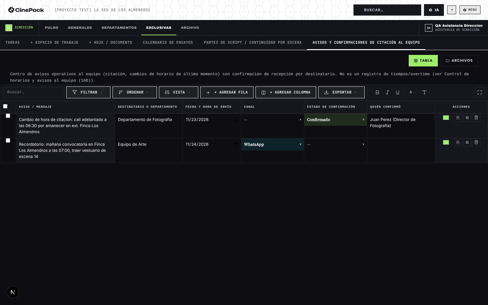
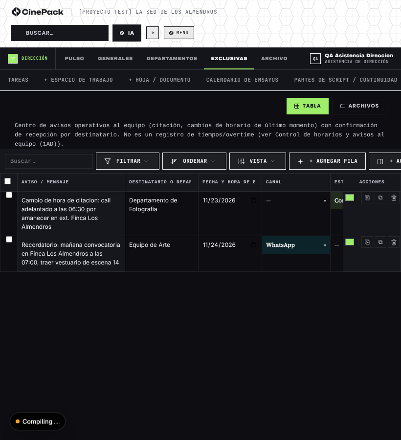
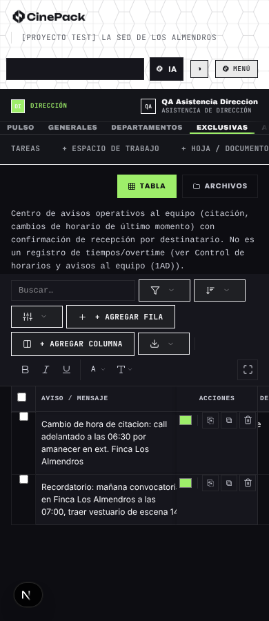

# Dossier — `dir-control-horarios` ("Avisos y confirmaciones de citación al equipo")

Oficina de Agentes CINEPACK. 22/11/2026.

## 1. Resumen ejecutivo

"Avisos y confirmaciones de citación al equipo" es la herramienta exclusiva
del cargo **Asistencia de dirección** (departamento Dirección) para
registrar los avisos operativos que ese cargo emite al equipo — cambios de
horario de última hora, confirmaciones de citación, avisos de transporte —
con seguimiento de canal y de estado de confirmación por destinatario. Se
mantiene el id de código `dir-control-horarios`, que hasta hoy estaba
clasificado como "Vacía": un duplicado sin adaptar del "Control de horarios
y overtime (1AD)". La diferenciación entre ambas herramientas no fusiona
nada: 1AD controla el CÁLCULO de tiempos (wrap por setup, overtime);
Asistencia de dirección gestiona la COMUNICACIÓN del plan hacia el equipo
(avisos, destinatarios, confirmaciones). Son dos flujos de datos de
naturaleza distinta, a diferencia del precedente válido de fusión
Flujo de caja/Presupuesto (dos vistas del mismo dato financiero). QA
encontró un bug de persistencia en las columnas de tipo `estado`
(`canal`, `estado_confirmacion`) —bug del motor genérico, no específico de
esta herramienta—, ya corregido por el desarrollador y reverificado por QA
en segunda pasada: Corte ya no está bloqueado. La decisión de agrupación de
ronda 2 fue **no agrupar**: tabla plana, ordenable por `fecha_envio`,
siguiendo la lectura cronológica real de "qué pasó hoy en orden de
ocurrencia".

## 2. Origen de la idea

La entrada `dir-control-horarios` ("Control de horarios y avisos al
equipo") ya existía en el catálogo de la app (`app/herramientas.ts`, línea
2707, cargo Asistencia de dirección) como placeholder: `tipo: "checklist"`,
sin `hint`, con el mismo nombre que la herramienta de 1AD
(`dir-control-horarios-1ad`, línea 2701) salvo la aclaración "(1AD)". Estaba
marcada "Vacía/duplicado sin adaptar" en `inventario.md` (línea 27). No hay
ningún render específico bajo `app/hoy/` para este id: es un checklist
genérico sin diferenciación real respecto al de 1AD. No es una herramienta
inventada hoy: es una de las entradas del backlog de placeholders por cargo
que la Oficina de Desarrollo eligió trabajar en el ciclo diario del
22/11/2026.

## 3. El cargo

Asistencia de dirección es un escalón del equipo de Dirección distinto de
la 1ª Asistencia de dirección (1AD) y de la 2ª Asistencia de dirección —
esta última ya tiene su propia herramienta separada de figuración en el
inventario de CINEPACK, lo que confirma que cada escalón de asistencia de
dirección tiene en este sistema un foco operativo propio, no intercambiable
mecánicamente con los demás. Mientras 1AD lleva el cómputo de tiempos del
día (wrap de cada setup, horas trabajadas, disparo de alertas de overtime
según convenio), Asistencia de dirección es quien comunica
operativamente el plan hacia el equipo: avisos de citación, cambios de
horario de último momento, y el seguimiento de quién confirmó recibirlos.

## 4. Necesidades y dolores (con fuente)

- El estado actual de la herramienta (checklist genérico, duplicado del
  nombre de 1AD sin adaptar) no permite registrar ni un aviso con
  destinatario, canal o estado de confirmación — no hay hoy ningún lugar en
  CINEPACK donde Asistencia de dirección pueda dejar constancia de a quién
  avisó, por qué canal y si confirmó.
- El término estándar de la industria para este flujo es "call sheet
  distribution" y "crew/cast notifications", con seguimiento de
  "confirmations"/"RSVP" por destinatario — terminología que ya usa
  StudioBinder en la documentación de su propio producto. En español de
  producción audiovisual, consistente con el resto del inventario de
  CINEPACK (que ya usa "orden de rodaje" para el callsheet), la propuesta
  usa "aviso de citación" y "confirmación de recepción/lectura" — no se
  encontró un glosario normativo único en español que fije estos términos
  (los sindicatos no publican uno), por lo que esta terminología es
  coherente con el uso del sector pero no está respaldada por una fuente
  normativa española específica.
- No se encontró fuente española (sindicato, foro profesional) que
  documente cómo maneja hoy sin software esta comunicación Asistencia de
  dirección en particular — marcado explícitamente como ausencia de
  fuente, no como hallazgo inventado.

## 5. Estado del arte

**StudioBinder** ya resuelve una necesidad equivalente, como referencia de
diseño de un competidor directo: su sistema de distribución de orden de
rodaje permite enviar la orden por email/SMS, ver qué destinatarios la
abrieron ("read tracking") y cuáles no, y que el equipo confirme sin cuenta
("RSVP directly from the email without needing an account") (StudioBinder,
"Call Sheet Confirmations Have Arrived", consultado 22/11/2026). El propio
fabricante describe este sistema de seguimiento de apertura y confirmación
como una mejora reciente de su producto (StudioBinder, "new features reach
your crews inbox with more confidence", consultado 22/11/2026). Su guía de
mejores prácticas de distribución de callsheet recomienda, como práctica
estándar del sector, pedir confirmación de recepción en el cuerpo del email
y enviar en PDF de solo lectura (StudioBinder, "5 best practices for
distributing call sheets", consultado 22/11/2026). No se encontraron
reseñas independientes (de terceros) que confirmen el funcionamiento real
de este sistema de confirmaciones en producción.

Esto no significa que CINEPACK no deba construirlo: es una referencia que
ya valida la necesidad y refuerza que las columnas `estado_confirmacion`
(Pendiente/Confirmado/No leído) y `confirmado_por` propuestas están
alineadas con el estado del arte del sector.

No se encontró evidencia de un módulo equivalente documentado para Yamdu,
Movie Magic, SetHero o Celtx en las búsquedas realizadas — se marca como
"sin evidencia encontrada", no como "confirmado que no lo tienen".

### Normativa española aplicable

El convenio de referencia es el III Convenio colectivo estatal de la
industria de producción audiovisual (técnicos), BOE del 6/04/2024
(BOE-A-2024-6846). Su artículo 17.2.a) regulaba las alteraciones de
horario sobre planes de trabajo ya establecidos, exigiendo un aviso
previo mínimo de 48 horas a las personas afectadas. **Hallazgo
relevante para el diseño**: la Audiencia Nacional, en sentencia del
21/04/2025, declaró nulo por ilegalidad ese artículo 17.2.a), en un
procedimiento promovido por TACE; existe además una demanda adicional de
CGT de enero de 2025 contra el mismo convenio (Resolución del 5/05/2025,
BOE del 19/05/2025: BOE-A-2025-9881). A fecha de este ciclo, el plazo de
48 horas de preaviso **no es exigible** según este fallo judicial, aunque
la situación puede ser objeto de recurso o renegociación. Por eso la
herramienta no debe "hardcodear" un plazo legal de preaviso como
validación obligatoria: el campo de fecha de envío es de registro libre,
no una regla de negocio basada en un plazo legal actualmente anulado.

## 6. Propuesta

"Avisos y confirmaciones de citación al equipo" resuelve una sola pregunta
cada vez que Asistencia de dirección la abre: **¿a quién avisé, por qué
canal, y quién me confirmó?** No es un registro de tiempos (eso lo
conserva 1AD en `dir-control-horarios-1ad`, fuera del alcance de este
ciclo) — es un centro de avisos con estado de lectura/confirmación por
destinatario.

### Estructura de columnas

| key | label | tipo |
|---|---|---|
| `mensaje` | Aviso / mensaje | texto |
| `destinatario` | Destinatario o departamento | texto |
| `fecha_envio` | Fecha y hora de envío | fecha |
| `canal` | Canal | estado (WhatsApp, Llamada, Presencial, Callsheet) |
| `estado_confirmacion` | Estado de confirmación | estado (Pendiente, Confirmado, No leído) |
| `confirmado_por` | Quién confirmó | texto |

Son exactamente los tipos de columna ya existentes (`ColTipo`), sin tipo
nuevo. Se confirma la propuesta sin cambios de columnas.

### Decisión de agrupación (ronda 2)

Columnas candidatas evaluadas: `canal` o `destinatario`. **Decisión: NO
agrupar — tabla plana, cronológica por `fecha_envio`.** El caso de uso
primario documentado es "qué mandé/qué cambió hoy", en orden de ocurrencia
de la jornada, no "qué le falta confirmar a cada persona" (esa necesidad
secundaria ya está cubierta por la columna `estado_confirmacion` visible en
la misma fila, sin necesitar agrupación). Agrupar por `destinatario`
rompería la lectura cronológica: un cambio de horario y el aviso de
transporte relacionado, enviados con minutos de diferencia a personas
distintas, quedarían en bloques separados en vez de seguirse en la
secuencia real del día. Agrupar por `canal` tiene aún menos sentido de
uso real. Si en un ciclo futuro se confirma que el cargo necesita con
frecuencia la vista "qué le falta confirmar a cada destinatario" como
tarea recurrente, se podría reconsiderar `agruparPor: "destinatario"` — hoy
no hay esa confirmación, así que se mantiene tabla plana, sin cambio de
código.

### Por qué conserva el id y no se fusiona con 1AD

Se mantiene el id de código `dir-control-horarios` (no se crea uno nuevo):
el nombre visible al usuario vive en los `messages/*.json`, no en el id,
así que renombrar el contenido sin tocar el id no rompe nada. Cambiar el id
obligaría a migrar filas existentes sin beneficio real, con cero filas de
producción reales todavía. Se descarta expresamente la fusión con
`dir-control-horarios-1ad`: mezclaría dos flujos de datos con columnas de
naturaleza distinta (tiempos vs. destinatarios/confirmaciones), a
diferencia del precedente válido de Flujo de caja/Presupuesto (dos vistas
del mismo dato financiero). Si en un futuro ciclo se decide fusionar,
habría que introducir una columna discriminadora (`tipo_registro`:
"Tiempo" | "Aviso") y permisos distintos por fila — queda documentado como
alternativa viable, no implementada hoy.

## 7. Integración

### Nivel 1 — con el propio departamento (Dirección)
`dir-control-horarios-1ad` (1AD, fuera del alcance de hoy) registra
eventos de TIEMPO, no avisos; no comparte filas ni columnas con
`dir-control-horarios`: son dos `herramienta_id` distintos en
`herramienta_filas`, sin relación de clave. No hay otras herramientas de
departamento Dirección que compartan datos con esta tabla de avisos.

### Nivel 2 — con el proyecto en su conjunto
No escribe en `GENERAL_CALENDARIO`/`GENERAL_PLAN_RODAJE`/
`GENERAL_ORDEN_RODAJE` de forma automática. Asistencia de dirección suele
avisar sobre cambios que SÍ están en esos registros de planificación, pero
el aviso en sí (`mensaje`, `destinatario`, `canal`) es un registro de
comunicación, no un dato de planificación — no corresponde escribirlo ahí.
Pregunta abierta para un ciclo futuro: una columna opcional
`referencia_jornada` (texto o link a la fila de Orden de rodaje) para
trazabilidad bidireccional — no se agrega hoy por falta de necesidad
confirmada por el cargo.

### Nivel 3 — con otros departamentos
Es, por naturaleza, transversal: los destinatarios de los avisos son
personas/departamentos de todo el equipo (campo `destinatario`), no solo
Dirección. Un jefe de Fotografía debería poder ver los avisos donde
`destinatario` lo mencione a él o a su departamento. Esto no se resuelve
con RLS por departamento: la RLS base de `herramienta_filas` ya da lectura
a cualquier miembro del proyecto, así que cualquier cargo ya puede leer
esta tabla sin cambios adicionales de permisos. Lo que falta es solo de
presentación: un filtro en el panel de "Hoy" de cada cargo que muestre
"avisos dirigidos a mí/mi departamento" — responsabilidad del
desarrollador de UI, no del modelo de datos ni de RLS.

### Permisos
- **Edita**: Asistencia de dirección (RLS base por departamento).
- **Ve, no edita**: 1AD y resto del equipo — lectura abierta ya cubierta
  por la RLS base; no se necesita entrada nueva en
  `herramienta_asignaciones`.
- **Espacio**: 100% común del proyecto — un aviso de citación no tiene
  sentido como nota privada de cargo.

### Librerías
Sin necesidad de librería externa — tabla estándar del motor genérico
(`HerramientaPanel.tsx`), igual que `prod-transporte`.

## 8. Diseño visual

`tipo: "tabla"` sobre el motor genérico (`HerramientaPanel.tsx`), sin panel
a medida: las seis columnas (`mensaje`, `destinatario`, `fecha_envio`,
`canal`, `estado_confirmacion`, `confirmado_por`) se renderizan con los
componentes estándar ya existentes para columnas `texto`, `fecha` y
`estado` (`CpSelect` para los dos dropdowns). Usa los tokens reales del
sistema de diseño, igual que el resto de la app. La tabla tiene scroll
horizontal interno propio (`.hp-table-wrap`, patrón estándar del motor para
tablas anchas) sin provocar scroll horizontal de página en ningún ancho.

## 9. Componentes (implementación)

- **Definición de la herramienta** — `app/herramientas.ts`: se conserva el
  id `dir-control-horarios` (línea 2707), cargo Asistencia de dirección;
  `tipo: "tabla"` con las seis columnas documentadas en la sección 6.
  `dir-control-horarios-1ad` (línea 2701, cargo 1AD) no se toca.
- **Traducciones** — `messages/{es,en,ca}.json`: se actualiza la cadena de
  nombre visible de `dir-control-horarios` a "Avisos y confirmaciones de
  citación al equipo" en los 3 idiomas; el id de código no cambia.
- **Render**: sin panel a medida — reutiliza el motor genérico de tabla
  (`HerramientaPanel.tsx`) ya usado por cualquier herramienta `tipo:
  "tabla"`, incluyendo la columna `estado` vía `CpSelect`.
- **Documentación de oficina**: `inventario.md` (línea 27) pasa de
  "Vacía/duplicado" a "necesidad definida y construida: centro de avisos de
  citación".

### Capturas reales de la herramienta en uso

Capturas Playwright reales contra `cinepack-dev` real, cuenta
`qa.dir-asistencia2@mailinator.com`, proyecto de prueba `[PROYECTO TEST]
La sed de los almendros` — no mockups ni ejemplos dibujados a mano.

**Escritorio (1440px):**

**Tablet (820px):**

**Móvil (390px):**

## 10. QA (22/11/2026)

Verificado contra `cinepack-dev` real (`npm run dev -- -p 3501`,
`NODE_USE_ENV_PROXY=1`), cuenta `qa.dir-asistencia2@mailinator.com`,
proyecto `[PROYECTO TEST] La sed de los almendros`, Playwright con
Chromium real (sin mockups). Perfil del usuario de prueba ya estaba
completo, no hizo falta self-update.

**Funcional:** golden path confirmado — tabla vacía → "+ Agregar primera
fila" → 2 filas con datos reales (aviso de cambio de call, destinatario,
fecha, canal, estado, confirmado por). Columnas confirmadas exactamente
como en la arquitectura. Texto, destinatario y fecha persisten
correctamente tras reload. Caso límite probado: fila con solo el campo
"mensaje" completado — no bloquea, guarda igual.

**BUG encontrado (motor genérico, no específico de esta herramienta):**
las columnas tipo `estado` (`canal`, `estado_confirmacion`) no persistían
su valor en la base de datos, pese a que la UI mostraba el valor
seleccionado hasta recargar. Confirmado directamente contra la tabla
`herramienta_filas` en Supabase. Causa ubicada en
`app/hoy/HerramientaPanel.tsx`, `CeldaConAutocomp` (columnas `tipo ===
"estado"`, línea ~2068): `CpSelect` llamaba `onChange(v)` seguido
síncronamente de `onCommit()`, y como `setDraft` no se aplica de forma
síncrona, `commit(f)` leía `draft[f.id]` todavía sin el valor recién
elegido, perdiendo el cambio. Se reprodujo también, de forma
independiente, en `prod-checklist-vehiculos` ("Nivel de combustible" y
"Estado del vehículo"), confirmando que es un bug del motor, no de esta
herramienta en particular.

**Riesgo abierto al momento del hallazgo:** el bug bloqueaba el uso real
de "Canal" y "Estado de confirmación" — ambas columnas centrales del
propósito de la herramienta. No se recomendaba Corte hasta la corrección y
reverificación de QA.

**Reverificación post-fix (22/11/2026, commit `56fa4f8`):** el
desarrollador aplicó el mismo patrón ya usado para la columna `fecha`
(commit `4d0d5b0`) — el `CpSelect` de columnas `estado` ahora guarda vía
`onSave` con el valor nuevo pasado directo, sin depender de que `draft` ya
esté actualizado. Verificado en vivo con Playwright: se editaron `canal` y
`estado_confirmacion` en la misma fila en sucesión rápida (el escenario
exacto que antes perdía la primera edición), con reload + re-navegación, y
ambas columnas persisten correctamente. `npx tsc --noEmit` y `npx next
build --webpack` limpios tras el fix. **Corte ya no bloqueado por este
motivo.**

**Responsive (los 3 anchos probados interactuando, no solo mirando
capturas):**
- **390px:** sin scroll horizontal de página (confirmado por script); la
  tabla tiene su propio scroll horizontal interno (`.hp-table-wrap`,
  patrón estándar, no un bug). Se agregó una fila nueva y se editó una
  celda de texto en este ancho sin problemas.
- **820px:** sin scroll horizontal de página, tabla completa visible con
  menos scroll interno que en 390px.
- **1440px:** sin scroll horizontal, tabla completa visible sin scroll
  interno.
- `qa_responsive_ok: true` para esta herramienta (el bug de persistencia
  de `estado` fue funcional, no responsive).

## 11. Fuentes

- [StudioBinder — "Call Sheet Confirmations Have Arrived"](https://studiobinder.com/call-sheet-confirmations-have-arrived-at-studio-binder)
- [StudioBinder — "new features reach your crews inbox with more confidence"](https://studiobinder.com/blog/new-features-reach-your-crews-inbox-with-more-confidence)
- [StudioBinder — "5 best practices for distributing call sheets"](https://www.studiobinder.com/blog/5-best-practices-for-distributing-call-sheets)
- [BOE — III Convenio colectivo estatal de la industria de producción audiovisual (técnicos), BOE-A-2024-6846](https://BOE.ES/boe/dias/2024/04/06/pdfs/BOE-A-2024-6846.pdf)
- [BOE — Resolución de 5 de mayo de 2025, sentencia de la Audiencia Nacional sobre el art. 17.2.a) del convenio, BOE-A-2025-9881](https://www.boe.es/boe/dias/2025/05/19/pdfs/BOE-A-2025-9881.pdf)
- [Panorama Audiovisual — "Claves del III Convenio Colectivo de Técnicos de la Industria Audiovisual"](https://www.panoramaaudiovisual.com/en/2024/04/23/claves-iii-convenio-colectivo-tecnicos-industria-audiovisual)
- `app/herramientas.ts`, `oficina/inventario.md`, `oficina/cola-merge.md` — verificación del estado actual y del precedente de fusión Flujo de caja/Presupuesto.

### Pendientes de verificación explícitos
- No se encontró glosario normativo español que fije "aviso de citación"/
  "confirmación de recepción" como terminología oficial — propuesta
  coherente con el uso del sector, no respaldada por fuente normativa
  específica.
- Evidencia de módulos equivalentes en Yamdu, Movie Magic, SetHero o Celtx
  — no localizada, marcada como "sin evidencia encontrada", no como
  "confirmado que no lo tienen".
- Cruce de lectura con `GENERAL_ORDEN_RODAJE`/`GENERAL_CALENDARIO` vía una
  futura columna `referencia_jornada` — pregunta abierta para un ciclo
  futuro, sin confirmación del cargo todavía.
