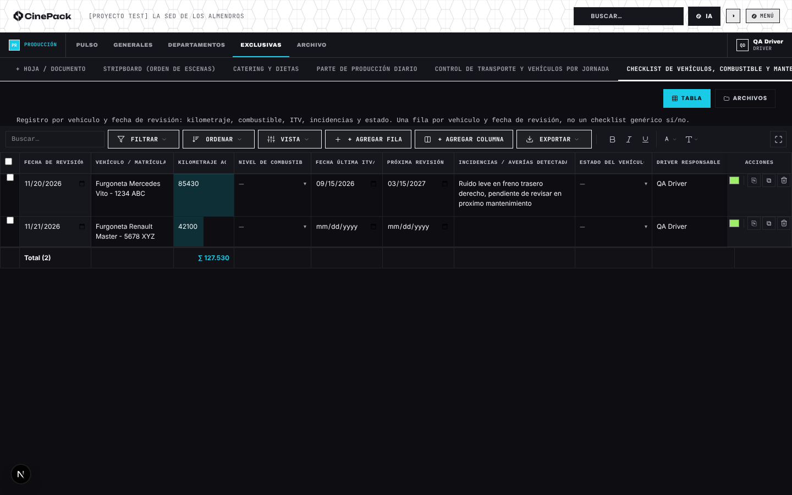
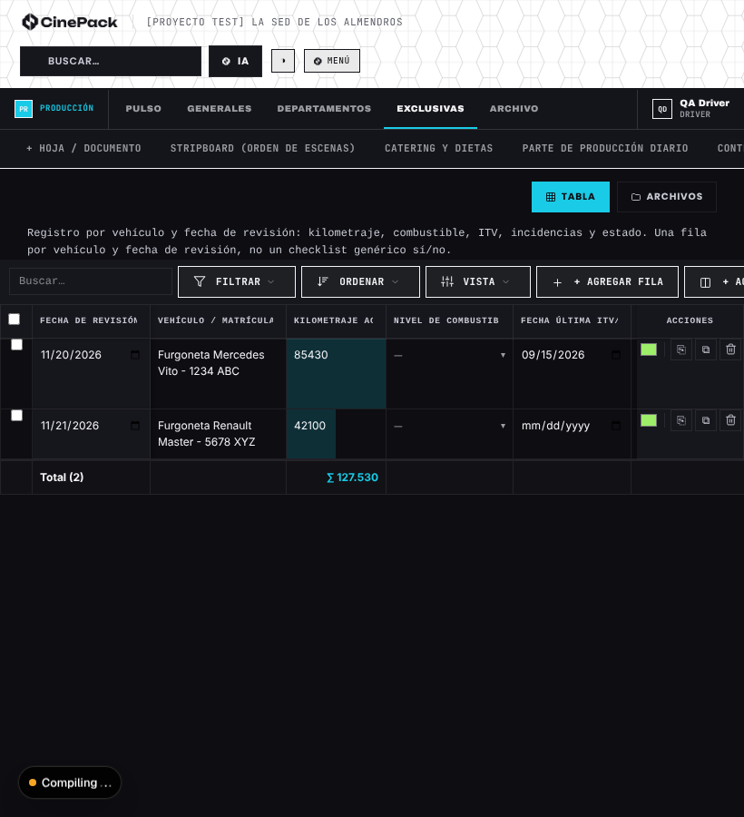
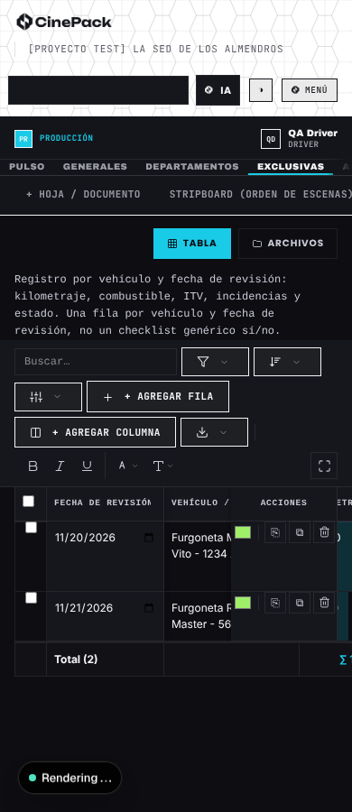
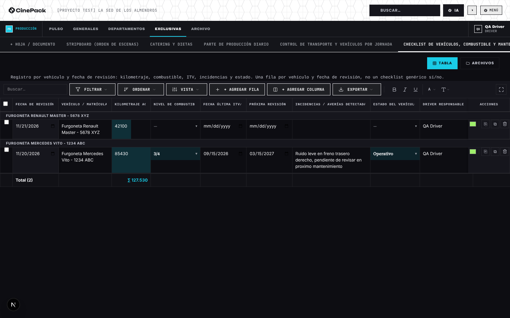

# Dossier — `prod-checklist-vehiculos` ("Checklist de vehículos, combustible y mantenimiento")

Oficina de Agentes CINEPACK. 22/11/2026.

## 1. Resumen ejecutivo

"Checklist de vehículos, combustible y mantenimiento" es la herramienta
del cargo **Driver** (departamento Producción) para llevar un registro
real de estado mecánico, combustible e ITV **por vehículo y por fecha de
revisión** — algo que la entrada original, un `checklist` booleano
genérico sin estructura de datos propia, no permitía en absoluto. Se
transformó en una tabla de 10 columnas (`fecha`, `vehiculo`,
`kilometraje`, `combustible`, `ultima_itv`, `proxima_revision`,
`incidencias`, `estado`, `responsable`, `foto`), agrupada por `vehiculo`
en la ronda 2 de arquitectura para que el historial completo de una misma
unidad de flota se vea de un vistazo. QA encontró y confirmó corregido un
bug crítico de persistencia en las columnas tipo `estado` (mismo bug que
en `dir-control-horarios`), reverificado en vivo tras el fix. Aprobado por
comité de calidad en ronda 2, sin objeciones pendientes.

## 2. Origen de la idea

La entrada `prod-checklist-vehiculos` ya existía en el catálogo
(`app/herramientas.ts`, cargo Driver) como `{ id:
"prod-checklist-vehiculos", nombre: "Checklist de vehículos, combustible
y mantenimiento", tipo: "checklist" }` — un `checklist` sin `columnas` y
sin `hint`, es decir una lista de ítems booleanos genérica, sin identidad
de vehículo, sin fecha ni kilometraje. No permitía llevar ningún registro
real por vehículo ni en el tiempo. No es una herramienta inventada hoy:
es una de las entradas del backlog de placeholders por cargo trabajada en
el ciclo diario del 22/11/2026.

## 3. El cargo y la necesidad real

El Driver, al cierre de cada jornada o en cada revisión, controla en la
práctica: qué vehículo es (identificación/matrícula), cuándo fue la
última revisión/ITV y cuándo toca la próxima, el kilometraje actual, el
nivel de combustible al cierre de jornada, incidencias detectadas
(ruidos, luces, frenos, daños, en texto libre) y el estado general de
disponibilidad del vehículo (operativo, en taller, fuera de servicio).
Nada de esto es representable en un checklist booleano genérico. La
observación que cristalizó el cambio vino de QA (`qa-prod-driver`): "un
checklist con fecha de última revisión de cada vehículo, no solo un sí/no
genérico".

### Relación con otras herramientas de Producción (sin duplicar)

- **Control de transporte y vehículos** (`prod-transporte`, Consolidada,
  Logística/Jefatura de producción): registra **viajes** por jornada —
  fecha, vehículo/matrícula, conductor, pasajeros, origen, destino, horas,
  estado del viaje. Es un *trip sheet*, no un registro de estado mecánico.
  No hay solapamiento de campos: `prod-checklist-vehiculos` se centra en
  el estado del vehículo, no en el viaje.
- **Parte de producción diario** (`prod-parte-diario`, Consolidada):
  incidencias generales del día de rodaje, no detalle de mantenimiento
  vehicular.
- La columna `vehiculo` reutiliza el mismo label ("Vehículo / Matrícula")
  ya usado en `prod-transporte`, por coherencia de nomenclatura.

## 4. Estado del arte y normativa (con fuentes)

El rol que coordina la flota de un rodaje se llama en inglés
"Transportation Captain" (o Transportation Coordinator), que lidera
transportation managers y drivers, gestiona recogidas de reparto y
despliega vehículos/conductores para mantener el rodaje en calendario y
presupuesto (Broadway Stages, "Industry Jobs | Transportation Captain";
Broadway Stages, "Driving Production Forward: The Role of a
Transportation Captain in Film and TV"). No se encontró, sin embargo, un
término único y estandarizado para el documento de registro de estado del
vehículo: lo más cercano documentado es el "Record of Duty Status"
(RODS), que en EE. UU. registra horas de conducción (de/fuera de
servicio), no estado mecánico/combustible (CSATF, "LMS HOS FAQ"; FMCSA,
exención de registro electrónico de horas de servicio para producción
cinematográfica). No se encontró plantilla sectorial publicada de
"vehicle log"/"fleet maintenance" específica de producción audiovisual —
las columnas propuestas (kilometraje, combustible, ITV, incidencias) se
marcan como hipótesis de diseño por analogía con registros de flota
genéricos, no como estándar confirmado.

No se encontró en StudioBinder, Yamdu, Movie Magic, SetHero ni Celtx
documentación de una herramienta específica de checklist/registro de
estado de vehículo para Driver/Transportation Captain — hueco de mercado
no cubierto por ninguno de los competidores investigados, dentro de lo
verificable por fuente abierta.

**Normativa española de ITV**: la inspección técnica de vehículos se rige
por el Real Decreto 920/2017, que transpone la Directiva 2014/45/UE y
deroga el régimen de los RD 2042/1994 y 224/2008 (BOE-A-2017-12841).
Según Fundación Mapfre, los vehículos de alquiler (con o sin conductor —
relevante porque muchas productoras alquilan furgonetas para rodaje) hoy
equiparan su periodicidad de ITV a la de su categoría, sin régimen propio
diferenciado, a diferencia del régimen de 1994 que sí fijaba plazos
específicos para vehículos de alquiler de hasta nueve plazas. No se
localizó el anexo concreto del RD 920/2017 con la tabla de periodicidades
vigente por categoría — para plazos exactos de una furgoneta de
producción habría que consultar ese anexo directamente en el BOE. La
gestión de las estaciones ITV depende de cada Comunidad Autónoma.
Implicación de diseño: `proxima_revision` debe registrarse según la
categoría del vehículo, no con una periodicidad fija universal. No se
encontró normativa española de PRL específica para checklists de
mantenimiento de vehículos de rodaje más allá de la normativa general de
seguridad vial y de uso de vehículos de empresa.

## 5. Propuesta de columnas

Tipo `tabla` (reemplaza `checklist`), una fila por vehículo y fecha de
revisión, con los tipos de columna ya existentes (`ColTipo`), sin tipo
nuevo:

| key | label | tipo |
|---|---|---|
| `fecha` | Fecha de revisión | fecha |
| `vehiculo` | Vehículo / Matrícula | texto |
| `kilometraje` | Kilometraje actual | num |
| `combustible` | Nivel de combustible al cierre | estado (Lleno, 3/4, 1/2, 1/4, Vacío) |
| `ultima_itv` | Fecha última ITV/revisión técnica | fecha |
| `proxima_revision` | Próxima revisión programada | fecha |
| `incidencias` | Incidencias / averías detectadas | largo |
| `estado` | Estado del vehículo | estado (Operativo, En taller, Fuera de servicio) |
| `responsable` | Driver responsable | texto |
| `foto` | Foto de incidencia/estado | archivo |

## 6. Arquitectura

### Decisión sobre el id

Se mantiene `prod-checklist-vehiculos` como id de código, aunque deja de
ser conceptualmente un checklist (pasa a `tipo: "tabla"`) — mismo
razonamiento que para `dir-control-horarios`: el id es un slug interno no
mostrado al usuario, no hay render acoplado al nombre "checklist", y la
herramienta está Circunstancial/sin filas reales todavía. Renombrar el id
a algo como `prod-registro-vehiculos` queda documentado como alternativa
cosmética de bajo riesgo, no aplicada hoy.

### Clave `vehiculo`: coherencia de nombre, sin normalización forzada

`vehiculo` comparte label y tipo (`texto`) con `prod-transporte` por
convención de nomenclatura, pero **no es clave foránea real ni tabla
normalizada**: el motor genérico `herramienta_filas` guarda cada fila
como `datos jsonb` dentro de su propia herramienta, y no hay mecanismo de
FK entre filas de herramientas distintas en el esquema actual (las
integraciones cruzadas existentes, p. ej.
`app/api/plan-financiacion/sincronizar-hito/route.ts`, usan un endpoint
ad-hoc por `id` de fila, no FK de Postgres). Introducir una tabla
`vehiculos` normalizada sería una migración nueva, descartada hoy porque
el volumen real de una flota de rodaje es pequeño y la consistencia
manual de texto libre es suficiente. Riesgo documentado: inconsistencia
de texto libre ("Furgo 1" vs. "Furgoneta 1") entre personas distintas —
mitigable a futuro con un selector precargado desde los vehículos ya
usados en `prod-transporte`, sin migración, pero queda como mejora de UI
para otro ciclo.

### Integración en 3 niveles

- **Nivel 1 — departamento (Producción)**: no se solapa con
  `prod-transporte` (trip sheet por jornada) ni con el Parte de
  producción diario (incidencias generales); comparten solo la
  convención de nombre de la columna `vehiculo`, sin lectura/escritura
  cruzada automática. Una avería grave (`estado = Fuera de servicio`)
  podría ameritar que el Driver también la reporte en el parte diario,
  pero es un paso manual del usuario, no una sincronización.
- **Nivel 2 — proyecto completo**: no escribe en
  `GENERAL_PLAN_RODAJE`/`GENERAL_ORDEN_RODAJE`/`GENERAL_CALENDARIO` — es
  un registro de mantenimiento de flota, no un dato de planificación de
  rodaje. Si un vehículo queda fuera de servicio y eso afecta el plan de
  transporte, es Logística/Jefatura de producción quien actúa
  manualmente; no hay puente automático propuesto hoy.
- **Nivel 3 — otros departamentos/cargos**: Jefatura de producción y
  Logística deberían poder **ver** la tabla para anticipar vencimientos
  de ITV o vehículos fuera de servicio antes de planificar transporte —
  resuelto con una entrada en `herramienta_asignaciones` con nivel "ver",
  igual patrón que `prod-tareas-admin`, sin RLS nuevo. Ningún otro
  departamento necesita verla de forma estructural.

### Permisos y espacio

Edita: Driver (RLS base por departamento/cargo). Ve, no edita: Jefatura
de producción / Logística, vía `herramienta_asignaciones` (nivel "ver").
Espacio: 100% común del proyecto — el estado del vehículo debe ser
visible a quien decide si sale a rodar.

### Librerías

Sin librería externa — tabla estándar del motor genérico, misma base que
`prod-transporte`, incluida la columna `archivo` para `foto` (componente
de subida ya existente en otras herramientas del motor; si el desarrollador
no encuentra un componente reutilizable queda como pregunta abierta a
resolver antes de implementar).

## 7. Decisión de agrupación (ronda 2)

**Columnas candidatas:** `vehiculo` o `estado`.

**Decisión: sí agrupar, por `vehiculo`** —
`agruparPor: "vehiculo"` en la definición de `prod-checklist-vehiculos`
en `app/herramientas.ts`.

El caso de uso real del Driver es revisar el historial completo de
mantenimiento/combustible de una misma unidad de flota de un vistazo —
por ejemplo antes de asignar una furgoneta a un trayecto, ver todas sus
revisiones, ITV y última incidencia juntas, igual que "Checklist de
mezcla y masterización" agrupa por fase de proceso. Con flota pequeña y
filas que se acumulan por fecha, una tabla plana ordenada solo por fecha
mezclaría las revisiones de distintas unidades, obligando a escanear toda
la tabla para reconstruir el historial de un vehículo concreto.

Se descartó `estado` como eje de agrupación: aunque "ver de un vistazo
qué está Fuera de servicio/En taller" es una necesidad real, es una
necesidad puntual de triage mejor resuelta con un filtro/orden por
`estado` o un indicador visual en la fila — agrupar toda la tabla por ese
eje dispersaría el historial de una misma unidad entre varios grupos cada
vez que cambia de estado, justo el problema que se busca evitar
agrupando. `vehiculo` es el eje estable; `estado` cambia con cada revisión
y no debe ser el criterio de agrupación.

**Tarea para el desarrollador:** agregar `agruparPor: "vehiculo"` a la
definición de `prod-checklist-vehiculos` en `app/herramientas.ts` (mismo
mecanismo declarativo ya usado por "Checklist de mezcla y
masterización", sin lógica nueva en `HerramientaPanel.tsx`).

## 8. Capturas reales de la herramienta en uso

Capturas Playwright reales contra `cinepack-dev`, cuenta
`qa.prod-driver2@mailinator.com`, proyecto de prueba real `[PROYECTO
TEST] La sed de los almendros` — no mockups ni ejemplos dibujados a mano.

**Escritorio (1440px), tabla plana:**

**Tablet (820px):**

**Móvil (390px):**

**Escritorio (1440px), agrupado por `vehiculo` (ronda 2):**

## 9. QA

QA verificado 22/11/2026 contra `cinepack-dev` real (`npm run dev -- -p
3501`, `NODE_USE_ENV_PROXY=1`), cuenta `qa.prod-driver2@mailinator.com`,
Playwright con Chromium real, sin mockups.

**Funcional**: confirmadas las 10 columnas exactamente según la
arquitectura. Fila 1 con kilometraje numérico (85430, con suma en el pie
de tabla — `Σ 85.430`), fecha última ITV, próxima revisión, incidencias
en texto libre, responsable y **foto adjunta** (subida real confirmada
con miniatura + nombre de archivo). Fila 2 con solo un subconjunto de
columnas completado — campos vacíos no bloquean el guardado. Texto,
fecha, número y foto persisten correctamente tras reload.

**BUG encontrado (mismo bug que en `dir-control-horarios`)**: las
columnas tipo `estado` (`combustible` y `estado` del vehículo) no
persistían — confirmado contra `herramienta_filas` en Supabase, el valor
del dropdown quedaba ausente del JSON `datos` tras guardar, tanto en
fila nueva como existente. Bug del motor genérico de tabla
(`HerramientaPanel.tsx`, `CeldaConAutocomp` para `tipo === "estado"`), no
de esta herramienta en particular.

**Reverificación post-fix (commit `56fa4f8`)**: corregido en
`HerramientaPanel.tsx` con el mismo patrón `onSave` ya usado para la
columna `fecha` (commit `4d0d5b0`). Verificado en vivo: `combustible` y
`estado` editados en la misma fila en sucesión rápida, reload + nueva
navegación, ambas columnas persisten correctamente. `npx tsc --noEmit` y
`npx next build --webpack` limpios tras el fix. **Corte ya no bloqueado
por este motivo.**

**Responsive** (390/820/1440px, interactuando, no solo capturas): sin
scroll horizontal de página en ningún ancho; tabla con scroll interno
propio (`.hp-table-wrap`). En 390px se agregó una fila, se editó una
celda de texto y se borró la fila de prueba sin problemas.
`qa_responsive_ok: true`.

## 10. Fuentes

- Broadway Stages, "Industry Jobs | Transportation Captain" — https://www.broadway-stages.com/news/2021/11/30/industry-jobs-what-is-a-transportation-captain (consultado 22/11/2026)
- Broadway Stages, "Driving Production Forward: The Role of a Transportation Captain in Film and TV" — https://www.broadway-stages.com/newsletter-articles-uploads/2025/6/12/47nmzdbi50azn3lavyp10bxnkush6v (consultado 22/11/2026)
- CSATF, "LMS HOS FAQ" — https://csatf.org/LMS_hos_faq (consultado 22/11/2026)
- FMCSA, exención de ELD para producción cinematográfica — https://www.fmcsa.dot.gov/newsroom/hours-service-drivers-application-exemption-motion-picture (consultado 22/11/2026)
- BOE, Real Decreto 920/2017 (ITV) — https://www.boe.es/boe/dias/2017/11/08/pdfs/BOE-A-2017-12841.pdf (consultado 22/11/2026)
- Administración.gob.es, ficha ITV — https://administracion.gob.es/pag_Home/gl/Tu-espacio-europeo/derechos-obligaciones/ciudadanos/vehiculos/itv.html (consultado 22/11/2026)
- Fundación Mapfre, análisis sobre periodicidad ITV vehículos de alquiler — https://documentacion.fundacionmapfre.org/documentacion/en/media/group/1097693.do (consultado 22/11/2026)

### Pendientes de verificación explícitos

- Anexo concreto del RD 920/2017 con la tabla de periodicidades de ITV por categoría de vehículo — no localizado en esta sesión.
- Componente reutilizable de subida de archivos para columnas `archivo` ya consolidadas en otras herramientas — no verificado en esta sesión.
- Cruce de lectura entre `prod-checklist-vehiculos` y `prod-transporte` para precargar el selector de vehículo desde los ya usados — queda como mejora de UI para otro ciclo, no construida hoy.

## 11. Estado del expediente

Aprobado por **comité de calidad en ronda 2**, sin objeciones pendientes.
Worktree `oficina/2026-11-22-ciclo`, commit `85552ed` en adelante. Listo
para que este dossier se adjunte al PR correspondiente.
