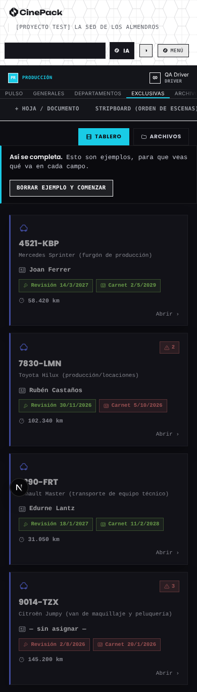
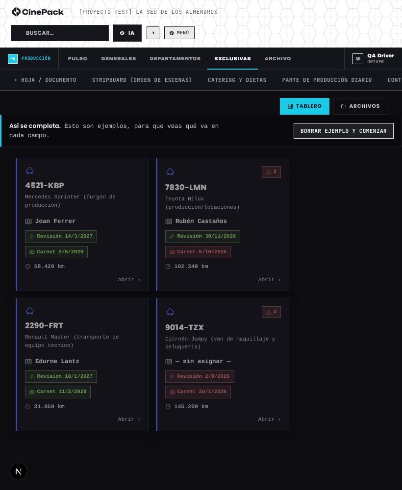
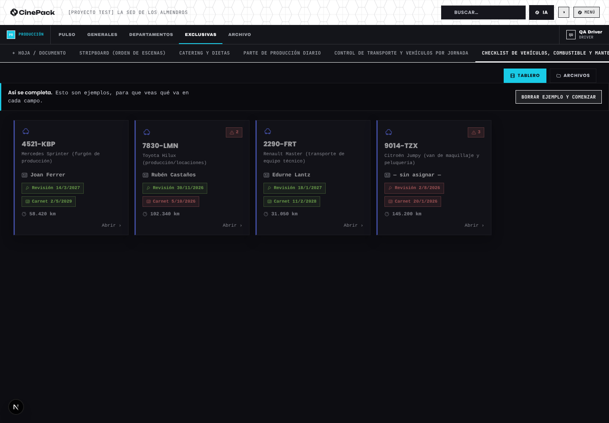
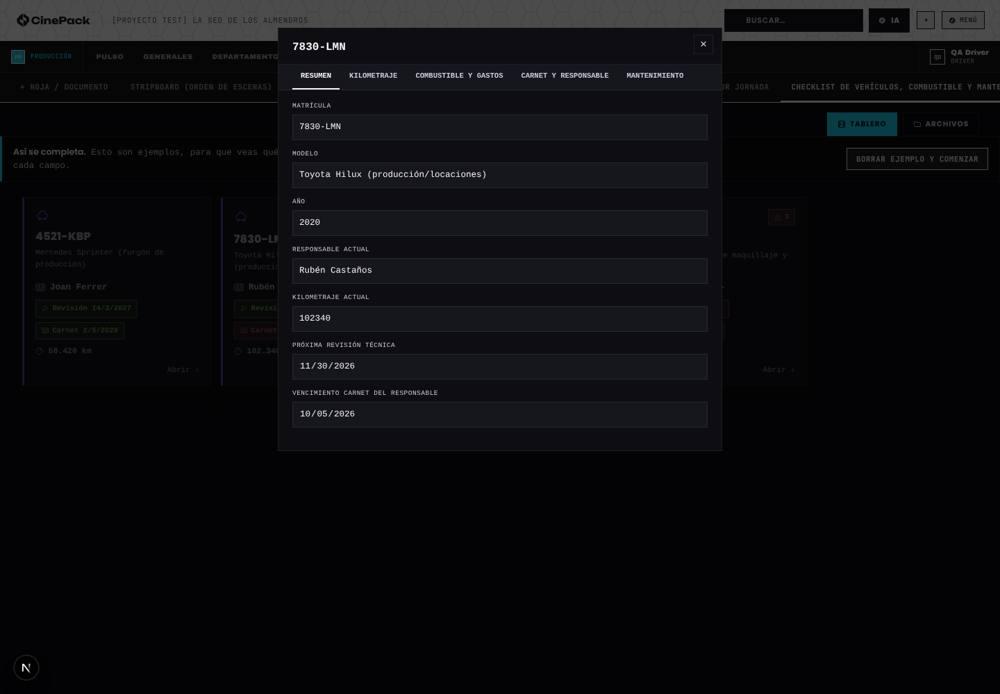
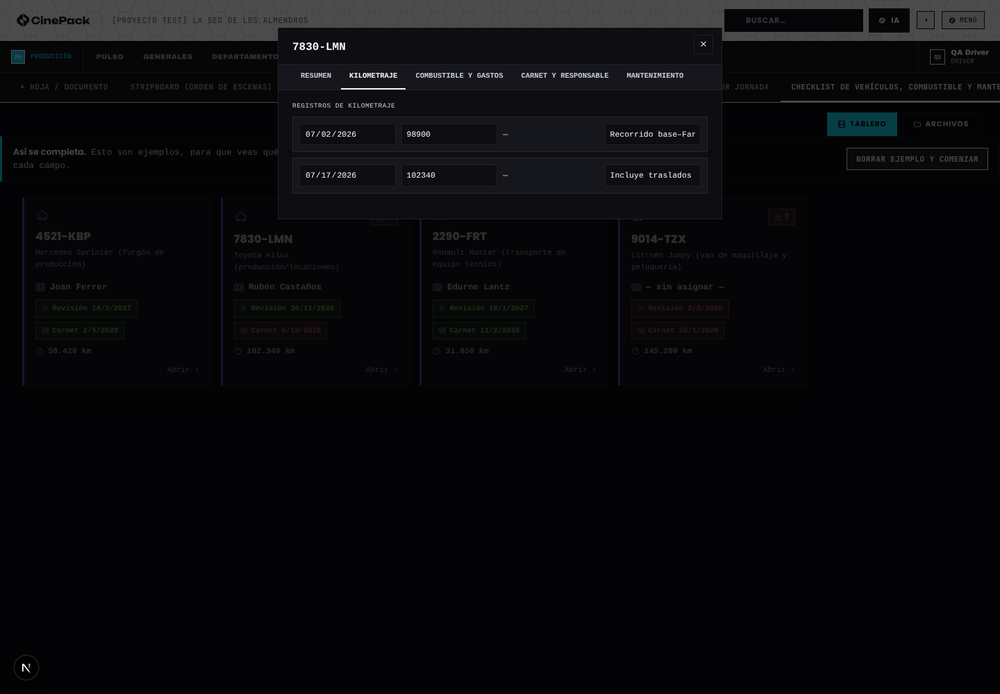
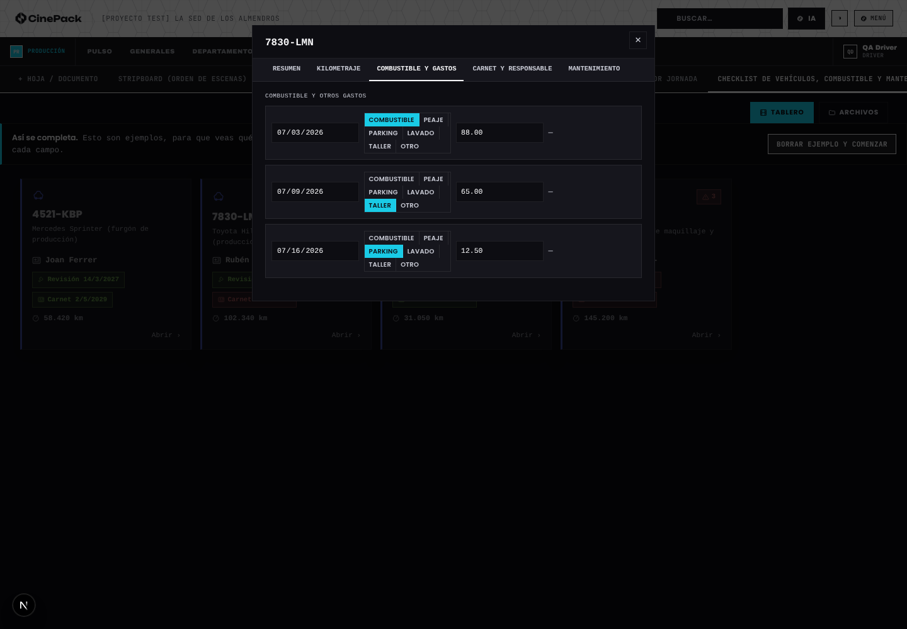
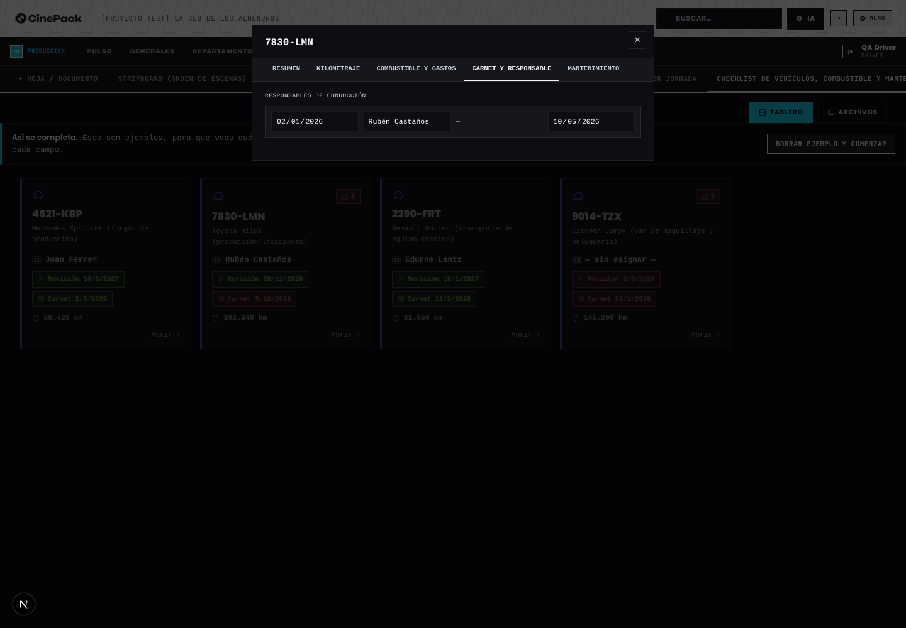
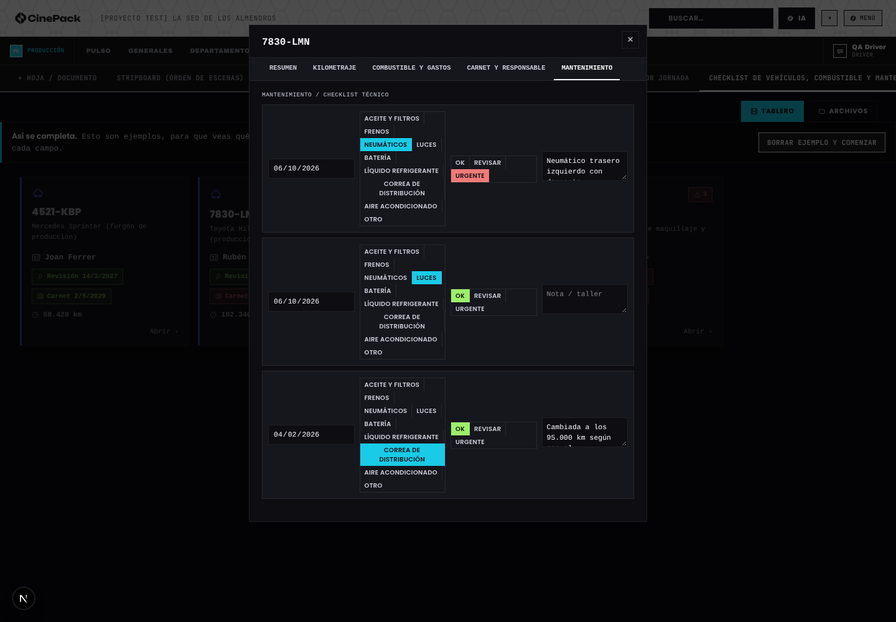

# Dossier — `prod-checklist-vehiculos` ("Checklist de vehículos, combustible y mantenimiento")

Oficina de Agentes CINEPACK. 22/11/2026 (secciones 1-5, 7, 8, 10 originales de
ronda 2) — actualizado 25/11/2026 con la ronda 3 (rediseño "tarjeta por
matrícula", secciones 6, 8, 9 y 11 re-escritas; sección 7 conservada como
registro histórico de la decisión de ronda 2, ya superada por este rediseño).

## 1. Resumen ejecutivo

"Checklist de vehículos, combustible y mantenimiento" es la herramienta
del cargo **Driver** (departamento Producción) para llevar un registro
real de estado mecánico, combustible e ITV **por vehículo y por fecha de
revisión** — algo que la entrada original, un `checklist` booleano
genérico sin estructura de datos propia, no permitía en absoluto. En
ronda 2 se transformó en una tabla de 10 columnas agrupada por
`vehiculo`. En **ronda 3**, Nico rebotó explícitamente esa tabla de
celdas ("Muy lejos de lo esperado... Basta de cuadro de celdas. Quiero
una que esta herramienta esté presentada por tarjeta; según matrícula.")
y pidió, además de estado mecánico/ITV, historial de kilometraje,
combustible/gastos y carnet/responsable con fotos. El rediseño final es
un **mapa de tarjetas por matrícula** (una tarjeta por vehículo, con
badge de alerta visible sin abrir) que al abrirse muestra el historial
completo en 5 pestañas — construido reutilizando `EntidadTabsBoard`, el
mismo motor ya aprobado en `rrhh-plan-bienestar` y otras 7 herramientas.

## 2. Origen de la idea

La entrada `prod-checklist-vehiculos` ya existía en el catálogo
(`app/herramientas.ts`, cargo Driver) como `{ id:
"prod-checklist-vehiculos", nombre: "Checklist de vehículos, combustible
y mantenimiento", tipo: "checklist" }` — un `checklist` sin `columnas` y
sin `hint`, es decir una lista de ítems booleanos genérica, sin identidad
de vehículo, sin fecha ni kilometraje. No permitía llevar ningún registro
real por vehículo ni en el tiempo. No es una herramienta inventada hoy:
es una de las entradas del backlog de placeholders por cargo trabajada en
el ciclo diario del 22/11/2026.

## 3. El cargo y la necesidad real

El Driver, al cierre de cada jornada o en cada revisión, controla en la
práctica: qué vehículo es (identificación/matrícula), cuándo fue la
última revisión/ITV y cuándo toca la próxima, el kilometraje actual, el
nivel de combustible al cierre de jornada, incidencias detectadas
(ruidos, luces, frenos, daños, en texto libre) y el estado general de
disponibilidad del vehículo (operativo, en taller, fuera de servicio).
Nada de esto es representable en un checklist booleano genérico. La
observación que cristalizó el cambio vino de QA (`qa-prod-driver`): "un
checklist con fecha de última revisión de cada vehículo, no solo un sí/no
genérico". En ronda 3, Nico amplió la necesidad real más allá del estado
puntual: quiso el **historial** de cada vehículo (kilometraje periódico
con foto de odómetro, tickets de combustible/gastos con foto, y quién fue
responsable de conducción a lo largo del tiempo, no solo hoy) — el
Driver no solo registra un estado, reconstruye la historia de cada
unidad de flota.

### Relación con otras herramientas de Producción (sin duplicar)

- **Control de transporte y vehículos** (`prod-transporte`, Consolidada,
  Logística/Jefatura de producción): registra **viajes** por jornada —
  fecha, vehículo/matrícula, conductor, pasajeros, origen, destino, horas,
  estado del viaje. Es un *trip sheet*, no un registro de estado mecánico.
  No hay solapamiento de campos: `prod-checklist-vehiculos` se centra en
  el estado del vehículo, no en el viaje.
- **Parte de producción diario** (`prod-parte-diario`, Consolidada):
  incidencias generales del día de rodaje, no detalle de mantenimiento
  vehicular.
- La columna/campo matrícula reutiliza el mismo concepto ("Vehículo /
  Matrícula") ya usado en `prod-transporte`, por coherencia de
  nomenclatura.

## 4. Estado del arte y normativa (con fuentes)

El rol que coordina la flota de un rodaje se llama en inglés
"Transportation Captain" (o Transportation Coordinator), que lidera
transportation managers y drivers, gestiona recogidas de reparto y
despliega vehículos/conductores para mantener el rodaje en calendario y
presupuesto (Broadway Stages, "Industry Jobs | Transportation Captain";
Broadway Stages, "Driving Production Forward: The Role of a
Transportation Captain in Film and TV"). No se encontró, sin embargo, un
término único y estandarizado para el documento de registro de estado del
vehículo: lo más cercano documentado es el "Record of Duty Status"
(RODS), que en EE. UU. registra horas de conducción (de/fuera de
servicio), no estado mecánico/combustible (CSATF, "LMS HOS FAQ"; FMCSA,
exención de registro electrónico de horas de servicio para producción
cinematográfica). No se encontró plantilla sectorial publicada de
"vehicle log"/"fleet maintenance" específica de producción audiovisual —
las columnas propuestas (kilometraje, combustible, ITV, incidencias) se
marcan como hipótesis de diseño por analogía con registros de flota
genéricos, no como estándar confirmado.

No se encontró en StudioBinder, Yamdu, Movie Magic, SetHero ni Celtx
documentación de una herramienta específica de checklist/registro de
estado de vehículo para Driver/Transportation Captain — hueco de mercado
no cubierto por ninguno de los competidores investigados, dentro de lo
verificable por fuente abierta.

**Normativa española de ITV**: la inspección técnica de vehículos se rige
por el Real Decreto 920/2017, que transpone la Directiva 2014/45/UE y
deroga el régimen de los RD 2042/1994 y 224/2008 (BOE-A-2017-12841).
Según Fundación Mapfre, los vehículos de alquiler (con o sin conductor —
relevante porque muchas productoras alquilan furgonetas para rodaje) hoy
equiparan su periodicidad de ITV a la de su categoría, sin régimen propio
diferenciado, a diferencia del régimen de 1994 que sí fijaba plazos
específicos para vehículos de alquiler de hasta nueve plazas. No se
localizó el anexo concreto del RD 920/2017 con la tabla de periodicidades
vigente por categoría — para plazos exactos de una furgoneta de
producción habría que consultar ese anexo directamente en el BOE. La
gestión de las estaciones ITV depende de cada Comunidad Autónoma.
Implicación de diseño: la próxima revisión técnica debe registrarse según
la categoría del vehículo, no con una periodicidad fija universal. No se
encontró normativa española de PRL específica para checklists de
mantenimiento de vehículos de rodaje más allá de la normativa general de
seguridad vial y de uso de vehículos de empresa.

## 5. Propuesta de columnas (ronda 2, base de datos subyacente)

Tipo `tabla` (reemplaza `checklist`), con los tipos de columna ya
existentes (`ColTipo`), sin tipo nuevo. Esta es la base de datos que la
ronda 3 reorganiza visualmente en tarjeta + pestañas (ver sección 9); las
columnas en sí no cambiaron, cambió únicamente cómo se presentan:

| key | label | tipo |
|---|---|---|
| `matricula` | Matrícula | texto |
| `modelo` | Modelo | texto |
| `anio` | Año | num |
| `responsable_actual` | Responsable actual | texto |
| `km_actual` | Kilometraje actual | num |
| `revision_tecnica` | Próxima revisión técnica | fecha |
| `carnet_vencimiento` | Vencimiento del carnet del responsable | fecha |
| `historial_km` | Kilometraje (repetible: fecha, km, foto, nota) | repetible |
| `historial_gastos` | Combustible y gastos (repetible: fecha, tipo, monto, foto) | repetible |
| `historial_responsables` | Carnet y responsable (repetible: fecha inicio, nombre, foto carnet, vencimiento) | repetible |
| `mantenimiento` | Mantenimiento (repetible: fecha, punto del checklist, estado OK/Revisar/Urgente, nota) | repetible |

## 6. Propuesta (rediseño, ronda 3)

### Motivo del rebote (ronda 3)

> "Muy lejos de lo esperado, quiero una propuesta de diseño real. Basta de
> cuadro de celdas. Quiero una que esta herramienta esté presentada por
> tarjeta; según matrícula. Y cuando entrés a la matrícula, puedas ver el
> historial. Y agregar información. Fotografías periódicas de kilometraje,
> fotos de tickets de combustibles y otros gastos, (también ingresados de
> forma manual), carnet y responsable de conducción del vehículo."

### Patrón de interacción elegido y por qué

Se evaluaron tres patrones antes de elegir:

1. **Lista + detalle (bandeja)** — descartado: un Driver no "archiva"
   vehículos como quien archiva correos, tiene un número chico de
   matrículas (2-6) que revisa todos los días; una bandeja angosta
   desperdicia la pantalla.
2. **Línea de tiempo única cruzando todos los vehículos** — descartado:
   mezcla kilometraje/gastos/mantenimiento de matrículas distintas en un
   solo eje temporal, que es exactamente lo que Nico pidió evitar ("según
   matrícula").
3. **Mapa de tarjetas navegables, una por matrícula, con historial
   cronológico al abrir cada una** — elegido. Es como el Driver piensa el
   problema de verdad: "¿qué vehículos tengo a cargo, cuál necesita
   atención hoy, y cuál es la historia de ESTE vehículo en particular?"
   Cada tarjeta es la unidad real de trabajo.

Se implementó reutilizando `EntidadTabsBoard` (`app/hoy/HerramientaPanel.tsx`),
el motor de "tarjeta → modal con pestañas" ya aprobado por el comité en
`rrhh-plan-bienestar` y otras 7 herramientas — **no** la tabla/grilla
genérica de celdas que Nico rebotó. Se documenta explícitamente por qué
no se construyó un componente 100% nuevo desde cero: el patrón de
interacción (tarjeta cerrada con badges de estado → abrir → pestañas de
categoría) es exactamente el que Nico pidió, y ya tiene pulido real
(animaciones, estados vacíos, mobile-first) verificado en otras 8
herramientas; reinventarlo habría significado menos tiempo en lo
específico del cargo (alertas de vencimiento, variedad del historial) y
más en reconstruir infraestructura ya resuelta. Lo específico de este
expediente — la rama de alerta `vehiculo-alerta`, las tarjetas con acento
índigo y badges de vencimiento, los 5 tabs del Driver, los datos de
ejemplo — sí es 100% a medida de este cargo, no genérico.

### Nivel 1 — Mapa de tarjetas por matrícula

Cada tarjeta muestra, sin abrirla:
- Matrícula (título) y modelo (subtítulo).
- Responsable de conducción actual (o "Sin responsable asignado").
- Próxima revisión técnica y vencimiento del carnet del responsable, como
  chips de color: verde si están vigentes, rojo si ya vencieron.
- Kilometraje actual.
- Badge de alerta roja con el número de problemas críticos (carnet vencido /
  revisión vencida / algún punto de mantenimiento "Urgente"), visible sin
  tener que entrar — exactamente el "de un vistazo" que pidió Nico.

### Nivel 2 — Historial al abrir la matrícula (5 pestañas)

1. **Resumen** — matrícula, modelo, año, responsable actual, kilometraje
   actual, próxima revisión técnica, vencimiento del carnet.
2. **Kilometraje** — registros cronológicos (fecha + km + foto del odómetro +
   nota), se agregan uno a uno conforme pasa el tiempo.
3. **Combustible y gastos** — tickets con fecha, tipo (Combustible / Peaje /
   Parking / Lavado / Taller / Otro), monto ingresado a mano y foto del
   ticket adjunta.
4. **Carnet y responsable** — historial completo de quién fue responsable de
   conducción de ese vehículo a lo largo del tiempo (no solo el actual), cada
   entrada con su fecha de inicio, foto del carnet de conducir y vencimiento
   propio — así se sabe quién respondía por el vehículo en cualquier fecha
   pasada, no solo hoy.
5. **Mantenimiento** — se preserva el checklist técnico real que ya existía
   (aceite y filtros, frenos, neumáticos, luces, batería, líquido
   refrigerante, correa de distribución, aire acondicionado, otro), ahora con
   fecha y estado (OK / Revisar / Urgente) por cada intervención, en vez de un
   sí/no plano — un punto "Urgente" dispara la alerta de la tarjeta cerrada.

### Flujo de uso paso a paso (Driver, jornada típica)

1. Abre "Checklist de vehículos" → ve el mapa de tarjetas de todos los
   vehículos a su cargo, con los badges rojos resaltando los que necesitan
   atención hoy (ej. "9014-TZX" con 3 alertas).
2. Toca la tarjeta con alerta → entra directo a la pestaña Resumen, confirma
   qué venció (carnet, revisión, o un punto de mantenimiento urgente).
3. Antes de salir con el vehículo, abre la pestaña Kilometraje y agrega un
   registro con la foto del odómetro tomada en el momento.
4. Al cargar combustible, abre Combustible y gastos, agrega el ticket con el
   monto y la foto.
5. Si cambia el responsable de conducción (otro miembro del equipo toma el
   vehículo por unos días), agrega una entrada nueva en Carnet y responsable
   sin perder el historial de quién lo condujo antes.

### Contenido precargado

4 vehículos de ejemplo, variados y con historiales reales de varias entradas
cada uno (furgón de producción Mercedes Sprinter al día; pickup Toyota Hilux
con neumático urgente y carnet vencido; furgón Renault Master al día; van
Citroën Jumpy con fuga de refrigerante urgente, carnet vencido y sin
responsable asignado) — dos de los cuatro muestran el estado de alerta real
para que el comité y Nico vean la tarjeta "en problema" sin tener que
imaginarla.

## 7. Decisión de agrupación (ronda 2 — superada por el rediseño de ronda 3)

*Nota de diseño (25/11/2026): esta sección se conserva como registro
histórico de la decisión tomada en ronda 2. El rediseño de ronda 3 (ver
sección 6) reemplaza la tabla plana agrupada por una vista de tarjetas
por matrícula; el razonamiento de fondo — que `vehiculo`/matrícula es el
eje estable del historial y no debe dispersarse — es el mismo que llevó,
en ronda 3, a que cada tarjeta SEA una matrícula en vez de agrupar filas
dentro de una tabla.*

**Columnas candidatas:** `vehiculo` o `estado`.

**Decisión: sí agrupar, por `vehiculo`** —
`agruparPor: "vehiculo"` en la definición de `prod-checklist-vehiculos`
en `app/herramientas.ts`.

El caso de uso real del Driver es revisar el historial completo de
mantenimiento/combustible de una misma unidad de flota de un vistazo —
por ejemplo antes de asignar una furgoneta a un trayecto, ver todas sus
revisiones, ITV y última incidencia juntas, igual que "Checklist de
mezcla y masterización" agrupa por fase de proceso. Con flota pequeña y
filas que se acumulan por fecha, una tabla plana ordenada solo por fecha
mezclaría las revisiones de distintas unidades, obligando a escanear toda
la tabla para reconstruir el historial de un vehículo concreto.

Se descartó `estado` como eje de agrupación: aunque "ver de un vistazo
qué está Fuera de servicio/En taller" es una necesidad real, es una
necesidad puntual de triage mejor resuelta con un filtro/orden por
`estado` o un indicador visual en la fila — agrupar toda la tabla por ese
eje dispersaría el historial de una misma unidad entre varios grupos cada
vez que cambia de estado, justo el problema que se busca evitar
agrupando. `vehiculo` es el eje estable; `estado` cambia con cada revisión
y no debe ser el criterio de agrupación.

## 8. Capturas reales de la herramienta en uso (ronda 3)

Capturas Playwright reales contra `cinepack-dev` (worktree de esta misma
rama, `oficina/2026-11-25-checklist-vehiculos-rediseno`), cuenta
`qa.prod-driver2@mailinator.com`, proyecto de prueba real `[PROYECTO
TEST] La sed de los almendros` — no mockups ni ejemplos dibujados a mano.
Las capturas de ronda 2 (tabla de celdas) quedan obsoletas y no se
reutilizan: todas las imágenes de esta sección son del rediseño en
tarjetas.

**Mapa de tarjetas, Móvil (390px):**

**Mapa de tarjetas, Tablet (820px):**

**Mapa de tarjetas, Escritorio (1440px):**

**Detalle de matrícula — pestaña Resumen** (vehículo `7830-LMN`, Toyota
Hilux, con alerta real):

**Detalle de matrícula — pestaña Kilometraje** (2 registros cronológicos
reales, con kilometraje y nota):

**Detalle de matrícula — pestaña Combustible y gastos** (3 tickets reales
de distinto tipo: combustible, taller, parking):

**Detalle de matrícula — pestaña Carnet y responsable** (historial de
responsable con fecha de inicio y vencimiento propio):

**Detalle de matrícula — pestaña Mantenimiento** (3 intervenciones reales,
una marcada "Urgente" — neumático trasero izquierdo con desgaste, la que
dispara el badge de alerta de la tarjeta cerrada):

Todas las capturas muestran los 4 vehículos de ejemplo con datos ricos y
variados (ninguna tabla, tarjeta ni pestaña vacía) — cumple la regla
permanente de Nico del 25/11/2026 de nunca entregar un dossier con
contenido de ejemplo vacío. Verificado sin scroll horizontal de página en
los tres anchos (390/820/1440px).

## 9. Especificación técnica (ronda 3: tarjeta por matrícula)

- **Tipo de herramienta**: `tabla` con vista bespoke vía `ENTIDAD_TABS_IDS` /
  `ENTIDAD_TABS_CONFIG["prod-checklist-vehiculos"]` (no el motor genérico de
  tabla/grilla de celdas).
- **Componente de render**: `EntidadTabsBoard` (`app/hoy/HerramientaPanel.tsx`),
  con una rama de personalización `isVehiculo` (misma técnica que `isRrhh`
  para `rrhh-plan-bienestar`): tarjeta con acento índigo, icono `car`, badge
  de alertas (`vehiculoAlertas()`), chips de fecha ok/bad por vencimiento, y
  kilometraje con icono `gauge`.
- **Columnas** (`app/herramientas.ts`, `Herramienta.columnas`, ver también
  sección 5): `matricula`, `modelo`, `anio`, `responsable_actual`,
  `km_actual`, `revision_tecnica`, `carnet_vencimiento` (simples) +
  `historial_km`, `historial_gastos`, `historial_responsables`,
  `mantenimiento` (tipo `repetible`, con sub-columnas que incluyen
  `archivo` para las fotos).
- **Fotos**: mecanismo `archivo` existente (`ArchivoCell`, Supabase Storage,
  bucket `documentos`, ruta `{proyecto}/{departamento}/herramientas/{herramienta}/{fila}/{sub-col}/...`),
  mismo que ya usan `foto-checklist-descarga` y `dir-continuidad-foto` dentro
  de columnas `repetible` — no se introdujo ningún mecanismo de subida nuevo.
- **Iconos nuevos** (`app/components/Icon.tsx`, mismo trazo 1.75px que el
  resto del set): `car`, `fuel`, `gauge`, `wrench`.
- **CSS** (`app/hoy/dashboard.css`): bloque `.hp-veh-*` (tarjeta, badges,
  chips de fecha, cuerpo) + `.hp-etb-list-grid` (grilla que envuelve en vez de
  rail horizontal, pensada para pocas matrículas en vez de muchas entidades).
- **Sin librerías nuevas**: 100% componentes/CSS/infra ya existentes y
  aprobados.
- **Hint**: excluido del render para este id (igual técnica que otras
  herramientas con tarjeta a medida) — no hay bloque de texto largo antes
  del contenido real; sí se conserva una barra superior de "así se
  completa" sobre los 4 ejemplos, que indica cómo adoptar la fila con
  "BORRAR EJEMPLO Y COMENZAR" (visible en las capturas de la sección 8).

## 10. Fuentes

- Broadway Stages, "Industry Jobs | Transportation Captain" — https://www.broadway-stages.com/news/2021/11/30/industry-jobs-what-is-a-transportation-captain (consultado 22/11/2026)
- Broadway Stages, "Driving Production Forward: The Role of a Transportation Captain in Film and TV" — https://www.broadway-stages.com/newsletter-articles-uploads/2025/6/12/47nmzdbi50azn3lavyp10bxnkush6v (consultado 22/11/2026)
- CSATF, "LMS HOS FAQ" — https://csatf.org/LMS_hos_faq (consultado 22/11/2026)
- FMCSA, exención de ELD para producción cinematográfica — https://www.fmcsa.dot.gov/newsroom/hours-service-drivers-application-exemption-motion-picture (consultado 22/11/2026)
- BOE, Real Decreto 920/2017 (ITV) — https://www.boe.es/boe/dias/2017/11/08/pdfs/BOE-A-2017-12841.pdf (consultado 22/11/2026)
- Administración.gob.es, ficha ITV — https://administracion.gob.es/pag_Home/gl/Tu-espacio-europeo/derechos-obligaciones/ciudadanos/vehiculos/itv.html (consultado 22/11/2026)
- Fundación Mapfre, análisis sobre periodicidad ITV vehículos de alquiler — https://documentacion.fundacionmapfre.org/documentacion/en/media/group/1097693.do (consultado 22/11/2026)

### Pendientes de verificación explícitos

- Anexo concreto del RD 920/2017 con la tabla de periodicidades de ITV por categoría de vehículo — no localizado en esta sesión.
- Cruce de lectura entre `prod-checklist-vehiculos` y `prod-transporte` para precargar el selector de vehículo desde los ya usados — queda como mejora de UI para otro ciclo, no construida hoy.

## 11. QA y estado del expediente (ronda 3)

**Verificación QA (ronda 3)**: Playwright real,
`qa.prod-driver2@mailinator.com` contra `cinepack-dev`, en
390/820/1440px: sin scroll horizontal en ningún ancho, las 4 tarjetas de
ejemplo se ven y abren correctamente, se creó una fila real
("TEST-QA1"), se completó la matrícula, se agregó un registro de
kilometraje con foto real (`odometro-test.png`) y se confirmó que la
foto (miniatura + nombre de archivo) sigue presente después de recargar
la página — persistencia real contra Supabase Storage, no solo estado en
memoria. La fila de prueba se eliminó al final para dejar `cinepack-dev`
solo con los 4 ejemplos.

**Hallazgos no bloqueantes documentados por QA** (para que no se
confundan con bugs en la próxima revisión):

1. **Falta de affordance visual de swipe en 390px para las 5 pestañas**:
   en móvil, las pestañas del modal (Resumen / Kilometraje / Combustible
   y gastos / Carnet y responsable / Mantenimiento) se desplazan
   horizontalmente, pero no hay ninguna señal visual (flecha, sombra de
   borde, indicador de paginado) de que hay más pestañas fuera de la
   vista inicial — el usuario puede no descubrir que existen sin probar
   a deslizar. No bloquea el uso (todas las pestañas son alcanzables),
   pero reduce la "de un vistazo" que se buscó en el resto del diseño.
2. **Las tarjetas de ejemplo son de solo lectura hasta "BORRAR EJEMPLO Y
   COMENZAR"**: los 4 vehículos de ejemplo no se pueden editar
   directamente — hay que usar el botón de adopción para reemplazar un
   ejemplo por una fila real editable (mismo mecanismo que otras
   herramientas con datos de ejemplo precargados). Es el comportamiento
   esperado del patrón, no un bug, pero se anota explícitamente para que
   quien revise no reporte "no puedo editar la tarjeta" como hallazgo
   nuevo.

**Pendiente para QA formal** (ya anotado en el addendum de ronda 3, se
conserva aquí): repetir el mismo flujo de subida de foto también en
Combustible y gastos / Carnet y responsable (mismo mecanismo
`ArchivoCell`, ya verificado en Kilometraje) y confirmar con el comité
que el hint (ahora excluido del render para este id) no reaparece en
ninguna vista.

**Estado del expediente**: Ronda 2 fue aprobada por comité de calidad sin
objeciones pendientes sobre la tabla de celdas, pero esa versión quedó
obsoleta por el rebote explícito de Nico documentado en la sección 6.
Esta ronda 3 (rediseño en tarjetas) está **pendiente de revisión del
comité de calidad** — no auto-aprobada por este dossier. Worktree
`/home/user/cinepack-vehiculos-wt`, rama
`oficina/2026-11-25-checklist-vehiculos-rediseno`, commits `699065c`
(implementación) y `a30c70a` (addendum de ronda 3, ahora consolidado en
este dossier completo). Listo para volver a comité de calidad.
