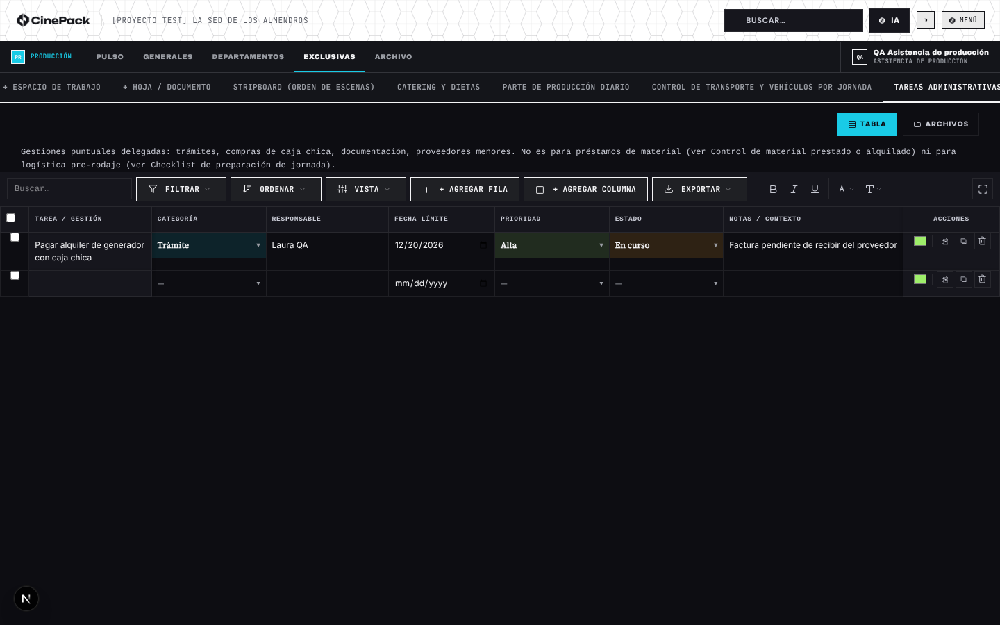
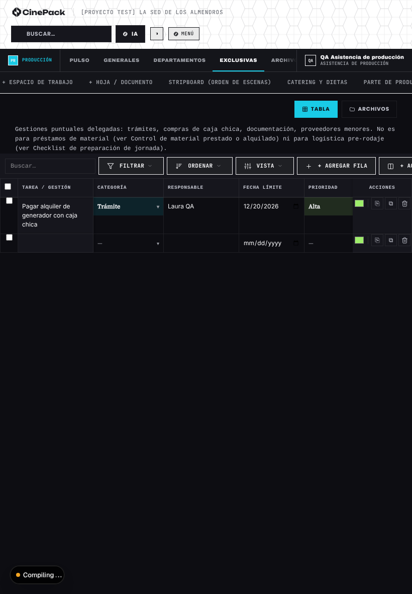
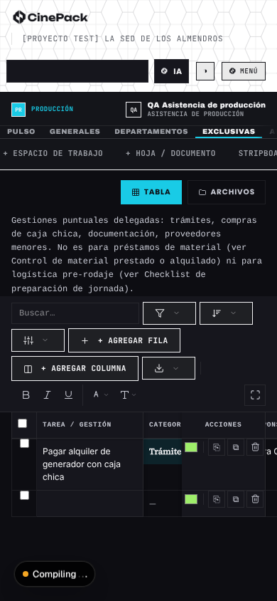

# Dossier — `prod-tareas-admin` ("Tareas administrativas diarias")

Oficina de Agentes CINEPACK. 22/11/2026.

## 1. Resumen ejecutivo

"Tareas administrativas diarias" es la herramienta exclusiva del cargo **Asistencia de producción** (departamento Producción) para registrar gestiones puntuales delegadas durante el rodaje — trámites, compras con caja chica, entregas/retiros de documentación, coordinación de proveedores menores — con responsable, fecha límite, prioridad y estado, en vez de un checklist booleano sin contexto. Se construye como tabla plana del motor genérico (`tipo: "tabla"`, 7 columnas), sin panel a medida: la investigación y la decisión explícita de agrupación (ronda 2) concluyeron que no hay un eje de agrupación que el cargo necesite ver en bloque, así que se mantiene ordenable por prioridad/fecha límite, sin `agruparPor`. Durante el QA real se encontraron y corrigieron 2 bugs del motor genérico de tabla (no propios de esta herramienta, afectan a cualquier herramienta tipo tabla) y se reverificaron tras el fix.

## 2. Origen de la idea

La entrada `prod-tareas-admin` ("Tareas administrativas diarias") ya estaba reservada en el catálogo de la app (`app/herramientas.ts`, línea ~2846) bajo el cargo "Asistencia de producción" del departamento Producción, como `tipo: "checklist"`. El inventario (`oficina/inventario.md`, línea 36) la tenía etiquetada por error bajo el cargo "Producción ejecutiva" (departamento Ejecutivo) — confusión de nombres entre "Asistencia de producción" y "Producción ejecutiva", que ya tiene sus 6 herramientas propias consolidadas (Gestión de coproductores, Justificación de subvenciones, Agenda ejecutiva, Deliverables, Historial de decisiones ejecutivas, KPIs). Esta corrección de encuadre, confirmada en código, se aplica en este ciclo junto con la construcción de la herramienta: se corrige `oficina/inventario.md` línea 36 para que diga "Cargo 'Asistencia de producción' (departamento Producción)".

## 3. El cargo

Asistencia de producción es el brazo operativo de Jefatura de producción en el día a día del rodaje: ejecuta encargos puntuales delegados por Jefatura/Dirección de producción — trámites, recados, compras menores con caja chica, entregas/retiros de documentación, coordinación de un proveedor menor — con plazo y responsable. No se encontró una fuente española específica (sindicato, asociación) que documente explícitamente el flujo de trabajo de este cargo con caja chica en rodajes españoles — se marca explícitamente como **hipótesis, no confirmada por fuente directa**, aunque es coherente con la práctica estándar descrita para "production assistant" en fuentes anglosajonas sobre gestión de caja chica (formulario de solicitud por escrito, recibo por cada gasto, conciliación diaria).

## 4. Necesidades y dolores (con fuente)

- La caja chica es una práctica administrativa general en España (no exclusiva del audiovisual): fondo de dinero para gastos imprevistos, bajo responsabilidad de una persona que debe rendir cuentas, con recibo/justificante por cada salida (Sage, "Caja chica").
- No se encontró una guía específica del sector audiovisual español sobre caja chica de rodaje; la guía de justificación de documentales de la Junta de Andalucía trata la justificación de gastos de subvención en general (ventanas temporales, topes de capítulo de viajes), no un procedimiento de caja chica diaria de plató.
- Una gestoría especializada en audiovisual advierte que pagar en efectivo sin factura (comidas, transporte, alojamiento de rodaje) genera gasto no deducible — razón práctica fuerte para que la caja chica de producción quede trazada con justificante, no solo como lista de "hecho/no hecho" (Billeo, "Gestoría para productoras audiovisuales").
- Herramientas comerciales de gasto corporativo (p. ej. Pleo, en colaboración con APPA) ya ofrecen gestión de tarjetas/gastos a productoras españolas, lo que confirma que el problema de caja chica/gastos sueltos en rodaje es real y hoy se resuelve con herramientas genéricas de gasto corporativo, no con software de producción audiovisual (Pleo, "Pleo y APPA").
- Fuera de eso, es razonable asumir (**hipótesis, sin fuente directa sobre rodajes españoles pequeños/medianos**) que muchas productoras pequeñas siguen gestionando estos encargos sueltos por WhatsApp y hojas de Excel/papel, en línea con lo ya documentado para otras herramientas "vacías" de este inventario, pero no se encontró un testimonio que lo confirme específicamente para este cargo.
- Práctica anglosajona de referencia sobre el rol del production assistant gestionando caja chica: formulario de solicitud por escrito, recibo por cada gasto, conciliación diaria (staffmeup.com; cmsla.squarespace.com).

## 5. Estado del arte

No se encontró evidencia de que StudioBinder tenga un módulo de caja chica o de gestión de tareas administrativas sueltas para el Production Assistant: su gestión de tareas es genérica (checklists, fechas límite, estados) asociada a guion, desglose, storyboard, calendario y callsheet, sin un objeto de dato "gasto/caja chica". Quien sí tiene un módulo dedicado de caja chica es **Wrapbook**, con un reporte línea a línea de transacciones, fechas de envío/aprobación e importes — referencia de diseño útil aunque no es uno de los competidores nombrados en el encargo original. Para Yamdu, Movie Magic (Budgeting) y SetHero no se encontró mención de caja chica o tareas administrativas sueltas del Production Assistant en las fuentes consultadas. Showbiz Budgeting (no mencionado en el encargo, pero relevante) sí ofrece seguimiento de caja chica, órdenes de compra y pagos a proveedores a nivel de dirección de producción, no a nivel de asistente (fuente agregadora, marcada como débil). Celtx no apareció en ninguna búsqueda relacionada con caja chica o tareas administrativas.

**Conclusión:** ningún competidor de los cinco nombrados ofrece, de forma documentada, una herramienta específica de "tareas administrativas sueltas con caja chica" para el cargo de asistente de producción — queda confirmado como hueco de mercado, al menos dentro de lo verificable por fuente abierta.

**Normativa española aplicable:** no existe normativa específica de "caja chica de rodaje"; aplica la normativa general de justificación de gastos y fiscalidad de empresas (facturación, deducibilidad de gastos pagados en efectivo) y, cuando el proyecto recibe subvención pública (ICAA o autonómica), las bases de la convocatoria y sus guías de justificación de gasto (ver Junta de Andalucía, citada arriba) fijan plazos y documentación exigida. No se encontró convenio colectivo del sector que regule específicamente la gestión de caja chica por el cargo de asistencia de producción.

## 6. Propuesta

Tipo `tabla` (motor genérico, no checklist y no panel a medida), 7 columnas:

| key | label | tipo |
|---|---|---|
| `tarea` | Tarea / gestión | texto |
| `categoria` | Categoría | estado (Trámite, Compra/caja chica, Documentación, Proveedor, Logística, Otro) |
| `responsable` | Responsable | texto |
| `fecha_limite` | Fecha límite | fecha |
| `prioridad` | Prioridad | estado (Alta, Media, Baja) |
| `estado` | Estado | estado (Pendiente, En curso, Bloqueada, Completada) |
| `notas` | Notas / contexto | largo |

Todos los tipos de columna ya existen en `ColTipo`; no se necesita tipo nuevo ni migración, el motor genérico `herramienta_filas` ya la soporta.

**Relación con otras herramientas (para no duplicar):**
- **Parte de producción diario** (consolidada, departamento): incidencias/horarios de la jornada ya ocurrida — no tareas administrativas sueltas; `prod-tareas-admin` es prospectivo (pendiente/en curso), no un registro de lo sucedido.
- **Control de material prestado o alquilado** (consolidada, cargo vecino): ya cubre préstamos/alquileres con su propia tabla — esta herramienta no duplica ese seguimiento, solo tareas administrativas que no sean de material. La categoría "Compra/caja chica" es para *gestiones puntuales*, nunca para seguimiento de un préstamo en curso.
- **Checklist de preparación de jornada** (circunstancial, mismo cargo): logística pre-rodaje con fecha de jornada fija — distinta de gestiones administrativas sueltas sin fecha de jornada fija.

**Por qué tabla plana y no panel a medida (a diferencia de otras herramientas construidas en ciclos anteriores):** el uso real del cargo con esta herramienta es leer de un vistazo qué vence antes o qué es más urgente entre trámites puntuales — no hay un eje de agrupación (como "escena" o "unidad de vehículo" en otras herramientas) que el cargo necesite ver en bloque. Por eso no se justifica un componente bespoke: el motor genérico de tabla, ya renderizado por `HerramientaPanel.tsx` con `tipo: "tabla"` + `columnas`, cubre el caso completo sin componente nuevo.

## 7. Integración

**Nivel 1 — con el propio departamento (Producción):**
- No comparte filas con Control de material prestado o alquilado: son `herramienta_id` distintos en `herramienta_filas`, sin join ni clave foránea. Riesgo abierto: si un usuario crea una tarea "devolver trípode prestado" aquí en vez de en Control de material, queda huérfana de ese seguimiento — se resuelve con el `hint` de la herramienta (texto que indique usar la otra herramienta para material prestado/alquilado), no con una restricción de datos.
- No comparte filas con Checklist de preparación de jornada: decisión explícita, sin columna `jornada_id` compartida.
- No comparte filas con Parte de producción diario: registros de naturaleza distinta (lo ya sucedido vs. lo pendiente).

**Nivel 2 — con el proyecto en su conjunto:**
- No escribe ni lee de `GENERAL_PLAN_RODAJE`, `GENERAL_ORDEN_RODAJE` ni `GENERAL_CALENDARIO`. Es intencional: gestión interna de Asistencia de producción sin impacto directo en el cronograma visible a todo el equipo. Si en el futuro se quisiera ver una `fecha_limite` coincidente con un día de rodaje en el calendario general, haría falta un puente explícito (ej. botón "crear evento" al estilo de `app/api/plan-financiacion/sincronizar-desde-evento/route.ts`) — no está en el alcance de hoy, queda como pregunta abierta de backlog.

**Nivel 3 — con otros departamentos:**
- Jefatura de producción (cargo superior directo del mismo departamento) necesita **ver** (no editar) la tabla completa para auditar estado/prioridad sin pedir reporte manual. Se resuelve con `herramienta_asignaciones` (tabla ya existente): fila con `herramienta = "prod-tareas-admin"`, `departamento = "Producción"`, nivel "ver" asignado al cargo Jefatura de producción desde el panel de Control.
- Ningún otro departamento necesita ver esta tabla de forma estructural; si Tesorería/Administración necesitara trazabilidad de caja chica, eso ya lo cubre su propia herramienta de Pagos/caja chica (Ejecutivo) — no se duplica aquí.

**Modelo de datos y permisos:**
- Espacio: todas las columnas viven en el espacio común del proyecto (`herramienta_filas`, `project_id` + `herramienta_id = "prod-tareas-admin"`), sin campo privado de cargo — estas tareas son por definición visibles a quien las delega.
- Permisos: edita Asistencia de producción (todos los miembros del cargo, vía RLS base de `herramienta_filas`). Jefatura de producción: solo lectura vía `herramienta_asignaciones` (nivel "ver"). Super_admin: lectura por la política `herramienta_filas_super_admin_select` ya existente, sin escritura especial.
- Librerías: ninguna — tabla estándar del motor genérico, sin componente nuevo.

## 8. Diseño visual

No aplica diseño a medida: la herramienta usa el renderizado estándar del motor genérico de tabla (`HerramientaPanel.tsx`, `tipo: "tabla"` con `columnas`), con los mismos tokens de diseño (`var(--sp-*)`, `var(--fs-*)`, `var(--acc)`, `var(--bg-2)`, `var(--panel)`, `var(--line)`) y el mismo patrón responsive del motor: tabla con su propio scroll horizontal interno, sin scroll horizontal de página en ningún ancho. No se introdujo CSS ni componente visual nuevo.

## 9. Componentes (implementación)

- **Definición de la herramienta** — `app/herramientas.ts` (línea ~2846, cargo "Asistencia de producción", departamento Producción): `prod-tareas-admin` ("Tareas administrativas diarias"), tipo `tabla` (reemplaza el `tipo: "checklist"` anterior), columnas `tarea` (texto), `categoria` (estado), `responsable` (texto), `fecha_limite` (fecha), `prioridad` (estado), `estado` (estado), `notas` (largo) — exactamente tipos ya existentes en `ColTipo`, sin tipo nuevo.
- **Renderizado** — sin panel bespoke: usa el motor genérico ya existente en `HerramientaPanel.tsx` para `tipo: "tabla"`, reutilizando el mismo motor de persistencia de filas (`crearFila`/`guardarFila`/`borrarFila`) que cualquier otra herramienta tabla.
- **Corrección de inventario** — `oficina/inventario.md` línea 36: cambiado "Cargo 'Producción ejecutiva'" por "Cargo 'Asistencia de producción' (departamento Producción)".
- Sin cambios de traducciones ni de estilos propios: la tabla genérica ya trae sus propias etiquetas de columna desde la definición en `herramientas.ts`.

### Capturas reales de la herramienta en uso

## 10. QA y decisión de agrupación

**QA — golden path real**, cuenta `qa.prod-asistencia2@mailinator.com` (perfil completado por self-update RLS, cargo "Asistencia de producción" exacto según `JERARQUIA_POR_DEPARTAMENTO`). Login real, proyecto test, Exclusivas → Tareas administrativas diarias. Fila real creada: "Pagar alquiler de generador con caja chica", probando las 7 columnas.

**2 bugs reales encontrados en el motor genérico de tabla durante esta QA, ambos corregidos en este mismo ciclo** — no son bugs propios de esta herramienta: afectaban potencialmente a cualquier herramienta tipo tabla de la app, descubiertos a través de este expediente:
1. Columna `fecha`: no persistía tras reload (commit `4d0d5b0`).
2. Columnas `estado` (dropdown `CpSelect`): al editar 2+ en la misma fila en sucesión rápida, la primera se perdía por una condición de carrera (commit `56fa4f8`).

**Reverificado tras ambos fixes:** categoría, prioridad, estado y fecha límite persisten correctamente tras reload + re-navegación (el reload por sí solo vuelve a Pulso, no es bug, hay que re-navegar a Exclusivas). Responsive 390/820/1440px verificado con la fila real cargada: tabla con su propio scroll horizontal interno (patrón estándar del motor), sin scroll horizontal de página en ningún ancho, usable de punta a punta en 390px. `qa_responsive_ok: true`.

**Decisión de agrupación (ronda 2).** Columna candidata: `categoria` (Trámite/Compra·caja chica/Documentación/Proveedor/Logística/Otro).

**Decisión: NO agrupar. Tabla plana, ordenable por `prioridad`/`fecha_limite`.**

Argumento: el uso real de Asistencia de producción con esta herramienta es gestión de trámites puntuales con vencimiento que el cargo revisa priorizando qué vence antes o qué es más urgente, no por tipo de trámite. Agrupar por `categoria` fragmentaría una lista que necesita leerse de un vistazo ordenada por `fecha_limite`/`prioridad`: una tarea de "Compra/caja chica" urgente para hoy terminaría en un bloque visual distinto de una "Documentación" igualmente urgente para hoy, obligando al cargo a leer categoría por categoría en vez de ver lo más urgente arriba. A diferencia de casos donde agrupar por una fase de proceso o por unidad es justo cómo se trabaja (en bloques secuenciales, o viendo todo el historial de una unidad junto), aquí no hay un eje de agrupación que el cargo necesite ver "en bloque" — la categoría es metadata de clasificación, no el eje de trabajo diario. Se mantiene tabla plana sin `agruparPor`, ordenable por las columnas existentes (comportamiento ya soportado por el motor genérico sin cambio de código).

## 11. Fuentes

- Sage, "Caja chica" — https://www.sage.com/es-es/blog/diccionario-empresarial/caja-chica/ (consultado 22/11/2026)
- Junta de Andalucía, "Guía justificativa producción documental 2021" — https://juntadeandalucia.es/sites/default/files/inline-files/2023/10/guia_justificativa_produccion_docu_2021.pdf (consultado 22/11/2026)
- Billeo, "Gestoría para productoras audiovisuales" — https://www.billeo.es/gestoria-productoras (consultado 22/11/2026)
- Pleo, "Pleo y APPA: partners de cine para ayudarte con tu producción audiovisual" — https://blog.pleo.io/es/pleo-appa-partners-gastos-produccion-audiovisual (consultado 22/11/2026)
- staffmeup.com, "Petty Cash Tips For Production Coordinators" — https://blog.staffmeup.com/?p=3476 (consultado 22/11/2026, fuente anglosajona, práctica general no específica de España)
- cmsla.squarespace.com, "The Role of a Production Assistant in Managing Petty Cash" — https://cmsla.squarespace.com/blog/managing-petty-cash-production (consultado 22/11/2026, fuente anglosajona)
- Wrapbook, "About petty cash" / "Petty cash report" — https://help.wrapbook.com/docs/about-petty-cash y https://help.wrapbook.com/petty-cash-report (consultado 22/11/2026)
- StudioBinder, "Task Management Software" — https://studiobinder.com/creative-project-management-software (consultado 22/11/2026)
- `app/herramientas.ts`, `oficina/inventario.md`, `oficina/backlog.md` — verificación de encuadre departamental y de no-duplicado.
