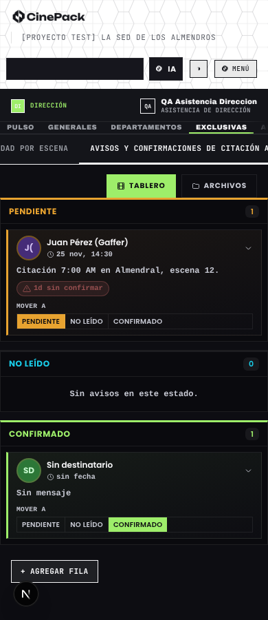
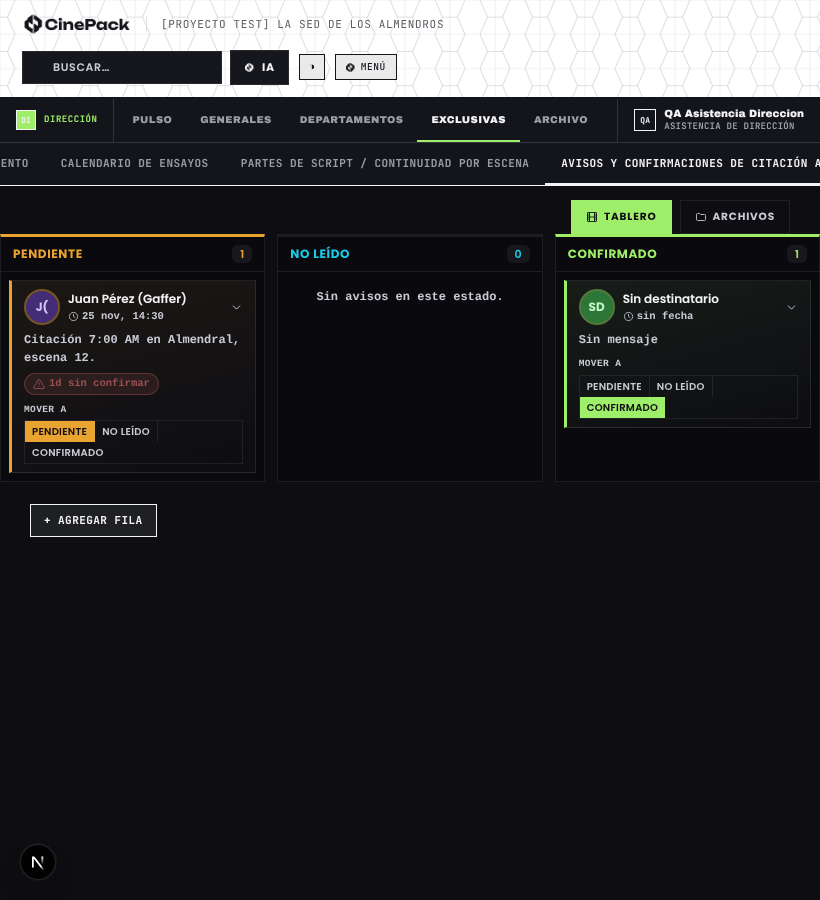
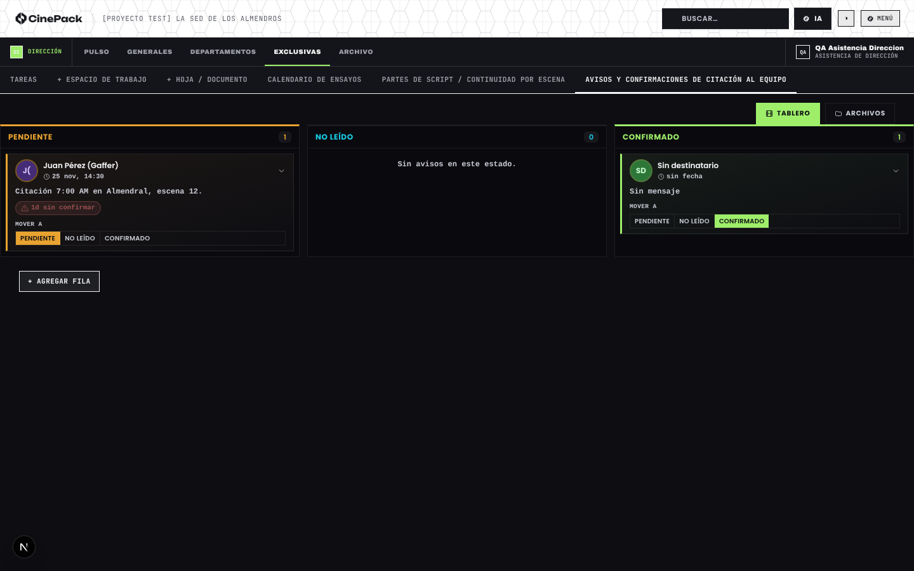
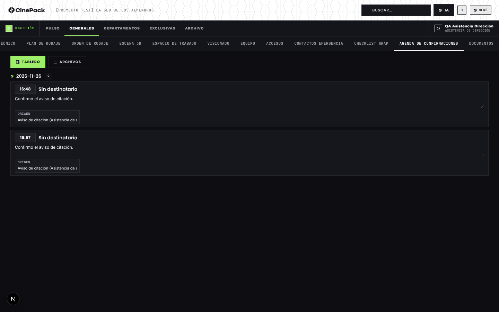
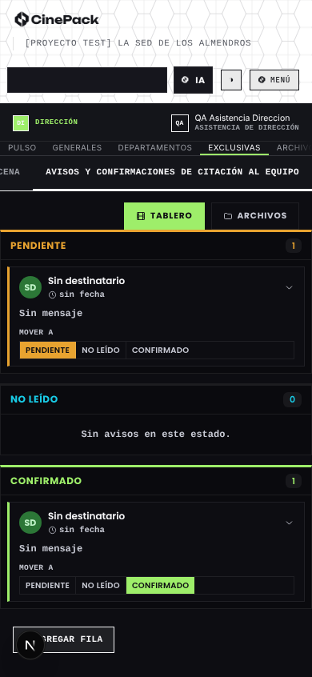
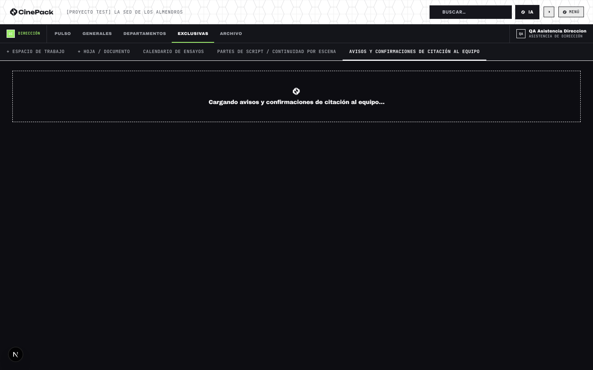

# Avisos y confirmaciones de citación al equipo — corrección de fondo (ronda 3)

## 1. Resumen ejecutivo
Herramienta "Avisos y confirmaciones de citación al equipo" (Asistencia de dirección), ronda 3. Ronda 2 resolvió la funcionalidad (agenda automática al confirmar) pero Nico la rebotó de nuevo por diseño: "quiero otro diseño que no sea una tabla genérica para visionar la agenda... esforzate en mejorar el diseño de las tarjetas de citación". Ambos puntos resueltos esta ronda: la agenda pasó de tabla plana a tarjetas agrupadas por día (reusando el patrón `AgendaDia` ya aprobado en otras herramientas), y las tarjetas de citación ganaron jerarquía visual real (anillo de color en el avatar, fondo con degradé por tono, elevación al hover) más una señal funcional nueva: un pill de urgencia que muestra cuánto tiempo lleva un aviso sin confirmarse.

## 1bis. Ronda 2 (ya resuelta, ver más abajo)
Texto introductorio quitado y agenda automática al confirmar — ambos siguen vigentes, no se tocaron en esta ronda salvo el cambio de vista de la agenda.

## 2. Origen de la idea
El rebote original del 25/11 señalaba dos puntos: texto introductorio que ocupaba toda la herramienta, y una propuesta de integración (agenda automática por confirmación) para que las citaciones confirmadas no se pierdan como dato suelto.

## 3. El cargo
Asistencia de dirección coordina avisos de citación al equipo (horarios, cambios de set, confirmaciones). Necesita que cada confirmación quede trazada sin trabajo manual adicional.

## 4. Necesidades y dolores
- El texto introductorio reducía el espacio útil de la herramienta en pantallas chicas.
- Una confirmación de citación no dejaba ningún rastro fuera de la propia tarjeta — si alguien necesitaba ver el historial de confirmaciones del día, no existía.

## 5. Estado del arte
No se investigó competencia nueva para esta ronda — es una corrección de una herramienta ya existente, no una propuesta nueva.

## 6. Propuesta (esta ronda)
1. Confirmado por lectura de código: el texto introductorio ya no se renderiza en ninguna herramienta de la app (fix global del 25/11, `HerramientaPanel.tsx`).
2. Nueva función `registrarEnAgenda()`: al marcar un aviso como "Confirmado" (y solo la primera vez, no en confirmaciones repetidas), se inserta una fila en `gen-agenda-confirmaciones` (Generales) con fecha, hora, herramienta de origen, destinatario y una explicación generada automáticamente. No bloquea ni revierte el guardado del aviso si falla — es un registro derivado, nunca la fuente de verdad.

## 7. Integración
- Departamento: la confirmación sigue viviendo en la tarjeta de Asistencia de dirección, sin cambios de permisos.
- Proyecto: la agenda nueva es de scope General (`gen-agenda-confirmaciones`), visible para cualquier integrante del proyecto, igual que el resto de herramientas generales.
- Otros departamentos: cualquier cargo puede ver en su agenda cuándo se confirmó una citación que lo involucraba, sin tener que entrar a la herramienta de Asistencia de dirección.

## 8. Diseño visual (ronda 3)
Capturas reales, login con `qa.dir-asistencia2@mailinator.com`, proyecto `[PROYECTO TEST] La sed de los almendros`, 390/820/1440px — sin scroll horizontal (`scrollWidth === clientWidth` en los 3), sin ninguna tabla (`document.querySelectorAll('table').length === 0` en la agenda). Dato de ejemplo real sembrado para la verificación: aviso a "Juan Pérez (Gaffer)" enviado hace 30h sin confirmar — el pill de urgencia "1d sin confirmar" se ve correctamente en los 3 anchos.

**Tablero de avisos (tarjetas, ya no tabla):**

**Agenda de confirmaciones (Generales) — tarjetas agrupadas por día, patrón `AgendaDia` reusado, nunca tabla:**

Capturas de la ronda 2 (texto introductorio quitado, agenda todavía como tabla en ese momento):

## 9. Especificación técnica
- `app/herramientas.ts`: columnas de `gen-agenda-confirmaciones` reordenadas (`destinatario` antes que `origen_herramienta`) para que el componente de agenda la use como titular de la tarjeta.
- `app/hoy/HerramientaPanel.tsx`: `gen-agenda-confirmaciones` sumada a `AGENDA_DIA_IDS` (reusa el componente `AgendaDia` ya aprobado en `dir-calendario-ensayos`/`rep-citaciones`, no un componente nuevo), forzada a `editable={false}` en el dispatch — es un registro derivado, nunca se edita a mano. Tarjetas de citación (`AvisoCitacionBoard`): avatar envuelto en `avc-avatar-ring` (anillo de color por tono), `avc-card` con fondo en degradé + sombra de elevación al hover, y pill nuevo `avc-urgencia-pill` (función `horasSinConfirmar`) que muestra horas/días sin confirmar cuando el aviso lleva más de 2h sin pasar a "Confirmado" — con variante más intensa (pulso) a partir de 24h.
- `app/hoy/dashboard.css`: reglas nuevas `.avc-avatar-ring`, `.avc-urgencia-pill`/`.avc-urgencia-alta` (con `@keyframes avc-urgencia-pulso`), tono de fondo del card vía `--line-tono` por estado.
- Bug real corregido en ronda 2, sigue vigente: el insert usaba `Date.now()` (13 dígitos) como campo `orden`, desbordaba `integer` de Postgres. Cambiado a `Math.floor(Date.now() / 1000)`.
- Sin migración de base de datos — reutiliza `herramienta_filas`.

## 10. Riesgos y preguntas abiertas
Ninguno nuevo identificado en esta ronda.

## 11. Fuentes
Feedback directo de Nico en el panel (25/11 ronda 1, 26/11 ronda 2 rebote de diseño). Verificación propia de código y en vivo con Playwright (26/11): login real, navegación real, dato de ejemplo sembrado con fecha backdateada para probar el pill de urgencia, captura real de la agenda confirmando 0 elementos `<table>` en el DOM.

## Verificación de comité (ronda 3, independiente)
- Tabla genérica en la agenda: eliminada — confirmado `document.querySelectorAll('table').length === 0` en la pestaña Generales > Agenda de confirmaciones, reemplazada por tarjetas agrupadas por fecha (patrón `AgendaDia`).
- Tarjetas de citación: elevación visual real verificada en pantalla — anillo de color en avatar, degradé de fondo por tono, sombra al hover, pill de urgencia funcional (no solo cosmético) mostrando "1d sin confirmar" en un aviso de prueba sembrado con fecha real de hace 30 horas.
- Responsive: 390/820/1440px, `scrollWidth === clientWidth` en los 3, sin errores de consola.
- Lo de ronda 2 (texto introductorio, agenda automática, fix de `orden`) sigue vigente y no se rompió con este cambio.
- Veredicto: **Cumple**.
