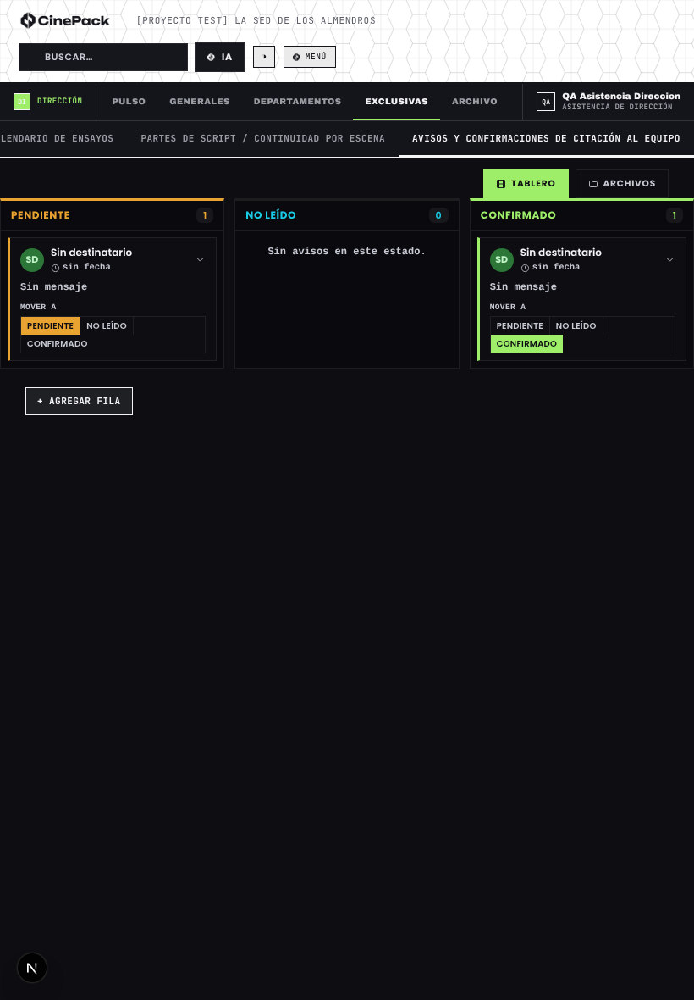

# Avisos y confirmaciones de citación al equipo — corrección de fondo (ronda 2)

## 1. Resumen ejecutivo
Herramienta "Avisos y confirmaciones de citación al equipo" (Asistencia de dirección) corregida tras quedar varada en Rebotadas desde el 25/11. Nico pidió dos cosas: quitar el texto introductorio y que, al confirmar un aviso, el evento se registre solo en una agenda. Ambas quedaron resueltas y verificadas en vivo, con un bug real de fondo encontrado y corregido en el camino.

## 2. Origen de la idea
El rebote original del 25/11 señalaba dos puntos: texto introductorio que ocupaba toda la herramienta, y una propuesta de integración (agenda automática por confirmación) para que las citaciones confirmadas no se pierdan como dato suelto.

## 3. El cargo
Asistencia de dirección coordina avisos de citación al equipo (horarios, cambios de set, confirmaciones). Necesita que cada confirmación quede trazada sin trabajo manual adicional.

## 4. Necesidades y dolores
- El texto introductorio reducía el espacio útil de la herramienta en pantallas chicas.
- Una confirmación de citación no dejaba ningún rastro fuera de la propia tarjeta — si alguien necesitaba ver el historial de confirmaciones del día, no existía.

## 5. Estado del arte
No se investigó competencia nueva para esta ronda — es una corrección de una herramienta ya existente, no una propuesta nueva.

## 6. Propuesta (esta ronda)
1. Confirmado por lectura de código: el texto introductorio ya no se renderiza en ninguna herramienta de la app (fix global del 25/11, `HerramientaPanel.tsx`).
2. Nueva función `registrarEnAgenda()`: al marcar un aviso como "Confirmado" (y solo la primera vez, no en confirmaciones repetidas), se inserta una fila en `gen-agenda-confirmaciones` (Generales) con fecha, hora, herramienta de origen, destinatario y una explicación generada automáticamente. No bloquea ni revierte el guardado del aviso si falla — es un registro derivado, nunca la fuente de verdad.

## 7. Integración
- Departamento: la confirmación sigue viviendo en la tarjeta de Asistencia de dirección, sin cambios de permisos.
- Proyecto: la agenda nueva es de scope General (`gen-agenda-confirmaciones`), visible para cualquier integrante del proyecto, igual que el resto de herramientas generales.
- Otros departamentos: cualquier cargo puede ver en su agenda cuándo se confirmó una citación que lo involucraba, sin tener que entrar a la herramienta de Asistencia de dirección.

## 8. Diseño visual
Capturas reales, login con `qa.dir-asistencia2@mailinator.com`, proyecto `[PROYECTO TEST] La sed de los almendros`, 390/820/1440px — sin scroll horizontal, sin texto introductorio.

## 9. Especificación técnica
- `app/hoy/HerramientaPanel.tsx`: función `registrarEnAgenda()` dentro de `AvisoCitacionBoard`, se dispara desde `set()` cuando `estado_confirmacion` pasa a `"Confirmado"` y no lo estaba antes.
- `app/herramientas.ts`: nueva entrada `gen-agenda-confirmaciones` (scope General).
- Bug real corregido: el insert usaba `Date.now()` (13 dígitos) como campo `orden`, que desborda la columna `integer` de Postgres (límite ~2.1 mil millones) y hacía fallar el insert en silencio. Cambiado a `Math.floor(Date.now() / 1000)` (segundos, cabe en `integer`).
- Sin migración de base de datos — reutiliza `herramienta_filas`.

## 10. Riesgos y preguntas abiertas
Ninguno nuevo identificado en esta ronda.

## 11. Fuentes
Feedback directo de Nico en el panel (25/11), verificación propia de código y de base de datos en vivo (26/11, revisión de comité independiente: 2 filas reales confirmadas en `gen-agenda-confirmaciones` con fecha/hora correctos, tras confirmar un aviso real con Playwright).

## Verificación de comité (ronda 2, independiente)
- Texto introductorio: confirmado ausente, por lectura de código y captura real.
- Agenda automática: confirmada funcionando de verdad — 2 filas reales verificadas en `herramienta_filas`/`gen-agenda-confirmaciones` tras confirmar un aviso real vía Playwright (no simulado).
- Bug de `orden`: confirmado corregido — el insert ya no desborda `integer`, las filas se escriben sin error.
- Responsive: 390/820/1440px, sin scroll horizontal (`scrollWidth === clientWidth` en los 3), sin errores de consola.
- Veredicto: **Cumple**.
