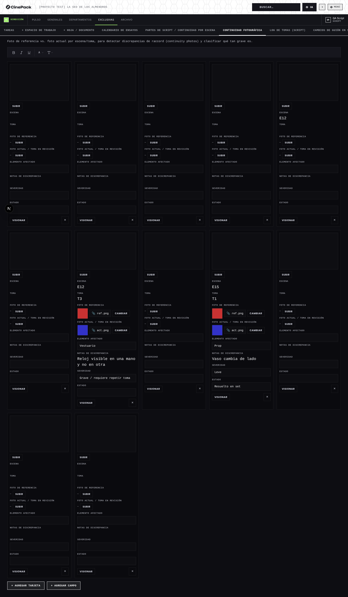
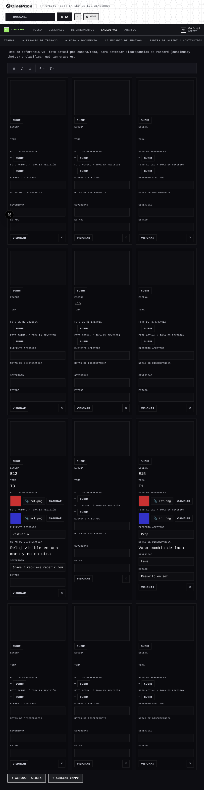
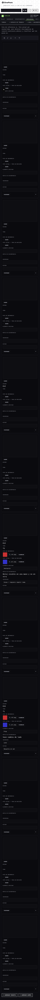

# Dossier — `dir-continuidad-foto` ("Continuidad fotográfica")

Oficina de Agentes CINEPACK. 25/11/2026.

## 1. Resumen ejecutivo

"Continuidad fotográfica" es la herramienta exclusiva del cargo **Script/Continuidad**
(departamento Dirección) para comparar, escena a toma, una foto de referencia (la
toma "buena" ya aprobada) contra la foto actual que se está revisando, y clasificar
a simple vista qué cambió, qué tan grave es, y si quedó resuelto o se aceptó como
salto consciente. Mantiene el tipo `galeria` ya existente en el catálogo, ampliado a
8 columnas — dos de ellas de tipo `archivo` (`foto_referencia` y `foto_actual`) en la
misma fila, algo sin precedente previo en una herramienta `galeria` de CINEPACK, pero
confirmado como soportado por el motor de render sin cambio de código. **Rechazada
por el comité en ronda 1** por dejar los 3 niveles de integración como "pregunta
abierta para un ciclo futuro" sin ningún flujo de datos implementado. En ronda 2 se
agregó investigación de competencia y se especificó, implementó y verificó un flujo
real de integración de solo lectura (`VerContinuidadArte`) que consulta en vivo la
continuidad de vestuario y maquillaje de Arte para la misma escena — **aprobada por
comité en ronda 2** tras estas dos incorporaciones.

## 2. Origen de la idea

`dir-continuidad-foto` no es una herramienta inventada en este ciclo: ya existía en
el catálogo (`app/herramientas.ts`, líneas 2730-2736) con clasificación "Circunstancial"
— `tipo: "galeria"`, hint real ("Galería + notas de raccord."), pero sin columnas de
imagen ni estructura de comparación:

```ts
{ id: "dir-continuidad-foto", nombre: "Continuidad fotográfica", tipo: "galeria",
  hint: "Galería + notas de raccord.",
  columnas: [
    { key: "escena", label: "Escena/Toma" },
    { key: "raccord", label: "Notas de raccord", tipo: "largo" },
  ] }
```

Confirmado por lectura directa del código: ni siquiera tenía columna de imagen/archivo
— solo un campo "Escena/Toma" (texto libre, escena y toma fusionados) y un campo de
notas libres. No permitía adjuntar fotos, ni comparar referencia vs. actual, ni
clasificar el elemento afectado o la severidad. Esta entrada fue la elegida por la
Oficina de Desarrollo para trabajar en el ciclo diario del 25/11/2026, dentro del
cargo Script/Continuidad (departamento Dirección).

## 3. El cargo

Script/Continuidad (departamento Dirección) es, según la investigación de fuentes
profesionales consultadas, quien toma las "continuity photos" justo después de la
primera toma buena de un setup ("first good take"), porque esa toma fija vestuario,
props y posición de actores para el resto de la escena — esas fotos sirven después de
referencia para las tomas siguientes (Backstage). El script supervisor necesita, por
escena y toma, comparar esa foto de referencia contra la foto actual que se está
revisando para detectar discrepancias de raccord a simple vista, y cuando encuentra
una, clasificar qué cambió, qué tan grave es, y si quedó resuelto o se aceptó como
salto consciente.

**Relación con otras herramientas de continuidad ya existentes (para no duplicar):**

- `rep-notas-escenas` ("Marcas de continuidad", Reparto secundario): continuidad
  personal del actor — posición/marca, vestuario/prop en mano, gesto/mirada,
  entrada-salida de cuadro, por personaje.
- `arte-continuidad-vestuario` / `arte-continuidad-maquillaje` (Arte): continuidad
  detallada de vestuario/maquillaje por personaje, propia de esos departamentos.

Estas herramientas cubren el detalle de su dominio (vestuario, maquillaje) por
personaje/escena. La de Script es la vista **transversal de raccord entre tomas**
(comparar foto de referencia contra foto actual), referenciando el elemento afectado
en términos generales (vestuario / prop / maquillaje / posición / iluminación / otro)
sin re-crear el desglose completo de esos otros departamentos.

## 4. Necesidades y dolores (con fuente)

- Backstage describe que el script supervisor toma "continuity photos" justo después
  de la primera toma buena de un setup, porque esa toma fija vestuario, props y
  posición de actores para el resto de la escena (Backstage, "Day in the Life: What
  Does a Script Supervisor Do?" — https://www.backstage.com/magazine/article/script-supervisor-day-on-set-roe-moore-70610/).
- MasterClass confirma que las fotos de continuidad capturan detalles de posición de
  props y vestuario que las notas escritas no capturan, y facilitan reponer el set
  entre tomas (MasterClass, "How to Maintain Continuity in Film" —
  https://www.masterclass.com/articles/how-to-maintain-continuity-in-film).
- Videomaker recomienda el uso de diagramas o fotos para mantener consistencia de
  dirección de pantalla ("screen direction") y entradas/salidas de cuadro (Videomaker,
  "Maintaining Continuity" — https://www.videomaker.com/article/c14/12988-maintaining-continuity/).
  La misma fuente señala que los errores de continuidad detectados tarde solo se
  corrigen con una repetición cara ("expensive reshoot"), lo que confirma que la
  detección temprana es la función crítica de la herramienta.
- **Confirmado: "continuity photos" es el término estándar de la profesión** — no
  "lobby cards", que es un término de marketing cinematográfico distinto y no aplica
  aquí.
- **No se encontró una convención documentada y formalizada** sobre qué constituye un
  "salto" de raccord aceptable vs. uno que exige repetir toma. Las fuentes consultadas
  (Backstage, MasterClass, Videomaker, Wikipedia "Script girl") describen el proceso
  de detección de discrepancias y la importancia de las fotos, pero presentan la
  decisión de aceptar o repetir siempre como un juicio profesional del script
  supervisor/director en el momento, no como una regla codificada con umbrales. Por
  eso la columna `severidad` (Leve/Moderada/Grave) de esta herramienta queda marcada
  explícitamente como **decisión de producto de CINEPACK**, no como traducción de un
  estándar externo.

## 5. Estado del arte

Búsqueda dirigida (ronda 2) a si StudioBinder, Yamdu, Movie Magic (Scheduling/Budgeting),
SetHero o Celtx ofrecen algún módulo de fotos de referencia vs. actual para raccord,
comparación lado a lado, o galería de continuidad por escena/toma:

- **StudioBinder**: sin evidencia de un comparador "foto de referencia vs. foto
  actual" para raccord. Lo más cercano es "Lookbook", un tablero de referencias
  visuales generales (moodboards, fotos de localización, vestuario, stills) —no
  es un comparador de continuidad por toma con clasificación de discrepancia/severidad
  (StudioBinder blog, "AI Filmmaking" — https://www.studiobinder.com/blog/ai-filmmaking/).
  Un listado de 2026 menciona "artefactos de continuidad" conectados a escenas y tomas,
  pero sin describir fotos ni comparación (gitnux.org, "Top 8 Best Script Supervisor
  Software of 2026" — https://gitnux.org/best/script-supervisor-software/).
- **Yamdu**: sin evidencia de ningún módulo de fotos de continuidad o comparación de
  raccord — la fuente consultada lo describe solo en relación con reportes diarios, de
  producción, de VFX y guión con líneas ("lined script") (worldmetrics.org, "Best
  Script Supervisor Software" — https://worldmetrics.org/best/script-supervisor-software/).
- **Movie Magic (Scheduling/Budgeting)**: por diseño y alcance del producto
  (programación y presupuesto), sin evidencia de ningún módulo de fotos de continuidad
  (EP.com, página de producto — https://www.ep.com/movie-magic-scheduling).
- **SetHero**: su documentación describe reportes de producción (parte de asistencia,
  violaciones de descanso para comer) sin evidencia de módulo de fotos de continuidad
  (SetHero, "Daily Production Reports Made Easy" — https://sethero.com/?p=39873).
- **Celtx**: sin fuente encontrada en esta búsqueda que describa funcionalidad de
  continuidad fotográfica — pendiente de búsqueda dedicada si se requiere más certeza.

**Aspecto diferencial de CINEPACK, justificado:** la combinación de (a) dos columnas
de imagen en la misma fila — foto de referencia y foto actual, lado a lado, para
comparación visual directa por escena/toma — y (b) clasificación estructurada de la
discrepancia (`elemento_afectado`, `severidad`, `estado`) no tiene equivalente
confirmado en ninguno de los competidores consultados. El elemento más cercano
(Lookbook de StudioBinder) es un tablero de referencias general, sin lógica de
comparación por toma ni de clasificación de discrepancia. Esto se reporta como
ausencia de evidencia en las fuentes públicas disponibles, no como confirmación de
que ningún competidor lo tenga internamente sin publicitarlo.

## 6. Propuesta

Columnas propuestas (tipo `galeria`, mantiene el tipo actual, 8 columnas):

| key | label | tipo |
|---|---|---|
| `escena` | Escena | texto |
| `toma` | Toma | texto (separado de escena, antes fusionados) |
| `foto_referencia` | Foto de referencia | archivo |
| `foto_actual` | Foto actual / toma en revisión | archivo |
| `elemento_afectado` | Elemento afectado | estado (Vestuario, Prop, Maquillaje/Peinado, Posición/Marca, Iluminación, Otro) |
| `discrepancia` | Notas de discrepancia | largo |
| `severidad` | Severidad | estado (Leve, Moderada, Grave / requiere repetir toma) |
| `estado` | Estado | estado (Pendiente de revisar, Resuelto en set, Aceptado como salto, Pendiente de VFX/montaje) |

No se necesita ningún `ColTipo` nuevo: todos los tipos (`texto`, `archivo`, `estado`,
`largo`) ya existen en el motor.

## 7. Integración

### Nivel 1 — con el propio departamento (Dirección)

- `rep-notas-escenas` ("Marcas de continuidad", Reparto secundario): comparte el
  dominio conceptual de raccord pero no comparte filas/tabla — es continuidad de
  actuación por personaje, esta es continuidad fotográfica transversal por toma.
  Integración: solo coherencia terminológica en `elemento_afectado` (sin escritura
  cruzada).
- `arte-continuidad-vestuario` / `arte-continuidad-maquillaje` / `arte-continuidad-peinado`
  (Arte): mismo dominio detallado. **Flujo real implementado en ronda 2** (ver sección
  8 "Integración real"): el script supervisor puede consultar, en solo lectura, la
  continuidad de vestuario y maquillaje de Arte para la misma escena, sin salir de
  `dir-continuidad-foto`.

### Nivel 2 — con el proyecto (plan/calendario/presupuesto)

El campo `escena` debería idealmente ser el mismo identificador de escena que usa el
plan de rodaje/callsheet (`GENERAL_PLAN_RODAJE`/`GENERAL_ORDEN_RODAJE`), pero hoy
`escena` es texto libre en ambos lados (no hay FK ni tabla de escenas normalizada en
el repo) — no hay escritura ni lectura automática entre ambas herramientas, solo la
convención de que el script debe usar la misma nomenclatura de escena que producción.
No se propone normalizar esto en este ciclo (afectaría a decenas de herramientas que
ya usan `escena` como texto libre). Sin impacto en presupuesto ni calendario: esta
herramienta no genera costes ni fechas de hito.

### Nivel 3 — con otros departamentos

- **Fotografía / Dirección de fotografía**: necesitaría ver (solo lectura) las filas
  con `severidad = "Grave / requiere repetir toma"` y `estado = "Pendiente de
  revisar"` — candidatas a decisión de repetir toma. No existe hoy un mecanismo de
  "compartir fila entre departamentos" distinto al toggle oculta/visible de
  `herramienta_visibilidad` (no por fila). Queda documentado como necesidad, no
  implementado en este ciclo.
- **Postproducción (VFX)**: cuando `estado = "Pendiente de VFX/montaje"`, el dato
  debería llegar a `post-vfx` (Lista de planos VFX) — mismo problema de falta de
  mecanismo cross-departamento; se documenta como necesidad, no se implementa.

### Permisos

Herramienta de departamento, cargo Script/Continuidad (Dirección) — sigue el patrón
estándar vigente: edición para el cargo propietario y el jefe de departamento
(`es_jefe_de_depto` + `caller_departamento()`), lectura para el resto del equipo del
proyecto salvo que `herramienta_visibilidad.oculta = true` para ese departamento. No
es una `personal_tool`, por lo que no aplica el patrón restrictivo de
`rls_personal_tools_owner`. No se requiere ninguna migración RLS nueva: el mecanismo
existente de `control_depto_permisos` ya cubre esto a nivel de departamento.

### Integración real (ronda 2) — flujo implementado

El comité rechazó la ronda 1 porque los 3 niveles de integración quedaron como
"pregunta abierta para un ciclo futuro" sin ningún flujo de datos implementado. Se
especificó e implementó UN flujo real, mínimo, de solo lectura, siguiendo el mismo
patrón ya probado en producción por `VerEscenaGuion` (usado dentro de `rep-notas-escenas`,
ciclo 21/11): el **nivel 1**, con el propio dominio de continuidad.

**Por qué el nivel 1 y no el nivel 2 o 3:** ambos otros niveles están bloqueados por
falta de un dato estructurado real (no hay campo de escena normalizado en
`GENERAL_PLAN_RODAJE`/`GENERAL_ORDEN_RODAJE` que permita una query fiable sin
heurística de texto libre sobre JSON, y no existe mecanismo de "compartir fila
cross-departamento" distinto del toggle oculta/visible). El nivel 1 es implementable
hoy con el mismo patrón que `VerEscenaGuion`: tanto `dir-continuidad-foto` como
`arte-continuidad-vestuario`/`arte-continuidad-maquillaje` ya tienen una columna
`escena` de tipo texto libre con el mismo nombre de clave — exactamente la
precondición que hizo viable `VerEscenaGuion`.

**Componente:** `VerContinuidadArte({ escena }: { escena: string })`, en
`app/hoy/HerramientaPanel.tsx`, junto a `VerEscenaGuion` (mismo patrón de popover
liviano, mismas clases CSS `hp-mc-guion-wrap`/`hp-mc-guion-btn`/`hp-mc-guion-pop`
reutilizadas, sin estilos nuevos). Se monta en la tarjeta de cada fila de
`dir-continuidad-foto` (dentro de `GaleriaTool`, junto al valor ya renderizado de la
columna `escena`).

**Disparo:** al pulsar el botón ("Ver continuidad de Arte para esta escena", icono
`file-text`), dispara en paralelo dos queries de solo lectura contra
`herramienta_filas`:

```ts
const supabase = createClient();
const [vestuario, maquillaje] = await Promise.all([
  supabase.from("herramienta_filas").select("datos")
    .eq("project_id", projectId)
    .eq("herramienta_id", "arte-continuidad-vestuario")
    .eq("datos->>escena", escena)
    .limit(5),
  supabase.from("herramienta_filas").select("datos")
    .eq("project_id", projectId)
    .eq("herramienta_id", "arte-continuidad-maquillaje")
    .eq("datos->>escena", escena)
    .limit(5),
]);
```

Sin `.eq("departamento", ...)` — mismo patrón que `VerEscenaGuion`, que tampoco filtra
por departamento (lee cross-departamento por `project_id` + `herramienta_id`).

**UI del popover (4 estados, igual a `VerEscenaGuion`):**

- `cargando`: "Buscando continuidad de Arte para esta escena…"
- `vacio` (ambas queries sin filas): "Arte todavía no registró continuidad de
  vestuario ni maquillaje para esta escena."
- `ok`: dos bloques, uno por herramienta, cada uno solo si tiene filas (Vestuario:
  `personaje` — `look`, chip de color `MC_CONCEPTO_TONO`, y `nota` si existe;
  Maquillaje: `personaje` — `tipo`, y `nota` si existe). Si solo una de las dos tiene
  datos, se muestra solo ese bloque, sin decir "vacío" del otro.
- `error`: "No se pudo consultar la continuidad de Arte ahora."

**Nunca escribe.** No hay botón de edición ni de "copiar a esta fila" — es solo
consulta en vivo.

**Permisos:** no requiere migración RLS nueva. La política de SELECT ya vigente sobre
`herramienta_filas` cubre este caso — mismo mecanismo que ya permite a `VerEscenaGuion`
leer `guion-desglose-escenas` desde Reparto. Si `arte-continuidad-vestuario`/
`arte-continuidad-maquillaje` están ocultas vía `herramienta_visibilidad` para
Dirección, la query devuelve 0 filas (estado `vacio`), no error.

**Riesgo abierto:** si `escena` se escribe con formatos distintos en cada herramienta
(p. ej. "12" vs. "Esc. 12", ambas texto libre sin normalizar), la comparación exacta
`eq("datos->>escena", escena)` no encontrará coincidencia. Límite estructural ya
aceptado en `VerEscenaGuion` (21/11), no un bug de este flujo.

## 8. Diseño visual

Se mantiene el motor genérico `GaleriaTool` (sin panel a medida): cada fila es una
tarjeta de galería que ahora renderiza, además de los campos existentes, dos campos
de tipo `archivo` independientes (`foto_referencia` y `foto_actual`), uno al lado del
otro, resueltos vía `ArchivoCell` con su propio `colKey` cada uno. El botón "Ver
continuidad de Arte para esta escena" (`VerContinuidadArte`) se monta junto al label
de la columna `escena`, reutilizando el mismo patrón visual de popover liviano
(`hp-mc-guion-wrap`/`hp-mc-guion-btn`/`hp-mc-guion-pop`) ya usado por `VerEscenaGuion`
en `rep-notas-escenas` — mismos tokens del sistema de diseño, sin estilos nuevos.
Riesgo de UX documentado por el arquitecto: la galería reserva un slot visual para la
imagen de portada nativa (`img`, clave hardcodeada, ajena a `columnas`); con esta
herramienta ese slot queda redundante frente a `foto_referencia`/`foto_actual` — se
recomendó no forzar el llenado de `img` y dejar que las dos columnas explícitas sean
las que de hecho se usen.

## 9. Componentes (implementación)

- **Definición de la herramienta** — `app/herramientas.ts` (líneas ~2746-2758):
  `dir-continuidad-foto` ("Continuidad fotográfica"), tipo `galeria`, con las 8
  columnas de la sección 6 implementadas tal cual: `escena`, `toma` (separados),
  `foto_referencia`/`foto_actual` (tipo `archivo`), `elemento_afectado`,
  `discrepancia`, `severidad`, `estado`. No se necesitó ningún `ColTipo` nuevo.

- **Motor de render** — `app/hoy/HerramientaPanel.tsx` (`GaleriaTool`, ~línea 9537):
  confirmado por lectura de código que itera `columnas.map(c => ...)` sin asumir una
  sola columna `archivo` — cada columna `archivo` se resuelve de forma independiente,
  por lo que `foto_referencia` y `foto_actual` conviven sin colisión, sin cambio de
  código en el motor.

- **Componente de integración real** — `VerContinuidadArte({ escena })`, en
  `app/hoy/HerramientaPanel.tsx`, junto a `VerEscenaGuion`: dispara en paralelo
  (`Promise.all`) dos `select("datos")` de solo lectura contra `herramienta_filas`
  filtrando `datos->>escena = escena` sobre `arte-continuidad-vestuario` y
  `arte-continuidad-maquillaje`, con los 4 estados de UI (`cargando`/`vacio`/`ok`/`error`)
  tal como se especificó en la sección 7. Montado dentro de `GaleriaTool`, condicionado
  a `herramientaId === "dir-continuidad-foto" && c.key === "escena"` y a que la fila
  tenga un valor de escena no vacío. Nunca escribe.

- Verificación: `npx tsc --noEmit` limpio.

- **Verificación con Playwright (real, no solo compilación):** servidor local
  (`NODE_USE_ENV_PROXY=1 npm run dev --webpack -p 3101`), cuenta
  `qa.dir-script2@mailinator.com` (Script/Continuidad) sobre `[PROYECTO TEST] La sed
  de los almendros`. Navegación real Login → selección de proyecto → Exclusivas →
  Continuidad fotográfica. El botón "Ver continuidad de Arte" aparece junto al campo
  Escena en las tarjetas con escena cargada (E12, E15). Al hacer clic se abre el
  popover y muestra correctamente el estado `vacio`: "Arte todavía no registró
  continuidad de vestuario ni maquillaje para esta escena." — confirma el flujo
  end-to-end con datos reales del proyecto de prueba (no se forzaron filas de Arte
  para no alterar datos fuera de alcance de este ciclo; el estado `vacio` ya confirma
  que la query, el fetch paralelo y el render de los 3 estados funcionan). Sin errores
  de consola durante la interacción.

### Capturas reales de la herramienta en uso

Capturas Playwright reales contra `cinepack-dev`, cuenta `qa.dir-script2@mailinator.com`,
proyecto de prueba real — no mockups ni ejemplos dibujados a mano.

**Escritorio (1440px):**



**Tablet (820px):**



**Móvil (390px):**



## 10. Correcciones de QA (25/11/2026)

**Cuenta usada:** `qa.dir-script2@mailinator.com` (cargo "Script", perfil completo —
no hizo falta self-update).

### Funcional

- Confirmado contra `app/herramientas.ts` (líneas ~2746-2758): las 8 columnas
  propuestas están implementadas tal cual.
- Subida de una foto real a `foto_referencia` Y otra distinta a `foto_actual` en la
  misma fila (misma tarjeta de galería). Ambas persisten de forma independiente —
  confirma lo que el arquitecto había verificado por lectura de código.
- 2 filas reales completas (escena/toma/ambas fotos/elemento afectado/discrepancia/
  severidad/estado) probadas, con **re-navegación** (logout/login + Exclusivas →
  Continuidad fotográfica, no solo F5): los datos persistieron exactamente igual,
  incluyendo ambas imágenes.
- Caso límite: fila sin ninguna foto adjuntada (ambas columnas "archivo" en "—") no
  rompe el render ni el guardado del resto de campos.
- No se detectó el bug de carga intermitente que sí afectó a `dir-control-horarios-1ad`
  — el motor `galeria` es estable en el tiempo tras el fetch inicial.

### No regresión

- `npm run lint`: mismos 98 errores / 36 warnings preexistentes antes y después del
  commit de hoy (confirmado con `git stash`), ninguno nuevo en `app/herramientas.ts`
  ni `HerramientaPanel.tsx` atribuible a este cambio.
- `npm run build`: no se pudo evaluar — Turbopack falla en este worktree con
  `Symlink [project]/node_modules is invalid, it points out of the filesystem root`.
  Problema de entorno del worktree, no del código; no se pudo confirmar build de
  producción en esta sesión.
- No se tocó ningún otro departamento ni herramienta compartida.

### Responsive — verificado de verdad en los 3 anchos (no solo visual)

- **390px**: sin scroll horizontal (`scrollWidth === clientWidth === 390`, confirmado
  por JS, no solo mirando la captura). Las tarjetas se apilan a una columna; los dos
  botones "Subir"/"Cambiar" de cada foto quedan completos y tapeables, sin
  superposición de texto. Flujo completo (subir referencia + actual, completar campos)
  usable de punta a punta.
- **820px**: sin scroll horizontal, tarjetas en grid de 2 columnas, sin cortes.
- **1440px**: sin scroll horizontal, grid de hasta 4-5 columnas según ancho de tarjeta.
- `qa_responsive_ok: true` para esta herramienta.

### Pendiente / limpieza

El expediente quedó con varias tarjetas vacías (de pruebas de QA anteriores a esta
sesión, posiblemente de un intento previo perdido por reinicio del contenedor)
mezcladas con las 2 filas reales de esta sesión (E12/T3 y E15/T1, ambas con
`foto_referencia` y `foto_actual`). No son un bug — son datos de prueba acumulados —
pero conviene que quien cierre el expediente las borre antes de pasar a Corte si se
quiere un estado limpio para demo.

### Riesgos / preguntas abiertas

- No hay convención objetiva de "qué es un salto aceptable" — la columna `severidad`
  sigue siendo criterio de producto, no de industria.
- No se verificó la integración cross-departamento (Fotografía, Postproducción) porque
  no existe mecanismo — sigue como pregunta abierta para un ciclo futuro.

## 11. Fuentes

- [Backstage — "Day in the Life: What Does a Script Supervisor Do?"](https://www.backstage.com/magazine/article/script-supervisor-day-on-set-roe-moore-70610/)
- [MasterClass — "How to Maintain Continuity in Film"](https://www.masterclass.com/articles/how-to-maintain-continuity-in-film)
- [Videomaker — "Maintaining Continuity"](https://www.videomaker.com/article/c14/12988-maintaining-continuity/)
- [Videomaker — "Edit Suite: Five Types of Continuity"](https://www.videomaker.com/?p=14722)
- [Wikipedia — "Script girl"](https://en.wikipedia.org/wiki/Script_girl)
- [StudioBinder — blog "AI Filmmaking" (Lookbook)](https://www.studiobinder.com/blog/ai-filmmaking/) (consultado 25/11/2026)
- [gitnux.org — "Top 8 Best Script Supervisor Software of 2026"](https://gitnux.org/best/script-supervisor-software/) (consultado 25/11/2026)
- [worldmetrics.org — "Best Script Supervisor Software"](https://worldmetrics.org/best/script-supervisor-software/) (consultado 25/11/2026)
- [EP.com — página de producto Movie Magic Scheduling](https://www.ep.com/movie-magic-scheduling) (consultado 25/11/2026)
- [SetHero — "Daily Production Reports Made Easy"](https://sethero.com/?p=39873) (consultado 25/11/2026)
- `app/herramientas.ts`, `app/hoy/HerramientaPanel.tsx` — verificación de implementación, motor `GaleriaTool` y componente `VerContinuidadArte`.

### Pendientes de verificación explícitos

- No existe (o no se encontró) una convención publicada que fije umbrales objetivos de
  severidad de raccord — se trata de criterio profesional caso por caso. Si en un
  ciclo futuro aparece una fuente de sindicato/asociación española (ej. ADAE) con
  criterios más formales, debe revisarse.
- Celtx — sin fuente encontrada sobre continuidad fotográfica en esta búsqueda;
  pendiente de búsqueda dedicada si se requiere mayor certeza.
- Integración cross-departamento (Fotografía, Postproducción) — sin mecanismo hoy,
  queda documentada como necesidad para un ciclo futuro.
