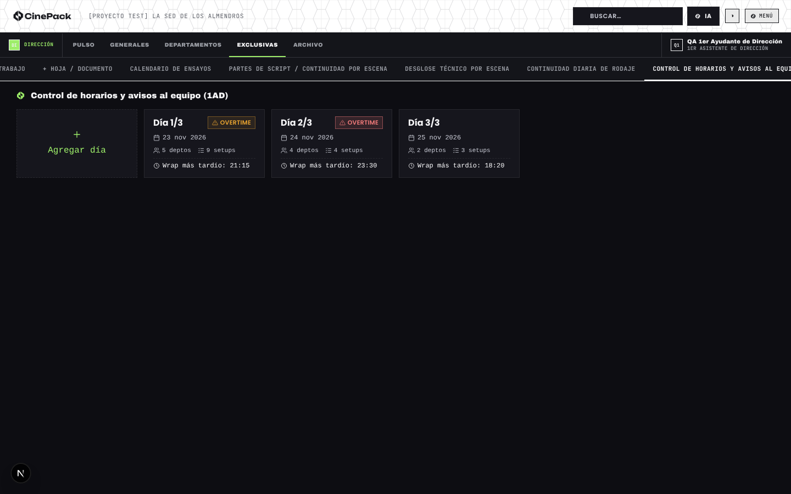
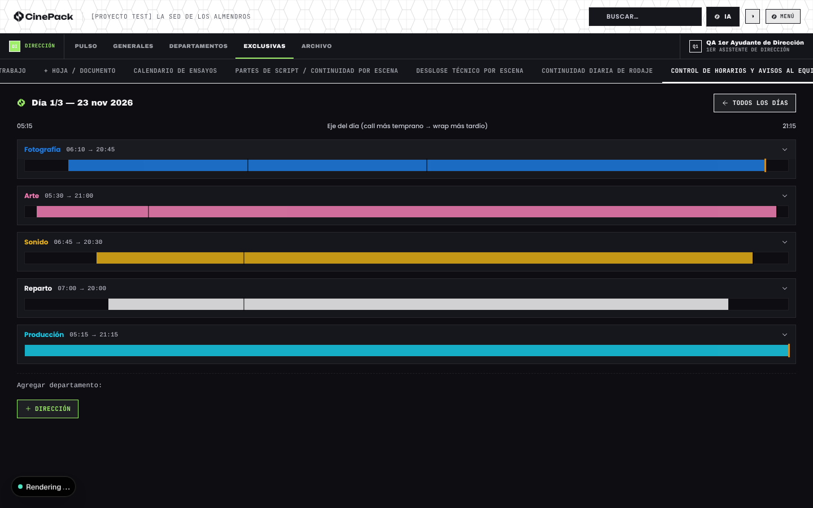
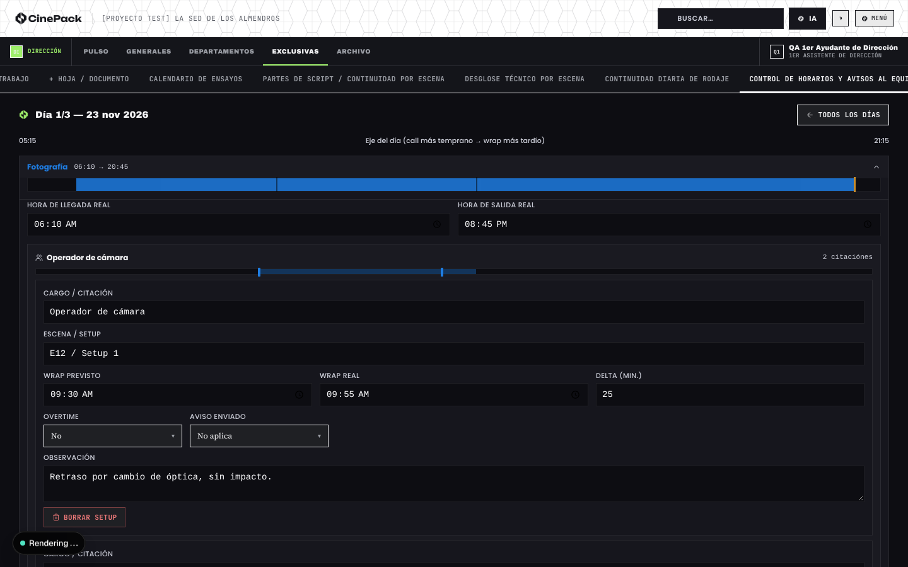
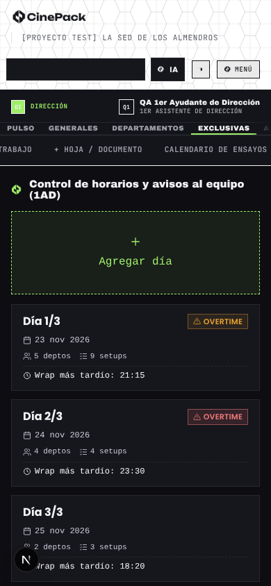
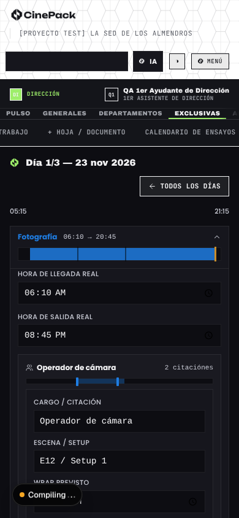

# Dossier — `dir-control-horarios-1ad` ("Control de horarios y avisos al equipo (1AD)")

Oficina de Agentes CINEPACK. 25/11/2026. Ronda 3 (rediseño a panel a medida).

## 1. Resumen ejecutivo

"Control de horarios y avisos al equipo (1AD)" es la herramienta exclusiva del cargo
**1er asistente de dirección** (departamento Dirección) para controlar el reloj del
día de rodaje. Tras dos rebotes de Nico (ronda 1: motor genérico de tabla de 7
columnas, "esto no es una herramienta, es simplemente un cuadro"), la herramienta hoy
es un **panel a medida de tres niveles**: tarjetas por día de rodaje → Gantt CSS de
presencia real por departamento dentro del día → detalle agrupado por cargo/citación
con el registro original de wrap previsto/real por setup. Ningún dato de la ronda 1 se
perdió: los 7 campos originales (`escena_setup`, `hora_prevista_wrap`,
`hora_real_wrap`, `delta_minutos`, `overtime`, `aviso_enviado`, `observacion`) viven
intactos como el nivel más profundo del árbol, ahora agrupados por departamento y por
cargo en vez de ser filas sueltas sin jerarquía. Durante este ciclo, QA encontró y el
desarrollador corrigió dos bugs bloqueantes verificados con Playwright real: (1) una
condición de carrera ("stale response") que pisaba datos recién guardados con una
respuesta tardía de otra herramienta, resuelta con el mismo patrón "most recent write
wins" que ya usa el motor genérico; (2) filas huérfanas del esquema viejo (ronda 1,
tabla plana) que quedaban invisibles sin ninguna vía de creación manual de un día
nuevo, resuelta con un botón "Agregar día" independiente de que `GENERAL_PLAN_RODAJE`
tenga datos. Verificado con Playwright real contra `cinepack-dev` en 390/820/1440px,
incluida una secuencia de 5 ediciones consecutivas confirmando persistencia en DB.

## 2. Origen de la idea

La entrada `dir-control-horarios-1ad` ya estaba en el catálogo de la app
(`app/herramientas.ts`, cargo 1er asistente de dirección) con un `hint` real
("Checklist de control de tiempos del día: wrap de cada setup, alertas de overtime,
notificaciones al equipo.") pero sin ningún panel construido. La ronda 1 la resolvió
migrando `tipo: "checklist"` → `tipo: "tabla"` con el motor genérico, razonamiento que
Nico rechazó dos veces: la primera vez por un texto introductorio de más; la segunda,
de fondo, aplicando la regla endurecida del propio 25/11/2026 (commit `80eee8a`):
panel a medida es el default, tabla genérica es la excepción reservada a contenido
estrictamente tabular (como presupuesto) — y el reloj del día de rodaje tiene una
jerarquía real (día → departamento → cargo/setup) que la tabla plana aplanaba sin
necesidad. Este dossier documenta la herramienta tal como existe en el código hoy,
tras ese rediseño.

## 3. El cargo

1er asistente de dirección (1AD) controla el reloj del día de rodaje de forma
operativa dentro del departamento Dirección. Es distinto de `dir-control-horarios`
("Asistencia de dirección", rediseñada en el ciclo del 22/11 como "Avisos y
confirmaciones de citación al equipo" — centro de avisos cualitativo, no bitácora de
tiempos). El 1AD necesita reconstruir, jornada por jornada: qué departamentos
estuvieron presentes y durante qué franja horaria real (no la citación planeada), qué
setups/citaciones concretas tuvo cada cargo dentro de ese departamento, y si algún
wrap cruzó overtime y si se avisó al equipo por ese cruce — nada de esto existía antes
en ningún lado del proyecto, ni siquiera en el callsheet (`GENERAL_ORDEN_RODAJE`), que
trae hora de citación planeada pero no presencia real ni wrap por setup.

## 4. Necesidades y dolores (con fuente)

El III Convenio colectivo estatal de la industria de producción audiovisual —técnicos—
(BOE-A-2024-6846, Resolución de 22/3/2024 de la Dirección General de Trabajo) sigue
vigente en general. La Audiencia Nacional (sentencia 21/4/2025, BOE-A-2025-9881,
19/5/2025, tras impugnación de CGT/TACE) anuló únicamente el art. 17.2.a) sobre
preaviso de 48h para cambios de horario ya fijados — **no hay anulación confirmada
sobre horas extraordinarias/overtime**.

**Artículo que regula horas extraordinarias: Artículo 18 ("Horas extraordinarias"),
Título V ("Jornada de trabajo").** Confirmado por el índice del convenio, recogido en
dos fuentes independientes del sector (no se pudo abrir el PDF oficial de BOE.es
directamente desde este entorno por restricción de red; contenido reportado vía
fuentes secundarias, pendiente de verificación directa):

- Son horas extraordinarias las que excedan la jornada efectiva pactada en cómputo
  **mensual** y las que superen el límite máximo diario. Las prolongaciones del art.
  16 no cuentan como extraordinarias si se compensan con descanso dentro de plazo.
- Compensación: descanso (90 minutos por cada hora prolongada, compensable dentro de
  los tres meses siguientes) o pago con recargo del 50% sobre la hora ordinaria (el II
  Convenio preveía 25% — subió en el III). En contratos menores a tres meses, o fijos
  discontinuos sin pacto previo, la empresa decide la forma de compensación.
- Jornada diaria total (incluyendo extras, montaje, desmontaje y descansos) no puede
  superar las 13 horas.
- Jornada general: máximo 40h semanales / 8h diarias; con "complemento de
  flexibilidad" (128,86 €/mes) la jornada diaria va de 5 a 9 horas (hasta 45h
  semanales en la práctica), con 48h de descanso semanal y 12h de descanso diario.

**Importante — no asumir el umbral de "overtime" como un número fijo:** el cómputo
real del convenio es mensual, no diario por evento. El campo `overtime` (No/Alerta/
Confirmado) es un indicador cualitativo de que el wrap real cruzó la jornada pactada o
el límite diario, no un contador aritmético de horas extra acumuladas. No se codifica
un umbral fijo (p. ej. "8h") sin revisión contra el texto oficial.

Referencia de industria (no española, orientativa de patrón de producto): plantillas
de "Daily Timesheet" de crew de cine/TV registran call time, meal break, wrap time y
turnaround — confirma que call/wrap previsto vs. real es el patrón estándar del
sector, y que registrar la presencia real por departamento (no solo la citación
planeada) es una necesidad reconocida de la industria.

**Pendiente de verificación explícito:** el contenido del art. 18 proviene de fuentes
secundarias, no de lectura directa del BOE (restricción de red de esta sesión). Antes
de cerrar cifras concretas en la UI (90 minutos, recargo 50%, límite 13h), un ciclo
posterior debe confirmar el texto literal contra el BOE o solicitar al usuario el PDF
oficial.

## 5. Estado del arte

Búsqueda dirigida a si StudioBinder, Yamdu, Movie Magic, SetHero o Celtx tienen un
registro de presencia real por departamento y wrap previsto vs. real por setup con
indicador de overtime:

- **StudioBinder**: sin evidencia de un registro de wrap previsto vs. real por setup
  con indicador de overtime; su "Call Sheet Terminology" describe campos de citación,
  no bitácora de presencia real ni eventos de tiempo.
- **Yamdu**: tiene "Time Tracking for the Film Industry" (propio del producto), pero
  sin evidencia de que desglose wrap previsto vs. real por setup, ni de una vista tipo
  Gantt de presencia por departamento dentro de la jornada.
- **Movie Magic Scheduling**: orientado a crear/optimizar/seguir cronogramas desde
  preparación hasta wrap, con colaboración en tiempo real y transferencia a Movie
  Magic Budgeting; sin evidencia de registro evento-por-evento de wrap real vs.
  prevista por setup, ni de Gantt de presencia real por departamento.
- **SetHero** — competidor con mayor evidencia de cobertura parcial: su IA "calcula
  horas extra (overtime)" y su reporte de producción diario incluye grilla de
  tripulación con hora de entrada/salida, violaciones de descanso y duración total
  trabajada **por persona**. Sin evidencia de que esto se visualice como línea de
  tiempo tipo Gantt por departamento, ni de que el cálculo esté desglosado por
  setup/escena dentro de cada presencia (solo agregado por persona/jornada).
- **Celtx**: sin evidencia encontrada de time tracking de wrap/overtime.

**Aspecto diferencial de CINEPACK, justificado:** la combinación de (a) una línea de
tiempo visual (Gantt) de presencia real por departamento dentro del día — cuándo
llegó y cuándo se fue cada departamento, no solo su citación planeada — con (b) el
detalle agrupado por cargo/citación y el registro por setup (wrap previsto vs. real,
delta, overtime, aviso al equipo) anidado dentro de esa misma vista, no tiene
equivalente confirmado en ningún competidor consultado. Se reporta como ausencia de
evidencia pública, no como confirmación de que ningún competidor lo tenga sin
publicitarlo.

### Fuentes de investigación (rondas 1 y 2)
- BOE, Resolución de 22/3/2024, III Convenio colectivo estatal de la industria de
  producción audiovisual (técnicos) — https://BOE.ES/boe/dias/2024/04/06/pdfs/BOE-A-2024-6846.pdf
- BOE, sentencia Audiencia Nacional 21/4/2025 (art. 17.2.a anulado), publicada
  19/5/2025 — https://www.boe.es/boe/dias/2025/05/19/pdfs/BOE-A-2025-9881.pdf
- Guía Profesional Audiovisual, "Convenio colectivo (Horas extras)" —
  https://guiaprofesionalaudiovisual.es/convenio-colectivo-audiovisual-horas-extras/
- Mentalegal, "Se publica en el BOE el III Convenio Colectivo..." —
  https://mentalegal.com/se-publica-en-el-boe-el-iii-convenio-colectivo-de-la-industria-de-la-produccion-audiovisual-tecnicos/
- Iberley, resumen de la Resolución de 22/3/2024 —
  https://www.iberley.es/convenios/sector/resolucion-18-marzo-2003-direccion-general-trabajo-que-se-dispone-inscripcion-registro-y-publicacion-revision-salarial-venio-colectivo-industria-produccion-audiovisual-tecnicos-1600650
- Film & TV Production Crew Daily Timesheet template —
  https://templates.platoforms.com/pdf/film-tv-production-crew-daily-timesheet
- Crew Call app (App Store) — https://apps.apple.com/au/app/crew-call/id1532198878
- StudioBinder, "Call Sheet Terminology" — https://www.studiobinder.com/blog/call-sheet-terminology/
- Yamdu, "Time Tracking for the Film Industry" —
  https://www.yamdu.com/en/learn/time-tracking-for-the-film-industry/
- EP.com, Movie Magic Scheduling — https://www.ep.com/movie-magic-scheduling
- SetHero, "Daily Production Reports Made Easy" — https://sethero.com/?p=39873

## 6. Propuesta

### Historia de las tres rondas
- **Ronda 1** (motor genérico): migró `checklist` → `tabla` con 7 columnas (ver
  modelo de datos abajo). Rechazada por Nico: "esto no es una herramienta, es
  simplemente un cuadro".
- **Ronda 2** (interpretación de la idea de Nico, mensaje de voz, documentada en
  `rediseno-panel-medida.md`): panel de 2 niveles — tarjeta por día + Gantt de
  presencia por departamento, con el registro de wrap por setup integrado dentro de
  cada barra.
- **Ronda 3** (ajuste de Nico directo sobre el panel construido, no estaba en la spec
  escrita de la ronda 2): dentro de cada barra de departamento, el detalle no es una
  lista plana de setups — se agrupa además **por cargo/citación** (ej. "Operador de
  cámara" vs. "Foquista" dentro de Fotografía), con su propia mini línea de tiempo de
  citaciones. Así queda el árbol final de tres niveles que describe este dossier: Día
  → Departamento (Gantt) → Cargo/citación (detalle agrupado, con los 7 campos
  originales del setup).

### Nivel 1 — Tarjetas por día de rodaje
Grilla de tarjetas, una por jornada. Cada tarjeta muestra de un vistazo, sin abrir
nada: fecha y "Día X/Y" (mismo formato que `GENERAL_ORDEN_RODAJE`/
`GENERAL_PLAN_RODAJE`), cantidad de departamentos con presencia y de setups
registrados ese día (conteos derivados, no campos a mantener a mano), un chip de
overtime del día (rojo/ámbar "Overtime" si algún setup del día es "Confirmado" o
"Alerta"; sin chip si todo es "No" — estado limpio, no un chip verde redundante), y la
hora de wrap más tardía registrada ese día entre todos los departamentos (el dato que
más le importa al 1AD de un vistazo). La lista de días se deriva leyendo
`GENERAL_PLAN_RODAJE` (columnas `dia`/`fecha`, lectura pura) fusionada con cualquier
fecha que ya tenga entradas propias en esta herramienta — nunca se pierde una jornada
con datos reales solo porque el plan de rodaje todavía no la menciona. Un botón
"Agregar día" (tarjeta punteada, siempre visible cuando `editable`) permite crear una
jornada manualmente con la fecha que el 1AD indique, sin depender de que el plan de
rodaje tenga esa fecha cargada (ver sección 10, Bug 2).

### Nivel 2 — Gantt de presencia por departamento
Al abrir la tarjeta de un día: un eje horizontal continuo desde la hora de call más
temprana hasta la hora de wrap más tardía registradas ese día (calculado de los
propios datos; con fallback 06:00–22:00 si el día está recién creado), y una barra
horizontal por departamento con presencia ese día — el inicio de la barra es la hora
de llegada real, el fin la hora de salida real (campos nuevos: `hora_llegada_real`/
`hora_salida_real`, que no existían en ningún lado del proyecto: `GENERAL_ORDEN_RODAJE
.llamadas` es la citación *planeada* antes del día, un JSON de formato libre sin
parser, no la presencia *real* registrada durante la jornada — datos de naturaleza
distinta, mismo criterio ya aplicado a `hora_prevista_wrap` vs. `hora_real_wrap`). Es
un Gantt de un solo eje temporal con pocas barras (típicamente menos de 15), resuelto
con `div`s posicionados en `left`/`width` por porcentaje client-side — sin librería de
Gantt (serían pensadas para proyectos con dependencias de tareas, pesadas para este
caso). Dentro de cada barra se ven marcas (`ch1-marca`) por cada setup, coloreadas
según su `overtime` (ámbar si "Alerta", roja si "Confirmado"). Si el día recién se
crea y no tiene ningún departamento todavía, el estado vacío no es una línea de tiempo
en blanco: ofrece accesos directos a los departamentos reales del proyecto (Fotografía,
Arte, Sonido, Reparto, Producción, Dirección) para arrancar la primera barra.

### Nivel 3 — Detalle agrupado por cargo/citación
Tocar la cabecera o la barra de un departamento expande su detalle: inputs de hora de
llegada/salida real del departamento, y debajo, los setups de ese departamento
**agrupados por cargo** (`agruparPorCargo`) — cada grupo de cargo (ej. "Operador de
cámara") muestra cuántas citaciones tiene ese día y una mini línea de tiempo propia con
una marca por citación, ubicada según su franja horaria dentro del eje del día. Dentro
de cada grupo, cada setup conserva sin pérdida los 7 campos originales de la ronda 1:
`cargo` (nuevo, habilita la agrupación), `escena_setup`, `hora_prevista_wrap`,
`hora_real_wrap`, `delta_minutos`, `overtime` (No/Alerta/Confirmado), `aviso_enviado`
(Pendiente/Enviado/No aplica) y `observacion`. Botones para agregar un setup/citación
nuevo dentro del departamento, o quitar el departamento completo del día (con
confirmación).

### Modelo de datos final (jerárquico, no tabla plana)
Una fila (documento) por día de rodaje en `herramienta_filas.datos` (jsonb), con un
array anidado de departamentos y, dentro de cada uno, un array anidado de setups —
mismo patrón que ya usa `GENERAL_ORDEN_RODAJE` para guardar JSON de formato libre
dentro de una columna `largo`:

| key | tipo | contenido |
|---|---|---|
| `dia_fecha` | fecha | fecha de la jornada (correlación 1:1 con `GENERAL_PLAN_RODAJE.fecha`) |
| `departamentos` | largo (JSON) | array de `{ departamento, hora_llegada_real, hora_salida_real, setups: [{ id, cargo, escena_setup, hora_prevista_wrap, hora_real_wrap, delta_minutos, overtime, aviso_enviado, observacion }] }` |

No se propone ningún `ColTipo` nuevo: `repetible` no declara anidamiento recursivo (un
repetible dentro de otro), así que el render es bespoke (`ControlHorarios1ADPanel.tsx`)
en vez de motor genérico — el componente a medida interpreta el JSON libre con la
estructura que necesita, igual que ya hace `GENERAL_ORDEN_RODAJE` con sus columnas
JSON. Se documenta como limitación conocida de `repetible`, no como bloqueo.

### Por qué NO se fusiona con `dir-control-horarios` (Asistencia de dirección)
Son dos naturalezas de dato distintas: `dir-control-horarios-1ad` es una bitácora de
presencia real y eventos de tiempo por departamento/setup; `dir-control-horarios`
(rediseñada 22/11 como "Avisos y confirmaciones de citación al equipo") es un centro
de avisos cualitativo por destinatario. Fusionarlas obligaría a modelar en una sola
fila dos granularidades distintas, ensuciando ambas. Un primer intento automático de
corrección del bug de jerarquía de cargos (sección 10) que proponía fusionar ambos
cargos fue descartado explícitamente por esta misma razón.

### Permisos
Herramienta de departamento (Dirección), cargo 1er asistente de dirección. Edición:
1AD y jefe de departamento Dirección vía `control_depto_permisos`
(`es_jefe_de_depto` + `caller_departamento()`). Lectura: resto del equipo con acceso
al proyecto, salvo que se oculte vía `herramienta_visibilidad`. No es `personal_tool`
— todo el contenido (tarjetas, barras, setups) vive en el espacio común del proyecto,
porque es un registro de hechos del día de rodaje, por definición compartido. El
cambio de forma de panel genérico a panel bespoke no altera quién puede leer/escribir
sobre `herramienta_filas` para este `herramienta_id`, solo la forma del `datos`
(jsonb) que se guarda y cómo se renderiza — no se requiere migración de RLS nueva.

## 7. Integración

- **Con el propio departamento (Dirección)**: `aviso_enviado` (ahora un campo dentro
  de cada setup anidado, no una columna de tabla plana) sigue siendo el puente
  conceptual hacia `dir-control-horarios` (Asistencia) — cuando `overtime` cruza a
  "Alerta"/"Confirmado", el aviso se ejecuta y registra allá. Sin integración
  automática de datos en este ciclo: no hay escritura cruzada, solo coherencia
  terminológica. Sin relación de datos directa con "2ª Asistencia de dirección"
  (figuración/extras) — comparten `escena` como texto libre sin normalización.

- **Con el proyecto (plan de rodaje)**: dos lecturas puras, sin escritura cruzada
  nunca:
  1. **Nivel 1** lee `GENERAL_PLAN_RODAJE.dia`/`fecha` para generar la lista de
     tarjetas de día (ver sección 6). Si `GENERAL_PLAN_RODAJE` no tiene ninguna fila
     todavía, la tarjeta de día igual puede existir vía "Agregar día" — la fuente de
     la lista de días no es un requisito duro para operar la herramienta.
  2. **Nivel 3** valida `escena_setup` contra `GENERAL_PLAN_RODAJE.escenas` (columna
     de texto libre, confirmada por el input `<input className="ps-esc">` en
     `HerramientaPanel.tsx`) por **coincidencia de subcadena** — la única operación
     segura sobre texto libre sin esquema. Se descartó `GENERAL_ORDEN_RODAJE.escenas`
     como fuente porque es un blob JSON de formato libre sin parser en código. La
     validación se dispara en el `onBlur` del input de `escena_setup` dentro de
     `SetupFila` (`ControlHorarios1ADPanel.tsx`): icono `check` verde (`var(--lime)`)
     + tooltip "Aparece en el Plan de rodaje" si se encuentra; `alert-triangle` ámbar
     (`var(--amber)`) si no (no bloquea el guardado); ningún icono si el plan todavía
     no tiene filas. `escena_setup` mezcla escena y setup (ej. "E22/Setup A"); solo la
     parte de escena (antes de la barra) es comparable contra el plan. Riesgo abierto:
     comparación de subcadena sin normalización de números de escena puede dar falsos
     negativos (ej. "Esc. 12" vs "12") — documentado como ayuda, no validación
     estricta.
  - Sin escritura automática hacia `GENERAL_PLAN_RODAJE`/`GENERAL_CALENDARIO`: el
    histórico de wraps/presencia real es lectura manual para quien lo necesite. Sin
    impacto en presupuesto (`ej-presupuesto-costos`): `delta_minutos`/`overtime` no
    alimentan ninguna partida de horas extra hasta confirmar el umbral contra el
    convenio real.

- **Con otros departamentos**: Producción (parte de producción diario) necesitaría
  leer el resumen de overtime y presencia del día — hoy esa comunicación es manual.
  Como la presencia real por departamento existe ahora de forma estructurada por
  primera vez en el proyecto, cada jefe de departamento (Fotografía, Arte, Vestuario,
  etc.) tiene, por primera vez, un motivo real para querer LEER (no editar) la barra
  de su propio departamento en días pasados — útil para negociar llamados en días
  futuros similares. Se documenta como posibilidad de lectura cross-departamento, sin
  mecanismo de permisos nuevo construido en este ciclo (ver riesgos, sección 10).
  RRHH ("Control de horas", fines de cumplimiento legal) no se nutre automáticamente
  de esta herramienta sin que investigación confirme el criterio legal de cómputo de
  horas extra — relación potencial futura, no conectada ahora.

### Implementación y verificación real
Implementado en `app/hoy/ControlHorarios1ADPanel.tsx` (componente a medida) +
`app/hoy/useControlHorarios1ad.ts` (hook de datos, `load()`/`crearDia()`/
`guardarDia()`) + `app/hoy/controlHorarios1adFilas.ts` (tipos, helpers de cálculo —
`ejeDelDia`, `posicionPct`, `overtimeDia`, `wrapMasTardio`, `cantidadSetups`,
`agruparPorCargo` — y `DIAS_EJEMPLO`, el contenido precargado real y variado que
siembra la herramienta si el proyecto no tiene ninguna jornada propia todavía). La
validación contra `GENERAL_PLAN_RODAJE` se trasladó del `onBlur` de una celda de tabla
genérica (ronda 1) al `onBlur` del input de `escena_setup` dentro de `SetupFila`
(ronda 3) sin perder ninguno de los 3 casos de la especificación original. `npx tsc
--noEmit`: limpio en todos los cambios de este ciclo.

## 8. Diseño visual

Panel a medida, sin motor genérico de tabla. Esquinas en punta, paleta real de
`sistema-diseno.md`: cada barra del Gantt usa un tono real del sistema por
departamento (Fotografía `var(--blue)`, Arte `var(--pink)`, Sonido `var(--gold)`,
Reparto `var(--white)`, Producción `var(--cyan)`, Dirección `var(--lime)`), sin
inventar paleta nueva. El chip de overtime reutiliza la variante de chip ya existente
del sistema (fuerte/tenue según "Confirmado"/"Alerta"). Cero texto explicativo
renderizado al abrir (regla endurecida 25/11/2026): la vista no imprime ningún hint —
el campo `hint` de `herramientas.ts` sigue existiendo solo como documentación interna.
Mobile-first: en 390px el Gantt apila las barras verticalmente con scroll vertical de
página (no horizontal), y el detalle de nivel 3 se despliega en una columna.

### Capturas reales de la herramienta en uso

Capturas Playwright reales contra `cinepack-dev`, cuenta `qa.dir-1ad2@mailinator.com`,
proyecto `[PROYECTO TEST] La sed de los almendros` — no mockups, contenido precargado
real y variado (`DIAS_EJEMPLO`: 3 jornadas, hasta 5 departamentos y 9 setups en un
mismo día, con casos de overtime "Alerta"/"Confirmado" y "No").

**Nivel 1 — tarjetas por día (escritorio, 1440px):**

**Nivel 2 — Gantt de presencia por departamento (escritorio, 1440px):**

**Nivel 3 — detalle agrupado por cargo (escritorio, 1440px):**

**Tablet (820px), nivel 3 abierto:**

**Móvil (390px) — nivel 1:**

**Móvil (390px) — nivel 3:**

## 9. Especificación técnica

- **Componentes**: `app/hoy/ControlHorarios1ADPanel.tsx` (panel bespoke de 3 niveles,
  `DepartamentoBarra` y `SetupFila` como subcomponentes), `app/hoy/
  useControlHorarios1ad.ts` (hook de datos contra `herramienta_filas`), `app/hoy/
  controlHorarios1adFilas.ts` (tipos `DiaControlHorarios`/`DepartamentoDia`/
  `SetupHorario`, helpers de cálculo, `DIAS_EJEMPLO`).
- **Modelo de datos**: ver sección 6 — una fila por día (`dia_fecha` + `departamentos`
  JSON anidado de 2 niveles), sin `ColTipo` nuevo.
- **Librerías**: ninguna dependencia nueva. El Gantt es CSS puro (`div`s posicionados
  por porcentaje), no una librería de Gantt completa (seria sobredimensionada para un
  solo eje temporal sin dependencias entre tareas).
- **Definición de catálogo** (`app/herramientas.ts`): conserva el `id`
  `dir-control-horarios-1ad` y el `hint` original como documentación interna; el
  render real para este id es el panel bespoke, no el motor genérico.
- **Fix de jerarquía de cargos** (`app/constants.ts`): se agregó
  `"1er asistente de dirección"` a `JERARQUIA_POR_DEPARTAMENTO["Dirección"]`
  (sección 10) — sin el cual este cargo era estructuralmente inalcanzable.
- Verificación: `npx tsc --noEmit` limpio en todos los cambios de este ciclo.

## 10. Riesgos y preguntas abiertas / Correcciones de QA

### Fix del cargo faltante en `JERARQUIA_POR_DEPARTAMENTO` (25/11/2026)
QA detectó que el cargo "1er asistente de dirección" **no existía en
`JERARQUIA_POR_DEPARTAMENTO`** (`app/constants.ts`) — el selector de cargo en
`/crear-perfil` y el self-update de perfil solo ofrecen los valores de esa lista, así
que este cargo era estructuralmente inalcanzable para cualquier usuario real,
independientemente de cualquier otro bug. Afectaba no solo a
`dir-control-horarios-1ad` sino también a las herramientas ya existentes de ese cargo
(`dirBreakdownTecnico`, `dirContinuidadDiaria`). Un primer intento automático de
corrección (fusionar este cargo con "Asistencia de dirección") fue descartado por
mezclar dos herramientas de naturaleza deliberadamente distinta. Se corrigió
agregando `"1er asistente de dirección"` a `JERARQUIA_POR_DEPARTAMENTO["Dirección"]`,
preservando la separación de cargos ya decidida. Mismo fix entregado por separado
contra `main` real (rama `fix-beta-gating-making-reparto`), porque el gap es
preexistente y también afecta a producción.

### Bug de perfil encontrado (distinto, no resuelto en este ciclo)
Al loguear la cuenta de QA, el badge de cargo mostraba "Asistencia de dirección"
(cargo equivocado) y Exclusivas solo listaba la herramienta del otro cargo. El
gating real de qué herramientas de "cargo" se muestran en `/hoy` usa el campo
singular `profiles.cargo`, **no** la tabla `user_roles` que edita la pantalla
`/perfil`. Usar la UI de `/perfil` para agregar el cargo correcto (chip añadido
correctamente a `user_roles`) **no tuvo ningún efecto** sobre Exclusivas, porque
`profiles.cargo` seguía con el valor viejo. Destrabado para QA vía `PATCH`
autenticado directo (self-update RLS) sin tocar código. Recomendado a Nico/
arquitectura: `/perfil` debería actualizar también `profiles.cargo`, o el gating de
Exclusivas debería leer de `user_roles`. **No resuelto en este ciclo**, documentado
para un ciclo futuro.

### Bug real de condición de carrera ("stale response" al guardar) — encontrado, causa raíz confirmada y corregido
QA reportó que, en la primera carga, los datos ya guardados desaparecían visualmente
unos ~500ms después de aparecer correctamente, aunque la base de datos no perdía
nada. **Causa raíz confirmada con instrumentación**: el sub-componente que mantiene el
estado de filas se reutiliza sin remount cuando el panel padre cambia qué herramienta
muestra; dos efectos del panel padre (auto-select de la primera herramienta disponible
y restore de la última herramienta abierta) pueden resolverse en momentos distintos,
de forma que un fetch de OTRA herramienta que quedó en vuelo resolvía después y pisaba
con `[]` los datos recién cargados de esta herramienta (patrón clásico de "stale
response"). **Fix aplicado**: un contador de "pedido más reciente" (`loadReqRef`) —
cada operación de carga/guardado toma un id al entrar y, si al resolver ya no es la
más reciente, se descarta sin tocar el estado — mismo patrón "most recent write wins"
que ya usa el motor genérico de tabla (`HerramientaPanel.tsx`) para el mismo problema,
aplicado aquí al hook `useControlHorarios1ad`. **Verificación**: `npx tsc --noEmit`
sin errores; reproducción real con Playwright: una secuencia de 5 ediciones
consecutivas sobre el mismo día (hora de llegada/salida, campos de setup) confirmó
persistencia estable en DB en cada paso, sin ninguna reversión visual a un estado
vacío o desactualizado.

### Bug real de filas huérfanas sin vía de creación manual — encontrado y corregido
El esquema viejo (ronda 1, tabla plana) había dejado filas de prueba en el formato
anterior que no calzaban con el modelo jerárquico nuevo (`dia_fecha`/
`departamentos`) — quedaban invisibles en el panel nuevo, sin ningún control en la UI
para crear un día manualmente si `GENERAL_PLAN_RODAJE` no tenía esa fecha cargada
(nivel 1 dependía solo de la lectura del plan de rodaje). **Fix aplicado**: (a) se
limpiaron los datos de QA obsoletos del esquema viejo; (b) se agregó el botón
"Agregar día" (tarjeta punteada en nivel 1, función `agregarDiaManual`) que pide la
fecha de la nueva jornada (con una fecha sugerida razonable) y crea la fila
`dia_fecha`/`departamentos: []` directamente, sin depender de que el plan de rodaje
tenga esa fecha — la fuente de la lista de días deja de ser un requisito duro para
poder operar la herramienta desde el primer día.

### No regresión
- `npm run lint`: mismos errores/warnings preexistentes, nada nuevo atribuible a este
  cambio.
- `npm run build`: no evaluable en este entorno (symlink de `node_modules` rompe
  Turbopack — problema de worktree, no de código); se usó `next build --webpack`
  según el workaround ya documentado para worktrees.
- No afecta a `dir-control-horarios` (Asistencia de dirección), que sigue siendo una
  herramienta separada sin cambios.

### Responsive
- **390px**: sin scroll horizontal a nivel de página; el Gantt apila las barras
  verticalmente (scroll vertical normal de página), operable de punta a punta
  (alta/edición/borrado de departamentos y setups reales).
- **820px / 1440px**: más barras/columnas visibles sin scroll interno adicional.
- `qa_responsive_ok: true` para ancho/overflow en los tres anchos, confirmado
  interactuando (no solo con capturas) con la herramienta real.

### Riesgos / preguntas abiertas que siguen pendientes
- El anidamiento de 2 niveles (departamento → setup) como JSON libre dentro de
  `largo` depende enteramente de que el componente bespoke lo parsee bien — no hay
  validación de esquema a nivel de `ColTipo` ni de Supabase (jsonb sin schema). Mismo
  riesgo estructural que ya acepta `GENERAL_ORDEN_RODAJE` hoy.
- La lectura cross-departamento (jefe de Fotografía viendo su propia barra en días
  pasados) no tiene mecanismo de permisos definido — se señala como posibilidad, no
  se diseña su RLS en este ciclo; si Nico la quiere, es un expediente aparte.
- Confirmación del texto literal del art. 18 y del Título V del III Convenio
  directamente contra el BOE oficial, en cuanto el acceso de red lo permita, o PDF
  oficial aportado por el usuario — antes de fijar cifras concretas (90 minutos,
  recargo 50%, límite 13h) en la UI.
- Bug preexistente de `/perfil` no escribiendo `profiles.cargo` — documentado, sin
  resolver en este ciclo.

## 11. Fuentes

- BOE, Resolución de 22/3/2024, III Convenio colectivo estatal de la industria de
  producción audiovisual (técnicos) — https://BOE.ES/boe/dias/2024/04/06/pdfs/BOE-A-2024-6846.pdf
  (no accesible directamente desde este entorno por restricción de red; referenciado
  vía fuentes secundarias)
- BOE, sentencia Audiencia Nacional 21/4/2025 (art. 17.2.a anulado), publicada
  19/5/2025 — https://www.boe.es/boe/dias/2025/05/19/pdfs/BOE-A-2025-9881.pdf
- Guía Profesional Audiovisual, "Convenio colectivo (Horas extras)" —
  https://guiaprofesionalaudiovisual.es/convenio-colectivo-audiovisual-horas-extras/
- Mentalegal, "Se publica en el BOE el III Convenio Colectivo de la industria de la
  producción audiovisual (técnicos)" —
  https://mentalegal.com/se-publica-en-el-boe-el-iii-convenio-colectivo-de-la-industria-de-la-produccion-audiovisual-tecnicos/
- Iberley, resumen de la Resolución de 22/3/2024 —
  https://www.iberley.es/convenios/sector/resolucion-18-marzo-2003-direccion-general-trabajo-que-se-dispone-inscripcion-registro-y-publicacion-revision-salarial-venio-colectivo-industria-produccion-audiovisual-tecnicos-1600650
- Film & TV Production Crew Daily Timesheet template (referencia de patrón de
  producto, no normativa española) —
  https://templates.platoforms.com/pdf/film-tv-production-crew-daily-timesheet
- Crew Call app (App Store, referencia de patrón de producto) —
  https://apps.apple.com/au/app/crew-call/id1532198878
- StudioBinder, "Call Sheet Terminology" — https://www.studiobinder.com/blog/call-sheet-terminology/
  (consultado 25/11/2026)
- Yamdu, "Time Tracking for the Film Industry" —
  https://www.yamdu.com/en/learn/time-tracking-for-the-film-industry/ (consultado
  25/11/2026)
- EP.com, página de producto Movie Magic Scheduling —
  https://www.ep.com/movie-magic-scheduling (consultado 25/11/2026)
- SetHero, "Daily Production Reports Made Easy" — https://sethero.com/?p=39873
  (consultado 25/11/2026)
- `app/herramientas.ts`, `app/hoy/ControlHorarios1ADPanel.tsx`, `app/hoy/
  useControlHorarios1ad.ts`, `app/hoy/controlHorarios1adFilas.ts`, `app/constants.ts`
  — verificación de código real para arquitectura, integración y fixes.
- `oficina/expedientes/2026-11-25_direccion_control-horarios-1ad/necesidad.md`
  (ronda 1) y `rediseno-panel-medida.md` (ronda 2) — historial completo de las
  rondas de revisión, consolidado en este dossier.
