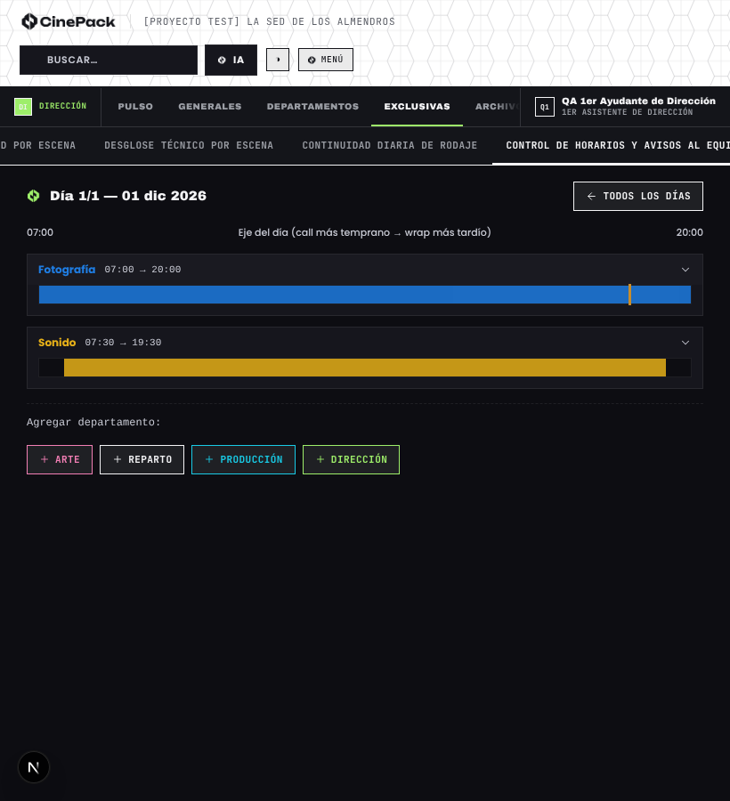
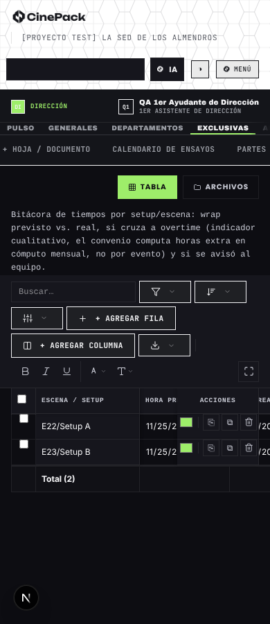

# Dossier — `dir-control-horarios-1ad` ("Control de horarios y avisos al equipo (1AD)")

Oficina de Agentes CINEPACK. 25/11/2026.

## 1. Resumen ejecutivo

"Control de horarios y avisos al equipo (1AD)" es la herramienta exclusiva del cargo
**1er asistente de dirección** (departamento Dirección) para registrar, setup a setup,
la bitácora cuantitativa del reloj del día de rodaje: hora prevista de wrap vs. hora
real, delta en minutos, si ese setup cruzó overtime y si se avisó al equipo por ese
cruce. Migra de `tipo: "checklist"` (hint real, sin columnas) a `tipo: "tabla"` con 7
columnas, usando el motor genérico ya existente en el repo — sin componente a medida.
Durante este ciclo se encontraron y corrigieron tres problemas reales: (1) el cargo
"1er asistente de dirección" no existía en `JERARQUIA_POR_DEPARTAMENTO`, lo que hacía
la herramienta estructuralmente inalcanzable; (2) un bug de condición de carrera
("stale response") en el motor genérico de tabla que hacía desaparecer visualmente
filas ya guardadas, corregido con un contador de pedido más reciente que beneficia a
toda herramienta `tabla`/`galería`/etc., no solo a esta; (3) un bug preexistente en
`/perfil` (no actualiza `profiles.cargo`), documentado pero no resuelto en este ciclo.
Se implementó además un flujo de integración real (ronda 2): validación liviana de
`escena_setup` contra `GENERAL_PLAN_RODAJE`. Verificado con Playwright en 390/820/1440px.
Listo para Corte en lo que respecta al bug de condición de carrera.

## 2. Origen de la idea

La entrada `dir-control-horarios-1ad` ya estaba en el catálogo de la app
(`app/herramientas.ts:2623`, cargo 1er asistente de dirección) con un `hint` real
("Checklist de control de tiempos del día: wrap de cada setup, alertas de overtime,
notificaciones al equipo.") pero seguía siendo `tipo: "checklist"` sin columnas
declaradas y sin panel a medida en `app/hoy/`. No es una herramienta inventada: es una
entrada ya reservada que el ciclo de hoy (25/11/2026) eligió trabajar, migrándola de
`checklist` a `tabla` porque el motor genérico de tabla ya alcanza para el dato que
necesita registrar.

## 3. El cargo

1er asistente de dirección (1AD) controla el reloj del día de rodaje de forma
operativa dentro del departamento Dirección. Es distinto de `dir-control-horarios`
("Asistencia de dirección", rediseñada en el ciclo del 22/11 como "Avisos y
confirmaciones de citación al equipo" — centro de avisos cualitativo, no bitácora de
tiempos). El 1AD necesita un registro de EVENTOS DE TIEMPO por setup/escena: hora
prevista de wrap, hora real, si cruza umbral de overtime y si se avisó al equipo —
nada de esto existía antes en ningún lado del proyecto, ni siquiera en el callsheet
(`GENERAL_ORDEN_RODAJE`), que trae hora de citación pero no horas de wrap por setup.

## 4. Necesidades y dolores (con fuente)

El III Convenio colectivo estatal de la industria de producción audiovisual —técnicos—
(BOE-A-2024-6846, Resolución de 22/3/2024 de la Dirección General de Trabajo) sigue
vigente en general. La Audiencia Nacional (sentencia 21/4/2025, BOE-A-2025-9881,
19/5/2025, tras impugnación de CGT/TACE) anuló únicamente el art. 17.2.a) sobre
preaviso de 48h para cambios de horario ya fijados — **no hay anulación confirmada
sobre horas extraordinarias/overtime**.

**Artículo que regula horas extraordinarias: Artículo 18 ("Horas extraordinarias"),
Título V ("Jornada de trabajo").** Confirmado por el índice del convenio, recogido en
dos fuentes independientes del sector (no se pudo abrir el PDF oficial de BOE.es
directamente desde este entorno por restricción de red; contenido reportado vía
fuentes secundarias, pendiente de verificación directa):

- Son horas extraordinarias las que excedan la jornada efectiva pactada en cómputo
  **mensual** y las que superen el límite máximo diario. Las prolongaciones del art.
  16 no cuentan como extraordinarias si se compensan con descanso dentro de plazo.
- Compensación: descanso (90 minutos por cada hora prolongada, compensable dentro de
  los tres meses siguientes) o pago con recargo del 50% sobre la hora ordinaria (el II
  Convenio preveía 25% — subió en el III). En contratos menores a tres meses, o fijos
  discontinuos sin pacto previo, la empresa decide la forma de compensación.
- Jornada diaria total (incluyendo extras, montaje, desmontaje y descansos) no puede
  superar las 13 horas.
- Jornada general: máximo 40h semanales / 8h diarias; con "complemento de
  flexibilidad" (128,86 €/mes) la jornada diaria va de 5 a 9 horas (hasta 45h
  semanales en la práctica), con 48h de descanso semanal y 12h de descanso diario.

**Importante — no asumir el umbral de "overtime" como un número fijo:** el cómputo
real del convenio es mensual, no diario por evento. La columna `overtime` propuesta
(No/Alerta/Confirmado) es un indicador cualitativo de que el wrap real cruzó la
jornada pactada o el límite diario, no un contador aritmético de horas extra
acumuladas. No se codifica un umbral fijo (p. ej. "8h") sin revisión contra el texto
oficial.

Referencia de industria (no española, orientativa de patrón de producto): plantillas
de "Daily Timesheet" de crew de cine/TV registran call time, meal break, wrap time y
turnaround — confirma que call/wrap previsto vs. real es el patrón estándar del sector.

**Pendiente de verificación explícito:** el contenido del art. 18 proviene de fuentes
secundarias, no de lectura directa del BOE (restricción de red de esta sesión). Antes
de cerrar cifras concretas en la UI (90 minutos, recargo 50%, límite 13h), un ciclo
posterior debe confirmar el texto literal contra el BOE o solicitar al usuario el PDF
oficial.

## 5. Estado del arte

Búsqueda dirigida a si StudioBinder, Yamdu, Movie Magic, SetHero o Celtx tienen un
registro de wrap time previsto vs. real por setup con indicador de overtime:

- **StudioBinder**: sin evidencia de un registro de wrap previsto vs. real por setup
  con indicador de overtime; su "Call Sheet Terminology" describe campos de citación,
  no bitácora de eventos de tiempo.
- **Yamdu**: tiene "Time Tracking for the Film Industry" (propio del producto), pero
  sin evidencia de que desglose wrap previsto vs. real por setup con alerta
  automática de overtime.
- **Movie Magic Scheduling**: orientado a crear/optimizar/seguir cronogramas desde
  preparación hasta wrap, con colaboración en tiempo real y transferencia a Movie
  Magic Budgeting; sin evidencia de registro evento-por-evento de wrap real vs.
  prevista por setup.
- **SetHero** — competidor con mayor evidencia de cobertura parcial: su IA "calcula
  horas extra (overtime)" y su reporte de producción diario incluye grilla de
  tripulación con hora de entrada/salida, violaciones de descanso y duración total
  trabajada por persona. Sin evidencia de que ese cálculo esté desglosado por
  setup/escena (solo por persona/jornada).
- **Celtx**: sin evidencia encontrada de time tracking de wrap/overtime.

**Aspecto diferencial de CINEPACK, justificado:** la granularidad **por setup/escena**
(no solo por persona o por jornada completa) del registro de wrap previsto vs. real,
junto con el campo `aviso_enviado` que conecta el evento de overtime con la acción
operativa de avisar al equipo, no tiene equivalente confirmado en ningún competidor
consultado. Se reporta como ausencia de evidencia pública, no como confirmación de que
ningún competidor lo tenga sin publicitarlo.

### Fuentes de investigación (rondas 1 y 2)
- BOE, Resolución de 22/3/2024, III Convenio colectivo estatal de la industria de
  producción audiovisual (técnicos) — https://BOE.ES/boe/dias/2024/04/06/pdfs/BOE-A-2024-6846.pdf
- BOE, sentencia Audiencia Nacional 21/4/2025 (art. 17.2.a anulado), publicada
  19/5/2025 — https://www.boe.es/boe/dias/2025/05/19/pdfs/BOE-A-2025-9881.pdf
- Guía Profesional Audiovisual, "Convenio colectivo (Horas extras)" —
  https://guiaprofesionalaudiovisual.es/convenio-colectivo-audiovisual-horas-extras/
- Mentalegal, "Se publica en el BOE el III Convenio Colectivo..." —
  https://mentalegal.com/se-publica-en-el-boe-el-iii-convenio-colectivo-de-la-industria-de-la-produccion-audiovisual-tecnicos/
- Iberley, resumen de la Resolución de 22/3/2024 —
  https://www.iberley.es/convenios/sector/resolucion-18-marzo-2003-direccion-general-trabajo-que-se-dispone-inscripcion-registro-y-publicacion-revision-salarial-venio-colectivo-industria-produccion-audiovisual-tecnicos-1600650
- Film & TV Production Crew Daily Timesheet template —
  https://templates.platoforms.com/pdf/film-tv-production-crew-daily-timesheet
- Crew Call app (App Store) — https://apps.apple.com/au/app/crew-call/id1532198878
- StudioBinder, "Call Sheet Terminology" — https://www.studiobinder.com/blog/call-sheet-terminology/
- Yamdu, "Time Tracking for the Film Industry" —
  https://www.yamdu.com/en/learn/time-tracking-for-the-film-industry/
- EP.com, Movie Magic Scheduling — https://www.ep.com/movie-magic-scheduling
- SetHero, "Daily Production Reports Made Easy" — https://sethero.com/?p=39873

## 6. Propuesta

### Decisión de id y tipo
- **Id**: se mantiene `dir-control-horarios-1ad` — slug interno sin filas de
  producción precargadas que dependan de él.
- **Tipo**: migra `"checklist"` → `"tabla"`. El motor genérico (`esMulti` en
  `HerramientaPanel.tsx:351`, que agrupa `"tabla"` y `"galeria"`) ya soporta las
  columnas propuestas con tipos existentes (`texto`, `fecha`, `num`, `estado`,
  `largo`), sin componente a medida ni `ColTipo` nuevo.

### Por qué `tipo: "tabla"` (log cronológico por setup) y no una vista agrupada
1. **La unidad atómica del dato es el evento, no el agregado.** Cada fila es un hecho
   discreto por setup/escena. Una vista agrupada con un solo "overtime total del día"
   perdería el dato que el 1AD necesita reconstruir: EN QUÉ setup concreto ocurrió el
   cruce, para el parte de producción o una negociación de horas extra. Agregar sobre
   un log es trivial y reversible; lo inverso no.
2. **Cardinalidad real y variable por jornada** (3 a 15 setups): no justifica una
   ficha de N campos fijos ni una estructura jerárquica anidada. `tabla` es el motor
   ya usado en el repo para "N eventos de la misma forma, cantidad variable".
3. **Precedente directo en el repo**: `GENERAL_ORDEN_RODAJE` (callsheet) es
   `tipo: "tabla"` con una fila por jornada — mismo razonamiento un nivel de
   granularidad más abajo (una fila por setup en vez de por jornada). Ninguna
   herramienta del repo modela una bitácora cronológica como "vista agrupada"; cuando
   el repo necesita un resumen, lo computa client-side sobre una tabla de eventos (ver
   `GestionDocumentalBoard`/`gdEstado()`).
4. **La vista agrupada sigue siendo posible como lectura derivada** en un ciclo
   futuro (p. ej. "3 overtimes hoy, 42 min de delta total"), calculada sobre las filas
   de `tabla` ya existentes, sin cerrar esa puerta modelando directamente como vista
   agrupada sin el log atómico debajo.

### Modelo de datos final (7 columnas)

| key | label | tipo | notas |
|---|---|---|---|
| `escena_setup` | Escena / Setup | texto | — |
| `hora_prevista_wrap` | Hora prevista de wrap | fecha | mismo input `date`/`datetime` que el resto del callsheet |
| `hora_real_wrap` | Hora real de wrap | fecha | idem |
| `delta_minutos` | Delta (minutos) | num | calculado manualmente por el 1AD; automatizarlo client-side es decisión de implementación futura |
| `overtime` | Overtime | estado | opciones: No, Alerta, Confirmado |
| `aviso_enviado` | Aviso enviado al equipo | estado | opciones: Pendiente, Enviado, No aplica |
| `observacion` | Observación | largo | — |

Todo expresable con `ColTipo` existente. No se propone tipo nuevo.

### Por qué NO se fusiona con `dir-control-horarios` (Asistencia de dirección)
Son dos naturalezas de dato distintas: `dir-control-horarios-1ad` es una bitácora
cuantitativa de eventos de tiempo por setup/escena; `dir-control-horarios`
(rediseñada 22/11 como "Avisos y confirmaciones de citación al equipo") es un centro
de avisos cualitativo por destinatario. Fusionarlas obligaría a modelar en una sola
fila dos granularidades distintas (por setup vs. por persona/destinatario),
ensuciando ambas. Un primer intento automático de corrección del bug de jerarquía que
proponía fusionar ambos cargos fue descartado explícitamente por esta misma razón (ver
sección 9).

### Permisos
Herramienta de departamento (Dirección), cargo 1er asistente de dirección. Edición:
1AD y jefe de departamento Dirección vía `control_depto_permisos`
(`es_jefe_de_depto` + `caller_departamento()`). Lectura: resto del equipo con acceso
al proyecto, salvo que se oculte vía `herramienta_visibilidad`. No es `personal_tool`.
No requiere migración nueva: la migración de `checklist` a `tabla` es solo metadata en
`app/herramientas.ts`; el `id` no cambia.

## 7. Integración

- **Con el propio departamento (Dirección)**: `aviso_enviado` es el puente conceptual
  hacia `dir-control-horarios` (Asistencia) — cuando `overtime` cruza a
  "Alerta"/"Confirmado", el aviso se ejecuta y registra allá. **Sin integración
  automática de datos en este ciclo**: no hay escritura cruzada, solo coherencia
  terminológica de que el dato nace aquí y el aviso vive allá. Un enganche futuro
  posible (no implementado): al guardar `overtime = "Confirmado"`, crear una fila
  sugerida en `dir-control-horarios`. Sin relación de datos directa con "2ª
  Asistencia de dirección" (figuración/extras) — comparten `escena` como texto libre
  sin normalización.

- **Con el proyecto (plan/calendario) — flujo real implementado en ronda 2**:
  `GENERAL_ORDEN_RODAJE` trae hora de citación por departamento pero no horas de wrap
  por setup (dato nuevo que esta herramienta aporta). Se descartó usar
  `GENERAL_ORDEN_RODAJE.escenas` como fuente de validación porque es un blob JSON sin
  esquema fijado en código (`tipo: "largo"`, label "Escenas del día (JSON)", sin
  parser en `HerramientaPanel.tsx`). Se eligió en cambio `GENERAL_PLAN_RODAJE.escenas`
  (columna de texto libre, una fila por jornada, confirmada por el input
  `<input className="ps-esc" ...>` en `HerramientaPanel.tsx:8250`), validada por
  **coincidencia de subcadena** — la única operación segura sobre texto libre sin
  esquema. Especificación exacta:
  - **Dónde**: `onBlur` de la celda `escena_setup` en el motor genérico de tabla,
    identificado por `herramienta.id === "dir-control-horarios-1ad" && col.key === "escena_setup"` (mismo patrón de excepción puntual por id que usa el archivo, ej.
    `VerEscenaGuion`).
  - **Query** (lectura, dispara solo en `onBlur`, nunca por tecla):
    ```ts
    const { data } = await supabase
      .from("herramienta_filas")
      .select("datos")
      .eq("project_id", projectId)
      .eq("herramienta_id", "gen-plan-rodaje");
    const encontrada = (data ?? []).some((fila) =>
      (fila.datos?.escenas ?? "").toLowerCase()
        .includes(valorEscenaSetup.toLowerCase().split("/")[0].trim())
    );
    ```
    `escena_setup` mezcla escena y setup (ej. "E22/Setup A"); solo la parte de escena
    (antes de la barra) es comparable contra `GENERAL_PLAN_RODAJE.escenas`.
  - **UI**: indicador inline, no bloqueante — `check` verde + tooltip "Aparece en el
    Plan de rodaje" si se encuentra; `alert-triangle` ámbar + tooltip "No se encontró
    esta escena en el Plan de rodaje — revisá el número o seguí igual, no bloquea el
    guardado" si no; ningún icono si `GENERAL_PLAN_RODAJE` no tiene filas todavía.
  - **Nunca escribe** en `GENERAL_PLAN_RODAJE`. Lectura pura, una vez por `onBlur`,
    sin polling ni suscripción en vivo.
  - **Permisos**: sin migración nueva. `GENERAL_PLAN_RODAJE` es de scope "General"
    (lectura abierta a todo el equipo del proyecto); sin fricción de RLS.
  - **Riesgo abierto**: comparación de subcadena sobre texto libre sin normalización
    de números de escena (mismo límite estructural que el resto del repo) — puede dar
    falsos negativos si la nomenclatura difiere (ej. "Esc. 12" vs "12"). Documentado
    como ayuda, no validación estricta.
  - Sin escritura automática hacia `GENERAL_PLAN_RODAJE`/`GENERAL_CALENDARIO`: si
    Producción quisiera ver el histórico de wraps para replanificar, es lectura
    manual. Sin impacto en presupuesto (`ej-presupuesto-costos`): `delta_minutos`/
    `overtime` no alimentan ninguna partida de horas extra hasta confirmar el umbral
    contra el convenio real.

- **Con otros departamentos**: Producción (parte de producción diario) necesitaría
  leer el resumen de overtime del día — hoy esa comunicación es manual, sin
  unificación de tablas. RRHH ("Control de horas", fines de cumplimiento legal) no se
  nutre automáticamente de esta tabla sin que investigación confirme el criterio legal
  de cómputo de horas extra — relación potencial futura, no conectada ahora.

### Implementación y verificación real (ronda 2, desarrollador)
Implementado tal cual la especificación, con `onBlur` colocado en el
`div.hp-cell-body` que envuelve a `CeldaConAutocomp` (recibe el blur por bubbling). La
query trae todas las filas de `gen-plan-rodaje` una sola vez (cacheada en estado local
tras el primer blur). `npx tsc --noEmit`: limpio.

Verificado con Playwright (`npm run dev --webpack -p 3101`, cuenta
`qa.dir-1ad2@mailinator.com`, proyecto `[PROYECTO TEST] La sed de los almendros`): se
sembró una fila real en `GENERAL_PLAN_RODAJE` (`fecha = 2026-12-01`,
`escenas = "E22, E23A"`, con la cuenta de Producción/Ejecutivo que sí tiene permiso de
edición sobre esa herramienta de scope General). Con ese plan cargado:
- `"E22/Setup A"` → icono ✓ verde, tooltip "Aparece en el Plan de rodaje".
- `"ZZZ-NoExiste/Setup Z"` → icono ⚠ ámbar, tooltip de no encontrada, sin bloquear el
  guardado del resto de la fila.
- Con `gen-plan-rodaje` vacío (antes de sembrar): ningún icono, tercer caso confirmado.

Datos de prueba revertidos al cerrar la verificación. Sin errores de consola.

## 8. Diseño visual

Motor genérico de tabla (`esMulti`/`TablaTool` en `HerramientaPanel.tsx`), sin panel a
medida: la tabla de 7 columnas usa los mismos controles ya existentes del repo para
cada `ColTipo` (`texto`, `fecha`, `num`, `estado` con desplegable de opciones,
`largo`). El indicador inline de validación contra `GENERAL_PLAN_RODAJE` (sección 7)
es la única pieza visual nueva: un icono pequeño junto al campo `escena_setup`
(`check` verde `var(--lime)` / `alert-triangle` ámbar `var(--amber)`), sin popover,
reutilizando tokens ya existentes del sistema de diseño. El patrón "page sin scroll
horizontal + contenedor de tabla con su propio scroll" (`.hp-table-wrap { overflow-x:
auto }`) es el mismo que usa cualquier otra herramienta `tabla` del repo.

## 9. Componentes (implementación) con capturas

- **Definición de la herramienta** — `app/herramientas.ts:2623`: migración de
  `tipo: "checklist"` a `tipo: "tabla"` con las 7 columnas del modelo de datos
  (sección 6), conservando el `hint` original como documentación interna.
- **Motor genérico de tabla** — `app/hoy/HerramientaPanel.tsx`: sin panel a medida
  nuevo; se añadió la excepción puntual de validación en la celda `escena_setup`
  (sección 7) y el fix de condición de carrera (sección 10, función `load()` dentro
  de `HerramientaData`).
- **Fix de jerarquía de cargos** — `app/constants.ts`: se agregó
  `"1er asistente de dirección"` a `JERARQUIA_POR_DEPARTAMENTO["Dirección"]`
  (sección 10).
- Verificación: `npx tsc --noEmit` limpio en todos los cambios de este ciclo.

### Capturas reales de la herramienta en uso

Capturas Playwright reales contra `cinepack-dev`, cuenta `qa.dir-1ad2@mailinator.com`,
proyecto de prueba real — no mockups.

**Escritorio (1440px):**


**Tablet (820px):**



**Móvil (390px):**



## 10. Correcciones de QA

### Fix del cargo faltante en `JERARQUIA_POR_DEPARTAMENTO` (25/11/2026)
QA detectó que el cargo "1er asistente de dirección" **no existía en
`JERARQUIA_POR_DEPARTAMENTO`** (`app/constants.ts`) — el selector de cargo en
`/crear-perfil` y el self-update de perfil solo ofrecen los valores de esa lista, así
que este cargo era estructuralmente inalcanzable para cualquier usuario real,
independientemente del bug de `MODULOS_BETA_ACTIVOS`. Afectaba no solo a
`dir-control-horarios-1ad` sino también a las herramientas ya existentes de ese cargo
(`dirBreakdownTecnico`, `dirContinuidadDiaria`).

Un primer intento automático de corrección (fusionar este cargo con "Asistencia de
dirección") fue descartado: habría mezclado dos herramientas de naturaleza
deliberadamente distinta bajo el mismo cargo (bitácora de tiempos cuantitativa del
1AD vs. centro de avisos cualitativo de Asistencia, separación decidida en los ciclos
del 22/11 y de hoy). Se corrigió en cambio agregando
`"1er asistente de dirección"` a `JERARQUIA_POR_DEPARTAMENTO["Dirección"]` (commit
`bfb3885` en este worktree), preservando la separación de cargos ya decidida. Mismo
fix aplicado y entregado por separado contra `main` real (rama de revisión
`fix-beta-gating-making-reparto`, junto con el fix de `MODULOS_BETA_ACTIVOS` ya
autorizado por Nico), porque el gap es preexistente y también afecta a producción.

### Bug de perfil encontrado (distinto, no resuelto en este ciclo)
Al loguear la cuenta de QA, el badge de cargo mostraba "Asistencia de dirección"
(cargo equivocado) y Exclusivas solo listaba la herramienta del otro cargo. El
gating real de qué herramientas de "cargo" se muestran en `/hoy` usa el campo
singular `profiles.cargo` (`app/hoy/page.tsx:16`), **no** la tabla `user_roles` que
edita la pantalla `/perfil`. Usar la UI de `/perfil` para agregar el cargo "1er
asistente de dirección" (chip añadido correctamente a `user_roles`) **no tuvo ningún
efecto** sobre Exclusivas, porque `profiles.cargo` seguía con el valor viejo — la
pantalla de autoservicio `/perfil` no tiene ningún control que actualice
`profiles.cargo`. Destrabado para QA vía `PATCH` autenticado directo (self-update
RLS) sin tocar código. Recomendado a Nico/arquitectura: `/perfil` debería actualizar
también `profiles.cargo`, o el gating de Exclusivas debería leer de `user_roles`.
**No resuelto en este ciclo**, documentado para un ciclo futuro.

### Funcional
Con el cargo corregido, la herramienta es visible y migró de `checklist` a `tabla`
con las 7 columnas. Se cargaron 2 filas reales (E22/Setup A: delta 15, overtime "No";
E23/Setup B: delta 95, overtime "Confirmado"), confirmadas por consulta directa a
`herramienta_filas` vía REST. El campo `aviso_enviado` ofrece exactamente las 3
opciones del expediente (Pendiente/Enviado/No aplica).

### Bug real de condición de carrera ("stale response") — encontrado, causa raíz confirmada y corregido
QA reportó que la tabla, en su primera carga, muestra una condición de carrera que
hace desaparecer visualmente los datos ya guardados: a los ~300ms la tabla está vacía
(normal, cargando), a los ~700ms aparecen las filas reales correctamente, y desde los
~1200ms en adelante (estable, sin recuperarse) la tabla vuelve a mostrar "Esta tabla
está vacía" / Total (0), aunque los datos siguen intactos en la base. No es pérdida
de datos, pero es un bug de UI serio: un usuario real cree que perdió su trabajo y
puede volver a cargarlo, generando filas duplicadas (esto le pasó literalmente a QA
durante la prueba).

**Candidato inicial de QA descartado por el desarrollador**: no es doble invocación
de `useEffect`/`load()` por React Strict Mode. Instrumentado con un contador de
llamadas y de mounts/unmounts: en todas las corridas `load()` se llamó exactamente
una vez para `dir-control-horarios-1ad` y el componente montó una sola vez.

**Causa raíz real, confirmada con instrumentación**: `HerramientaPanel` (el
sub-componente que mantiene el estado `filas`) se reutiliza sin remount cuando el
panel padre (`HerramientasPanel.tsx`) cambia qué `herramienta` le pasa como prop — sin
`key`, React solo actualiza props sobre el mismo fiber. `HerramientasPanel.tsx`
dispara la selección de "qué herramienta mostrar" desde dos efectos que pueden
resolverse en momentos distintos: el auto-select de la primera herramienta disponible
y el restore de la última herramienta abierta. Secuencia reproducida:
1. El panel monta mostrando temporalmente otra herramienta compartida de Dirección
   (`dir-calendario-ensayos`) mientras se resuelve cuál mostrar.
2. Casi de inmediato cambia la prop a `dir-control-horarios-1ad` (mismo fiber) —
   dispara un nuevo `load()` que resuelve con las 2 filas reales. `filas` se
   actualiza bien.
3. El fetch de `dir-calendario-ensayos` del paso 1, que había quedado en vuelo,
   resuelve después — y como `load()` no tenía forma de saber que era una respuesta
   obsoleta, llama a `setFilas([])` igual, pisando las 2 filas reales ya pintadas.

Confirmado con logs instrumentados: `setFilas call forId=dir-control-horarios-1ad
len=2` (correcto) seguido ~80ms después de `setFilas call forId=dir-calendario-ensayos
len=0` sobre el mismo fiber — patrón clásico de "stale response". Esta herramienta lo
expone de forma consistente porque es la primera vez que el cargo "1er asistente de
dirección" tiene una herramienta `tipo: "tabla"` con filas reales (antes era
`checklist` vacío) — con 0 filas reales, una respuesta tardía pisando `[]` con `[]` es
indetectable; acá por primera vez había datos reales visibles que desaparecían. No es
específico de `dir-control-horarios-1ad` ni de tipo `tabla`: es timing, y cualquier
herramienta reutilizada en el mismo slot del panel padre justo después de otra con un
fetch en vuelo es candidata.

**Fix aplicado** en `app/hoy/HerramientaPanel.tsx` (función `load()`, dentro de
`HerramientaData`): se agregó `loadReqRef` (contador de pedido más reciente). Cada
llamada a `load()` toma un `reqId` al entrar; tras esperar la respuesta de Supabase,
si `loadReqRef.current !== reqId` (se disparó otro `load()` más nuevo mientras
tanto), la respuesta se descarta sin tocar `filas`/`meta`/`error`. Mismo patrón que el
`let activo = true / return () => { activo = false }` que ya usa el repo en otros
fetches de efecto (ver `ImgPreview`), expresado como contador porque el fetch lo
dispara una función reutilizada por `useEffect(() => { load(); }, [load])`.

**Este es un fix del motor genérico de tabla, no de esta herramienta puntual —
beneficia a cualquier herramienta `tabla`/`galeria`/`nota`/`checklist`/`ficha` que
pueda quedar en el mismo escenario de reutilización de fiber con fetches
superpuestos.**

**Verificación**: `npx tsc --noEmit` sin errores. Reproducción real con Playwright: 14
corridas limpias consecutivas (antes del fix, el bug se reproducía en aproximadamente
la mitad de las corridas), observando el estado de la tabla durante ~9 segundos por
corrida — las 2 filas reales quedaron estables en todas, sin reversión a "Esta tabla
está vacía" en ningún punto de la ventana observada.

### No regresión
- `npm run lint`: mismos 98 errores / 36 warnings preexistentes, nada nuevo atribuible
  a este cambio.
- `npm run build`: no evaluable en este entorno (symlink de `node_modules` rompe
  Turbopack — problema de worktree, no de código).
- No afecta a `dir-control-horarios` (Asistencia de dirección), que sigue siendo una
  herramienta separada sin cambios.

### Responsive
- **390px**: sin scroll horizontal a nivel de página; la tabla interna sí tiene su
  propio scroll horizontal controlado (`.hp-table-wrap { overflow-x: auto }`),
  desplazable hasta la columna "Acciones" — herramienta operable de punta a punta
  (alta/edición/borrado de filas reales).
- **820px / 1440px**: sin scroll horizontal, más columnas visibles sin scroll interno.
- `qa_responsive_ok: true` para ancho/overflow, con la salvedad del bug de condición
  de carrera (ya resuelto, ver arriba).

**Puede pasar a Corte** en lo que respecta al bug de condición de carrera. Sigue
pendiente, sin relación con esto, el bug ya documentado de `/perfil` no escribiendo
`profiles.cargo`.

## 11. Fuentes

- BOE, Resolución de 22/3/2024, III Convenio colectivo estatal de la industria de
  producción audiovisual (técnicos) — https://BOE.ES/boe/dias/2024/04/06/pdfs/BOE-A-2024-6846.pdf
  (no accesible directamente desde este entorno por restricción de red; referenciado
  vía fuentes secundarias)
- BOE, sentencia Audiencia Nacional 21/4/2025 (art. 17.2.a anulado), publicada
  19/5/2025 — https://www.boe.es/boe/dias/2025/05/19/pdfs/BOE-A-2025-9881.pdf
- Guía Profesional Audiovisual, "Convenio colectivo (Horas extras)" —
  https://guiaprofesionalaudiovisual.es/convenio-colectivo-audiovisual-horas-extras/
- Mentalegal, "Se publica en el BOE el III Convenio Colectivo de la industria de la
  producción audiovisual (técnicos)" —
  https://mentalegal.com/se-publica-en-el-boe-el-iii-convenio-colectivo-de-la-industria-de-la-produccion-audiovisual-tecnicos/
- Iberley, resumen de la Resolución de 22/3/2024 —
  https://www.iberley.es/convenios/sector/resolucion-18-marzo-2003-direccion-general-trabajo-que-se-dispone-inscripcion-registro-y-publicacion-revision-salarial-venio-colectivo-industria-produccion-audiovisual-tecnicos-1600650
- Film & TV Production Crew Daily Timesheet template (referencia de patrón de
  producto, no normativa española) —
  https://templates.platoforms.com/pdf/film-tv-production-crew-daily-timesheet
- Crew Call app (App Store, referencia de patrón de producto) —
  https://apps.apple.com/au/app/crew-call/id1532198878
- StudioBinder, "Call Sheet Terminology" — https://www.studiobinder.com/blog/call-sheet-terminology/
  (consultado 25/11/2026)
- Yamdu, "Time Tracking for the Film Industry" —
  https://www.yamdu.com/en/learn/time-tracking-for-the-film-industry/ (consultado
  25/11/2026)
- EP.com, página de producto Movie Magic Scheduling —
  https://www.ep.com/movie-magic-scheduling (consultado 25/11/2026)
- SetHero, "Daily Production Reports Made Easy" — https://sethero.com/?p=39873
  (consultado 25/11/2026)
- `app/herramientas.ts`, `app/hoy/HerramientaPanel.tsx`, `app/constants.ts` —
  verificación de código real para arquitectura, integración y fix de jerarquía.

### Pendientes de verificación explícitos
- Confirmación del texto literal del art. 18 y del Título V del III Convenio
  directamente contra el BOE oficial, en cuanto el acceso de red lo permita, o PDF
  oficial aportado por el usuario — antes de fijar cifras concretas (90 minutos,
  recargo 50%, límite 13h) en la UI.
- Bug preexistente de `/perfil` no escribiendo `profiles.cargo` — documentado, sin
  resolver en este ciclo.
