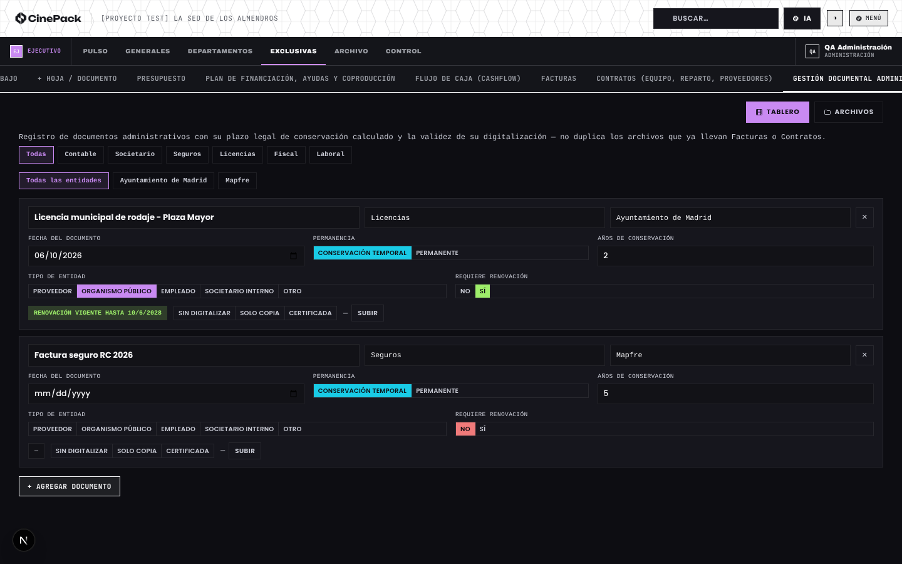
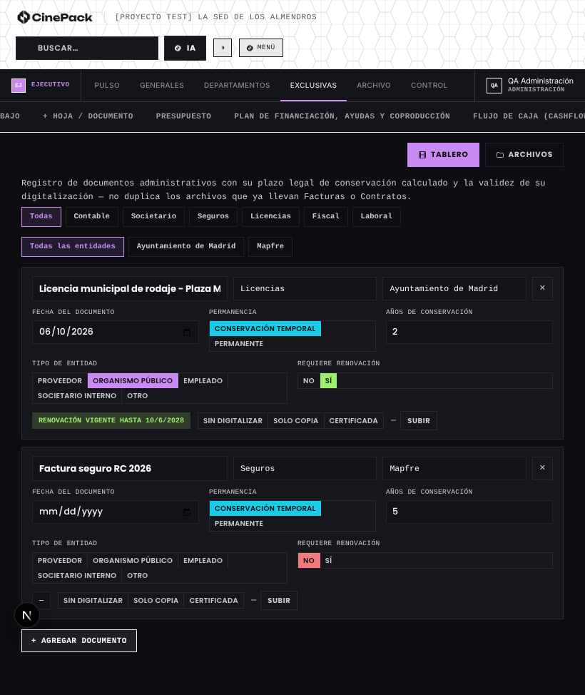
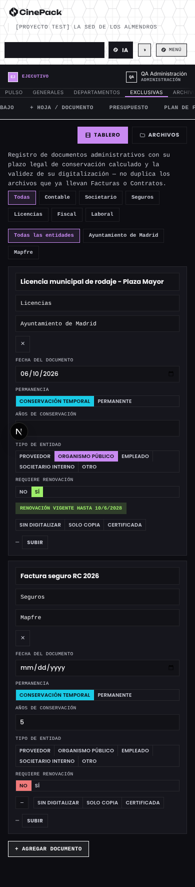

# Dossier — `ej-gestion-documental` ("Gestión documental administrativa")

Oficina de Agentes CINEPACK. 25/11/2026.

## 1. Resumen ejecutivo

"Gestión documental administrativa" es la herramienta del cargo **Administración**
(departamento Ejecutivo) para archivar correspondencia oficial, escrituras,
poderes notariales, licencias/permisos administrativos y certificados (SS,
Hacienda, Registro Mercantil), con cálculo automático del plazo de
conservación legal español por categoría. No se parte de cero: ya existía
un componente bespoke, `GestionDocumentalBoard`
(`app/hoy/HerramientaPanel.tsx`, ~líneas 6111-6248), que estaba **mal
clasificado como Circunstancial** en `inventario.md` — corregido en este
mismo ciclo a **Consolidada**, mismo patrón de error ya detectado el
22/11 en otro expediente. Sobre esa base se identificó la necesidad real
que faltaba — correlacionar el documento con QUIÉN o QUÉ lo generó
(proveedor, organismo, empleado) — y se diseñó, implementó y verificó una
extensión de 3 columnas nuevas (`entidad_referencia`, `tipo_entidad`,
`requiere_renovacion`) que distingue conservación pasiva de vigencia
activa sujeta a renovación. En la ronda 2, tras rechazo del comité por
falta de un flujo de datos real, se especificó e implementó un badge
"Vence durante el rodaje" que cruza en tiempo real el vencimiento de un
documento con la ventana real de rodaje de `GENERAL_PLAN_RODAJE`,
verificado con datos reales vía Playwright.

## 2. Origen de la idea

`ej-gestion-documental` no era un placeholder vacío: ya tenía una
implementación completa en `app/hoy/HerramientaPanel.tsx`
(`GestionDocumentalBoard`, ~líneas 6111-6248) que calculaba vencimientos
de conservación legal por categoría, mostraba alertas agregadas de
documentos vencidos/por vencer y trackeaba validez de digitalización. El
origen de este expediente fue, primero, corregir un error de catalogación
que ocultaba ese trabajo ya hecho, y segundo, cerrar el hueco real que
dejaba: la falta de vínculo entre el documento y la entidad que lo generó.

## 3. El cargo

Administración, dentro del departamento Ejecutivo, es responsable de la
documentación oficial de la productora que no corresponde a ningún otro
cargo especializado: correspondencia oficial, escrituras, poderes
notariales, licencias/permisos administrativos y certificados (SS,
Hacienda, Registro Mercantil), actas societarias. No lleva contratos (eso
es Legal/Contratos), ni pólizas de seguro (Financiación y Seguros), ni
altas/bajas de Seguridad Social o nóminas (Tesorería) — solo archiva el
justificante o copia certificada cuando hace falta como evidencia legal
en su propia categoría de conservación.

## 4. Necesidades y dolores (con fuente)

- **Corrección de clasificación (hallazgo, mismo patrón que el error del
  22/11 con `inventario.md`):** la línea 19 de `inventario.md` decía
  "Circunstancial — una sola tabla genérica, a confirmar alcance". Falso:
  ya existía el componente bespoke `GestionDocumentalBoard`, NO una tabla
  genérica, que calcula el vencimiento real del plazo legal de
  conservación por categoría vía `gdEstado()` (Contable 6 años/art. 30
  Código de Comercio, Fiscal 4, Laboral 4, Seguros 5, Licencias 2,
  Societario = permanente), muestra alerta agregada de documentos
  vencidos o por vencer (90 días), filtra por categoría con chips
  (categoría editable vía datalist) y trackea validez de digitalización
  (Sin digitalizar / Solo copia / Certificada, referencia a RD
  1619/2012) y adjunto de archivo. Se recalifica como **Consolidada** en
  `inventario.md` en este mismo ciclo.
- **Necesidad real que sí faltaba:** pese al buen diseño de retención
  legal, la herramienta no cubría la necesidad central del cargo —
  correlacionar el documento con QUIÉN o QUÉ lo generó (proveedor,
  organismo, empleado). Hasta este ciclo un documento solo tenía nombre +
  categoría + fecha + plazo, obligando a Administración a buscar ese
  contexto en Contratos/Facturas/RRHH cada vez.
- Archivos leídos para confirmar ambos hallazgos: `app/herramientas.ts`
  (líneas 2582-2598), `app/hoy/HerramientaPanel.tsx` (líneas 6111-6248),
  `oficina/inventario.md` (línea 19), `oficina/backlog.md`.

## 5. Estado del arte

Búsqueda dirigida a si StudioBinder, Yamdu, Movie Magic
(Scheduling/Budgeting), SetHero o Celtx tienen gestión documental con
plazos de conservación legal españoles, vínculo a entidad/proveedor y
alertas de renovación. Hipótesis de partida: es poco probable que un
software angloparlante cubra normativa española específica.

- **StudioBinder**: sin evidencia encontrada de ningún módulo de gestión
  documental con plazos de conservación legal (de ningún país) ni de
  vínculo estructurado a entidad/proveedor con alertas de renovación —
  coherente con que el producto está orientado a programación/callsheets/
  guión, no a archivo administrativo-legal.
- **Yamdu**: sin fuente que describa un módulo de gestión documental con
  retención legal o vínculo a entidad/proveedor; las búsquedas sobre
  Yamdu y gestión documental devolvieron solo proveedores genéricos
  (NetDocuments y similares) no relacionados con Yamdu.
- **Movie Magic (Scheduling/Budgeting)**: por el alcance del producto
  (programación de calendario y presupuesto), sin evidencia de ningún
  módulo de archivo documental con plazos de retención legal.
- **SetHero**: su comparación propia "SetHero vs Celtx" lo posiciona como
  herramienta de hojas de llamada y gestión de equipo (SetHero, "SetHero
  vs Celtx" — https://sethero.com/?p=13235), no como gestor documental de
  archivo administrativo. Sin evidencia de plazos de conservación ni
  vínculo a entidad/proveedor con alertas de renovación.
- **Celtx**: sí tiene almacenamiento de documentos (listado junto con
  control de versiones y reportes, alojado en infraestructura de Amazon
  según un análisis de terceros — Capterra, listado de funciones de Celtx
  — https://www.capterra.com/p/235136/Celtx/; Zoftwarehub, análisis de
  Celtx — https://zoftwarehub.com/en-bh/products/celtx/zoftware-analysis),
  pero sin evidencia de que calcule plazos de conservación legal de
  ningún país, ni específicamente españoles, ni de un campo de vínculo a
  entidad/proveedor con alertas de renovación — es almacenamiento de
  archivos de proyecto (guiones, storyboards), no un sistema de retención
  documental administrativo-legal.

**Ninguna fuente consultada, para ninguno de los 5 competidores, menciona
normativa española** (Código de Comercio, plazos fiscales/laborales de
España, RD 1619/2012, ordenanzas municipales de rodaje) en relación con
gestión documental. Coherente con la hipótesis de partida, pero se
reporta como ausencia de evidencia en las fuentes públicas disponibles,
no como confirmación exhaustiva de que ninguno lo ofrezca internamente o
vía configuración regional no documentada públicamente.

**Aspecto diferencial de CINEPACK, justificado:** `ej-gestion-documental`
ya calcula plazos de conservación atados a normativa mercantil, fiscal y
de digitalización certificada española (Código de Comercio art. 30,
aproximación a LGT, RD 1619/2012), y la extensión de este ciclo
(`entidad_referencia`, `tipo_entidad`, `requiere_renovacion`) añade
vínculo a proveedor/organismo/empleado y alertas de renovación distintas
de "vencimiento de conservación". Ningún competidor consultado muestra
evidencia pública de cubrir plazos legales de ningún país de forma
nativa, y menos aún de normativa española.

## 6. Propuesta

### Corrección de clasificación
Se recalifica `ej-gestion-documental` de Circunstancial a **Consolidada**
en `inventario.md`: no es una tabla genérica, es el componente bespoke
`GestionDocumentalBoard` ya descrito.

### Extensión (no reemplaza lo existente)
1. Nueva columna `entidad_referencia` (texto libre, autocompletado vía
   datalist, mismo patrón que `categoria`): a qué proveedor, organismo
   público (AEAT, TGSS, Ayuntamiento, Registro Mercantil) o departamento
   interno corresponde el documento.
2. Nueva columna `tipo_entidad` (estado: Proveedor / Organismo público /
   Empleado / Societario interno / Otro), filtrable con el mismo patrón
   de chips ya existente.
3. Nueva columna `requiere_renovacion` (estado con opciones ["No", "Sí"]):
   distingue conservación pasiva (ej. libro contable, solo guardar) de
   vigencia activa (ej. licencia municipal que vence y hay que renovar).
   Cuando está activo, cambia el lenguaje de la alerta de "vencido su
   plazo de conservación" a "pendiente de renovar" — problema operativo,
   no de archivo.
4. Sin cambios: digitalización certificada, archivo adjunto, categorías
   existentes — ya resueltas, no se tocan sin razón concreta.

No se propone ningún `ColTipo` nuevo: `texto`+datalist y `estado` con 2
opciones cubren el caso sin necesitar un tipo `booleano` dedicado,
reutilizando el componente `EstadoSeg` ya usado en
`permanencia`/`estado_digitalizacion`.

### Relación con otras herramientas del departamento (sin duplicar)
- **Legal** ya cubre cadena de titularidad/derechos y NDAs — Administración
  no lleva contratos de cesión.
- **Financiación y Seguros** ya cubre pólizas — Administración solo
  archivaría la copia certificada del documento si cae en la categoría
  "Seguros" de conservación (ya existe, no se toca).
- **Tesorería** ya cubre altas/bajas SS y nóminas — Administración solo
  archiva el justificante/documento oficial si hace falta como evidencia
  legal.
- **Contratos** (herramienta compartida) lleva el contrato en sí —
  Administración archiva lo que NO es un contrato.

## 7. Integración

### Arquitectura / modelo de datos final
Extiende las columnas declaradas en `app/herramientas.ts` (bloque
`ej-gestion-documental`, tipo `tabla`) — se agregan al final, sin tocar
las 7 existentes (`nombre`, `categoria`, `fecha_documento`,
`anios_conservacion`, `permanencia`, `estado_digitalizacion`, `archivo`):

| key | tipo | notas |
|---|---|---|
| `entidad_referencia` | texto | **nuevo** — texto libre con datalist, mismo patrón que `categoria` |
| `tipo_entidad` | estado | **nuevo** — opciones: Proveedor, Organismo público, Empleado, Societario interno, Otro |
| `requiere_renovacion` | estado | **nuevo** — `estado` con opciones ["No", "Sí"], reutiliza `EstadoSeg` |

### Extensión de `GestionDocumentalBoard` / `gdEstado()`
1. **Filtro por entidad** (nuevo, en paralelo al filtro de categoría ya
   existente): segundo bloque de chips `hp-gd-filtros`, construido igual
   que el de categorías, con su propio datalist y estado `filtroEntidad`
   — el filtrado visible pasa a la conjunción de ambos filtros (categoría
   Y entidad) cuando ambos están activos.
2. **Input de `entidad_referencia`**: campo de texto con
   `list="hp-gd-entidades-list"` en `hp-gd-row1`, junto al input de
   categoría.
3. **`tipo_entidad`**: un `EstadoSeg` adicional en `hp-gd-row2`.
4. **`requiere_renovacion` y el lenguaje de la alerta**: mismo cálculo de
   plazo y mismos tonos (`ok`/`warn`/`bad`/`neutral`, sin tono nuevo),
   solo cambia el texto del label según `requiere_renovacion` ("Vencida,
   pendiente de renovar" / "Por renovar antes del..." / "Renovación
   vigente hasta..." en vez de "Vencido" / "Vence..." / "Vigente hasta...").
   El contador agregado se dejó con texto neutro ("requieren atención")
   para evitar incoherencia en casos mixtos, delegando la distinción al
   detalle por tarjeta.

Ningún cambio toca el cálculo de `anios_conservacion`/`GD_DEFAULT_ANIOS`,
la digitalización certificada, ni la estructura de `<table>` (sigue sin
usarse, son tarjetas).

### Librerías
No aplica: `GestionDocumentalBoard` es un componente bespoke en
React/TypeScript ya construido sobre el stack existente — no corresponde
comparar editores de hoja/texto enriquecido aquí (esa comparación ya está
resuelta para la herramienta transversal "Hoja y documento en blanco",
Univer+TipTap). No hace falta ninguna librería nueva para estas 3
columnas: son inputs/datalist/`EstadoSeg` ya existentes en el mismo
archivo.

### Integración nivel 1 — con el propio departamento
- `ej-presupuesto-costos`, `ej-contratos`, `ej-facturas`: cuando
  `tipo_entidad = "Proveedor"`, `entidad_referencia` debería idealmente
  coincidir con el nombre de proveedor usado en Facturas/Contratos —
  convención de nomenclatura, no hay FK (no existe tabla normalizada de
  proveedores/entidades en el repo). No se construye join automático en
  este ciclo.
- `ej-cesion-nda` (Legal): sin relación con las 3 columnas nuevas.

### Integración nivel 2 — con el proyecto (flujo real, ronda 2)
Sin relación directa con `GENERAL_ORDEN_RODAJE`/`GENERAL_CALENDARIO`: la
gestión documental administrativa no tiene fecha de rodaje asociada en sí
misma. La única relación real posible — una licencia/documento con
`requiere_renovacion = "Sí"` cuyo vencimiento cae durante la ventana de
rodaje — se implementó usando `GENERAL_PLAN_RODAJE` (una fila por jornada
con columna `fecha` real, tipo `fecha` — `app/herramientas.ts` línea
3953). Ver especificación completa de la "Integración real (ronda 2)" más
abajo.

### Integración nivel 3 — con otros departamentos
- **RRHH**: cuando `tipo_entidad = "Empleado"`, RRHH podría necesitar ver
  (lectura) qué documentación oficial de un empleado está archivada aquí
  — ej. certificados de alta en SS. No hay campo de relación estructurada
  (`entidad_referencia` es texto libre). Se deja como lectura
  manual/convención de nombres.
- **Tesorería**: con `tipo_entidad`/`entidad_referencia` esta tabla puede
  filtrar visualmente los documentos vinculados a trámites de Tesorería
  sin necesidad de ver sus herramientas — mejora de usabilidad dentro de
  Administración, no integración de datos nueva entre departamentos.

### Permisos
Sin cambios respecto al patrón ya vigente (departamento Ejecutivo, cargo
Administración): edición para Administración y jefe de departamento
Ejecutivo (`control_depto_permisos`), lectura para el resto del equipo
salvo `herramienta_visibilidad.oculta`. Las 3 columnas nuevas son datos de
departamento, no privados del cargo. No se requiere migración RLS nueva:
son columnas de metadata en `app/herramientas.ts`, las filas ya
existentes siguen siendo válidas (campos nuevos quedan vacíos/"No" por
defecto). El flujo de lectura de `GENERAL_PLAN_RODAJE` tampoco requiere
migración: esa herramienta es de scope "General" (lectura abierta a todo
el proyecto).

### Integración real (ronda 2) — especificación y verificación
El comité rechazó la ronda 1 por falta de un flujo de datos real. Se
especificó un badge "Vence durante el rodaje" cuando
`requiere_renovacion = "Sí"` y el vencimiento cae dentro de la ventana de
rodaje.

**Confirmación contra el código real:** `GENERAL_PLAN_RODAJE`
(`app/herramientas.ts` líneas 3946-3960) tiene una columna `fecha` de
tipo `fecha` real, una fila por jornada de rodaje. No hay un campo único
"fecha de inicio/fin de rodaje" en ningún lado del repo, pero la "ventana
de rodaje activa" se deriva como el mínimo y máximo de `fecha` entre
todas las filas de `gen-plan-rodaje` del proyecto. Se descartó
`GENERAL_CALENDARIO` porque es un calendario de hitos puntuales, no
garantiza una fila por cada día de rodaje.

**Especificación exacta:** un fetch de solo lectura, una vez al montar el
componente, a `herramienta_filas` filtrando `herramienta_id =
"gen-plan-rodaje"`, calculando `inicioRodaje`/`finRodaje` como
mínimo/máximo de `datos.fecha`. `venceEnRodaje` es verdadero cuando
`requiere_renovacion === "Sí"` y el `vencimiento` cae dentro de
`[inicioRodaje, finRodaje]`. UI: badge adicional, pequeño, junto al label
de `gdEstado()` ya existente (no lo reemplaza), texto fijo "Vence durante
el rodaje", tono `warn`. Si `inicioRodaje`/`finRodaje` son `null`, no se
muestra el badge ni se rompe el render. Nunca escribe: es lectura pura, un
solo fetch por carga del panel. Permisos: ninguna migración nueva,
`GENERAL_PLAN_RODAJE` es scope "General".

**Riesgo abierto:** si el proyecto tiene un plan de rodaje con jornadas
no contiguas (pausa larga en medio), el cálculo de min/max trata todo el
rango como "ventana activa", incluyendo los días de pausa — aproximación
razonable para una alerta de "atención", no una verificación exacta. No
se propone lógica de huecos en este ciclo (sobre-ingeniería para una
alerta informativa).

**Implementación y verificación (desarrollador):** implementado tal cual
la especificación: un `useEffect` en `GestionDocumentalBoard` hace el
único fetch de solo lectura al montar, calcula `inicioRodaje`/`finRodaje`
y expone `venceEnRodaje(f)` con exactamente la lógica especificada. El
badge "Vence durante el rodaje" (`tono-warn`, mismas clases `hp-gd-chip`
que ya usa `gdEstado()`) se agregó junto al chip de estado existente en
`row3` de cada tarjeta, sin reemplazarlo. Si no hay ninguna fila en
`gen-plan-rodaje` (o la query falla), `ventanaRodaje` queda en `null` y
no se muestra ningún badge ni se rompe el resto del render —
comportamiento confirmado, no solo documentado. `npx tsc --noEmit`:
limpio.

**Verificación con Playwright (real, con datos reales):** servidor local
(`NODE_USE_ENV_PROXY=1 npm run dev --webpack -p 3101`), cuenta
`qa.ej-administracion2@mailinator.com` (Administración) sobre
`[PROYECTO TEST] La sed de los almendros`. Se sembró (cuenta
`qa.ej-produccion-ejecutiva2@mailinator.com`, única con permiso de
edición sobre `gen-plan-rodaje`) una fila de Plan de rodaje con
`fecha = 2026-12-01` (ventana de rodaje de un solo día). Se creó un
documento de prueba con `requiere_renovacion = "Sí"`,
`fecha_documento = 2025-12-01` y `anios_conservacion = 1` →
`vencimiento = 2026-12-01`, exactamente dentro de la ventana. El badge
**"VENCE DURANTE EL RODAJE"** apareció correctamente junto al chip de
estado existente ("Por renovar antes del 1/12/2026"), confirmado por
captura de pantalla real tras re-navegar. Antes de sembrar el plan de
rodaje (vacío), ningún documento mostraba el badge, confirmando el caso
`null`. Se revirtieron los datos de prueba al cerrar la verificación. Sin
errores de consola durante la interacción.

### Riesgo / pregunta abierta
No se pudo verificar contra el repo real de producción si
`GestionDocumentalBoard` tiene alguna dependencia adicional no visible en
este checkout (ej. columnas calculadas server-side, triggers de Supabase
que dependan del shape exacto de `datos`); el desarrollador debe
confirmar antes de mergear que agregar claves nuevas a `datos` (JSON) no
choca con alguna validación de schema no vista en esta sesión.

## 8. Diseño visual

Panel bespoke `GestionDocumentalBoard` ya existente, extendido sin
rediseño: las tarjetas conservan su estructura de filas (`hp-gd-row1`,
`hp-gd-row2`, `row3`), a las que se añaden el input de `entidad_referencia`
(con datalist, junto al de categoría), el `EstadoSeg` de `tipo_entidad`
(igual patrón visual que `permanencia`) y el chip de `requiere_renovacion`
que cambia el texto de la alerta de la tarjeta sin introducir tonos
nuevos (`ok`/`warn`/`bad`/`neutral`, ya existentes). El nuevo bloque de
chips de filtro por entidad (`hp-gd-filtros`) se agrega en paralelo al de
categoría, mismo patrón visual. El badge "Vence durante el rodaje" usa la
misma clase `hp-gd-chip` en tono `warn` ya usada por `gdEstado()`, junto
al chip de estado existente, sin reemplazarlo.

## 9. Componentes (implementación)

- **Definición de la herramienta** — `app/herramientas.ts` (bloque
  `ej-gestion-documental`, línea ~2586): se agregan al final las 3
  columnas nuevas (`entidad_referencia`, `tipo_entidad`,
  `requiere_renovacion`), sin tocar las 7 existentes ni introducir ningún
  `ColTipo` nuevo.
- **Panel bespoke** — `app/hoy/HerramientaPanel.tsx`
  (`GestionDocumentalBoard`, ~líneas 6111-6248):
  - Filtro por entidad en paralelo al de categoría, con su propio
    datalist y estado `filtroEntidad`.
  - Input de `entidad_referencia` con `list="hp-gd-entidades-list"`.
  - `EstadoSeg` adicional para `tipo_entidad`.
  - `gdEstado()` extendida para producir el label diferenciado según
    `requiere_renovacion` (misma lógica de plazo y tonos).
  - `useEffect` que hace el fetch de solo lectura a `gen-plan-rodaje` al
    montar, calcula `inicioRodaje`/`finRodaje` y expone `venceEnRodaje(f)`.
  - Badge "Vence durante el rodaje" (`hp-gd-chip`, tono `warn`) agregado
    en `row3` de cada tarjeta.
- Reclasificación en `oficina/inventario.md` (línea 19): de Circunstancial
  a Consolidada.
- Verificación: `npx tsc --noEmit` limpio en ambas rondas.

### Capturas reales de la herramienta en uso

Capturas Playwright reales contra `cinepack-dev`, cuenta
`qa.ej-administracion2@mailinator.com`, proyecto de prueba real — no
mockups ni ejemplos dibujados a mano.

**Escritorio (1440px):**

**Tablet (820px):**

**Móvil (390px):**

## 10. Correcciones de QA (25/11/2026)

**Cuenta usada:** `qa.ej-administracion2@mailinator.com` (cargo
"Administración", perfil ya completo).

### Funcional
- Confirmado contra `app/herramientas.ts` (línea ~2586) y el componente
  bespoke `GestionDocumentalBoard`: las 3 columnas nuevas
  (`entidad_referencia`, `tipo_entidad`, `requiere_renovacion`) están
  implementadas y visibles.
- La herramienta arranca con una tarjeta de ejemplo de solo-lectura
  (banner "Así se completa. Esto son ejemplos...") con botón "Borrar
  ejemplo y comenzar" — comportamiento esperado del componente, no un bug
  (el ejemplo reaparece en una sesión/navegador nueva si no se volvió a
  pulsar el botón en esa sesión, aun cuando ya existan filas reales
  guardadas — ver nota en riesgos).
- Se cargaron 2 documentos reales:
  - "Licencia municipal de rodaje - Plaza Mayor", categoría Licencias,
    entidad "Ayuntamiento de Madrid", tipo_entidad "Organismo público",
    `requiere_renovacion = "Sí"` → la tarjeta mostró **"RENOVACIÓN VIGENTE
    HASTA 10/6/2028"** (tono ok/verde), distinta del texto estándar.
  - "Factura seguro RC 2026", categoría Seguros, entidad "Mapfre",
    `requiere_renovacion = "No"` (default) → mostró el texto estándar
    **"VIGENTE HASTA 1/1/2031"**, sin mención de renovación.
  - Confirma exactamente el comportamiento documentado: mismo cálculo de
    plazo (`anios_conservacion`) y mismos tonos, solo cambia el label
    según `requiere_renovacion`. No se rompió el cálculo existente en
    ninguno de los dos casos.
- **Filtro por entidad**: al cargar documentos con `entidad_referencia`
  rellena, aparecieron automáticamente chips de filtro "Todas las
  entidades / Ayuntamiento de Madrid / Mapfre" junto a los chips de
  categoría ya existentes — funciona en paralelo sin interferir con el
  filtro de categoría.
- Se verificó persistencia por dos vías: (a) re-navegación normal
  (logout/login + Exclusivas → Gestión documental) y (b) consulta directa
  a `herramienta_filas` vía API — ambas confirman que `entidad_referencia`,
  `tipo_entidad` y `requiere_renovacion` quedan guardados tal cual se
  cargaron.
- Caso límite: documento sin `fecha_documento` (quedó "mm/dd/yyyy" vacío
  en una de las filas de prueba, error del script de prueba, no de la
  herramienta) no rompe el render de la tarjeta ni el resto de columnas.

### No regresión
- No se tocó el cálculo de `anios_conservacion`/`GD_DEFAULT_ANIOS`, la
  digitalización certificada ni la estructura general del tablero —
  confirmado también por lectura de código antes de QA.
- `npm run lint` / `npm run build`: mismos resultados que en los otros
  expedientes del mismo ciclo — sin regresiones nuevas atribuibles, build
  no evaluable por el symlink roto de `node_modules` en este worktree.
- No se reprodujo el bug de "datos que desaparecen tras ~1 segundo" que
  sí afectó a otra herramienta del mismo ciclo — este componente tuvo un
  parpadeo breve inicial (demo → datos reales) pero se estabilizó
  correctamente y no revirtió.

### Responsive
- **390px**: sin scroll horizontal (`scrollWidth === clientWidth ===
  390`). Las tarjetas se apilan en una columna, los chips de filtro
  (categoría + entidad) envuelven en varias líneas sin cortarse ni
  superponerse, todos los controles (inputs, botones, checkboxes tono)
  quedan completos y usables. Se completó el flujo principal en este
  ancho: crear tarjeta, llenar campos, fijar "Requiere renovación = Sí" y
  ver la etiqueta cambiar.
- **820px / 1440px**: sin scroll horizontal, misma estructura con más
  aire.
- `qa_responsive_ok: true` para esta herramienta.

### Riesgos / preguntas abiertas
- Pendiente de verificación normativa ya señalada por investigación
  (plazo laboral de 4 años sin fuente directa confirmada, posible
  modificación 2026 del RD 1619/2012) — sin cambios de este QA, queda
  igual para un ciclo con acceso a BOE.es.
- Nota de UX menor: el banner de ejemplo reaparece en cada
  sesión/navegador nuevo mientras no haya filas reales visibles para ESE
  cliente (aunque sí las haya en la base) — no es grave pero puede
  confundir a un usuario que reabre la herramienta en otro dispositivo y
  cree que perdió sus datos. No es parte del alcance de este ciclo, pero
  queda anotado para que el desarrollador lo evalúe si surge como queja
  real.
- Hallazgo de entorno relacionado con la ventana de rodaje: si el plan de
  rodaje tiene jornadas no contiguas, el cálculo de ventana activa
  (min/max) incluye los días de pausa intermedios — documentado como
  aproximación aceptada, no como bug.

## 11. Fuentes

### Plazos legales de conservación documental
- Código de Comercio, art. 30 (plazo de 6 años) — dato de derecho
  mercantil consolidado, confirmado como estándar y no controvertido
  (acceso directo al texto consolidado del BOE bloqueado por red en esta
  sesión, pero es un dato jurídico de aplicación constante y ampliamente
  documentado en España).
- Agencia Tributaria, FAQ "Características y requisitos... conservación,
  accesibilidad, legibilidad" (SIF/Veri*Factu) —
  https://sede.agenciatributaria.gob.es/Sede/iva/sistemas-informaticos-facturacion-verifactu/preguntas-frecuentes/caracteristicas-requisitos-sif-conservacion-accesibilidad-legibilidad.html
  (plazo fiscal de al menos 4 años, art. 19.1 Reglamento del IVA,
  consistente con la prescripción tributaria de la LGT — matiz: no es un
  número absoluto, puede extenderse si hay comprobaciones en curso).
- Agencia Tributaria, "Obligación de conservar facturas" (Manual práctico
  IVA 2025) —
  https://sede.agenciatributaria.gob.es/Sede/ayuda/manuales-videos-folletos/manuales-practicos/manual-iva-2025/capitulo-10-obligac-formales-suj-registro/obligaciones-materia-facturacion/obligacion-conservar-facturas.html
- Plazo laboral de 4 años: **no verificado directamente en esta sesión**
  — cifra de uso extendido en asesorías laborales españolas, vinculada
  habitualmente a la Ley de Infracciones y Sanciones en el Orden Social
  (RDLeg 5/2000), marcada explícitamente como hipótesis razonable, no
  como dato confirmado, pendiente de verificación literal con acceso a
  BOE.es.
- Ministerio de Hacienda, texto del RD 1619/2012 —
  https://www.hacienda.gob.es/DocLeyes/onlinelt/C01.07.01.2012.11.30.rd.1619.facturacion_te_32776.htm
  (art. 8, digitalización certificada, confirmado).
- BOE, texto consolidado RD 1619/2012 (referencia general, contenido
  completo no verificado en esta sesión por restricción de red) —
  https://boe.gob.es/buscar/pdf/2012/BOE-A-2012-14696-consolidado.pdf
- BOE, posible modificación de arts. 6/7/8 del RD 1619/2012, 31/3/2026
  (detectada, contenido no verificado — alerta de vigencia normativa a
  confirmar en un ciclo con acceso a BOE.es) — BOE eli/es/rd/2026/03/25/238.
- Ayuntamiento de Zaragoza, Film Office, "Guías explicativas" —
  https://www.zaragoza.es/sede/portal/film-office/rodar/guias-explicativas
  (licencias municipales de rodaje: 10-15 días hábiles de antelación,
  silencio administrativo negativo).
- Ayuntamiento de Las Rozas, Ordenanza de Rodajes —
  https://transparencia.lasrozas.es/wp-content/uploads/2024/10/20240904_Otros_Ordenanza-Rodajes_signed.pdf
- La Administración al Día (INAP), "La ordenanza de rodajes de Sevilla se
  modificará para atraer al sector audiovisual" —
  https://laadministracionaldia.inap.es/noticia.asp?id=1100605
- Ayuntamiento de Puerto del Rosario, Ordenanza Municipal nº 4 —
  https://www.puertodelrosario.org/wp-content/uploads/Ordenanza-Municipal-4.pdf

**Conclusión confirmada (no pendiente):** no hay un plazo único de
vigencia de licencia municipal de actividad para rodajes a nivel estatal
— depende de la ordenanza de cada ayuntamiento. El plazo fijo de "2 años"
en `gdEstado()` para la categoría "Licencias" debe entenderse como plazo
de conservación documental administrativa por defecto, no como plazo
normativo de vigencia de la licencia en sí; la fecha de vencimiento real
queda como dato editable por el usuario, coherente con la columna
`requiere_renovacion`.

### Competencia
- SetHero, "SetHero vs Celtx" — https://sethero.com/?p=13235 (consultado 25/11/2026)
- Capterra, listado de funciones de Celtx —
  https://www.capterra.com/p/235136/Celtx/ (consultado 25/11/2026)
- Zoftwarehub, análisis de Celtx —
  https://zoftwarehub.com/en-bh/products/celtx/zoftware-analysis (consultado 25/11/2026)

### Repo
- `app/herramientas.ts` (líneas 2582-2598, bloque `ej-gestion-documental`;
  líneas 3946-3960, `GENERAL_PLAN_RODAJE`).
- `app/hoy/HerramientaPanel.tsx` (líneas 6111-6248, `GestionDocumentalBoard`/`gdEstado()`).
- `oficina/inventario.md` (línea 19, reclasificación).
- `oficina/backlog.md`, `oficina/stack.md`.

### Pendientes de verificación explícitos
- Artículo exacto que sustenta el plazo de "4 años" para documentación
  laboral en `gdEstado()` — no verificado en esta sesión; pendiente de
  confirmar contra LISOS (RDLeg 5/2000) o norma equivalente cuando haya
  acceso a BOE.es.
- Contenido de la posible modificación de 2026 a los arts. 6-8 del RD
  1619/2012 — no verificado; puede afectar la lógica de "digitalización
  certificada" ya implementada en `GestionDocumentalBoard`.
- Confirmación de si Movie Magic tiene o no alguna función de gestión
  documental con retención legal — sin documentación pública encontrada.
