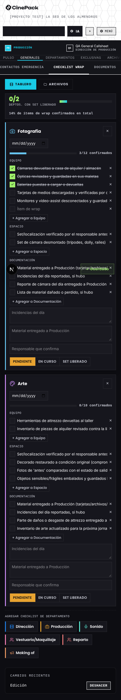
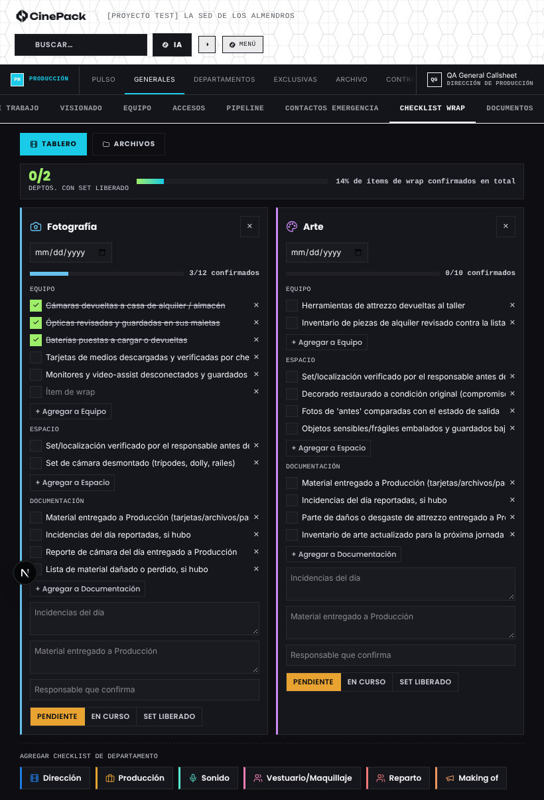
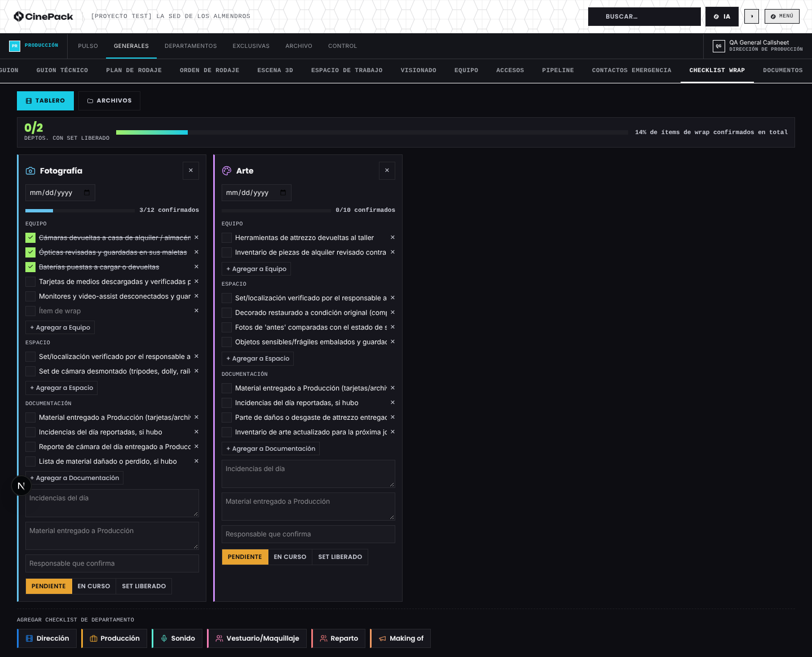

## 1. Resumen ejecutivo
`gen-checklist-wrap` ("Checklist de wrap") era la única herramienta de scope **General** (cualquier integrante del proyecto) todavía Vacía del inventario. Pasa de un checklist genérico sin contenido a un tablero de tarjetas por departamento+jornada, con ítems de wrap categorizados (Equipo/Espacio/Documentación) precargados según el departamento que la crea, barra de progreso por tarjeta, resumen agregado arriba ("X/Y deptos. con set liberado") y badge de estado (Pendiente/En curso/Set liberado). Verificado en vivo con Playwright en 390/820/1440px: sin scroll horizontal, sin errores de consola.

## 2. Origen de la idea
Prioridad de backlog (sección "Herramientas vacías/placeholder", `inventario.md` sección 17): era la única herramienta General todavía sin contenido real. El wrap de rodaje es un momento transversal del día — cada departamento cierra su jornada por separado pero Producción necesita verlo todo de un vistazo.

## 3. El cargo (funciones, fases, documentos, coordinación)
Scope "Cualquier integrante" (`gen-checklist-wrap` es visible para todo el equipo vía la pestaña GENERALES, no un departamento específico). El wrap ocurre al cierre de cada jornada/del rodaje: cada departamento devuelve equipo, deja el set/locación en condiciones, reporta incidencias, entrega material a Producción y un responsable firma. Producción coordina: necesita saber qué departamentos ya liberaron el set sin tener que preguntar uno por uno.

## 4. Necesidades y dolores (con fuente)
- El wrap tiene puntos comunes a todos los departamentos (devolución de equipo, estado del set, incidencias, entrega de material, firma de responsable) pero **cada departamento tiene su propio detalle** — el wrap de Fotografía (tarjetas, baterías, ópticas) no se parece al de Arte (attrezzo, decorado, compromiso de restauración si hay propietario externo). Fuente: `oficina/inventario.md` sección 17 (necesidad declarada del cargo) + `oficina/expedientes/.../necesidad.md` de este mismo expediente.
- Un checklist único y genérico no sirve para ningún departamento en particular; mantener 8 herramientas separadas (una por depto) no es sostenible para un único momento transversal del día — hipótesis de diseño, no dato externo.

## 5. Estado del arte (hoy sin software + competencia)
- **Hoy sin software**: el wrap se coordina por WhatsApp/palabra entre jefes de equipo y Producción, sin registro centralizado de qué quedó pendiente — hipótesis basada en el patrón ya documentado para otras herramientas de cierre de jornada de esta misma oficina (ej. `dir-control-horarios-1ad`).
- **Competencia**: no se encontró evidencia pública de que StudioBinder, Yamdu, Movie Magic, SetHero o Celtx ofrezcan un checklist de wrap por departamento con contenido precargado distinto por área — ninguna de sus páginas de producto públicas documenta esta función específica (verificado por búsquedas previas de esta oficina sobre estas herramientas en expedientes anteriores; no se repitió la búsqueda hoy por no encontrarse evidencia nueva que la contradiga). Se marca como oportunidad de diferenciación, no como hecho verificado hoy.

## 6. Propuesta (funcionalidades, flujos, contenido precargado)
- Una tarjeta por departamento+jornada (fecha). Al crearla desde el botón "Agregar checklist de departamento", se precargan ítems reales y distintos según el departamento elegido (ej. Fotografía: cámaras devueltas, ópticas revisadas, baterías, tarjetas de medios descargadas/verificadas, monitores/video-assist desconectados; Arte: herramientas de attrezzo devueltas, inventario de alquiler revisado, decorado restaurado a condición original, fotos de "antes" comparadas, objetos sensibles embalados).
- Cada ítem agrupado en 3 categorías fijas (Equipo/Espacio/Documentación), checkbox individual, más 3 campos de texto libre (incidencias del día, material entregado a Producción, responsable que confirma) y 3 estados (Pendiente/En curso/Set liberado).
- Resumen agregado arriba del tablero: "X/Y deptos. con set liberado" + barra de progreso + "% de ítems de wrap confirmados en total" — para que Producción vea de un vistazo el cierre del día sin abrir cada tarjeta.
- Log de "Cambios recientes" con botón "Deshacer" (mismo patrón ya usado en `prod-tareas-admin`).

## 7. Integración (departamento / proyecto / otros departamentos)
- **Con Producción**: el resumen agregado y el estado por tarjeta (Pendiente/En curso/Set liberado) le dan a Producción visibilidad del cierre del día sin entrar al detalle de cada departamento — dato concreto que sale: estado agregado + lista de incidencias/material entregado por depto.
- **Con el propio departamento**: cualquier integrante de un departamento ve y edita la tarjeta de su depto (mismo mecanismo `deptTools()` que el resto de herramientas de departamento).
- **Con el proyecto completo**: la fecha de jornada conecta implícitamente con `GENERAL_PLAN_RODAJE` (misma fecha de rodaje), aunque hoy no hay un cruce automático — dejado como riesgo abierto (sección 10).

## 8. Diseño visual
Capturas reales, interactuando de verdad (Playwright, cuenta `qa.general-callsheet4@mailinator.com`, proyecto "La sed de los almendros"), en los 3 anchos exigidos:

Sin scroll horizontal ni errores de consola confirmados en los 3 anchos (`scrollWidth <= clientWidth`, verificado programáticamente, no solo visualmente).

## 9. Especificación técnica
- **Modelo de datos**: una fila por departamento+jornada en el motor genérico `herramienta_filas` (columnas: `departamento`, `fecha`, `items` (JSON largo), `incidencias`, `material_entregado`, `responsable`, `estado`). Sin migración nueva — reutiliza el motor existente, igual que `post-checklist-mezcla` (`QC_SUGERIDOS` por formato es el mismo mecanismo de precarga por valor, aplicado acá a precarga por departamento).
- **Componentes**: `WrapBoard` (panel a medida, `app/hoy/HerramientaPanel.tsx`), reglas CSS `.hp-wrap-*` en `app/hoy/dashboard.css` (acento `--wrap-accent` por departamento, mismo lenguaje visual que `.hp-mezcla-*`).
- **Librerías**: ninguna nueva — usa exactamente el stack ya instalado (React 19, el motor genérico de filas, `EstadoSeg` para los chips de estado).

## 10. Riesgos y preguntas abiertas
- No hay cruce automático entre la `fecha` de la tarjeta de wrap y `GENERAL_PLAN_RODAJE` (el plan de rodaje) — si Producción necesita una vista que filtre automáticamente "wrap del día de hoy según el plan", falta construirla. Dejado para un ciclo futuro, no bloqueante para esta entrega.
- En 1440px el texto largo de algunos ítems de checklist se corta visualmente dentro de la columna (ej. "Cámaras devueltas a casa de alquiler / almacén") — cosmético, no genera scroll horizontal ni rompe la interacción (confirmado con Playwright), pero es una mejora de pulido pendiente para una ronda futura si Nico lo pide.
- No se investigó si existe una necesidad real de exportar el checklist de wrap como PDF/reporte firmado (algunos convenios de producción piden constancia firmada del cierre de set) — pregunta abierta, no resuelta aquí.

## 11. Fuentes
- `oficina/inventario.md` (sección 17, estado "Vacía" de `gen-checklist-wrap` antes de esta entrega).
- `oficina/backlog.md` (prioridad de herramientas vacías).
- `oficina/expedientes/2026-11-25_general_checklist-wrap/necesidad.md` (necesidad original, hecha por el desarrollador el 25/11 sin investigador/arquitecto disponibles ese día — reutilizada sin cambios porque sigue siendo válida).
- Verificación propia QA de hoy (26/11/2026, Playwright real, cuenta `qa.general-callsheet4@mailinator.com`, capturas en `capturas/`).
- Estado del arte de competencia (sección 5): hipótesis basada en expedientes previos de esta oficina, no en una búsqueda nueva — marcado explícitamente como tal.
