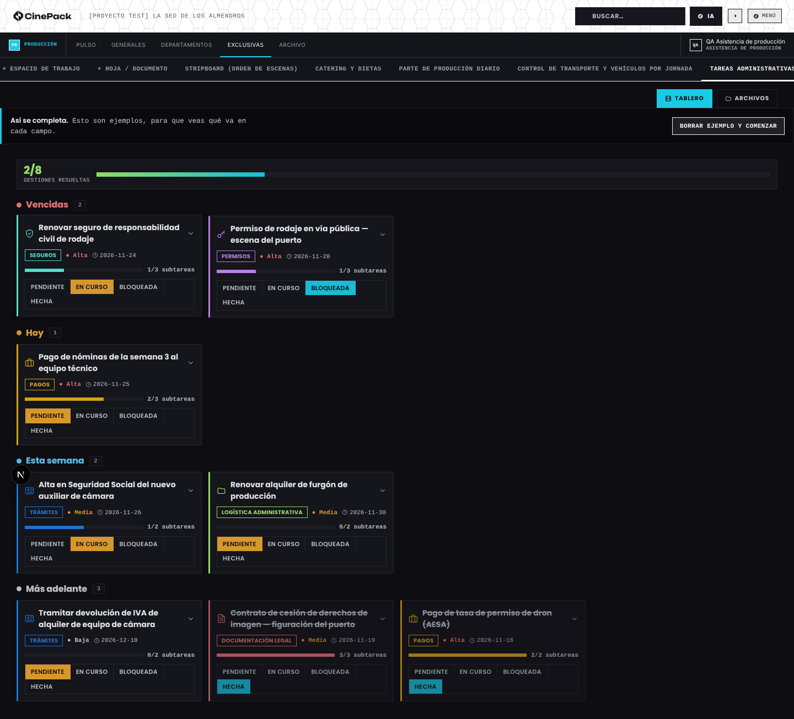
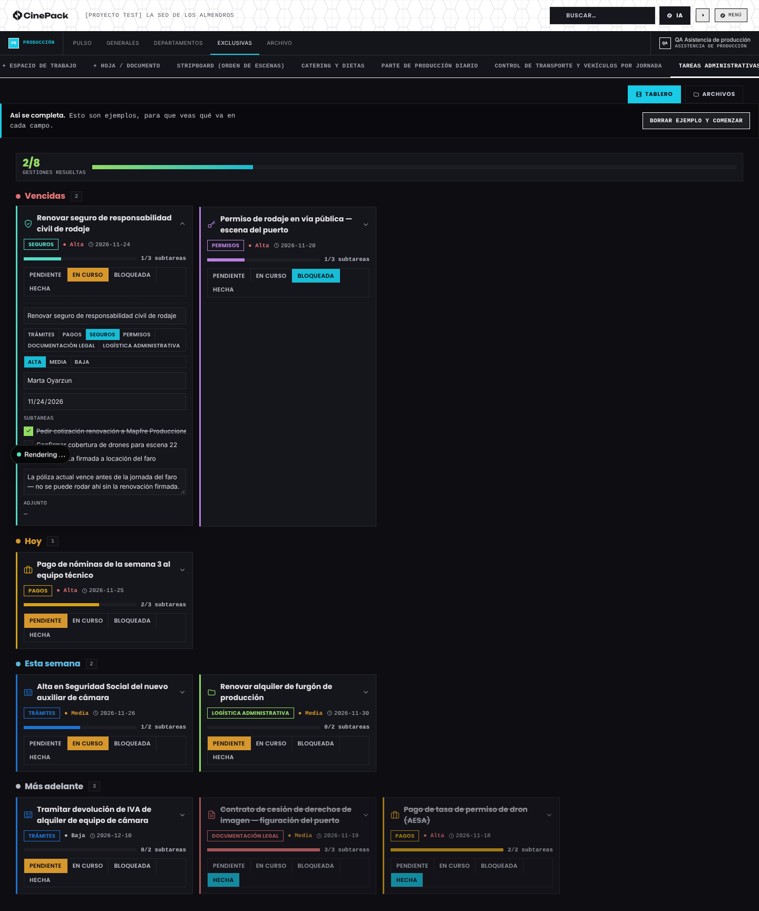
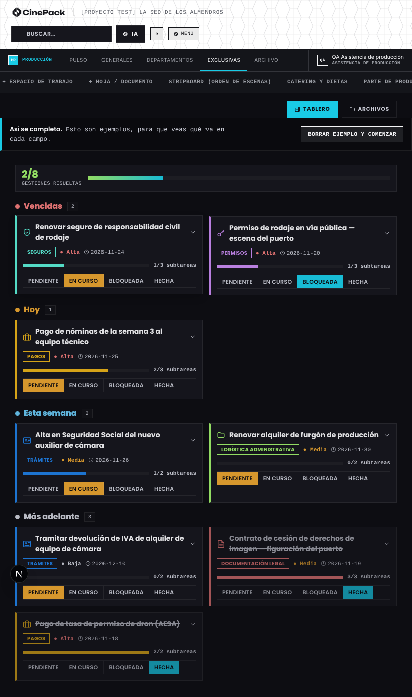
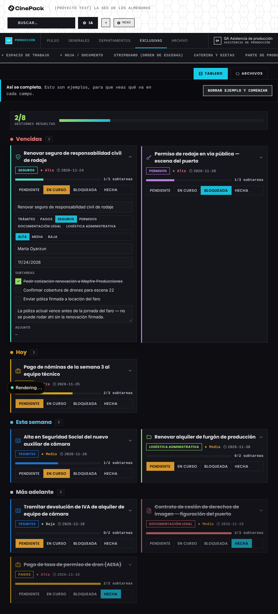
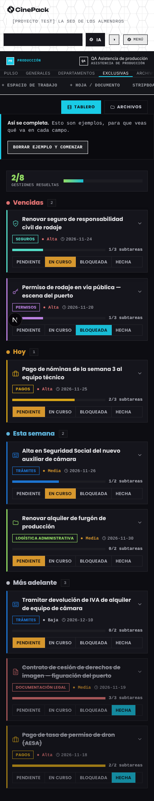
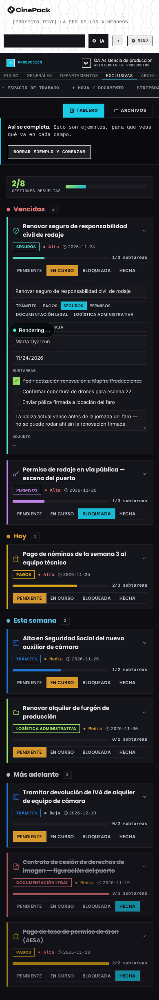

# Tareas administrativas diarias — Asistencia de producción (rediseño 25/11/2026)

> Este expediente documenta el **rediseño** de `prod-tareas-admin`, rebotada dos veces por Nico como "Lejos de lo esperado": "Quítale el texto inicial que explica la herramienta sin necesidad. Y me gustaría empezar a ver otro modelo de herramienta. Esta tabla, me parece completamente incómoda [...] Entrégame una herramienta de verdad trabajada respecto a la funcionalidad y al diseño." Se documentan aquí solo las secciones 6 y 9 (propuesta y especificación de componentes), que es lo que cambia respecto a la herramienta original tipo "checklist" en blanco.

## 6. Propuesta

### Qué resuelve
La Asistencia de producción no gestiona "una categoría de trámites a la vez" — gestiona lo que vence antes, sin importar si es un pago, un seguro o un permiso. La versión anterior era un `checklist` genérico sin columnas propias (ítem vacío sin terminología real). La nueva versión es una **tabla con columnas reales de gestión administrativa de rodaje** (categoría, prioridad, vencimiento, responsable, estado, subtareas, notas, adjunto), con una vista a medida (`TareasAdminBoard`) en vez del motor de tabla genérico.

### Patrón de interacción elegido y por qué (3 opciones consideradas)
1. **Tabla genérica de filas/columnas** (la rechazada por Nico): rápida de construir pero obliga a escanear una fila completa para saber el estado de una gestión — exactamente lo que Nico señaló como "completamente incómoda", y ya existe una herramienta de tabla mejor trabajada (Presupuesto) con la que esta competiría sin ganar.
2. **Lista plana de tarjetas por categoría fija** (Trámites arriba, Pagos debajo, etc.): se descartó porque agrupar por categoría no refleja cómo trabaja de verdad la Asistencia de producción — un trámite urgente y un pago urgente compiten por la misma atención hoy; agrupar por categoría separaría cosas que deberían verse juntas y uniría cosas que no urgen lo mismo.
3. **Tablero agrupado por urgencia real (elegido)**: las tareas se agrupan en "Vencidas / Hoy / Esta semana / Más adelante / Sin fecha", calculado desde el campo `vencimiento` contra la fecha de hoy — así la primera sección que ve la Asistencia de producción al abrir la herramienta es siempre "qué se vence ya", que es la pregunta real que se hace cada mañana. La categoría (Trámites/Pagos/Seguros/Permisos/Documentación legal/Logística administrativa) queda como acento visual de la tarjeta (badge + icono con color propio del sistema de diseño), no como agrupador — da identificación de un vistazo sin fragmentar la urgencia.

### Flujo de uso paso a paso
1. **Entrada**: se abre la pestaña "Tareas administrativas diarias" (Exclusivas → cargo). El resumen superior muestra "X/Y gestiones resueltas" con barra de progreso global.
2. **Vista cerrada de cada tarjeta** (sin necesidad de abrir nada): categoría (badge con color + icono), prioridad (punto de color: alta=rose, media=amber, baja=muted), vencimiento con icono de reloj, barra de progreso de subtareas si existen, y control de estado (segmentado: Pendiente/En curso/Bloqueada/Hecha) editable directamente desde la tarjeta cerrada.
3. **Abrir una tarjeta** (clic en el título): despliega responsable, fecha editable, lista de subtareas con checkbox individual (agregar/tachar/borrar), notas libres y adjunto de archivo (contrato, justificante, póliza escaneada), más el botón de eliminar la tarea completa.
4. **Crear tarea nueva**: botón "+ Nueva tarea administrativa" al pie del tablero, que crea una fila con `estado: "Pendiente"` y `prioridad: "Media"` por defecto — nunca un formulario vacío de 8 campos en blanco, arranca ya clasificada y lista para completar.
5. **Primer uso (estado vacío)**: en vez de tabla vacía, se precargan 8 ejemplos reales y variados (ver §9) en modo fantasma/solo-lectura con un botón "Empezar con una fila en blanco" — el usuario ve la estructura real en uso antes de cargar sus propios datos (mismo mecanismo `VistaConEjemplos` ya usado en otras herramientas aprobadas, ej. Banco de investigación de guion).

### Contenido precargado (8 gestiones reales y variadas, no 2-3 genéricas)
Cubre las 6 categorías reales del cargo con fechas, prioridades y estados distintos: renovación de seguro de responsabilidad civil (vencida, alta prioridad, con subtareas sin terminar), pago de nóminas semanales (hoy, alta prioridad), permiso de rodaje en vía pública (vencido y bloqueado — escalamiento real), alta en Seguridad Social de personal nuevo (próxima, media), devolución de IVA (sin urgencia, baja), contrato de cesión de derechos de imagen (ya hecho y archivado), renovación de alquiler de furgón (logística, pendiente), pago de tasa de dron (hecho). Ver `EJ_TAREAS_ADMIN` en `app/hoy/HerramientaPanel.tsx`.

## 9. Especificación técnica (componentes)

- **Modelo de datos** (reutiliza el motor de filas/columnas existente, `herramientas.ts`, sin tabla nueva en Supabase): `prod-tareas-admin` pasa de `tipo: "checklist"` a `tipo: "tabla"` con columnas `tarea` (texto), `categoria` (estado: Trámites/Pagos/Seguros/Permisos/Documentación legal/Logística administrativa), `prioridad` (estado: Alta/Media/Baja), `vencimiento` (fecha), `responsable` (texto), `estado` (estado: Pendiente/En curso/Bloqueada/Hecha), `subtareas` (largo — JSON embebido `{item, hecha}[]`, mismo patrón que `qc_items` en `ChecklistMezclaBoard`), `notas` (largo), `adjunto` (archivo, vía `ArchivoCell` existente — Supabase Storage).
- **Componente**: `TareasAdminBoard` en `app/hoy/HerramientaPanel.tsx`, registrado en `tablaTieneVistaBespoke()` (gating que evita que el motor de tabla genérico renderice además de la vista a medida) y montado en el render de `herramienta.tipo === "tabla" && herramienta.id === "prod-tareas-admin"`, envuelto en `VistaConEjemplos` con `EJ_TAREAS_ADMIN` para el estado vacío.
- **Sin librerías nuevas**: reusa `Icon` (set propio, iconos `id-card`/`briefcase`/`shield`/`key`/`file-text`/`folder`/`clock`/`chevron-up`/`chevron-down`/`plus` ya existentes en `app/components/Icon.tsx` — ninguno nuevo), `EstadoSeg` (control segmentado ya resuelto), `ArchivoCell` (subida de adjuntos ya resuelta contra Supabase Storage), `parseArr` (parseo de JSON embebido ya usado en Checklist de mezcla).
- **CSS**: clases `.hp-tad-*` nuevas en `app/hoy/dashboard.css`, siguiendo el mismo esquema de tokens que `.hp-mezcla-*` (`var(--gutter)`, `var(--sp-*)`, `var(--fs-*)`, acentos con nombre `--blue/--gold/--teal/--violet/--rose/--lime`), grid `repeat(auto-fill, minmax(280px, 1fr))` que colapsa a 1 columna bajo 640px.
- **Sin texto introductorio**: `hint` se mantiene solo como documentación interna (no se renderiza en ningún caso — regla endurecida 25/11, ya aplicada globalmente en `HerramientaPanel.tsx`).

## Nota — ronda de corrección de QA (25/11/2026, commit `8e5e530`)

La primera entrega de `TareasAdminBoard` llegó a comité con dos bugs reales encontrados en la verificación de QA (cuenta `qa.prod-asistencia2@mailinator.com`), ambos corregidos antes de esta versión:

1. **Sin vía de edición de título/categoría/prioridad**: la tarjeta abierta permitía editar responsable, fecha, subtareas, notas y adjunto, pero no el propio título de la gestión ni su categoría o prioridad — una vez creada, una tarea quedaba mal clasificada para siempre. Corregido: los tres campos ahora son editables desde el detalle de la tarjeta, igual que el resto.
2. **Condición de carrera en guardado concurrente**: al editar dos campos de la misma tarjeta en sucesión rápida (p. ej. marcar una subtarea y luego escribir una nota), el segundo guardado podía pisar al primero y perder la edición previa si la respuesta del servidor llegaba desordenada. Corregido: el guardado ahora serializa las escrituras por fila en vez de disparar peticiones en paralelo sin orden garantizado.

Las capturas de este expediente (`capturas/390px.png`, `820px.png`, `1440px.png` y sus variantes `-opened`) se regeneraron después de esta corrección contra `cinepack-dev` y muestran el contenido de ejemplo real `EJ_TAREAS_ADMIN` (8 gestiones: seguro de responsabilidad civil vencido, nómina de la semana al día, permiso de rodaje bloqueado, alta en Seguridad Social, devolución de IVA, contrato de cesión de imagen archivado, alquiler de furgón y tasa de dron), agrupadas por urgencia con sus chips de categoría y prioridad visibles. La entrega anterior de capturas mostraba por error datos sucios de pruebas de QA ("Responsable 820px", "testfile.txt") y tarjetas sin título/categoría — señalado por el comité y corregido en esta ronda.

### Capturas (regeneradas, `EJ_TAREAS_ADMIN`)

