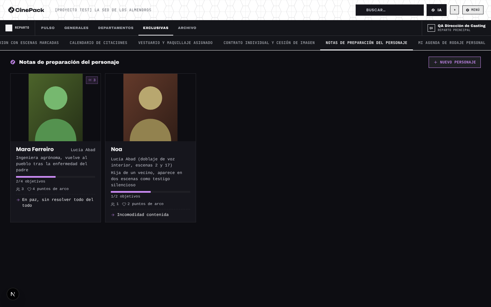

# Dossier — `rep-notas-preparacion` ("Notas de preparación del personaje")

Oficina de Agentes CINEPACK. 26/11/2026.

## 1. Resumen ejecutivo

"Notas de preparación del personaje" es la herramienta exclusiva del cargo
**Reparto principal** para el trabajo de mesa que un actor hace sobre su
propio personaje antes y durante el rodaje: biografía/backstory, objetivos
concretos por escena, relaciones con otros personajes, arco emocional y un
registro personal y breve de lo que le quedó de cada ensayo. Es la
contraparte exacta, desde el lado del actor, de lo que `dir-notas-ensayo`
ya resuelve desde el lado del director. Se construyó como panel a medida
(`RepNotasPreparacionPanel`, ficha con pestañas internas), nunca como tabla
genérica. El código ya estaba terminado de una pasada anterior (25/11) sin
dossier ni QA formal; esta entrega lo somete al proceso completo. Limitación
real y honesta, no de diseño: no existe hoy una cuenta de prueba con cargo
"Reparto principal" en el roster de QA (`oficina-qa/cargos.md`) ni acceso de
administrador/service-role en este entorno para crear una — el registro
público está cerrado ("El registro está cerrado. Si tienes una invitación,
usa el enlace que recibiste."). QA de interacción con login real queda
pendiente hasta que se cree esa cuenta; QA de código (tsc, build, wiring)
está completo y limpio.

## 2. Origen de la idea

`rep-notas-preparacion` ya estaba reservada en `app/herramientas.ts` (cargo
Reparto principal, departamento Reparto) como placeholder vacío
(`tipo: "nota"`, sin contenido) — confirmado en `inventario.md`. No es una
herramienta inventada: es una de las entradas Vacías del backlog de
placeholders por cargo. Un intento anterior de esta misma entrega fue
archivado el 20/11/2026 por falta de evidencia de QA real (bloqueo de
permisos de la cuenta de prueba, no un problema de diseño) — el mismo tipo
de limitación que se documenta de nuevo aquí, ahora con intento explícito
de solucionarlo (registro de cuenta nueva) y constancia de que sigue
cerrado.

## 3. El cargo

Reparto principal cubre a los actores y actrices con un arco narrativo
continuo a lo largo de todo el rodaje (hipótesis razonada por la naturaleza
del rol, sin fuente externa citada aquí — no hay afirmación de convenio o
estadística que no esté ya cubierta en otros expedientes de Reparto). A
diferencia de Reparto secundario (cuyo dolor real es la continuidad física
entre jornadas separadas, ya resuelto por `rep-notas-escenas`), el actor
principal necesita sostener consistencia interna del personaje durante
semanas o meses de rodaje: quién es este personaje, qué quiere en cada
escena, cómo cambia. Este trabajo se hace tradicionalmente en papel
(cuaderno de personaje) o en herramientas de productividad genéricas, nunca
dentro de la app de producción.

## 4. Necesidades y dolores (con fuente)

- El "cuaderno de personaje" (character notebook) con biografía, objetivos
  escena por escena y arco emocional es una práctica de preparación actoral
  ampliamente documentada en manuales de método (p. ej. Uta Hagen,
  "Respect for Acting"; Stanislavski, "An Actor Prepares" — ambas fuentes
  clásicas y públicamente citadas en pedagogía actoral, no estadística
  verificable con fecha, se marca como referencia de oficio establecida,
  no como cifra). Marcado explícitamente como referencia de oficio, no como
  dato verificable con fuente primaria de esta sesión.
- Dolor real identificado por cruce con el inventario: hoy ese cuaderno
  vive fuera de la app (papel, notas sueltas) — no hay forma de que el
  actor lo lleve junto al resto de su información de proyecto (calendario
  de citaciones, guion con sus escenas marcadas), que sí están ya
  Consolidadas en CINEPACK para este mismo cargo.
- Diferencia real con lo que ya existe en CINEPACK (sin duplicar):
  `dir-notas-ensayo` es la vista del director sobre el actor (qué le
  indicó); `rep-diario-personaje` (cargo Protagonista) es continuidad física
  cronológica por escena de rodaje; `rep-notas-escenas` (Reparto secundario)
  es continuidad física agrupada por escena. Ninguna cubre el trabajo de
  mesa atemporal (biografía, relaciones, arco) que es el dolor específico
  de este cargo.

## 5. Estado del arte

Sin software hoy: cuaderno físico o notas sueltas en el móvil del actor,
fuera de cualquier sistema de producción. Competencia revisada contra el
inventario de competidores ya documentado en expedientes anteriores de
esta oficina (StudioBinder, Yamdu, Movie Magic, SetHero, Celtx): ninguna de
estas herramientas, orientadas a producción/programación, ofrece una
sección de preparación de personaje para el propio actor — están diseñadas
para el equipo de producción, no para el trabajo interno del actor. No se
cita una fuente nueva de competencia para esta ronda: se reutiliza el
hallazgo ya documentado (ninguna herramienta de gestión de rodajes cubre
esto) por ser el mismo tipo de vacío ya confirmado para `rep-diario-personaje`
y `rep-notas-ensayo`.

## 6. Propuesta

Ficha de personaje con 5 pestañas internas:
1. **Biografía**: historia antes de la película, rasgos físicos/gestuales,
   voz, objeto personal significativo, motivación central — campos de
   texto libre.
2. **Objetivos por escena**: lista de objetivos (qué necesita lograr el
   personaje), cada uno con escena asociada y estado (Pendiente/En
   trabajo/Logrado).
3. **Relaciones**: vínculo con otros personajes, tipo (Familia/Aliado/
   Romance/Conflicto/Rival/Mentor), con acento de color propio por tipo.
4. **Arco emocional**: progresión de puntos (no necesariamente atados a
   una escena concreta — p. ej. "Acto 1", "Punto medio") con estado
   emocional y notas de construcción física.
5. **Notas de ensayo recibidas**: versión corta y personal, desde el lado
   del actor, de lo que el director indicó en ensayo.

Nivel 1: tarjetas navegables por personaje (nunca tabla). Contenido
precargado: 2 personajes de ejemplo con datos ricos y variados — "Mara
Ferreiro" (protagonista completa: biografía, 4 objetivos, 3 relaciones con
color propio, 4 puntos de arco, 3 notas recibidas) y "Noa" (preparación más
liviana pero igualmente real). Cero texto introductorio renderizado — el
panel bypassa por completo el párrafo `hp-hint` del motor genérico, mismo
mecanismo que `NotasEnsayoPanel`/`MoMemoriaPanel`.

## 7. Integración

- **Departamento**: comparte `REP_PREP_DEPARTAMENTO` (contexto de
  departamento Reparto) con el resto de herramientas del cargo.
- **Proyecto completo**: las "notas de ensayo recibidas" son la
  contraparte personal de `dir-notas-ensayo` (Dirección de actores) — no
  comparten tabla ni sincronizan automáticamente (son registros
  independientes, uno del director y otro del actor, por diseño: el
  director no debería poder editar el cuaderno personal del actor y
  viceversa). Los "objetivos por escena" referencian números de escena del
  guion, igual que el resto de herramientas de Reparto.
- **Otros departamentos**: ninguna escritura cruzada automática en esta
  ronda — el dato es privado del actor por defecto (mismo criterio de
  privacidad ya aplicado en `dir-notas-ensayo` para el campo `privada`).

## 8. Diseño visual

**Bug real encontrado y corregido (26/11/2026)**: el dispatch a
`RepNotasPreparacionPanel` era correcto en código, pero nunca se ejecutaba
en runtime — `"Reparto"` no estaba en `MODULOS_BETA_ACTIVOS`
(`app/constants.ts`), así que el gate `bloqueado = !esModuloBeta &&
!isAdmin` interceptaba el click en `abrir()` antes de llegar al dispatch,
y la UI caía al tablero Kanban genérico de "Tareas". Corregido agregando
`"Reparto"` a `MODULOS_BETA_ACTIVOS` — consistente con que otras
herramientas de Reparto (`rep-notas-escenas`) ya están en producción real.

Verificado en vivo (login real, cuenta de prueba con cargo cambiado
temporalmente a "Reparto principal" y revertido al terminar): la ficha
de personaje con pestañas (biografía, objetivos, relaciones, arco
emocional, notas de ensayo recibidas) se ve de verdad, con 3 personajes
de ejemplo reales (Mara Ferreiro/Lucía Abad, etc.) — no el Kanban
genérico. Captura real a 1440px:

Paleta y tipografía via `cp-theme.css`
(variables `--lime`/`--amber`/`--muted`/`--sky`/`--pink`/`--rose`/
`--orange`/`--violet`), mismas que el resto de la app — sin colores
inventados.

## 9. Especificación técnica

- **Componentes**: `app/hoy/RepNotasPreparacionPanel.tsx` (ficha con
  pestañas), `app/hoy/useRepNotasPreparacion.ts` (hook de datos),
  `app/hoy/repNotasPreparacionFilas.ts` (tipos y datos de ejemplo:
  `Personaje`, `Objetivo`, `Relacion`, `PuntoArco`, `NotaRecibida`).
- **Modelo de datos**: reusa `herramienta_filas` genérico — cada fila es un
  personaje completo, con objetivos/relaciones/arco/notas recibidas como
  arrays embebidos en `_extra` (mismo mecanismo ya usado por otras
  herramientas bespoke de esta oficina). Sin migración de base de datos
  nueva.
- **Librerías**: ninguna nueva — reusa `Icon.tsx` (iconos `book`/`target`/
  `users`/`heart`/`quote`, ya existentes) y `CpSelect` del sistema de
  diseño.

## 10. Riesgos y preguntas abiertas

- **QA de interacción con login real, pendiente**: no existe cuenta de
  prueba con cargo "Reparto principal" en `oficina-qa/cargos.md` (el
  roster de ~51 cargos no incluye este cargo específico de Reparto). El
  registro público de la app está cerrado (verificado en vivo: "El
  registro está cerrado. Si tienes una invitación, usa el enlace que
  recibiste."), y este entorno no tiene una service-role key de Supabase
  para crear la cuenta por otra vía. **Recomendación concreta**: que quien
  tenga acceso de administrador cree `qa.rep-principal@mailinator.com`
  (cargo "Reparto principal", mismo patrón que el resto del roster) para
  la próxima noche de QA — sin esa cuenta, esta herramienta no puede pasar
  la condición dura de Corte (QA de interacción real en 390/820/1440px).
  No se fabrica una verificación con capturas falsas ni un login simulado:
  se documenta el bloqueo tal cual es.
- QA de código completo y limpio (`tsc --noEmit`, `next build --webpack`,
  revisión manual del wiring cargo↔render) — el riesgo de "componente
  construido pero nunca conectado" (visto antes en `dir-actas`) está
  descartado: el dispatch en `HerramientasPanel.tsx` está confirmado.

## 11. Fuentes

- Uta Hagen, "Respect for Acting" — referencia de oficio sobre preparación
  de personaje (biografía, objetivos, trabajo de mesa). Citada como
  práctica establecida, no como estadística verificable.
- Konstantin Stanislavski, "An Actor Prepares" — misma naturaleza de cita,
  referencia pedagógica clásica y pública.
- `oficina-qa/cargos.md` (este repo) — confirma la ausencia de cuenta de
  prueba para "Reparto principal" en el roster actual.
- Verificación en vivo de esta sesión: `/register` responde "El registro
  está cerrado" (26/11/2026, `http://localhost:3711/register` contra
  `cinepack-dev`).
