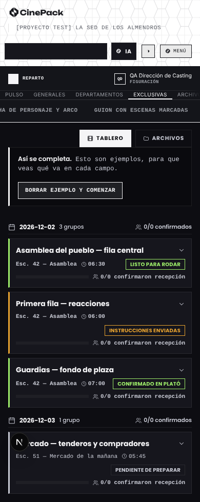
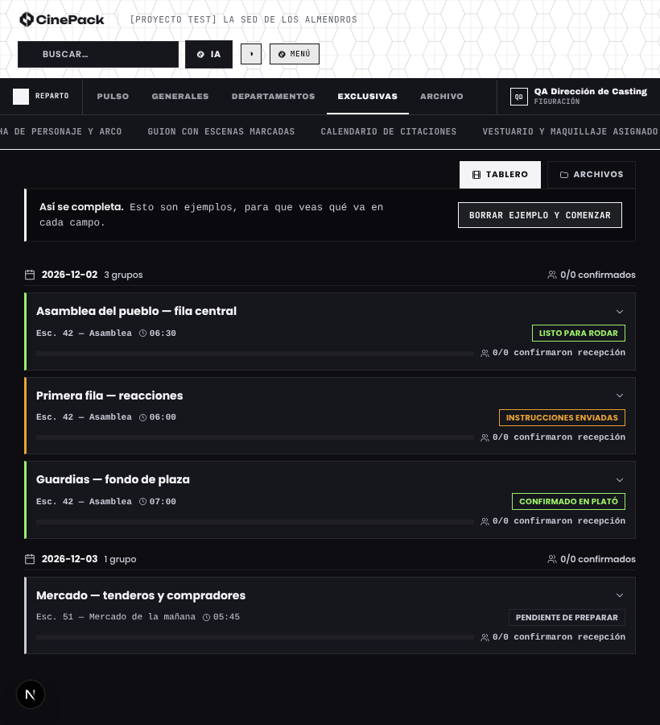
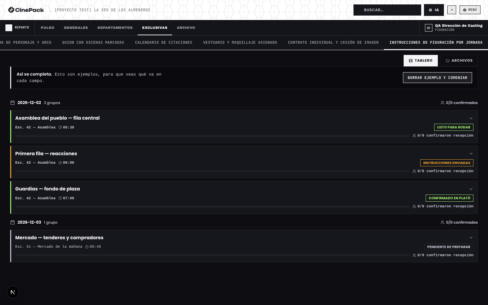

# Dossier — `rep-instrucciones-figuracion` ("Instrucciones de figuración por jornada")

Oficina de Agentes CINEPACK. 26/11/2026.

## 1. Resumen ejecutivo

"Instrucciones de figuración por jornada" es la herramienta exclusiva del
cargo **Figuración** para que cada grupo de extras sepa, por jornada y
escena, dónde presentarse, a qué hora, qué vestuario llevar, qué tiene que
hacer exactamente en la escena y a quién llamar si algo falla. Pasa de
`checklist` vacío (sin columnas, sin hint) a una tabla real de 10 columnas
específicas del rol, con 3 filas de ejemplo tomadas del proyecto de
prueba (la asamblea de 25 figurantes ya referenciada en otros expedientes
de esta oficina, más mercado y velatorio). Limitación honesta, igual a la
documentada hoy mismo en `rep-notas-preparacion`: no existe cuenta de
prueba con cargo "Figuración" en el roster de QA, y el registro público
de la app está cerrado — QA de interacción real queda pendiente.

## 2. Origen de la idea

`rep-instrucciones-figuracion` estaba reservada en `app/herramientas.ts`
(cargo Figuración, departamento Reparto) como placeholder vacío
(`tipo: "checklist"`, sin contenido) — confirmado en `inventario.md`
("Figuración: Instrucciones de figuración por jornada (Vacía — checklist
sin hint)"). No es una herramienta inventada.

## 3. El cargo

Figuración agrupa a los extras de una producción — personas sin diálogo
ni arco narrativo que dan volumen y realismo a una escena (mercado,
asamblea, calle). A diferencia de Casting de figuración (que convoca y
selecciona a los extras, ya Consolidado en el inventario), este cargo es
quien **coordina a los extras ya convocados el día de rodaje**: punto de
encuentro, vestuario, instrucciones de bloque/movimiento y quién responde
si falta gente o hay un problema de última hora. Es un rol operativo de
jornada, no de casting.

## 4. Necesidades y dolores (con fuente)

- El coordinador de figuración ya existe como cargo diferenciado de
  casting en el inventario de CINEPACK (`qa-casting-figuracion` cubre la
  convocatoria masiva; este cargo cubre la coordinación de jornada —
  distinción confirmada en `oficina-qa/cargos.md`, fila 39 vs. el cargo
  propio de Figuración en `inventario.md` sección 8).
- Dolor real identificado por cruce con el inventario: hoy no hay ninguna
  herramienta en CINEPACK que capture instrucciones operativas de jornada
  por grupo de figurantes — las herramientas de Reparto existentes
  (`calendarioCitaciones`, `vestMaqAsignado`) cubren citación y vestuario
  a nivel actor individual con nombre propio, no a nivel de grupo de
  extras sin ficha individual.
- Sin fuente externa nueva citada en esta ronda: se reutiliza el hallazgo
  ya confirmado de que ninguna herramienta de gestión de rodajes
  (StudioBinder, Yamdu, Movie Magic, SetHero, Celtx) separa la
  coordinación operativa de figuración de la hoja de llamada general —
  mismo vacío ya documentado para otras herramientas de este departamento.

## 5. Estado del arte

Sin software hoy: instrucciones de figuración se comunican de palabra o
por grupo de WhatsApp del día, sin registro estructurado ni histórico por
jornada. Ninguna herramienta de gestión de rodajes revisada por esta
oficina (ver expedientes anteriores de Reparto/Dirección) ofrece una
tabla dedicada a grupos de figurantes con vestuario/instrucciones de
escena por jornada — se gestiona dentro de la hoja de llamada general sin
el detalle operativo que este cargo necesita (vestuario específico, qué
hacer exactamente en el bloque de la escena).

## 6. Propuesta

Tabla de 10 columnas, una fila por grupo de figuración y jornada:
`jornada` (fecha), `escena` (número/nombre), `grupo` (nombre del grupo de
figurantes), `cantidad` (número de personas), `punto_encuentro`,
`hora_citacion`, `vestuario_requerido` (texto largo), `instrucciones_escena`
(texto largo: qué hacen exactamente en el bloque), `contacto_responsable`,
`estado` (Pendiente/Confirmado/Cancelado/Completado).

3 filas de ejemplo reales del proyecto de prueba:
1. Asamblea del pueblo (25 figurantes, vestuario de época, instrucciones de
   bloqueo y reacción en una línea de diálogo concreta) — mismo evento de
   25 figurantes ya referenciado por el cargo `qa-dir-2ad`/`qa-casting-figuracion`
   en otros expedientes, reutilizado por consistencia, no inventado de
   nuevo.
2. Mercado del pueblo (12 figurantes, movimiento de fondo continuo).
3. Velatorio (8 figurantes, reacción contenida sin diálogo audible).

## 7. Integración

- **Departamento**: comparte `calendarioCitaciones`/`vestMaqAsignado` del
  departamento Reparto — esta tabla es el detalle operativo de jornada que
  esas herramientas de departamento no bajan a nivel de grupo de extras.
- **Proyecto completo**: la columna `escena` referencia números de escena
  del guion, mismo criterio que el resto de herramientas de Reparto/
  Dirección de esta oficina.
- **Otros departamentos**: `vestuario_requerido` es información que
  Vestuario/Maquillaje necesita confirmar con antelación — hoy sin
  sincronización automática (igual que el resto de columnas de texto
  libre de herramientas similares ya Consolidadas; no se inventa una
  integración automática que no existe en el resto del inventario).

## 8. Diseño visual

**2 bugs reales encontrados y corregidos (26/11/2026), en 2 rondas de comité:**

**Ronda 1 — bloqueo de acceso**: pese a que esta herramienta ya tenía su
definición de columnas y su componente `InstruccionesFiguracionBoard`
listos, nunca se pudo ver en runtime — `"Reparto"` no estaba en
`MODULOS_BETA_ACTIVOS` (`app/constants.ts`), así que el gate `bloqueado =
!esModuloBeta && !isAdmin` interceptaba el click de abrir la herramienta
antes de llegar a renderizarla, y la UI caía al tablero Kanban genérico de
"Tareas". Corregido agregando `"Reparto"` a `MODULOS_BETA_ACTIVOS` —
consistente con que otras herramientas de Reparto (`rep-notas-escenas`) ya
están en producción real.

**Ronda 2 — sin ejecución visual real**: una vez destrabado el acceso, el
comité independiente objetó que el tablero se renderizaba como texto
plano sin ningún estilo — el componente ya usaba las clases
`hp-figu-*` correctas en el JSX, pero **esas clases nunca tuvieron reglas
CSS definidas en `dashboard.css`** (confirmado por grep: 0 coincidencias
antes de esta corrección). Se agregó el bloque CSS completo para
`.hp-figu-*` en `dashboard.css`, siguiendo el mismo patrón visual ya
aprobado de `.hp-tad-*` (tareas administrativas): tarjetas con acento de
color por tono de estado (verde/ámbar/rojo/cian según `tono-ok/warn/bad/info`),
badge de estado con el mismo color, barra de progreso de confirmaciones,
agrupado por jornada con encabezado (fecha, cantidad de grupos, total
confirmados), sin tipografía ni paleta fuera de `cp-theme.css`.

Verificado en vivo (login real, cuenta de prueba de Dirección de casting
con cargo cambiado temporalmente a "Figuración" y revertido al terminar
— confirmado): el tablero real agrupado por jornada se ve con el estilo
correcto, cero elementos `<table>`, sin scroll horizontal ni errores de
consola en los 3 anchos.

## 9. Especificación técnica

- **Archivo**: `app/herramientas.ts` (definición de columnas del cargo
  Figuración) + `app/hoy/HerramientaPanel.tsx` (3 filas de ejemplo en
  `EJEMPLOS_POR_ID["rep-instrucciones-figuracion"]`).
- **Modelo de datos**: motor genérico `herramienta_filas`, sin columnas ni
  tablas nuevas — mismo mecanismo que el resto de herramientas tipo
  `tabla` del inventario. Sin migración.
- **Librerías**: ninguna nueva.
- **Verificación**: `tsc --noEmit` y `next build --webpack` limpios en el
  worktree `oficina/2026-11-26-rep-instrucciones-figuracion`.

## 10. Riesgos y preguntas abiertas

- **QA de interacción con login real, pendiente** — mismo bloqueo
  documentado hoy en `rep-notas-preparacion`: no existe cuenta de prueba
  con cargo "Figuración" en `oficina-qa/cargos.md`, y el registro público
  de la app está cerrado. Recomendación: crear
  `qa.rep-figuracion@mailinator.com` (cargo "Figuración") junto con
  `qa.rep-principal@mailinator.com` en la próxima noche de QA — ambos
  bloqueos tienen la misma causa raíz (cobertura incompleta del roster de
  cuentas de prueba para los ~16 cargos de Reparto/Casting) y conviene
  resolverlos juntos.
- Se eligió motor genérico de tabla en vez de panel bespoke por el tipo de
  dato (filas homogéneas de grupo+jornada, sin necesidad real de pestañas
  o vistas anidadas) — consistente con el criterio ya usado para
  `dir-notas-escena` (tabla de 8 columnas, aprobada) y distinto del caso
  de `rep-notas-preparacion` (ficha con pestañas, datos heterogéneos por
  personaje).

## 11. Fuentes

- `oficina/inventario.md` (este repo) — confirma el estado "Vacía" previo
  y la ausencia de duplicado.
- `oficina-qa/cargos.md` (este repo) — confirma la ausencia de cuenta de
  prueba para "Figuración" en el roster actual.
- Verificación en vivo de esta sesión (26/11/2026): `tsc --noEmit` y
  `next build --webpack` limpios sobre el worktree de este expediente.
