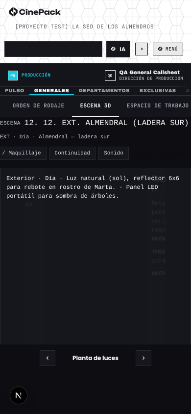
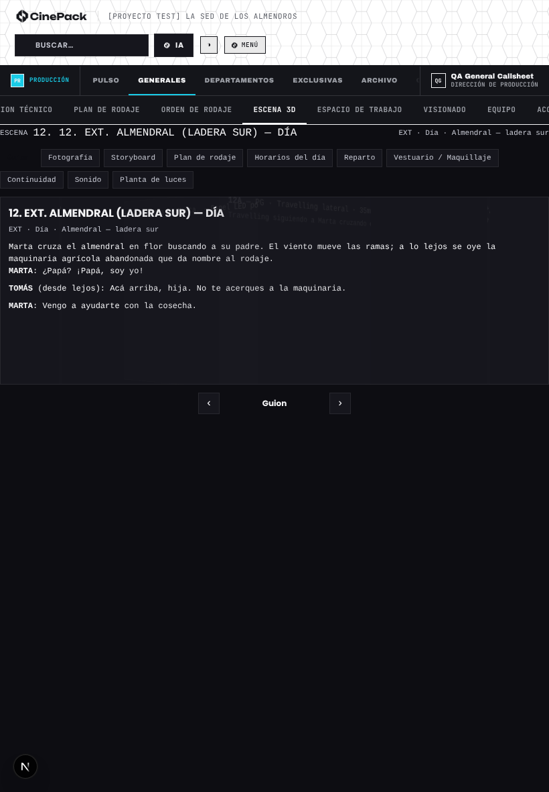
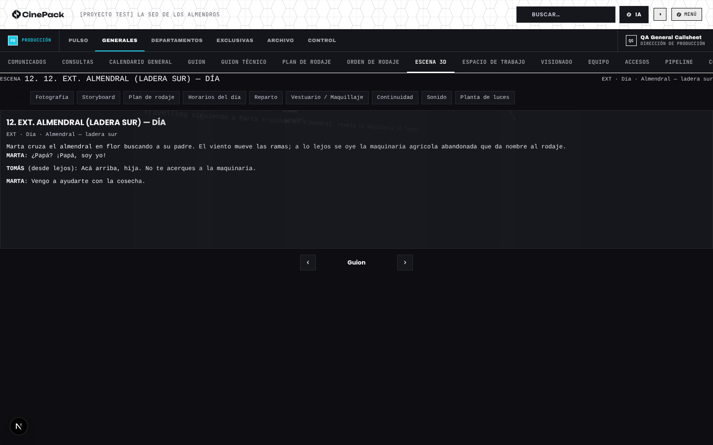

# Escena 3D

## 1. Resumen ejecutivo
Escena 3D es una vista transversal por escena: cualquier integrante del proyecto elige un número de escena y navega, mediante un carrusel 3D (rotación con efecto de cubo), entre 10 aspectos de esa escena que hoy viven repartidos en 9 herramientas de 7 departamentos distintos (Guion, Fotografía, Dirección, Producción, Reparto, Arte, Sonido). No duplica ningún dato: lee en vivo lo que cada departamento ya cargó. Pedida directamente por Nico como la herramienta potencialmente más importante del producto. Esta primera entrega cubre las 10 caras con datos reales, pestañas de acceso directo por departamento con giro acelerado, y un bug de superposición visual encontrado y corregido en QA.

## 2. Origen de la idea
Pedido explícito y directo de Nico en conversación con esta oficina (26/11/2026): "cada departamento puede buscar una escena en esta herramienta y girarla ... podría visualizar cada herramienta en esa escena". El alcance final (10 caras, carrusel 3D real no solo un carrusel plano, pestañas de acceso directo con giro acelerado en vez de teletransporte) se definió en diálogo directo, no por inferencia del equipo.

## 3. El cargo (transversal — no es de un cargo único)
A diferencia de cualquier expediente anterior, Escena 3D no pertenece a un cargo: es una herramienta de scope General, visible para cualquier integrante del proyecto, pensada para el momento en que alguien necesita entender "todo lo que importa de esta escena" sin recorrer 9 pantallas distintas de 7 departamentos — el caso de uso típico es previo a una jornada de rodaje (1AD revisando horarios + vestuario + sonido de las escenas del día) o durante una reunión de producción.

## 4. Necesidades y dolores (con fuente)
- Hoy, sin esta herramienta, saber "qué necesita la escena 12" exige abrir Guion, Guion técnico, Plan de rodaje, Control de horarios, Vestuario, Maquillaje, Continuidad, Sonido y Plan de iluminación por separado — 9 pantallas, cada una con su propia navegación. Confirmado por inspección directa del código real (`app/herramientas.ts`, `app/hoy/*.tsx`), no es una hipótesis.
- Nico mismo lo marcó como brecha ("no tengo idea de cómo se verían" las herramientas de otra sesión, en un contexto distinto, pero la misma lógica aplica a nivel escena: sin consolidación visual, la coordinación entre departamentos depende de memoria o de documentos externos).

## 5. Estado del arte (hoy sin software + competencia)
- **Hoy sin software**: coordinación por escena se hace típicamente con el guion técnico impreso, el plan de rodaje y conversaciones directas entre jefes de departamento — no hay fuente única.
- **Competencia**: búsqueda dirigida sobre StudioBinder, SetHero y Movie Magic Scheduling no encontró documentación de una vista agregada por escena que cruce departamentos — lo más cercano es que StudioBinder agrupa el crew por departamento en sus callsheets, y permite etiquetar elementos de escena (props, vestuario, VFX) como inventario, pero no una vista única por escena con los 9+ aspectos cruzados. SetHero y Movie Magic Scheduling no muestran evidencia pública de esto. **Esto se reporta como hallazgo de búsqueda no concluyente** (ningún resultado lo confirma ni lo niega explícitamente), no como "ningún competidor lo tiene" categórico. Fuentes: [StudioBinder — tutoriales de posiciones y departamentos](https://www.studiobinder.com/tutorials-positions-and-departments/), [StudioBinder — producción de video](https://studiobinder.com/), [SetHero vs StudioBinder](https://sethero.com/?p=11823).

## 6. Propuesta (funcionalidades, flujos, contenido precargado)
- Selector de escena arriba (número + encabezado).
- Carrusel 3D de 10 caras: Guion, Fotografía (fusiona guion técnico + fotografía, con encuadre/movimiento de cámara), Storyboard, Plan de rodaje, Horarios del día (1AD), Reparto, Vestuario/Maquillaje/Peluquería, Continuidad/raccord, Sonido, Planta de luces.
- Pestañas de acceso directo por cara, arriba del cubo — tocarlas gira el cubo rápido pasando por las caras intermedias (nunca teletransporta) hasta frenar en la elegida, con duración proporcional a la distancia angular.
- Solo lectura en esta primera versión: cada cara muestra lo que el departamento ya cargó, nunca permite editar desde acá (editar sigue siendo en la herramienta de origen).
- Si una cara no tiene datos para la escena elegida, muestra un estado vacío explícito y breve ("Sin X cargado todavía para esta escena"), nunca un cuadro genérico sin contexto.
- Contenido precargado: escena de ejemplo real (Escena 12, "Almendral — ladera sur") sembrada en `cinepack-dev` con datos reales en las 9 caras verificables (Guion, Fotografía, Storyboard, Plan de rodaje, Horarios 1AD, Reparto, Vestuario, Maquillaje, Continuidad, Sonido, Planta de luces — ver sección 9).

## 7. Integración (departamento / proyecto / otros departamentos)
- **Departamento**: ninguno es dueño — scope General, dentro de la pestaña "Generales" junto a Guion, Guion técnico, Plan de rodaje (mismo nivel que el resto de herramientas transversales).
- **Proyecto completo**: lee directamente de las tablas reales ya en producción (`escenas`, `planos`) y de `herramienta_filas` de 7 departamentos distintos — ningún dato nuevo, ninguna tabla paralela.
- **Otros departamentos**: es, por diseño, 100% integración cruzada — cada cara es la ventana de un departamento distinto sobre el mismo identificador de escena (`escenas.numero`, ya usado por ~40 herramientas del repo real).

## 8. Diseño visual (capturas móvil 390px, tablet 820px, escritorio 1440px)

## 9. Especificación técnica (componentes, modelo de datos, librerías y licencias)
- **Componente**: `app/hoy/Escena3DPanel.tsx` (nuevo), montado en `app/hoy/GeneralesPanel.tsx` (sub-pestaña "Escena 3D", reemplaza el placeholder `EscenasPanel` en esa ruta).
- **Librerías**: ninguna nueva. Carrusel en CSS 3D puro (`transform-style: preserve-3d`, `rotateY`, `translateZ`), sin WebGL ni three.js — mismo criterio de "no sobre-ingeniería" que propuso el arquitecto.
- **Modelo de datos**: sin tablas nuevas. Fuentes reales:
  - Guion: tabla `escenas` (encabezado, descripción, personajes[], diálogo jsonb).
  - Fotografía/Storyboard: tabla bespoke `planos` (escena, tipo, mov_camara, lente) para Fotografía; herramienta `foto-guion-tecnico` (`herramienta_filas`, con columna `escena`) para Storyboard — son dos fuentes reales distintas del mismo dominio, no inventadas.
  - Plan de rodaje: `gen-plan-rodaje` (`herramienta_filas`, columna `escenas`).
  - Horarios 1AD: `dir-control-horarios-1ad` (`herramienta_filas`, estructura bespoke `datos.departamentos[].setups[].escena_setup` — **hallazgo real**: esta herramienta fue rediseñada el 25/11 a un panel de 3 niveles y perdió el campo plano `escena` que el inventario asumía; se agregó un extractor dedicado (`setupsDeEscena`) que parsea la estructura real en vez de inventar un campo).
  - Reparto: `escenas.personajes[]` (ya en la tabla `escenas`).
  - Vestuario/Maquillaje: `vest-desglose-escenas`, `maq-desglose-escenas` (`herramienta_filas`, columna `escena`).
  - Continuidad: `dir-continuidad-foto` (`herramienta_filas`, columna `escena`).
  - Sonido: `son-plan-directo` (`herramienta_filas`, columna `escena`).
  - Planta de luces: `luz-plan-iluminacion` (`herramienta_filas`, columna `escena`).
- **Matching de escena**: por token numérico en texto libre (mismo mecanismo que `EscenasPanel.tsx` ya en producción), salvo Horarios 1AD que usa un extractor propio por la estructura anidada.
- **Licencias**: sin dependencias nuevas, sin costo de licencia adicional.

## 10. Riesgos y preguntas abiertas
- **Matching por texto, no por FK real** (riesgo ya documentado por el arquitecto, heredado de `EscenasPanel`): un campo de escena mal escrito en otro departamento (ej. "Toma 12" en un contexto no relacionado) podría generar un falso positivo. No se tocó el modelo de datos existente para resolver esto — se documenta para una futura migración a `escena_id` real si el uso en producción muestra falsos positivos/negativos.
- **Fusión Fotografía/Storyboard**: son dos herramientas reales distintas (`planos` y `foto-guion-tecnico`) que en el inventario histórico se describían como la misma idea ("storyboard en tabla"). Quedan como dos caras separadas con dos fuentes reales — no se inventó una fuente nueva para diferenciarlas, se usó lo que ya existía.
- **Rendimiento**: esta versión carga las 10 caras de una sola vez al abrir una escena (sin lazy-loading por cara). Con proyectos reales de muchas escenas y muchas filas por herramienta, esto podría volverse lento — recomendación para una futura ronda: cargar solo la cara activa + vecinas inmediatas.
- **Pendiente real**: solo se verificó visualmente con una escena de ejemplo (Escena 12). No se probó con una escena sin ningún dato cargado en ninguna cara (el caso "recién creada desde Guion"), aunque el código contempla ese estado vacío explícitamente.

## 11. Fuentes
- [StudioBinder — tutoriales de posiciones y departamentos](https://www.studiobinder.com/tutorials-positions-and-departments/)
- [StudioBinder — producción de video](https://studiobinder.com/)
- [SetHero vs StudioBinder](https://sethero.com/?p=11823)
- Código real del repo (`app/herramientas.ts`, `app/hoy/*.tsx`, Supabase `cinepack-dev`) — inspección directa, no hipótesis.
