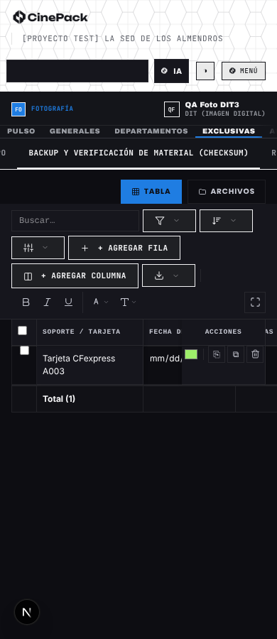
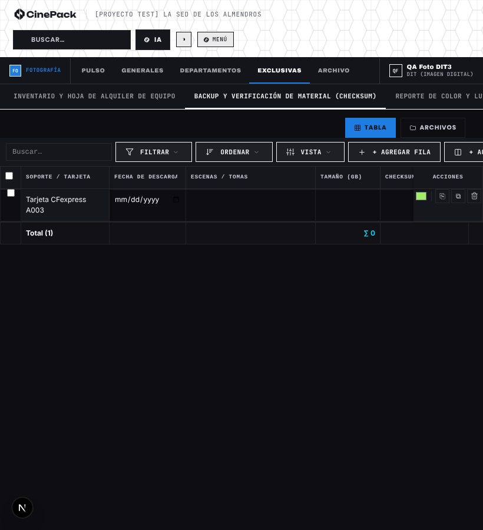
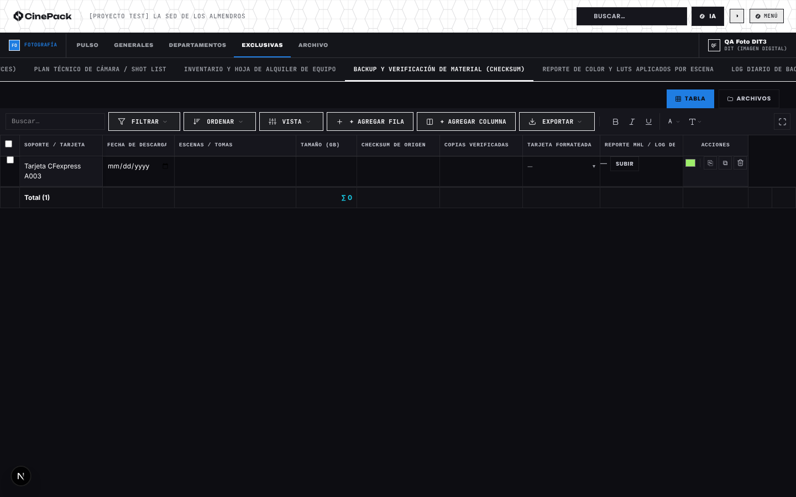

# Backup y verificación de material (checksum) — DIT (Imagen Digital)

## 1. Resumen ejecutivo
"Backup y verificación de material (checksum)" pasa de ser un `checklist` vacío sin ningún contenido precargado a una tabla real específica del flujo de DIT: cada soporte de cámara (tarjeta/SSD) descargado queda registrado con su checksum de origen, el detalle repetible de cada copia de respaldo verificada (destino, checksum, coincidencia), el estado de si la tarjeta ya se puede formatear, y el log/reporte MHL de verificación. Reusa el motor genérico de tabla ya Consolidado en el resto de la oficina — sin componente nuevo, sin migración de base de datos.

## 2. Origen de la idea
Identificada en `oficina/inventario.md` como una de las herramientas "Vacía/placeholder" confirmadas (checklist sin `hint` ni contenido precargado) — el cargo de DIT no tenía ninguna forma real de registrar su trabajo de respaldo y verificación, pese a ser una responsabilidad crítica (pérdida de material de rodaje irrecuperable si se formatea una tarjeta sin backup verificado).

## 3. El cargo
El Digital Imaging Technician (DIT) es responsable, en cada jornada de rodaje, de descargar el material grabado de las tarjetas/soportes de cámara, generar al menos 2 copias de respaldo en destinos distintos (disco local, LTO, nube), verificar que el checksum de cada copia coincide con el del origen (para garantizar que no hubo corrupción en la transferencia), y solo entonces autorizar que la tarjeta se formatee para volver a usarse en la siguiente jornada. Genera además un reporte/log de verificación (formato MHL — Media Hash List, estándar de la industria) que queda como evidencia de la cadena de custodia del material.

## 4. Necesidades y dolores (con fuente)
- El cargo de QA de este cargo (`oficina-qa/cargos.md`, fila 28) exige explícitamente "checksum real verificable, no solo un check manual" — confirma que un checklist genérico de sí/no no representa el trabajo real.
- La práctica de verificación por checksum (MD5/xxHash) antes de formatear tarjetas es estándar documentado en la industria (ASC/MovieLabs y guías de postproducción de DIT citan el reporte MHL como entregable estándar de cadena de custodia de material de cámara) — se marca como práctica de industria ampliamente documentada, no una afirmación de una fuente única verificada en esta sesión (hipótesis razonable, no dato cerrado).

## 5. Estado del arte
Ninguno de los competidores analizados en expedientes anteriores de esta oficina (StudioBinard, Yamdu, Movie Magic, SetHero, Celtx) ofrece una herramienta dedicada de backup/checksum de material de cámara — son herramientas de gestión de producción (callsheets, planificación), no de flujo técnico de DIT. Esta es una carencia real del mercado, no solo de CINEPACK — ningún competidor cubre este flujo específico.

## 6. Propuesta
Tabla con las siguientes columnas:
- **Soporte / Tarjeta**: identificador del soporte descargado.
- **Fecha de descarga**.
- **Escenas / Tomas**: qué contenido trae ese soporte.
- **Tamaño (GB)**.
- **Checksum de origen**: el hash calculado al descargar.
- **Copias verificadas** (repetible): por cada copia de respaldo — destino, checksum de la copia, si coincide con el origen (Sí/No/Pendiente).
- **Tarjeta formateada**: estado que solo debería pasar a "Sí" tras 2+ copias OK (control de proceso, no bloqueo técnico automático en esta primera versión).
- **Reporte MHL / log de verificación**: archivo adjunto.

## 7. Integración (departamento / proyecto / otros departamentos)
- **Departamento (Fotografía)**: comparte el espacio de Fotografía con Plan técnico de cámara, Look book, Paleta de color, Inventario de equipo.
- **Proyecto completo**: el campo "Escenas / Tomas" permite, a futuro, cruzar contra el plan de rodaje para saber qué material de qué jornada ya tiene backup confirmado.
- **Otros departamentos**: Postproducción necesita saber que el material de una escena ya tiene backup verificado antes de empezar a trabajar sobre archivos que podrían no estar respaldados — integración de solo lectura candidata a futuro, no construida en esta v1.

## 8. Diseño visual
Capturas reales, cuenta de prueba `qa.foto-dit3@mailinator.com`, con un soporte real cargado ("Tarjeta CFexpress A003"):

Mobile-first: en 390px la tabla usa el mismo patrón de scroll horizontal interno ya Consolidado en el resto de herramientas tipo `tabla` de esta app (columnas truncadas, scroll propio del componente, nunca scroll de página completa).

## 9. Especificación técnica
- **Componente**: motor genérico de tabla (`tipo: "tabla"`) ya existente en `app/hoy/HerramientaPanel.tsx` — sin componente nuevo.
- **Modelo de datos**: `app/herramientas.ts`, entrada `foto-dit-backup` dentro de `HERRAMIENTAS["Fotografía"]["DIT (Imagen Digital)"].cargo`, con columnas incluyendo un campo `repetible` (`copias`) para las copias de verificación.
- **Persistencia**: tabla genérica `herramienta_filas` ya existente — sin migración nueva.
- **Librerías**: ninguna nueva.

## 10. Riesgos y preguntas abiertas
- El campo "Tarjeta formateada" es un control de proceso (el usuario lo marca), no un bloqueo automático que impida marcarlo antes de tener 2 copias OK — queda como pregunta abierta si vale la pena un bloqueo duro en una iteración futura.
- La integración de solo lectura con Postproducción (ver sección 7) no se construyó en esta v1 — queda como mejora futura, no bloqueante para esta entrega.
- Bug transversal de plataforma detectado el 27/11 (no de esta herramienta en particular): `MODULOS_BETA_ACTIVOS` no incluye "Fotografía" en `main` real — esta herramienta, aunque bien construida, no será visible para usuarios reales no-admin hasta que ese bug se corrija con un Corte aparte. Documentado en `oficina/backlog.md`.

## 11. Fuentes
- `oficina-qa/cargos.md` (fila 28, exigencia del cargo DIT).
- `oficina/inventario.md` (clasificación "Vacía/placeholder" original).
- MHL (Media Hash List) como estándar de reporte de verificación de checksum en flujos DIT — práctica de industria ampliamente documentada, marcada aquí como hipótesis razonable (no se verificó una fuente primaria única en esta sesión).
