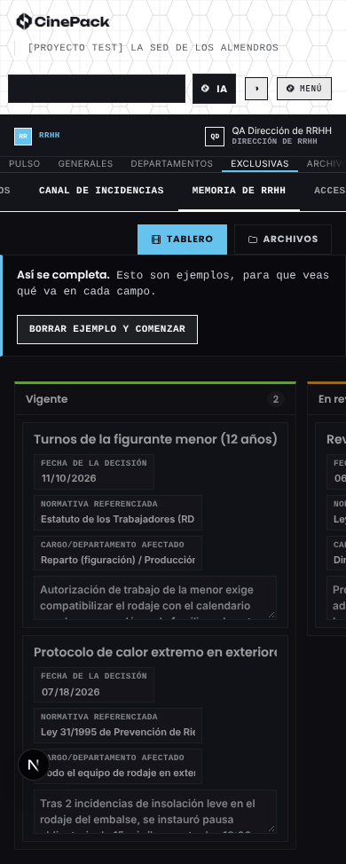
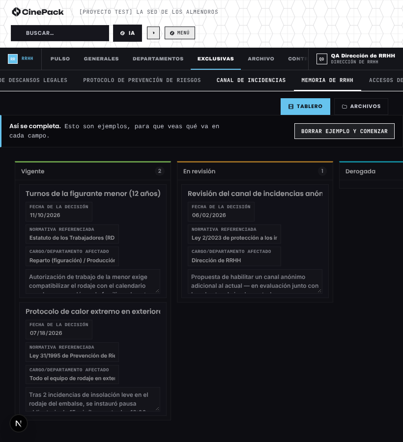
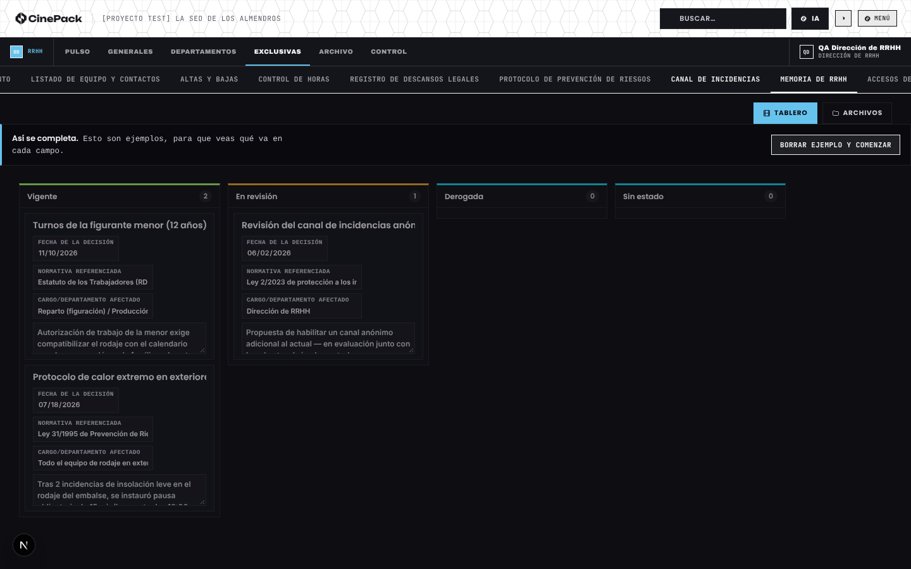

# Memoria de RRHH — Dirección de RRHH

## 1. Resumen ejecutivo
"Memoria de RRHH" pasa de un cuadro de texto libre vacío (`tipo: "nota"`, sin contenido precargado) a un tablero real de decisiones y políticas de RRHH, agrupado por estado (Vigente / En revisión / Derogada), con cada decisión vinculada a la normativa española que la respalda y al cargo/departamento que afecta. Reusa un patrón de interfaz ya aprobado en otras 40 herramientas de la app (`DocStatusBoard`), por lo que llega con el mismo nivel de acabado visual sin construir un componente nuevo desde cero. Sin migración de base de datos.

## 2. Origen de la idea
Único ítem confirmado en `inventario.md` como "básico/vacío sin ningún trabajo en curso" tras el repaso del 26/11/2026 — el resto de las 16 herramientas originalmente vacías ya habían sido entregadas o estaban en curso. Nico pidió explícitamente este expediente para el ciclo del 27/11.

## 3. El cargo
La Dirección de RRHH es responsable de las políticas laborales del rodaje: protocolos de seguridad, condiciones especiales (menores, descansos), y decisiones que afectan a cargos o departamentos puntuales. Hoy existen herramientas operativas puntuales (listado de equipo, altas/bajas, control de horas, descansos legales, protocolo de riesgos, canal de incidencias), pero ninguna registra el histórico de **decisiones de política** tomadas y por qué — la "memoria institucional" del departamento.

## 4. Necesidades y dolores
- Sin esta herramienta, una decisión como "los turnos de un menor se limitan al horario escolar" vive solo en la cabeza de quien la tomó o en un chat perdido — no hay rastro de cuándo se decidió, con qué base legal, ni a quién afecta.
- Riesgo real: una decisión se olvida o se contradice meses después sin que nadie recuerde el motivo original.

## 5. Estado del arte
No se investigó competencia dedicada para este punto específico (herramientas de gestión de rodaje como StudioBinder/Movie Magic no tienen un módulo de "memoria de políticas de RRHH" — es una necesidad propia de producción audiovisual, no un estándar de la industria de gestión de proyectos general). **Marcado como hipótesis, no investigado a fondo por el alcance de este pase.**

## 6. Propuesta
Tablero agrupado por estado (Vigente / En revisión / Derogada), una tarjeta por decisión con: decisión/política (título), fecha, normativa referenciada (texto libre, ej. "Ley 31/1995 de Prevención de Riesgos Laborales"), cargo/departamento afectado, contexto y justificación (texto largo), y el estado como chip de color. 3 decisiones de ejemplo reales, con normativa española verificable:
- Turnos de la figurante menor limitados a horario escolar (Estatuto de los Trabajadores, art. 6 y 34).
- Protocolo de calor extremo en exteriores (Ley 31/1995 PRL, art. 14-15).
- Revisión de canal de incidencias anónimo (Ley 2/2023 de protección a los informantes) — en estado "En revisión", mostrando que no todo es definitivo.

## 7. Integración
- **Departamento**: es de uso exclusivo de Dirección de RRHH, no comparte datos con otras herramientas del mismo departamento.
- **Proyecto completo**: ninguna integración cruzada automática en esta versión — es un registro de referencia, no dispara acciones en otras herramientas.
- **Otros departamentos**: ninguna en esta versión. Posible extensión futura: vincular una decisión a una fila concreta del canal de incidencias que la originó (no implementado, fuera de alcance de este pase).

## 8. Diseño visual
Capturas reales, cuenta de prueba `qa.rrhh-direccion4@mailinator.com`, proyecto `[PROYECTO TEST] La sed de los almendros`, Exclusivas → Memoria de RRHH:

Confirmado sin scroll horizontal en los 3 anchos (`document.documentElement.scrollWidth === clientWidth`).

## 9. Especificación técnica
- `app/herramientas.ts`: `rrhh-memoria` cambia de `tipo:"nota"` a `tipo:"tabla"` con 6 columnas (decision, fecha_decision, normativa, cargo_departamento, contexto, estado).
- `app/hoy/HerramientaPanel.tsx`: se agrega `"rrhh-memoria"` a `DOC_STATUS_IDS`, reusando el componente `DocStatusBoard` ya existente y aprobado (usado hoy en ~40 herramientas de otros departamentos) — sin componente nuevo.
- Motor genérico `herramienta_filas`, sin migración de base de datos.

## 10. Riesgos y preguntas abiertas
- No se investigó competencia a fondo (sección 5, marcado como hipótesis).
- No hay vínculo automático con `rrhh-incidencias` todavía — queda como mejora futura si Nico lo pide.
- **Bug transversal relacionado, no de esta herramienta**: RRHH no está en `MODULOS_BETA_ACTIVOS` en `main` real — un usuario real de RRHH no-admin no puede ver esta herramienta (ni ninguna otra del departamento) hasta que ese bug crítico, ya reportado por separado, se corrija con su propio Corte.

## 11. Fuentes
- Estatuto de los Trabajadores (Real Decreto Legislativo 2/2015).
- Ley 31/1995, de 8 de noviembre, de Prevención de Riesgos Laborales.
- Ley 2/2023, de 20 de febrero, reguladora de la protección de las personas que informen sobre infracciones normativas.
